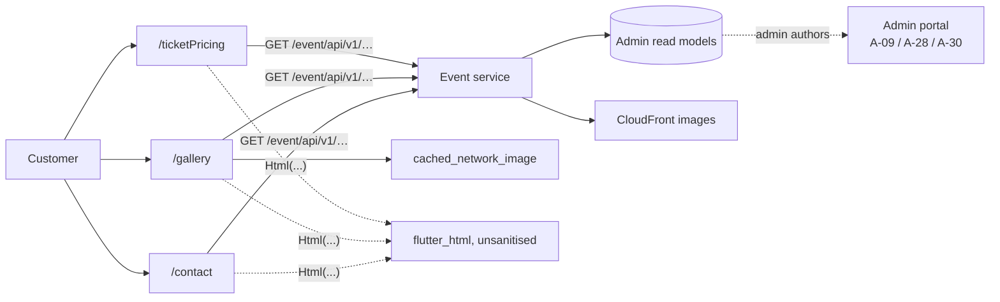

# U-03 · তথ্য পেজ (দাম, গ্যালারি, যোগাযোগ)

> **Bangla name:** তথ্য পেজ (দাম, গ্যালারি, যোগাযোগ)
>
> [← 30 · ইউজার অ্যাপ](README.md) · [সূচিপত্র](../README.md) · [ওপেন কোয়ারি](../99-open-queries.md)

## 1. নাম ও উদ্দেশ্য

**তথ্য পেজ।** হোম মেনু থেকে পৌঁছানো যায় এমন তিনটি read-only স্ক্রিন: কোনো প্রোগ্রামের **ticket-pricing** টেবিল, ইভেন্টের ছবির **গ্যালারি**, এবং **যোগাযোগ** পেজ। এগুলো বহন করে সেই স্ট্যাটিক, অ্যাডমিন-লেখা কনটেন্ট যা গ্রাহক বুকিংয়ের সিদ্ধান্ত নেওয়ার আগে দরকার। লেখার পক্ষটি [A-09](../10-admin-portal/A-09-event-level-pricing.md), [A-28](../10-admin-portal/A-28-media-configuration.md) এবং [A-30](../10-admin-portal/A-30-header-footer-social.md)।

## 2. ট্রিগার ও অ্যাক্টর

সাইন-ইন করা গ্রাহক। রুট `/ticketPricing`, `/gallery`, `/contact`।

## 3. ব্যবসায়িক প্রবাহ

1. **দাম:** গ্রাহক একটি প্রোগ্রাম খোলেন এবং ইভেন্ট বাছাইয়ের আগে প্রতি গ্যালারি / প্রতি লেভেলের মূল্য টেবিল দেখেন।
2. **গ্যালারি:** নির্বাচিত ইভেন্ট বা ভেন্যুর ছবির সোয়াইপযোগ্য তালিকা।
3. **যোগাযোগ:** হেডার/ফুটার কনফিগারেশন থেকে যোগাযোগের তথ্য, টেক্সট ও লিংক হিসেবে দেখানো হয়।

## 4. কারিগরি প্রবাহ

1. **[HTTP + ইউজার টোকেন]** `TicketPricingRepositoryImpl`-এর মাধ্যমে `GET event/api/v1/ticket-pricing/program-pricing` (`event_api_service_impl.dart:66`) → `/ticketPricing` স্ক্রিন।
2. **[HTTP + ইউজার টোকেন]** `GalleryRepositoryImpl`-এর মাধ্যমে `GET event/api/v1/landing-page-image/public` (`gallery_api_service_impl.dart:13`) → `/gallery` স্ক্রিন। [U-02](U-02-home-browse-events.md)-এ উল্লেখ করা মতো, এটি হোমের ব্যানারগুলোর **একই এন্ডপয়েন্ট**; গ্যালারি একই মিডিয়া সেটের ফিল্টার করা ভিউ।
3. **[HTTP + ইউজার টোকেন]** `GET event/api/v1/header-footer` (`event_api_service_impl.dart:56`) যোগাযোগের তথ্য সরবরাহ করে। কোনো আলাদা contact এন্ডপয়েন্ট নেই।
4. ছবি `cached_network_image`-এর মাধ্যমে CloudFront থেকে লোড হয়, যা ডিস্কে ক্যাশ করে; টেক্সট কনটেন্ট প্রতিটি স্ক্রিন খোলার সময় আবার ফেচ হয়, কোনো লোকাল স্থায়িত্ব নেই।
5. **HTML রেন্ডারিং:** দুটি উইজেট অ্যাডমিন-লেখা HTML `flutter_html` দিয়ে রেন্ডার করে — `booking_details/widgets/ticket_guideline.dart:56` (বুকিং ডিটেইলস স্ক্রিনে টিকিট গাইডলাইন) এবং `event_list/widgets/warning_message.dart:87` (ইভেন্ট সতর্কতার বার্তা)। `[UNCONFIRMED: Q-55]` — `flutter_html` 3.0.0 কোনো sanitisation কনফিগারেশন ছাড়াই ব্যবহৃত হয়, ফলে এটি পোর্টালের `bypassSecurityTrustHtml`-এর অ্যাপ-সংশ্লিষ্ট উপমা ([Q-33](../20-user-portal/P-03-info-pages.md))। অ্যাডমিন-লেখা HTML হুবহু এভাবেই রেন্ডার হয়।

## 5. কম্পোনেন্ট

| ধরন | কম্পোনেন্ট |
|---|---|
| ক্লায়েন্ট | `lib/presentation/feature/ticket_pricing/`, `feature/gallery/`, `feature/contact/` |
| ক্লায়েন্ট | `feature/booking_details/widgets/ticket_guideline.dart`, `feature/event_list/widgets/warning_message.dart` |
| ক্লায়েন্ট সার্ভিস | `TicketPricingRepositoryImpl`, `GalleryRepositoryImpl`, `EventRepositoryImpl` |
| API সার্ভিস | `event_api_service/`, `gallery_api_service/` |
| সার্ভিস | Event (Admin-এর টেবিলের উপর read model) |
| বাহ্যিক | CloudFront |

## 6. API কন্ট্র্যাক্ট

| মেথড | পাথ | অথ | স্ক্রিন |
|---|---|---|---|
| GET | `/event/api/v1/ticket-pricing/program-pricing` | User | `/ticketPricing` |
| GET | `/event/api/v1/landing-page-image/public` | User | `/gallery` |
| GET | `/event/api/v1/header-footer` | User | `/contact` |

রেসপন্সের শেপ পোর্টালের সঙ্গে হুবহু এক — [P-03](../20-user-portal/P-03-info-pages.md) দেখুন।

## 7. ডেটা ও পার্শ্বপ্রতিক্রিয়া

কিছু লেখা হয় না। ছবি `cached_network_image` দিয়ে ডিভাইসে ক্যাশ হয়; `etp`-তে কিছু পরিবর্তন হয় না।

## 8. কোড রেফারেন্স

| কী | কোথায় |
|---|---|
| Pricing API | `rvl-gobcb-user-app/data/lib/remote/api_service/event_api_service/event_api_service_impl.dart:66` |
| Gallery API | `rvl-gobcb-user-app/data/lib/remote/api_service/gallery_api_service/gallery_api_service_impl.dart:13` |
| Header/footer API | `rvl-gobcb-user-app/data/lib/remote/api_service/event_api_service/event_api_service_impl.dart:56` |
| HTML উইজেট | `rvl-gobcb-user-app/lib/presentation/feature/booking_details/widgets/ticket_guideline.dart:3, 56`; `feature/event_list/widgets/warning_message.dart:3, 87` |
| রিপোজিটরি | `rvl-gobcb-user-app/data/lib/repository/ticket_pricing_repository_impl.dart:6`, `gallery_repository_impl.dart:6` |
| প্যাকেজ | `rvl-gobcb-user-app/pubspec.yaml` (`flutter_html: 3.0.0`, `cached_network_image: 3.4.1`) |

## 9. হ্যান্ডওভার নোট

1. **কোনো contact-নির্দিষ্ট এন্ডপয়েন্ট নেই** — contact স্ক্রিন হেডার/ফুটার কনফিগারেশন পড়ে, তাই সাইট হেডার থেকে স্বাধীনভাবে যোগাযোগের তথ্য সম্পাদনা করা যায় না ([Q-34](../20-user-portal/P-13-language-switch.md) এখানেও প্রযোজ্য)।
2. **গ্যালারি হোমের ব্যানারের সাথে ল্যান্ডিং-পেজ এন্ডপয়েন্ট ভাগ করে**; [U-02](U-02-home-browse-events.md) নোট ১ দেখুন `[UNCONFIRMED: Q-53]`।
3. **অ্যাডমিন-লেখা HTML অনুবাদমূলকভাবে রেন্ডার হয়** `flutter_html` দিয়ে দুই জায়গায় (§4 নোট ৫) `[UNCONFIRMED: Q-55]`। কোনো অ্যাক্উন্ট compromised বা উদাসীন হলে সেখান থেকে প্রতিটি গ্রাহকের ডিভাইস পর্যন্ত পৌঁছানো markup ইনজেক্ট করা সম্ভব।
4. **`flutter_html` 3.0.0 পিন করা আছে** — এটি এখন Flutter-এর maintained প্যাকেজ নয়, যা নিরাপত্তার বিষয়টির চেয়ে আলাদা একটি রক্ষণাবেক্ষণের ঝুঁকি।
5. **কোনো অফলাইন কনটেন্ট নেই:** নেটওয়ার্ক ছাড়া তিনটি স্ক্রিনই ফাঁকা।

## 10. কম্পোনেন্ট সম্পর্ক

**নির্ভর করে:** [U-02](U-02-home-browse-events.md) (নেভিগেশন), [A-09](../10-admin-portal/A-09-event-level-pricing.md), [A-28](../10-admin-portal/A-28-media-configuration.md), [A-30](../10-admin-portal/A-30-header-footer-social.md)। **প্রভাব ফেলে:** পরবর্তী কিছুর উপর নয় — তিনটি স্ক্রিনই terminal read।

## 11. ডেভেলপার টেস্ট গাইড

**লোকালভাবে টেস্টযোগ্য: সম্পূর্ণ।**

| আইটেম | বিস্তারিত |
|---|---|
| টেস্ট ডেটা ও অ্যাকাউন্ট | seeded ইউজার `+8801700000011`; `scripts/seed/*.sql` থেকে seeded গ্যালারির ছবি ও হেডার/ফুটারের রো |
| ব্রাউজার | পোর্টালে `/en/pricing` ও `/en/gallery`-তে সমতুর্য — [P-03](../20-user-portal/P-03-info-pages.md) দেখুন |
| এমুলেটর | অ্যাপ চালু করুন; হোম মেনু থেকে `/ticketPricing`, `/gallery`, `/contact` খুলুন |
| Postman | `postman/services/etp-event.postman_collection.json`: "GET /api/v1/ticket-pricing/program-pricing", "GET /api/v1/landing-page-image/public", "GET /api/v1/header-footer" |
| Visual Studio ডিবাগ | Event সার্ভিসে `EventController`; ক্লায়েন্ট পাশে `GalleryRepositoryImpl` |
| যাচাই | `TicketPricingContent`, `LandingPageImages` ও `HeaderFooters` টেবিল; HTML-এর ঝুঁকি পরীক্ষা করতে কোনো seeded guideline ফিল্ডে একটি `<script>` ট্যাগ বসিয়ে অ্যাপ সেটি রেন্ডার করে কি না নিশ্চিত করুন |