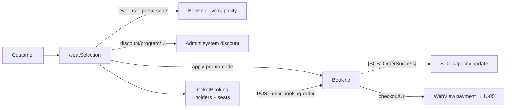

# U-04 · সিট নির্বাচন ও প্রোমো কোড

> **Bangla name:** সিট নির্বাচন ও প্রোমো কোড
>
> [← 30 · ইউজার অ্যাপ](README.md) · [সূচিপত্র](../README.md) · [ওপেন কোয়ারি](../99-open-queries.md)

## 1. নাম ও উদ্দেশ্য

**সিট নির্বাচন ও প্রোমো কোড।** সিট-নির্বাচন স্ক্রিনে গ্রাহক একটি লেভেলের লাইভ availability দেখেন, নিজের সিট বাছাই করেন, ওই লেভেলে প্রযোজ্য সিস্টেম ডিসকাউন্ট দেখেন, চাইলে প্রোমো কোড প্রয়োগ করেন, টিকিট-হোল্ডারের নাম ও ফোন নম্বর দেন, এবং পেমেন্টে এগোন। ব্যাকএন্ড ও নিয়মগুলো ওয়েব পোর্টালের সাথে ভাগ করা ([P-04](../20-user-portal/P-04-seat-selection.md), [P-05](../20-user-portal/P-05-apply-promo-code.md)); এই অংশে অ্যাপের নিজস্ব আচরণ নথিভুক্ত।

## 2. ট্রিগার ও অ্যাক্টর

সাইন-ইন করা গ্রাহক, ইভেন্টের বিস্তারিত স্ক্রিন থেকে ([U-02](U-02-home-browse-events.md))। রুট `/seatSelection`, তারপর চেকআউটের জন্য `/ticketBooking`।

## 3. ব্যবসায়িক প্রবাহ

1. ভেন্যু ম্যাপ আসে `venue-details` থেকে; কোনো ব্লক/লেভেল নির্বাচন করলে ওই লেভেলের লাইভ সিট তালিকা খোলে।
2. গ্রাহক খালি সিটে ট্যাপ করেন; চলমান মোট হালনাগাদ হয়।
3. ওই প্রোগ্রাম/ইভেন্ট/গ্যালারির জন্য কনফিগার করা যেকোনো **সিস্টেম ডিসকাউন্ট** দেখানো ও স্বয়ংক্রিয়ভাবে প্রয়োগ হয় — গ্রাহকের কিছু করতে হয় না।
4. এর উপরে একটি প্রোমো কোড প্রয়োগ করা যেতে পারে।
5. গ্রাহক **প্রতিটি** টিকিটের জন্য একটি নাম ও ফোন নম্বর দেন, তারপর পেমেন্টে চলে যান ([U-05](U-05-booking-webview-payment.md))।

## 4. কারিগরি প্রবাহ

1. **[HTTP + ইউজার টোকেন]** `GET booking/api/v1/capacity/level-user-portal-seats?eventId=…&galleryId=…&blockId=…&levelId=…` (`ticket_api_service_impl.dart:267`) — একটি লেভেলের লাইভ সিট অবস্থা। পোর্টালের সিট ম্যাপ যে একই এন্ডপয়েন্ট ব্যবহার করে।
2. **কোনো polling নেই।** `[UNCONFIRMED: Q-54]` — অ্যাপ লেভেল খোলার সময় সেই লেভেলের সিট **একবার** ফেচ করে; `seat_selection_view_model.dart`-এ কোনো `Timer` বা রিফ্রেশ লুপ নেই। পোর্টাল ইন্টারঅ্যাকশনে রিফ্রেশ করে, ফলে অ্যাপে সিট ম্যাপ খোলা রেখে দেওয়া গ্রাহক পুরোনো availability-এর ভিত্তিতে কাজ করতে পারে এবং চেকআউটে বাতিল খেতে পারে `[UNCONFIRMED: Q-56]`।
3. **[HTTP + ইউজার টোকেন]** `GET admin/api/v1/discount/program/{programId}/{eventId}/{galleryId}` (`:247`) — এই নির্বাচনের জন্য সিস্টেম ডিসকাউন্ট। লক্ষ্য করুন, এটি Booking নয়, **Admin** সার্ভিসে পরিবেশিত হয়।
4. **[HTTP + ইউজার টোকেন]** `POST booking/api/v1/user-booking-order/apply-promo-code` (`:222`) → `ApplyPromoCodeRequest/Response`, [P-05](../20-user-portal/P-05-apply-promo-code.md)-এর হুবহু।
5. **[HTTP + ইউজার টোকেন]** `POST booking/api/v1/user-booking-order` (`ticket_api_service_impl.dart:65`) অর্ডার তৈরি করে। রিকোয়েস্টে বেছে নেওয়া সিট, টিকিট-হোল্ডারের নাম ও ফোন নম্বর থাকে (`ticket_booking_view_model.dart:521-528`), আর রেসপন্স `CheckOutResponse { checkoutUrl }` (`response/check_out_response.dart`)।
6. ক্লায়েন্ট-সাইড গার্ড: `showTicketHolderInputBoxes()` তখনই এগোতে দেয় না যদি না `galleryId`, `blockId`, `levelId` সেট থাকে এবং `numberOfSeats > 0` হয়, তখন "Please select all the boxes" দেখায় (`ticket_booking_view_model.dart:566-573`)।

## 5. কম্পোনেন্ট

| ধরন | কম্পোনেন্ট |
|---|---|
| ক্লায়েন্ট | `lib/presentation/feature/seat_selection/`, `feature/ticket_booking/` (প্রতিটিতে `route/`, `binding/`, `screen/`, `widgets/`, `*_view_model.dart`) |
| ক্লায়েন্ট সার্ভিস | `VenueDetailsRepositoryImpl`, `TicketBookingRepositoryImpl`, `TicketPricingRepositoryImpl` |
| API সার্ভিস | `data/lib/remote/api_service/ticket_api_service/ticket_api_service_impl.dart:65, 222, 247, 267` |
| সার্ভিস | Booking, Admin (ডিসকাউন্ট), Event (ভেন্যু ডিটেইলস) |
| কিউ | ক্লায়েন্ট থেকে কোনোটিই নয়; অর্ডার সার্ভার-সাইডে `OrderSuccess` ট্রিগার করে ([S-01](../50-system-initiated/S-01-level-capacity-update.md)) |
| Redis | ওয়ার্কাররা লিখে এমন লাইভ ক্যাপাসিটি key, `level-user-portal-seats`-এর মাধ্যমে পড়া হয় |

## 6. API কন্ট্র্যাক্ট

| মেথড | পাথ | অথ | রিকোয়েস্ট → রেসপন্স |
|---|---|---|---|
| GET | `/booking/api/v1/capacity/level-user-portal-seats?eventId&galleryId&blockId&levelId` | User | — → availability ফ্ল্যাগসহ সিট তালিকা |
| GET | `/admin/api/v1/discount/program/{programId}/{eventId}/{galleryId}` | User | — → সিস্টেম ডিসকাউন্ট |
| POST | `/booking/api/v1/user-booking-order/apply-promo-code` | User | `ApplyPromoCodeRequest` → `ApplyPromoCodeResponse` |
| POST | `/booking/api/v1/user-booking-order` | User | বুকিং + হোল্ডার → `CheckOutResponse { checkoutUrl }` |

অর্ডার তৈরি ও প্রোমো রিকোয়েস্টের সম্পূর্ণ JSON [P-06](../20-user-portal/P-06-booking-payment.md) ও [P-05](../20-user-portal/P-05-apply-promo-code.md)-এ; অ্যাপ একই শেপ পাঠায়।

## 7. ডেটা ও পার্শ্বপ্রতিক্রিয়া

`UserBookingOrders` ও সিটের রো লেখে Booking সার্ভিস; ক্যাপাসিটি কমে `OrderSuccess` কিউ-এর মাধ্যমে ([S-01](../50-system-initiated/S-01-level-capacity-update.md))। অ্যাপ নিজে কেবল ডিভাইসের অবস্থা লেখে (বেছে নেওয়া সিট, হোল্ডারের নাম)।

## 8. কোড রেফারেন্স

| কী | কোথায় |
|---|---|
| সিট / ডিসকাউন্ট / প্রোমো API | `rvl-gobcb-user-app/data/lib/remote/api_service/ticket_api_service/ticket_api_service_impl.dart:222, 247, 267` |
| অর্ডার তৈরি | `rvl-gobcb-user-app/data/lib/remote/api_service/ticket_api_service/ticket_api_service_impl.dart:65` |
| বুকিং ভিউ মডেল | `rvl-gobcb-user-app/lib/presentation/feature/ticket_booking/ticket_booking_view_model.dart:517-585` |
| সিট নির্বাচন | `rvl-gobcb-user-app/lib/presentation/feature/seat_selection/seat_selection_view_model.dart` |
| চেকআউট রেসপন্স | `rvl-gobcb-user-app/data/lib/remote/response/check_out_response.dart:3-13` |
| রিপোজিটরি | `rvl-gobcb-user-app/data/lib/repository/ticket_booking_repository_impl.dart:15` |

## 9. হ্যান্ডওভার নোট

1. **সিটের কোনো লাইভ রিফ্রেশ নেই** (§4 নোট ২) — বুকিং ফ্লোতে অ্যাপ বনাম পোর্টালের সবচেয়ে গুরুত্বপূর্ণ পার্থক্য `[UNCONFIRMED: Q-56]`।
2. **সিস্টেম ডিসকাউন্ট আসে Admin সার্ভিস থেকে** (`admin/api/v1/discount/program/…`), Booking থেকে নয়। Admin সার্ভিস বন্ধ থাকলে কিন্তু Booking চালু থাকলে, এই কলেই চেকআউট ব্যর্থ হয়।
3. **প্রোমো কোডের নিয়মগুলো পোর্টালের সাথে ভাগ করা**, কোডের `IsActive` ফ্ল্যাগ যাচাইয়ের অংশ নয় — এই ফলাফলসহ ([Q-18](../20-user-portal/P-05-apply-promo-code.md))।
4. **পেমেন্টের আগেই অর্ডার তৈরি হয়।** গ্রাহক WebView থেকে ফিরে আসলে অর্ডারটি pending অবস্থায় থাকে এবং পরে [S-05](../50-system-initiated/S-05-pending-failed-revalidation.md) দ্বারা বাতিল হয়; পোর্টালের status polling-এর বিপরীতে অ্যাপে "পেমেন্ট আবার শুরু করুন" কোনো পথ নেই `[UNCONFIRMED: Q-57]`।
5. **সিট ধরে রাখা সার্ভার-সাইডে ১২ মিনিট**, তাই অ্যাপে বকেল ছেড়ে দেওয়া চেকআউটও ঠিক পোর্টালের মতো সেই সিটগুলো ধরে রাখে ([Q-37](../20-user-portal/P-04-seat-selection.md))।

## 10. কম্পোনেন্ট সম্পর্ক

**নির্ভর করে:** [U-02](U-02-home-browse-events.md) (ইভেন্ট ও ভেন্যু ডেটা), [A-10](../10-admin-portal/A-10-capacity-adjustment.md), [A-15](../10-admin-portal/A-15-promo-codes.md), [A-16](../10-admin-portal/A-16-discounts.md)। **প্রভাব ফেলে:** [U-05](U-05-booking-webview-payment.md), [S-01](../50-system-initiated/S-01-level-capacity-update.md)।

## 11. ডেভেলপার টেস্ট গাইড

**লোকালভাবে টেস্টযোগ্য: read ও প্রোমো যাচাইয়ের জন্য সম্পূর্ণ;** পেমেন্টের জন্য **আংশিক** (একটি ডামি DgePay বা gateway sandbox দরকার)।

| আইটেম | বিস্তারিত |
|---|---|
| টেস্ট ডেটা ও অ্যাকাউন্ট | seeded ইউজার `+8801700000011`; ব্লক/লেভেলসহ এবং খালি সিটসহ একটি প্রকাশিত ইভেন্ট; `scripts/seed/01-catalog.sql:190` থেকে একটি প্রোমো কোড |
| ব্রাউজার | পোর্টালে `/en/events/:id/seats` — [P-04](../20-user-portal/P-04-seat-selection.md) দেখুন |
| এমুলেটর | অ্যাপ চালু করুন; একটি ইভেন্ট খুলুন → সিট নির্বাচন; অ্যাপের HTTP লগে দেখুন `level-user-portal-seats` প্রতি লেভেল খোলায় **একবার**ই আসে |
| Postman | `postman/services/etp-booking.postman_collection.json`: "GET /api/v1/capacity/level-user-portal-seats", "POST /api/v1/user-booking-order/apply-promo-code", "POST /api/v1/user-booking-order"; `postman/services/etp-admin.postman_collection.json`: "GET /api/v1/discount/program/{programId}/{eventId}/{galleryId}" |
| Visual Studio ডিবাগ | Booking সার্ভিসে `UserBookingOrderManager`; ক্লায়েন্ট: `TicketBookingViewModel` প্রায় ৫২১ নম্বর লাইনে |
| যাচাই | বুকিং অর্ডার ও তার সিটের উপর `SELECT`; `level-user-portal-seats`-এর পিছনের Redis ক্যাপাসিটি key |