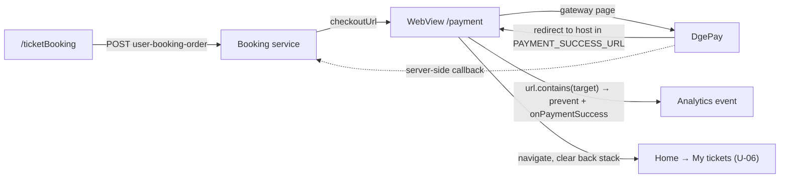

# U-05 · বুকিং ও WebView পেমেন্ট

> **Bangla name:** বুকিং ও WebView পেমেন্ট
>
> [← 30 · ইউজার অ্যাপ](README.md) · [সূচিপত্র](../README.md) · [ওপেন কোয়ারি](../99-open-queries.md)

## 1. নাম ও উদ্দেশ্য

**বুকিং ও WebView পেমেন্ট।** কেনাকাটার একেবারে শেষ ধাপ। অ্যাপ অর্ডারটি Booking-এ পাঠায়, একটি `checkoutUrl` পায়, সেটি অ্যাপের ভেতরের **WebView**-তে খোলে, এবং পেমেন্ট সফল হয়েছে কি না তা শুধুমাত্র **কোন URL-এ WebView নেভিগেট করল সেটি দেখেই** সিদ্ধান্ত নেয়। অ্যাপের দৃষ্টিকোণ থেকে কোনো gateway callback নেই এবং কোনো polling loop-ও নেই — এটিই ওয়েব পোর্টাল থেকে মূল পার্থক্য, যেখানে পেমেন্ট-স্ট্যাটাস এন্ডপয়েন্ট পোল করা হয় ([P-06](../20-user-portal/P-06-booking-payment.md))।

## 2. ট্রিগার ও অ্যাক্টর

সাইন-ইন করা গ্রাহক [U-04](U-04-seat-selection-promo.md) সম্পন্ন করছেন। রুট `/payment` (`RoutePath.payment`), সঙ্গে `PaymentArgument { paymentUrl, targetUrl, onPaymentSuccess }`।

## 3. ব্যবসায়িক প্রবাহ

1. অ্যাপ অর্ডারটি পাঠায়; Booking `checkoutUrl` ফেরত দেয় (DgePay পেজ)।
2. WebView সেটি লোড করে এবং লোড হওয়ার সময় একটি প্রগ্রেস বার দেখায়।
3. গ্রাহক gateway পেজে পেমেন্ট করেন।
4. সফল হলে gateway একটি পরিচিত হোস্টে রিডাইরেক্ট করে। WebView সেই URL দেখে, `onPaymentSuccess` কল করে, এবং অ্যাপ **My tickets**-এ চলে যায়।
5. গ্রাহক বাতিল করলে বা ফিরে আসলে কিছুই হয় না — [S-05](../50-system-initiated/S-05-pending-failed-revalidation.md) অবস্ধার মেয়াদ শেষ না হওয়া পর্যন্ত অর্ডারটি pending থাকে।

## 4. কারিগরি প্রবাহ

1. **[HTTP + ইউজার টোকেন]** `POST booking/api/v1/user-booking-order` (`ticket_api_service_impl.dart:65`) → `CheckOutResponse { checkoutUrl }` (`response/check_out_response.dart:13`)। সিট, টিকিট-হোল্ডারের নাম ও ফোনসহ `ticket_booking_view_model.dart:521-528` থেকে কল করা হয়।
2. `if (paymentUrl != null)` হলে অ্যাপ `PaymentArgument(paymentUrl, targetUrl, onPaymentSuccess)` সহ `/payment`-এ যায় (`:530-553`)। `targetUrl` আসে **`.env`** থেকে: `dotenv.env['PAYMENT_SUCCESS_URL'] ?? 'ticket-bangla.com/tickets'` (`:535-536`) — এটি একটি **hard-coded production fallback** `[UNCONFIRMED: Q-58]`।
3. `PaymentViewModel` তৈরি করে একটি `WebViewController` (`payment_view_model.dart:44-52`) `webview_flutter` 4.13.0 থেকে (+ `webview_flutter_android` 4.10.1, `webview_flutter_wkwebview` 3.23.0), **JavaScript enabled** রেখে (`setJavaScriptMode(JavaScriptMode.unrestricted)`), সাদা ব্যাকগ্রাউন্ড, iOS inline-media প্যারামিটার (`:54-62`) এবং Android ডিবাগিং ও gesture-free media playback (`:64-70`)।
4. **সাফল্য শনাক্তকরণ** হয় `_onNavigationRequest`-এ (`:109-126`):
   - URL যদি `http://` বা `https://` দিয়ে শুরু হয় **এবং** `targetUrlHostName` ধারণ করে, তাহলে — একবার-use `_hasPopped` ফ্ল্যাগের নিরাপত্তাবলয়ে — এটি `argument.onPaymentSuccess(request.url)` কল করে এবং স্ক্রিন pop করে, `NavigationDecision.prevent` ফেরত দেয়;
   - অন্যান্য http/https URL স্বাভাবিকভাবে নেভিগেট করে;
   - **অন্য যেকোনো স্কিম ব্লক করা হয়** `NavigationDecision.prevent` দিয়ে এবং লগ করা হয় (`:122-125`) — gateway-কে ব্যাংক অ্যাপে হ্যান্ড-অফ দেওয়া এটাই আটকায়।
5. `onPaymentSuccess` একটি `ticket_booking_success` analytics ইভেন্ট ফায়ার করে, যেখানে থাকে `payment_success_url`, `event_id`, `gallery_id`, `block_id`, `level_id`, `number_of_seats`, `price_per_seat` ও `total_charge` (`:537-551`), তারপর `_navigateToMyTicketPage()` কল করে।
6. এই মেথডটি অর্ডার **খোলে না**। এটি ব্যাক স্ট্যাক মুছে `HomeRoute(initialNavigationItemType: NavigationItemType.myTickets)`-এ যায় (`:556-565`)।
7. সার্ভার-সাইডে অর্ডারের পেমেন্ট সম্পন্ন করে DgePay callback এবং `OrderSuccess` মেসেজ; [P-06](../20-user-portal/P-06-booking-payment.md) ও [S-01](../50-system-initiated/S-01-level-capacity-update.md) দেখুন।

## 5. কম্পোনেন্ট

| ধরন | কম্পোনেন্ট |
|---|---|
| ক্লায়েন্ট | `lib/presentation/feature/payment/payment_view_model.dart`, `payment_argument.dart`, `feature/ticket_booking/` |
| ক্লায়েন্ট | `.env` key `PAYMENT_SUCCESS_URL` |
| API সার্ভিস | `data/lib/remote/api_service/ticket_api_service/ticket_api_service_impl.dart:65` |
| সার্ভিস | Booking (অর্ডার), Admin (পেমেন্ট-gateway কনফিগ read model) |
| বাহ্যিক | WebView-এর ভেতরে **DgePay** gateway পেজ |
| অ্যানালিটিক্স | `AnalyticsRepository.logCustomEvent` |

## 6. API কন্ট্র্যাক্ট

| মেথড | পাথ | অথ | রিকোয়েস্ট → রেসপন্স |
|---|---|---|---|
| POST | `/booking/api/v1/user-booking-order` | User | বুকিং + সিট + হোল্ডার → `CheckOutResponse { checkoutUrl }` |
| — | WebView নেভিগেশন | — | অ্যাপ `request.url` পরীক্ষা করে; **সফলতায় কোনো API কল হয় না** |

নমুনা, রেসপন্স (মানগুলো কেবল উদাহরণ হিসেবে):

```json
{ "checkoutUrl": "https://dgpay.dhaka-payment.com/checkout/8f2c1d4e-77aa-4b2e-9c31-55de9a0b1f22" }
```

## 7. ডেটা ও পার্শ্বপ্রতিক্রিয়া

Booking সার্ভিস অর্ডার ও তার সিট লেখে; gateway নিজস্ব callback-এর মাধ্যমে পেমেন্ট জানায় (অ্যাপ থেকে নয়)। লোকালে একটি analytics ইভেন্ট লগ হয়। কোনো S3 অবজেক্ট নয়, ক্লায়েন্ট থেকে কোনো কিউ মেসেজ নয়।

## 8. কোড রেফারেন্স

| কী | কোথায় |
|---|---|
| পেমেন্ট ভিউ মডেল | `rvl-gobcb-user-app/lib/presentation/feature/payment/payment_view_model.dart:44-142` |
| আর্গুমেন্ট | `rvl-gobcb-user-app/lib/presentation/feature/payment/route/payment_argument.dart:4-12` |
| বুকিং + নেভিগেশন | `rvl-gobcb-user-app/lib/presentation/feature/ticket_booking/ticket_booking_view_model.dart:517-565` |
| অর্ডার তৈরির API | `rvl-gobcb-user-app/data/lib/remote/api_service/ticket_api_service/ticket_api_service_impl.dart:65` |
| রেসপন্স মডেল | `rvl-gobcb-user-app/data/lib/remote/response/check_out_response.dart:3-13` |
| প্যাকেজ | `rvl-gobcb-user-app/pubspec.yaml` (`webview_flutter: 4.13.0`) |

## 9. হ্যান্ডওভার নোট

1. **সাফল্য সার্ভারে যাচাই না করে রিডাইরেক্ট URL থেকে অনুমান করা হয়।** অ্যাপ কখনো পেমেন্ট-স্ট্যাটাস এন্ডপয়েন্ট কল করে না, ফলে gateway পেজ যেদের রিডাইরেক্ট করে কিন্তু webhook এখনো পৌঁছায়নি এমন একজন গ্রাহক "সফল" দেখেন অথচ অর্ডারটি এখনো অপরিশোধিত থাকে `[UNCONFIRMED: Q-59]`। এটিই প্ল্যানে উল্লেখ করা অ্যাপ বনাম পোর্টালের পার্থক্য।
2. **সাফল্যের হোস্ট মিলিয়ে দেখা হয় `String.contains`** দিয়ে (`:113`), সুনির্দিষ্ট prefix দিয়ে নয়। সেই স্ট্রিং ধারণ করে এমন যেকোনো gateway URL — একটি দেখতে-একই হোস্টসহ — সফল হিসেবে গণ্য হয় `[UNCONFIRMED: Q-58]`।
3. **Fallback-টি হলো production domain** `'ticket-bangla.com/tickets'` (`:536`), তাই `.env`-এর key না থাকলে একটি development build-ও production-কেই নিজের সাফল্যের URL হিসেবে ধরে নেয় `[UNCONFIRMED: Q-58]`।
4. **null `checkoutUrl` নীরবে ব্যর্থ হয়।** `if (paymentUrl != null)` নেভিগেশনটি রক্ষা করে (`:530`) কিন্তু কোনো `else` নেই — কোনো toast নেই, কোনো error state নেই। গ্রাহক পে করে ট্যাপ করেন এবং কিছুই হয় না, যা পোর্টালের জন্য নথিভুক্ত একই ত্রুটি ([P-06](../20-user-portal/P-06-booking-payment.md))।
5. **কোনো cancel বা timeout হ্যান্ডলিং নেই।** WebView থেকে ফিরে আসলে [S-05](../50-system-initiated/S-05-pending-failed-revalidation.md) পর্যন্ত অর্ডার pending থাকে, আর অ্যাপে পেমেন্ট আবার শুরু করার কোনো উপায় নেই `[UNCONFIRMED: Q-57]`।
6. **WebView-তে JavaScript unrestricted**, যা gateway-এর প্রয়োজন; নোট ২-এর সাথে মিলিয়ে এর মানে WebView-এর ভেতরে লোড হওয়া যেকোনো পেজই সাফল্যের callback ট্রিগার করতে পারে।
7. **Non-http স্কিম ব্লক করা আছে** (`:122-125`), যা ব্যাংক অ্যাপে হ্যান্ড-অফ আটকায়। ভবিষ্যতের কোনো gateway-কে কাস্টম স্কিম দরকার হলে এই যাচাই বদলাতে হবে।
8. **Android WebView ডিবাগিং শর্তহীনভাবে চালু** (`AndroidWebViewController.enableDebugging(true)`, `:66`), release build-এও।
9. **`_hasPopped` callback-টিকে একবার-use করে**, ফলে সাফল্যের হোস্ট দুইবার ছুঁয়ে যাওয়া একটি redirect চেইন শুধু একবারই নেভিগেট করে।

## 10. কম্পোনেন্ট সম্পর্ক



**নির্ভর করে:** [U-04](U-04-seat-selection-promo.md) (সিট ও হোল্ডার), [X-19](../60-cross-cutting/X-19-service-to-service.md) (gateway কনফিগারেশন), [A-03](../10-admin-portal/A-03-program-settings.md) (কোন gateway একটি প্রোগ্রাম ব্যবহার করে)। **প্রভাব ফেলে:** [U-06](U-06-my-bookings-tickets.md), [S-01](../50-system-initiated/S-01-level-capacity-update.md), [S-05](../50-system-initiated/S-05-pending-failed-revalidation.md)।

## 11. ডেভেলপার টেস্ট গাইড

**লোকালভাবে টেস্টযোগ্য: আংশিক।** অর্ডারের POST লোকালে কাজ করে, কিন্তু আসল DgePay পেজে লোকাল থেকে পৌঁছানো যায় না। একটি স্টাব gateway বা নিচে বর্ণিত ডামি ব্যবহার করুন।

| আইটেম | বিস্তারিত |
|---|---|
| টেস্ট ডেটা ও অ্যাকাউন্ট | seeded ইউজার `+8801700000011`; খালি সিটসহ একটি ইভেন্ট |
| ব্রাউজার | পোর্টালে `/en/checkout` — [P-06](../20-user-portal/P-06-booking-payment.md) দেখুন |
| এমুলেটর | অ্যাপ চালু করুন; `.env`-এ `PAYMENT_SUCCESS_URL` সেট করুন এমন একটি লোকাল স্টাব পেজের হোস্টে যা "pay"-এর পর নিজেকেই রিডাইরেক্ট করে; Android WebView ডিবাগিং দিয়ে `chrome://inspect`-এর মাধ্যমে লাইভ পেজ দেখা যায় |
| Postman | `postman/services/etp-booking.postman_collection.json`: "POST /api/v1/user-booking-order" |
| Visual Studio ডিবাগ | ক্লায়েন্ট: `PaymentViewModel._onNavigationRequest`; সার্ভার: Booking সার্ভিসে `UserBookingOrderController` ও DgePay callback হ্যান্ডলার |
| যাচাই | `UserBookingOrders`-এ `PaymentStatus`-এর উপর `SELECT`; অ্যাপের লগ লাইন `WebView is loading (progress : …%)`; নোট ৪ reproduce করতে `null` মানের একটি `checkoutUrl` স্টাব করুন |