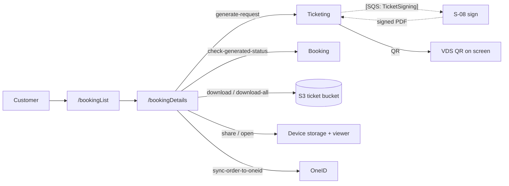

# U-06 · আমার বুকিং ও টিকিট

> **Bangla name:** আমার বুকিং ও টিকিট
>
> [← 30 · ইউজার অ্যাপ](README.md) · [সূচিপত্র](../README.md) · [ওপেন কোয়ারি](../99-open-queries.md)

## 1. নাম ও উদ্দেশ্য

**আমার বুকিং ও টিকিট।** গ্রাহক তার অর্ডারগুলো দেখেন, কোনো একটি খুলে তার টিকিট দেখেন, availability তারিখ এলে টিকিট তৈরির অনুরোধ জানান, তৈরির অবস্থা দেখেন, এবং তারপর টিকিট PDF খোলেন, শেয়ার করেন বা ডাউনলোড করেন। এটি [P-07](../20-user-portal/P-07-my-bookings.md), [P-08](../20-user-portal/P-08-ticket-generation-request.md), [P-09](../20-user-portal/P-09-ticket-details-downloads.md) এবং [P-10](../20-user-portal/P-10-oneid-ticket-sync.md)-এর অ্যাপ সংশ্লিষ্ট সংস্করণ।

## 2. ট্রিগার ও অ্যাক্টর

সাইন-ইন করা গ্রাহক। রুট `/bookingList`, `/bookingDetails`, `/paymentDetails`। সফল পেমেন্টের পর এখানেই ল্যান্ডিং টার্গেট ([U-05](U-05-booking-webview-payment.md) `NavigationItemType.myTickets` দিয়ে এখানে নেভিগেট করে)।

## 3. ব্যবসায়িক প্রবাহ

1. **বুকিং তালিকা:** গ্রাহকের অর্ডারের পেজযুক্ত তালিকা, যেখানে ইভেন্টের নাম, অর্ডার নম্বর, স্ট্যাটাস ও তারিখ থাকে।
2. **বুকিং বিস্তারিত:** অর্ডারের টিকিটগুলো; প্রতিটি টিকিটে তার নম্বর, হোল্ডার, ব্লক/লেভেল/সিট এবং একটি QR কোড দেখা যায়।
3. **টিকিট তৈরি:** ইভেন্টের টিকিট-availability তারিখ পেরিয়ে গেলে এবং অর্ডার পরিশোধিত হলে একটি **Generate** বাটন আসে; ট্যাপ করলে তৈরির পাইপলাইন শুরু হয় ([S-07](../50-system-initiated/S-07-initiate-user-ticket-generation.md), [S-08](../50-system-initiated/S-08-ticket-signing.md))।
4. **তৈরির অবস্থা দেখা:** অর্ডার `Requested`/`Processing` থাকাকালীন অ্যাপ তৈরির স্ট্যাটাস এন্ডপয়েন্ট কল করে।
5. **টিকিট ব্যবহার:** একটি ভিউয়ারে PDF খুলুন, শেয়ার করুন, বা অর্ডারের সব টিকিট ডাউনলোড করুন; OneID গ্রাহকদের জন্য OneID ওয়ালেটে সিঙ্ক করুন।

## 4. কারিগরি প্রবাহ

1. **[HTTP + ইউজার টোকেন]** `GET booking/api/v1/user-booking-order/list?…` (`booking_api_service_impl.dart:19`) — পেজযুক্ত তালিকা।
2. **[HTTP + ইউজার টোকেন]** `GET booking/api/v1/user-booking-order/{orderId}` (`:32`) — একটি অর্ডার।
3. **[HTTP + ইউজার টোকেন]** `POST ticketing/api/v1/booking-order-ticket/generate-request/{publicId}` (`booking_api_service_impl.dart:43`, এছাড়াও `ticket_api_service_impl.dart:127`) — তৈরি শুরু করে। সার্ভার-সাইডে অ্যাননিমাস, যা [Q-40](../20-user-portal/P-08-ticket-generation-request.md) হিসেবে নথিভুক্ত।
4. **[HTTP + ইউজার টোকেন]** `GET booking/api/v1/user-booking-order/check-generated-status/?id={publicId}` (`ticket_api_service_impl.dart:143`) — তৈরির অবস্থা। অ্যাপ অর্ডার এখনো `Generated` না হওয়া পর্যন্ত এটি কল করে; `[UNCONFIRMED: Q-54]` — কোনো `Timer` ব্যবহার করা হয় না, তাই লাইভ কাউন্ট না দেখে গ্রাহককে pull-to-refresh করতে হবে বা স্ক্রিনটি আবার খুলতে হবে।
5. **[HTTP + ইউজার টোকেন]** `POST ticketing/api/v1/booking-order-ticket/details` (`ticket_api_service_impl.dart:96`) — অর্ডারের টিকিট তালিকা; একটি টিকিটের জন্য `GET ticketing/api/v1/booking-order-ticket` (`:112`)।
6. **[HTTP + ইউজার টোকেন]** `GET ticketing/api/v1/booking-order-ticket/download?ticketNumber={id}` (`:150`) — একটি একক PDF, JSON ক্লায়েন্টের মাধ্যমে না গিয়ে পূর্ণ URL হিসেবে (`${apiClient.baseUrl}/…`) ফেচ করা হয়, তারপর `DownloadService`-কে দেওয়া হয়।
7. **[HTTP + ইউজার টোকেন]** `GET ticketing/api/v1/booking-order-ticket/download-all/{publicId}` (`:166`) — সব টিকিট একটি ফাইলে।
8. **[HTTP + ইউজার টোকেন]** `POST ticketing/api/v1/booking-order-ticket/sync-order-to-oneid/{publicOrderId}` — OneID সিঙ্ক, যেমন [P-10](../20-user-portal/P-10-oneid-ticket-sync.md)।
9. **[HTTP + ইউজার টোকেন]** `ticketBanglaApiClient`-এর মাধ্যমে `GET ticketing/api/v1/booking-order-ticket/download-invoice/{paymentId}` (`:193`) — ইনভয়েস, একটি **দ্বিতীয় base URL** থেকে ফেচ করা হয় (`ticket_bangla_api_client.dart`)।
10. **খোলা ও শেয়ার:** `openFile(fileName: '${ticket.uniqueTicketNumber}.pdf')` (`booking_details_view_model.dart:230`, `open_file` 3.5.10) ডাউনলোড করা PDF খোলে; `SharePlus.instance.share(...)` (`:264`, `share_plus` 12.0.0) শেয়ার করে। `DownloadService` `openFileFromNotification` সমর্থন করে (`download_service.dart:186`), তাই ব্যাকগ্রাউন্ডে শেষ হওয়া ডাউনলোড নিজে থেকেই খুলে যায়।
11. **QR দেখানো:** টিকিটের QR Ticketing সার্ভিস যে ডেটা ফেরত দেয় তা থেকে রেন্ডার হয়; QR নিজেই সাইনিং-এর সময় তৈরি VDS-সাইন করা payload ([S-08](../50-system-initiated/S-08-ticket-signing.md))।

## 5. কম্পোনেন্ট

| ধরন | কম্পোনেন্ট |
|---|---|
| ক্লায়েন্ট | `lib/presentation/feature/booking_list/`, `feature/booking_details/` (`widgets/ticket_guideline.dart`-সহ), `feature/payment_details/` |
| ক্লায়েন্ট সার্ভিস | `BookingListRepositoryImpl`, `BookingDetailsRepositoryImpl`, `TicketBookingRepositoryImpl`, `DownloadService` |
| API সার্ভিস | `booking_api_service/booking_api_service_impl.dart`, `ticket_api_service/ticket_api_service_impl.dart`, `ticket_bangla_api_client.dart` |
| সার্ভিস | Booking, Ticketing |
| কিউ | `TicketSigning`, `TicketProcessing` — generate request দ্বারা ট্রিগার হয় |
| S3 / CloudFront | টিকিট বাকেট ও মার্জ করা ZIP ([X-20](../60-cross-cutting/X-20-file-storage.md)) |
| বাহ্যিক | OneID (সিঙ্ক), TSP (সিগনেচার) |

## 6. API কন্ট্র্যাক্ট

| মেথড | পাথ | অথ | নোট |
|---|---|---|---|
| GET | `/booking/api/v1/user-booking-order/list?…` | User | পেজযুক্ত |
| GET | `/booking/api/v1/user-booking-order/{orderId}` | User | অর্ডারের বিস্তারিত |
| GET | `/booking/api/v1/user-booking-order/check-generated-status/?id={publicId}` | User | তৈরির অবস্থা |
| POST | `/ticketing/api/v1/booking-order-ticket/generate-request/{publicId}` | **অ্যাননিমাস** ([Q-40](../20-user-portal/P-08-ticket-generation-request.md)) | তৈরি শুরু করে |
| POST | `/ticketing/api/v1/booking-order-ticket/details` | User | টিকিট তালিকা |
| GET | `/ticketing/api/v1/booking-order-ticket` | User | একটি টিকিট |
| GET | `/ticketing/api/v1/booking-order-ticket/download?ticketNumber=` | User | PDF স্ট্রিম |
| GET | `/ticketing/api/v1/booking-order-ticket/download-all/{publicId}` | User | ZIP — **কোনো owner যাচাই নেই** ([Q-41](../20-user-portal/P-09-ticket-details-downloads.md)) |
| GET | `/ticketing/api/v1/booking-order-ticket/download-invoice/{paymentId}` | User | ইনভয়েস, দ্বিতীয় base URL |
| POST | `/ticketing/api/v1/booking-order-ticket/sync-order-to-oneid/{publicOrderId}` | User | OneID — **কোনো owner যাচাই নেই** ([Q-41](../20-user-portal/P-10-oneid-ticket-sync.md)) |

## 7. ডেটা ও পার্শ্বপ্রতিক্রিয়া

Ticketing সার্ভিসের অর্ডার ও টিকিট টেবিল পড়ে; generate request `Tickets` রো লেখে এবং `TicketSigning`-এ পাবলিশ করে; ডাউনলোড ডিভাইস স্টোরেজে একটি PDF লেখে; OneID সিঙ্ক গ্রাহকের OneID ওয়ালেটে PDF রাখে।

## 8. কোড রেফারেন্স

| কী | কোথায় |
|---|---|
| Booking API | `rvl-gobcb-user-app/data/lib/remote/api_service/booking_api_service/booking_api_service_impl.dart:19, 32, 43` |
| Ticket API | `rvl-gobcb-user-app/data/lib/remote/api_service/ticket_api_service/ticket_api_service_impl.dart:96, 112, 127, 143, 150, 166, 184, 193` |
| বুকিং বিস্তারিত | `rvl-gobcb-user-app/lib/presentation/feature/booking_details/booking_details_view_model.dart:230, 264` |
| ডাউনলোড সার্ভিস | `rvl-gobcb-user-app/data/lib/service/download_service.dart:186` |
| ইনভয়েস ক্লায়েন্ট | `rvl-gobcb-user-app/data/lib/remote/api_client/ticket_bangla_api_client.dart` |
| রিপোজিটরি | `rvl-gobcb-user-app/data/lib/repository/booking_list_repository_impl.dart:10`, `booking_details_repository_impl.dart:7` |
| প্যাকেজ | `rvl-gobcb-user-app/pubspec.yaml` (`open_file: 3.5.10`, `share_plus: 12.0.0`) |

## 9. হ্যান্ডওভার নোট

1. **তৈরির স্ট্যাটাস দেখতে ম্যানুয়াল রিফ্রেশ লাগে** (§4 নোট ৪) `[UNCONFIRMED: Q-54]`। পোর্টাল পোল করে; অ্যাপ করে না, তাই টিকিটের জন্য অপেক্ষা করা গ্রাহককে স্ক্রিনটি আবার খুলতে হবে।
2. **`download-all` ও `sync-to-oneid`-এ কোনো owner যাচাই নেই** — সার্ভার থেকে এসেছে, আর অ্যাপ থেকেও সমানভাবে শোষণযোগ্য ([Q-41](../20-user-portal/P-09-ticket-details-downloads.md))।
3. **ইনভয়েস আসে দ্বিতীয় base URL থেকে** (`ticketBanglaApiClient`), যা মূল API ক্লায়েন্ট থেকে আলাদাভাবে কনফিগার করা; ভুল ইনভয়েস URL শুধু ইনভয়েস ভেঙে দেয়।
4. **`openFileFromNotification: true`** (`download_service.dart:186`) মানে ব্যাকগ্রাউন্ডে শুরু করা ডাউনলোড শেষ হলে ফাইলটি খুলে যায় — গ্রাহক চলে গেলে এটি অপ্রত্যাশিত আচরণ।
5. **টিকিট PDF ডিভাইসের public storage-এ ক্যাশ হয়** এবং `open_file` দিয়ে খোলা হয়; পথটি টিকিট নম্বর থেকে নির্ণিত হয়।
6. **generate request সার্ভার-সাইডে অ্যাননিমাস**, তাই কেউ একটি `publicId` জানলেই সেই অর্ডারের তৈরি শুরু করতে পারে ([Q-40](../20-user-portal/P-08-ticket-generation-request.md))।
7. **OneID সিঙ্ক বাটন প্রোফাইলের `sso_provider`-এর উপর নির্ভর করে**; OneID নয় এমন গ্রাহকের ক্ষেত্রে কখনো কলটি করা হয় না।

## 10. কম্পোনেন্ট সম্পর্ক

**নির্ভর করে:** [U-05](U-05-booking-webview-payment.md) (যে অর্ডারগুলো দেখাতে হবে), [S-06](../50-system-initiated/S-06-booking-status-generated.md), [S-07](../50-system-initiated/S-07-initiate-user-ticket-generation.md)। **প্রভাব ফেলে:** [C-02](../40-checker-app/C-02-offline-ticket-download.md) — চেকার যে টিকিটগুলো যাচাই করে সেগুলো এগুলোই।

## 11. ডেভেলপার টেস্ট গাইড

**লোকালভাবে টেস্টযোগ্য:** তালিকা ও বিস্তারিতের জন্য **সম্পূর্ণ**; PDF ডাউনলোডের জন্য **আংশিক** (টিকিট বাকেট দরকার, যা Floci সার্ভ করতে পারে) এবং TSP সাইনিং ও OneID-এর জন্য **লোকালভাবে সম্ভব নয়**।

| আইটেম | বিস্তারিত |
|---|---|
| টেস্ট ডেটা ও অ্যাকাউন্ট | একটি পরিশোধিত অর্ডারসহ seeded ইউজার `+8801700000011` (`scripts/seed/*.sql`) |
| ব্রাউজার | পোর্টালে সমতুর্য — [P-07](../20-user-portal/P-07-my-bookings.md) ও [P-09](../20-user-portal/P-09-ticket-details-downloads.md) দেখুন |
| এমুলেটর | অ্যাপ চালু করুন; My tickets খুলুন; Generate বাটনে পৌঁছাতে seeded ইভেন্টের টিকিট-availability তারিখ অতীতে সেট করুন |
| Postman | `postman/services/etp-ticketing.postman_collection.json`: "PATCH /api/v1/booking-order-ticket/generate-request/{publicId}", "GET /api/v1/booking-order-ticket/details", "GET /api/v1/booking-order-ticket/download", "GET /api/v1/booking-order-ticket/download-all/{orderPublicId}"; `postman/services/etp-booking.postman_collection.json`: "GET /api/v1/user-booking-order/list", "GET /api/v1/user-booking-order/check-generated-status" |
| Visual Studio ডিবাগ | `TicketManager.TicketGenerateRequest` ও `TicketSigning` ওয়ার্কার ([S-08](../50-system-initiated/S-08-ticket-signing.md)); ক্লায়েন্ট: `BookingDetailsViewModel` প্রায় ২৩০ নম্বর লাইনে |
| যাচাই | `SignedTicketUrl`-এর জন্য `Tickets` টেবিলে `SELECT`; টিকিট বাকেটের নিচে Floci-তে S3 অবজেক্ট; [S-09](../50-system-initiated/S-09-ticket-merge-zip.md)-এর মার্জ করা ZIP |