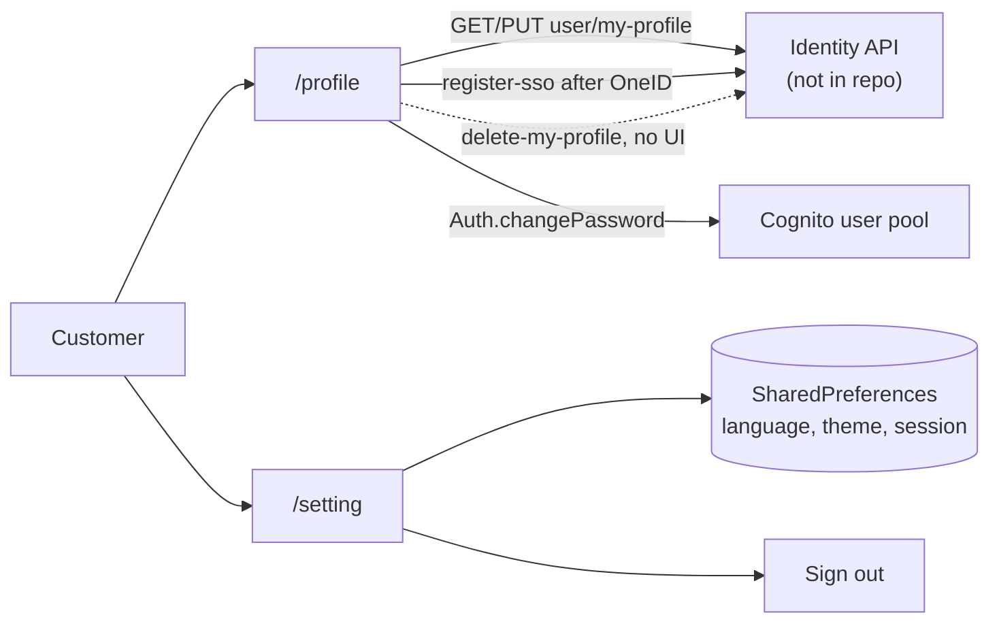

# U-07 · প্রোফাইল ও সেটিংস

> **Bangla name:** প্রোফাইল ও সেটিংস
>
> [← 30 · ইউজার অ্যাপ](README.md) · [সূচিপত্র](../README.md) · [ওপেন কোয়ারি](../99-open-queries.md)

## 1. নাম ও উদ্দেশ্য

**প্রোফাইল ও সেটিংস।** অ্যাপের অ্যাকাউন্ট স্ক্রিন: ব্যক্তিগত তথ্য, গ্রাহক যেসব ফিল্ড সম্পাদনা করতে পারেন, পাসওয়ার্ড পরিবর্তনের ফর্ম, এবং ভাষা ও থিমের মতো অ্যাপ-লেভেল সেটিংস। এটি [P-11](../20-user-portal/P-11-profile.md)-এর অ্যাপ সংশ্লিষ্ট সংস্করণ, এবং একই সাথে **অ্যাকাউন্ট মুছে ফেলা** সুবিধা দেওয়া একমাত্র ক্লায়েন্ট ([X-11](../60-cross-cutting/X-11-delete-account-force-update.md))।

## 2. ট্রিগার ও অ্যাক্টর

সাইন-ইন করা গ্রাহক, হোম ড্রয়ার বা প্রোফাইল ট্যাব থেকে। রুট `/profile`, `/setting`, এবং auth সাব-রুট `/forgetPassword`, `/confirmNewPassword`, `/forgetPasswordSuccess`।

## 3. ব্যবসায়িক প্রবাহ

1. প্রোফাইল স্ক্রিন গ্রাহকের তথ্য লোড করে এবং নাম, ফোন, ইমেইল ও সম্পাদনাযোগ্য ফিল্ড দেখায়।
2. জন্ম তারিখ, পরিচয়পত্র বা ঠিকানা সম্পাদনা করে সেভ করলে identity API হালনাগাদ হয়।
3. **Change password** ফর্ম নতুন পাসওয়ার্ড ও কনফার্মেশনের মিল যাচাই করে, তারপর Cognito কল করে।
4. সেটিংসে থাকে ভাষা, থিম এবং সাইন-আউট।
5. **অ্যাকাউন্ট মুছে ফেলা** নিশ্চিতকরণ চায় এবং identity API কল করে — পোর্টালে এর কোনো সমতুর্য নেই।

## 4. কারিগরি প্রবাহ

1. **[HTTP + ইউজার টোকেন] → identity API:** `GET user/my-profile?user_id={userId}` (`profile_api_service_impl.dart:17-22`) → `UserDataResponse`। লক্ষ্য করুন, অ্যাপ `user_id` একটি **query parameter** হিসেবে পাঠায়, যা পোর্টালের কল করে না ([P-11](../20-user-portal/P-11-profile.md) §4) `[UNCONFIRMED: Q-60]`।
2. **[HTTP + ইউজার টোকেন] → identity API:** `PUT user/my-profile` (`:32-38`) যেখানে `verification_type`, `verification_id`, `address` এবং **`dob` `DateFormat("yyyy-MM-dd")` ফরম্যাটে** — অর্থাৎ শুধু তারিখের একটি স্ট্রিং, যেখানে পোর্টাল পূর্ণ ISO timestamp পাঠায়। ত্রুটিগুলো টাইপ করা এক্সেপশনে মানচিত্রিত হয়: `user_update_and_verification_failed` → `UserUpdateAndVerificationFailedException`, অন্য যেকোনো কিছু → `UserProfileUpdateFailedException` (`:39-44`)।
3. `[UNCONFIRMED: Q-61]` — **`delete-my-profile`-এর কোনো কলার নেই।** `auth_api_service_impl.dart:296` `apiClient.delete('user/delete-my-profile')` বাস্তবায়ন করে, কিন্তু কোনো view model বা স্ক্রিন সেটি কল করে না: `lib/` ও `domain/`-এ সার্চ করলে কোনো কলার বা রুট পাওয়া যায় না। তাই API ডেটা লেয়ারে যুক্ত, কিন্তু delete-account **UI অনুপস্থিত**, যা [X-11](../60-cross-cutting/X-11-delete-account-force-update.md)-এর বর্ণনার বিরোধিতা করে, সেখানে এটিকে app-only বলা হয়েছে। স্ক্রিনটি হয় সরানো হয়েছে, নয়তো কখনোই বানানো হয়নি।
4. **পাসওয়ার্ড পরিবর্তন** identity API-র মাধ্যমে নয়, auth রিপোজিটরি থেকে Amplify/Cognito-র মাধ্যমে যায় (`auth_repository_impl.dart`)। ফর্মটি `profile_view_model.dart`-এ সর্বনিম্ন দৈর্ঘ্য ৮ এবং কনফার্মেশন ফিল্ড যাচাই করে (`confirmNewPasswordTextFieldChecker`, `:323-325`, `password_tab_states.dart`-সহ)।
5. **Register SSO user** (`POST user/register-sso`, `:49-54`) OneID সাইন-ইন সফল হওয়ার পর ব্যবহৃত হয়, বডি `{"name": "", "cognito_sub": …}` — নাম **খালি** পাঠানো হয়, তাই OneID ব্যবহারকারীদের প্রোফাইলের নাম তারা নিজে না লেখা পর্যন্ত ফাঁকা থাকে।
6. সেটিংসের অবস্থা (ভাষা, থিম, লোকেশন, দেশ) `data/lib/local/shared_preference/entity/`-এর নিচে `SharedPreferences` এন্টিটিতে রাখা হয়; সাইন-আউট Amplify সেশন মুছে ফেলে।

## 5. কম্পোনেন্ট

| ধরন | কম্পোনেন্ট |
|---|---|
| ক্লায়েন্ট | `lib/presentation/feature/profile/` (`state/password_tab_states.dart`-সহ), `feature/settings/` |
| ক্লায়েন্ট সার্ভিস | `ProfileRepositoryImpl`, `AuthRepositoryImpl`, `ProfileApiServiceImpl`, `AuthApiServiceImpl` |
| API ক্লায়েন্ট | `profile_api_client.dart`, `auth_api_client.dart` (base URL `.env` `AUTH_API_BASE_URL`-এ থেকে) |
| সার্ভিস | Identity API (প্রোফাইল, ডিলিট), Cognito user pool (পাসওয়ার্ড) |
| টেবিল | identity API-এর নিজস্ব user টেবিল |
| লোকাল | `SharedPreferences`: ভাষা, থিম, সেশন |

## 6. API কন্ট্র্যাক্ট

| মেথড | পাথ | অথ | রিকোয়েস্ট → রেসপন্স |
|---|---|---|---|
| GET | `{AUTH_API_BASE_URL}/user/my-profile?user_id={userId}` | user bearer | — → `UserDataResponse` |
| PUT | `{AUTH_API_BASE_URL}/user/my-profile` | user bearer | `{ verification_type, verification_id, address, dob }` |
| POST | `{AUTH_API_BASE_URL}/user/register-sso` | — | `{ name: "", cognito_sub }` |
| DELETE | `{AUTH_API_BASE_URL}/user/delete-my-profile` | user bearer | **বাস্তবায়িত, কোনো কলার নেই** ([Q-61](../20-user-portal/P-11-profile.md)) |
| — | Cognito change-password | user pool session | পুরোনো ও নতুন পাসওয়ার্ড |

নমুনা, অ্যাপ যেভাবে PUT রিকোয়েস্ট পাঠায় (লক্ষ্য করুন শুধু তারিখের `dob`):

```json
{ "verification_type": "nid", "verification_id": "1994567890123",
  "address": "House 42, Road 7, Dhanmondi, Dhaka-1209", "dob": "1994-07-21" }
```

## 7. ডেটা ও পার্শ্বপ্রতিক্রিয়া

identity API-এর user রো (`dob`, ঠিকানা, ভেরিফিকেশন); Cognito পাসওয়ার্ড; সেটিংসের জন্য লোকাল `SharedPreferences`। `etp`-তে কিছু লেখা হয় না — পোর্টালের মতোই, প্রোফাইল পরিবর্তন কখনোই টিকিট হোল্ডারের তথ্যে পৌঁছায় না ([U-06](U-06-my-bookings-tickets.md))।

## 8. কোড রেফারেন্স

| কী | কোথায় |
|---|---|
| Profile API | `rvl-gobcb-user-app/data/lib/remote/api_service/profile_api_service/profile_api_service_impl.dart:17-54` |
| অ্যাকাউন্ট ডিলিট | `rvl-gobcb-user-app/data/lib/remote/api_service/auth_api_service/auth_api_service_impl.dart:296` |
| প্রোফাইল রিপোজিটরি | `rvl-gobcb-user-app/data/lib/repository/profile_repository_impl.dart:17` |
| Auth রিপোজিটরি | `rvl-gobcb-user-app/data/lib/repository/auth_repository_impl.dart:12` |
| প্রোফাইল ভিউ মডেল | `rvl-gobcb-user-app/lib/presentation/feature/profile/profile_view_model.dart:323-325` |
| পাসওয়ার্ড স্টেট | `rvl-gobcb-user-app/lib/presentation/feature/profile/state/password_tab_states.dart:8-39` |
| সেটিংস এন্টিটি | `rvl-gobcb-user-app/data/lib/local/shared_preference/entity/` (`language_`, `app_theme_mode_`, `user_session_`) |
| ক্লায়েন্ট | `rvl-gobcb-user-app/data/lib/remote/api_client/profile_api_client.dart`, `auth_api_client.dart:6` |

## 9. হ্যান্ডওভার নোট

1. **`delete-my-profile` বাস্তবায়িত কিন্তু পৌঁছানো যায় না** (§4 নোট ৩) `[UNCONFIRMED: Q-61]`। এটি [X-11](../60-cross-cutting/X-11-delete-account-force-update.md)-এর বিরোধিতা করে এবং সেখানে সংশোধন করা দরকার: আজ কোনো ক্লায়েন্টই UI-এর মাধ্যমে অ্যাকাউন্ট মুছতে পারে না। এন্ডপয়েন্টটি আছে, তাই ঘাটতি শুধু অনুপস্থিত স্ক্রিন।
2. **`dob` পাঠানো হয় `yyyy-MM-dd` হিসেবে**, পোর্টালে পূর্ণ ISO timestamp। identity API দুটোই পার্স করলে ঠিক আছে; কঠোরভাবে ভ্যালিডেট করলে দুটো ক্লায়েন্টের একটি ব্যর্থ হবে `[UNCONFIRMED: Q-60]`।
3. **অ্যাপের GET-এ `user_id` একটি query parameter হিসেবে যায়**, কিন্তু পোর্টালের কলে যায় না — একই এন্ডপয়েন্ট কীভাবে কল করা হচ্ছে তার একটি অসামঞ্জস্য ([Q-60](../20-user-portal/P-11-profile.md))।
4. **OneID রেজিস্ট্রেশন খালি নাম পাঠায়** (`:51`), তাই OneID সাইন-ইনের পর গ্রাহক তা সম্পাদনা না করা পর্যন্ত প্রোফাইলের নাম ফাঁকা থাকে।
5. **পোর্টালের মতো একই চারটি সম্পাদনাযোগ্য ফিল্ড** — নাম, ফোন ও ইমেইল দুই ক্লায়েন্টেই read-only থাকে, তাই ভুল করে লেখা ফোন নম্বর পণ্যের কোথাও শুধরানো যায় না `[UNCONFIRMED: Q-43](../20-user-portal/P-11-profile.md)`।
6. **সেটিংস `SharedPreferences`-এ থাকে**, তাই ভাষা ও থিম প্রতি ডিভাইসে আলাদা এবং অ্যাপ পুনর্বinstall করলে হারিয়ে যায়।
7. **identity API এই রিপোজিটরিতে নেই** `[UNCONFIRMED: Q-01]`, তাই এর কোনো কলই ওয়ার্কস্পেসের কোড থেকে যাচাই করা যায় না।

## 10. কম্পোনেন্ট সম্পর্ক



**নির্ভর করে:** [X-06](../60-cross-cutting/X-06-user-registration.md), [X-07](../60-cross-cutting/X-07-user-password-login.md), [X-08](../60-cross-cutting/X-08-oneid-sso.md)। **প্রভাব ফেলে:** [U-09](U-09-device-token.md) — টোকেনটি PushNotification সার্ভিসে প্রতি সাইন-ইন করা ব্যবহারকারীর জন্য আলাদা করে সংরক্ষিত।

## 11. ডেভেলপার টেস্ট গাইড

**লোকালভাবে টেস্টযোগ্য: আংশিক।** স্ক্রিনগুলো `/p/identity` স্টাবের বিপরীতে সম্পূর্ণ চলে; Cognito কলের জন্য আসল বা লোকাল user pool দরকার।

| আইটেম | বিস্তারিত |
|---|---|
| টেস্ট ডেটা ও অ্যাকাউন্ট | seeded ইউজার `+8801700000011`; `/p/identity` স্টাব একটি নির্দিষ্ট প্রোফাইল ফেরত দেয় |
| ব্রাউজার | পোর্টালে `/en/user-profile` — [P-11](../20-user-portal/P-11-profile.md) দেখুন |
| এমুলেটর | অ্যাপ চালু করুন; `/profile` খুলুন; DOB ও ঠিকানা সম্পাদনা করে অ্যাপের লগে PUT বডি দেখুন — নিশ্চিত করুন `dob` হলো `yyyy-MM-dd`; খালি নাম দেখতে OneID দিয়ে সাইন-ইন করুন |
| Postman | কোনো GoBCB কালেকশনে নেই — এগুলো identity-API-র কল `[UNCONFIRMED: Q-01]` |
| Visual Studio ডিবাগ | কেবল ক্লায়েন্ট (`ProfileRepositoryImpl`); identity API আউট অফ প্রসেস |
| যাচাই | Floci কনসোল লগে স্টাবের গ্রহণ করা PUT বডি; ভাষা ও থিমের জন্য `SharedPreferences`-এর বিষয়বস্তু |