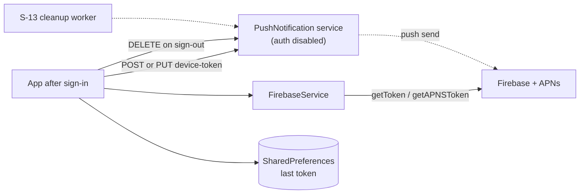

# U-09 · পুশ ডিভাইস-টোকেন রেজিস্ট্রেশন

> **Bangla name:** পুশ ডিভাইস-টোকেন রেজিস্ট্রেশন
>
> [← 30 · ইউজার অ্যাপ](README.md) · [সূচিপত্র](../README.md) · [ওপেন কোয়ারি](../99-open-queries.md)

## 1. নাম ও উদ্দেশ্য

**পুশ ডিভাইস-টোকেন রেজিস্ট্রেশন।** যাতে প্ল্যাটফর্ম গ্রাহকের ফোনে পুশ নোটিফিকেশন পাঠাতে পারে, তার জন্য ডিভাইসের Firebase টোকেন সাইন-ইন করা ব্যবহারকারীর বিপরীতে রেজিস্টার করতে হয়। এই অংশে রয়েছে টোকেন পাওয়া (iOS-নির্দিষ্ট APNs ধাপসহ), তা রেজিস্টার করা, Firebase রোটেট করলে হালনাগাদ করা, এবং সাইন-আউটে তা সরানো। এটি [X-23](../60-cross-cutting/X-23-push-firebase.md)-এর ক্লায়েন্ট অর্ধেক।

## 2. ট্রিগার ও অ্যাক্টর

যেকোনো সাইন-ইন করা গ্রাহক, প্রতিটি টোকেন মানের জন্য একবার। নিজস্ব কোনো রুট নেই — এটি সেশন লাইফসাইকেলের অংশ হিসেবে চলে।

## 3. ব্যবসায়িক প্রবাহ

1. সাইন-ইনের পর অ্যাপ Firebase-এর কাছ থেকে একটি push token চায় এবং সেটি প্ল্যাটফর্মে পাঠায়, যা সেটি ব্যবহারকারীর বিপরীতে সংরক্ষণ করে।
2. Firebase পরে যদি টোকেনটি রোটেট করে (reinstall, restore, token refresh), অ্যাপ নতুন মানটি পাঠায়, যাতে প্ল্যাটফর্ম আর মৃত টোকেনে পাঠাতে বন্ধ করে।
3. সাইন-আউটে অ্যাপ তার টোকেন সরায়, যাতে পুরোনো ডিভাইস আগের ব্যবহারকারীর নোটিফিকেশন না পায়।

## 4. কারিগরি প্রবাহ

1. **Firebase ইনিশিয়ালাইজেশন** — `FirebaseService.initialize()` (`firebase_service.dart:20-30`) একটি `try/catch`-এর ভেতরে `Firebase.initializeApp(options: DefaultFirebaseOptions.currentPlatform)` কল করে, যা ব্যর্থ হলে লগ করে এগিয়ে যায়। অপশনগুলো `.env` key থেকে আসে (`data/lib/firebase_options.dart:51-64`): `FIREBASE_ANDROID_API_KEY`, `FIREBASE_ANDROID_APP_ID`, `FIREBASE_ANDROID_MESSAGING_SENDER_ID`, `FIREBASE_ANDROID_PROJECT_ID`, `FIREBASE_ANDROID_STORAGE_BUCKET`, সঙ্গে `FIREBASE_IOS_*`-এর সমতুর্যগুলো এবং `FIREBASE_IOS_BUNDLE_ID`।
2. **টোকেন অর্জন** — `setupFCMToken({required Function(String) onTokenRefresh})` (`:99-125`):
   - **শুধু iOS:** ২ সেকেন্ড অপেক্ষা করে (`Future.delayed(const Duration(seconds: 2))`), তারপর `getAPNSToken()` কল করে; এটি এখনো null হলে সেটি `APNs token not yet available` লগ করে এবং **কিছুই রেজিস্টার না করেই ফিরে যায়** (`:101-110`);
   - `FirebaseMessaging.instance.getToken()` → `onTokenRefresh(token)` (`:112-115`);
   - `onTokenRefresh.listen(...)` রোটেশনের জন্য শুনতে থাকে; `.onError` শুধু লগ করে (`:117-121`);
   - পুরো মেথডটি একটি `try/catch`-এ মোড়ানো যা লগ করে গিলে ফেলে (`:122-124`)।
3. **[HTTP + ইউজার টোকেন] → PushNotification:** `{"fcmToken": <token>}` সহ `POST pushnotification/api/v1/device-token` (`firebase_api_service_impl.dart:17-21`)। user id সার্ভার-সাইডে টোকেন থেকে নেওয়া হয়।
4. **[HTTP + ইউজার টোকেন] → PushNotification:** `PUT pushnotification/api/v1/device-token` — হালনাগাদের পথ, সংরক্ষিত টোকেন নতুনটি থেকে আলাদা হলে ব্যবহৃত হয় (`firebase_repository_impl.dart:69-77` `savedToken != fcmToken` তুলনা করে, তারপর সেভ করার আগে আপডেট কল করে)।
5. **নতুন টোকেনটি আগে লোকালে সংরক্ষিত হয়** (`_saveFirebaseFCMToken`, `:65`, `:77`), যাতে পরবর্তী চালু করায় আবার ফেচ না করেই তুলনা করা যায়।
6. **[HTTP + ইউজার টোকেন] → PushNotification:** `{"userId": …, "fcmToken": …}` সহ `DELETE pushnotification/api/v1/device-token` (`firebase_api_service_impl.dart:44-48`) — সাইন-আউটের পরিষ্কারকরণ।

## 5. কম্পোনেন্ট

| ধরন | কম্পোনেন্ট |
|---|---|
| ক্লায়েন্ট | `data/lib/service/firebase_service.dart`, `data/lib/repository/firebase_repository_impl.dart:10-77` |
| ক্লায়েন্ট | `data/lib/firebase_options.dart` (`.env` থেকে), `data/lib/remote/api_service/firebase_api_service/` |
| সার্ভিস | **PushNotification** ([X-18](../60-cross-cutting/X-18-endpoints-without-auth.md) দেখুন — এই সার্ভিসে `UseAuthentication`/`UseAuthorization` কমেন্ট করা) |
| টেবিল | PushNotification-এর নিজস্ব ডিভাইস-টোকেন টেবিল |
| বাহ্যিক | Firebase Cloud Messaging, APNs |
| সার্ভার | `S-13` পুরোনো টোকেন পরিষ্কার করে ([S-13](../50-system-initiated/S-13-device-token-cleanup.md)) |

## 6. API কন্ট্র্যাক্ট

| মেথড | পাথ | অথ | রিকোয়েস্ট → রেসপন্স |
|---|---|---|---|
| POST | `/pushnotification/api/v1/device-token` | **কোনোটিই প্রয়োগ করা হয় না** | `{ fcmToken }` |
| PUT | `/pushnotification/api/v1/device-token` | **কোনোটিই প্রয়োগ করা হয় না** | `{ … }` আপডেট |
| DELETE | `/pushnotification/api/v1/device-token` | **কোনোটিই প্রয়োগ করা হয় না** | `{ userId, fcmToken }` |

তিনটিই PushNotification সার্ভিসে, যার authentication middleware নিষ্ক্রিয় ([X-18](../60-cross-cutting/X-18-endpoints-without-auth.md)), তাই `[UNCONFIRMED: Q-62]` — কাগজে অ্যাপ একটি user bearer পাঠায়, কিন্তু সার্ভার সেটি যাচাই করে না, এবং `POST` ব্যবহারকারীকে শুধু রিকোয়েস্ট বডি/টোকেন থেকে বের করে।

## 7. ডেটা ও পার্শ্বপ্রতিক্রিয়া

প্রতি (ব্যবহারকারী, টোকেন)-এর জন্য PushNotification-এর ডিভাইস-টোকেন টেবিলে একটি রো; শেষ টোকেনের জন্য লোকাল `SharedPreferences`; এবং iOS-এ ডিভাইস থেকে পঠিত একটি APNs টোকেন।

## 8. কোড রেফারেন্স

| কী | কোথায় |
|---|---|
| Firebase সার্ভিস | `rvl-gobcb-user-app/data/lib/service/firebase_service.dart:20-125` |
| রিপোজিটরি | `rvl-gobcb-user-app/data/lib/repository/firebase_repository_impl.dart:35-77` |
| API সার্ভিস | `rvl-gobcb-user-app/data/lib/remote/api_service/firebase_api_service/firebase_api_service_impl.dart:12-48` |
| অপশন | `rvl-gobcb-user-app/data/lib/firebase_options.dart:51-64` |
| Env key | `rvl-gobcb-user-app/env/README.md` |
| প্যাকেজ | `rvl-gobcb-user-app/pubspec.yaml` (`firebase_core`, `firebase_messaging`, `flutter_local_notifications`) |

## 9. হ্যান্ডওভার নোট

1. **iOS-এ টোকেন প্রায়ই আদৌ রেজিস্টারই হয় না।** ২ সেকেন্ডের অপেক্ষার সাথে null `getAPNSToken()` শেষে ফিরে আসে (`:106-110`), আর বাইরের `catch` ত্রুটিটি গিলে ফেলে — তাই একজন iOS গ্রাহক লম্বা সময় কোনো দৃশ্যমান লক্ষণ ছাড়াই পুশ সুবিধা ছাড়া থাকতে পারে। এটিই প্ল্যানে নথিভুক্ত "locally Firebase ডামি" ঘাটতির বাস্তব চেহারা `[UNCONFIRMED: Q-63]`।
2. **সব Firebase ত্রুটি গিলে ফেলা হয়** (`catch (e) { Logger.debug(...) }` `:26-28`, `:122-124`), তাই ভুলভাবে কনফিগার করা `FIREBASE_*` key দেয় নীরবে পুশহীন একটি অ্যাপ।
3. **Firebase কাজ করতে `.env` অবশ্যই দরকার** এবং এটি gitignore করা; `firebase_options.dart`-এর প্রতিটি `dotenv.env[...]!` key না থাকলে থ্রো করবে, যা ইনিশিয়ালাইজের `catch` ধরে ফেলে — তাই key না থাকা আর key ভুল থাকা দুটোই হুবহু একই রূপ (পুশ নেই)।
4. **`firebase_repository_impl.dart:69`-এর তুলনাই POST বনাম PUT সিদ্ধান্ত করে**; যে গ্রাহক অ্যাপ স্টোরেজ মুছে দেন তিনি হালনাগাদ না করে একই টোকেন আবার POST করেন।
5. **সাইন-আউটে বডিতে `userId` সহ DELETE পাঠায়** (`:46`), আর POST কেবল `fcmToken` নেয় — অসমতিমূলক, এবং দুটি কলের মধ্যে সার্ভার-সাইড আইডেন্টিটি আলাদা `[UNCONFIRMED: Q-62]`।
6. **অ্যাকাউন্ট মুছে ফেলার সময় ডিভাইস টোকেন মোছে না**, কারণ delete-account-এর কোনো UI নেইই ([Q-61](U-07-profile-settings.md)) — মুছে ফেলা গ্রাহকের ফোনে টোকেন থেকে যায় যতক্ষণ না [S-13](../50-system-initiated/S-13-device-token-cleanup.md) তা সরিয়ে দেয়।
7. **সার্ভার-সাইড পরিষ্কার ওয়ার্কার `Services:Admin` কল করে `/pushnotification` prefix ছাড়া** ([Q-16](../50-system-initiated/S-13-device-token-cleanup.md)), যা একই এলাকার একটি আলাদা ত্রুটি।

## 10. কম্পোনেন্ট সম্পর্ক

**নির্ভর করে:** [X-07](../60-cross-cutting/X-07-user-password-login.md) (টোকেন যার সাথে যুক্ত করা হবে এমন একজন সাইন-ইন করা ব্যবহারকারী), [U-07](U-07-profile-settings.md)। **প্রভাব ফেলে:** [U-10](U-10-push-receipt.md), [S-11](../50-system-initiated/S-11-firebase-notification.md), [S-12](../50-system-initiated/S-12-ticket-generated-notification.md), [S-13](../50-system-initiated/S-13-device-token-cleanup.md)।

## 11. ডেভেলপার টেস্ট গাইড

**লোকালভাবে টেস্টযোগ্য: আংশিক।** লোকালে Firebase একটি ডামি, তাই আসল টোকেন কেবল একটি আসল Firebase প্রজেক্টের বিপরীতেই পাওয়া যায় — লোকাল পথ কোড চালায়, কিন্তু ডেলিভারি নয়।

| আইটেম | বিস্তারিত |
|---|---|
| টেস্ট ডেটা ও অ্যাকাউন্ট | seeded ইউজার `+8801700000011` |
| ব্রাউজার | প্রযোজ্য নয় (শুধু মোবাইল) |
| এমুলেটর | `.env`-এ আসল `FIREBASE_*` key সহ অ্যাপ চালু করুন; অ্যাপের লগে `Started Firebase Initialization` দেখুন এবং iOS-এ `APNs token not yet available` দেখুন |
| Postman | `postman/collections` — ডিভাইস-টোকেনের কলগুলো কোনো GoBCB কালেকশনে নেই; লোকাল PushNotification সার্ভিসের বিপরীতে হাতে কল করুন `[UNCONFIRMED: Q-62]` |
| Visual Studio ডিবাগ | `PushNotificationController` ও ডিভাইস-টোকেন ম্যানেজার; ক্লায়েন্ট: `FirebaseRepositoryImpl.sendFirebaseFCMToken` |
| যাচাই | PushNotification ডিভাইস-টোকেন টেবিলে `SELECT`; FCM টোকেনের জন্য `adb logcat`; ডেলিভারি নিশ্চিত করতে `adb shell dumpsys firebase` বা Firebase কনসোল |