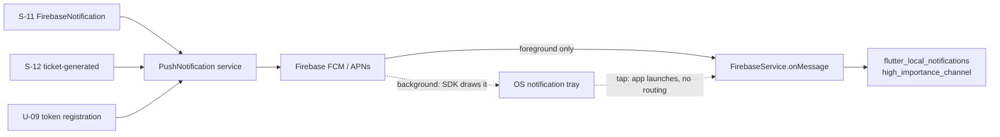

# U-10 · পুশ নোটিফিকেশন গ্রহণ

> **Bangla name:** পুশ নোটিফিকেশন গ্রহণ
>
> [← 30 · ইউজার অ্যাপ](README.md) · [সূচিপত্র](../README.md) · [ওপেন কোয়ারি](../99-open-queries.md)

## 1. নাম ও উদ্দেশ্য

**পুশ নোটিফিকেশন গ্রহণ।** প্ল্যাটফর্ম থেকে পাঠানো একটি নোটিফিকেশন গ্রাহকের ফোনে কীভাবে পৌঁছায় এবং অ্যাপ সেটি নিয়ে কী করে। নোটিফিকেশনগুলো গ্রাহককে জানায় তার টিকিট প্রস্তুত ([S-12](../50-system-initiated/S-12-ticket-generated-notification.md)) অথবা ইভেন্টে কিছু বদলেছে। এটি [X-23](../60-cross-cutting/X-23-push-firebase.md)-এর ক্লায়েন্ট অর্ধেক।

## 2. ট্রিগার ও অ্যাক্টর

যেকোনো সাইন-ইন করা গ্রাহক যার ডিভাইস টোকেন রেজিস্টার করা ([U-09](U-09-device-token.md))। কোনো রুট নেই; অ্যাপ ব্যাকগ্রাউন্ডে শুনে থাকে।

## 3. ব্যবসায়িক প্রবাহ

1. প্ল্যাটফর্ম `FirebaseNotification`-এ পাবলিশ করে ([S-11](../50-system-initiated/S-11-firebase-notification.md)) এবং Firebase ডিভাইসে বার্তা পৌঁছে দেয়।
2. **অ্যাপ foreground-এ থাকলে**, অ্যাপ নিজেই একটি high-priority Android channel ব্যবহার করে নোটিফিকেশনটি দেখায়।
3. **অ্যাপ background-এ থাকলে**, Firebase-এর নিজস্ব নোটিফিকেশন দেখানো ব্যবহৃত হয় — সেটি SDK আঁকে, অ্যাপ নয়।
4. নোটিফিকেশনে ট্যাপ করলে অ্যাপ খোলে। `[UNCONFIRMED: Q-64]` — নোট ১ দেখুন: কোনো in-app নেভিগেশন হ্যান্ডলার নেই, তাই ট্যাপ করলে অ্যাপ যে স্ক্রিনে ছিল সেখানেই চালু হয়।

## 4. কারিগরি প্রবাহ

1. **ইনিশিয়ালাইজেশন** — `FirebaseService.initialize()` (`firebase_service.dart:20-30`) এবং singleton কনস্ট্রাক্টরে `_setupForegroundNotifications()` (`:32-43`)।
2. **Foreground-এ দেখানো SDK লেভেলে নিষ্ক্রিয় করা** — `setForegroundNotificationPresentationOptions(alert: false, badge: false, sound: false)` (`:33-38`), তাই OS সেটি আঁকে না; অ্যাপ নিজে আঁকে।
3. **লোকাল নোটিফিকেশন ইনিশিয়ালাইজ** হয় একটি Android channel `@mipmap/ic_launcher` এবং ডিফল্ট Darwin সেটিংসসহ (`:45-52`)।
4. **পারমিশন** alert, badge ও sound-এর জন্য চাওয়া হয় (`:54-60`)।
5. **লিসেনার** — `FirebaseMessaging.onMessage.listen(...)` (`:62-67`) **শুধুমাত্র foreground বার্তার** জন্য ফায়ার হয় এবং `_handleForegroundMessage`-এ কাজ দেয় (`:69-97`):
   - `message.notification == null` হলে এটি সঙ্গে সঙ্গে ফিরে যায় (`:70`) — data-only বার্তা নীরবে বাদ পড়ে;
   - এটি `AndroidNotificationDetails('high_importance_channel', …)` তৈরি করে `Importance.max`, `Priority.high`, ভাইব্রেশন ও সাউন্ডসহ (`:72-80`), সঙ্গে alert, badge ও sound-সহ Darwin details (`:84-88`);
   - এটি `flutter_local_notifications`-এর মাধ্যমে নোটিফিকেশনটি দেখায়, যেখানে notification id হিসেবে `message.hashCode` এবং টেক্সট হিসেবে `notification.title`/`notification.body` ব্যবহার করে (`:91-96`)।
6. **কোনো background হ্যান্ডলার নিবন্ধন করা নেই।** অ্যাপের কোথাও `FirebaseMessaging.onBackgroundMessage(...)` নেই, তাই data-only বা background বার্তার কোনো কাস্টম হ্যান্ডলিং নেই `[UNCONFIRMED: Q-64]`।
7. **ট্যাপে নেভিগেট করার হ্যান্ডলার নেই।** `getNotificationAppLaunchDetails` বা `onMessageOpenedApp` লিসেনার পাওয়া যায়নি, তাই নোটিফিকেশনে ট্যাপ করলে অ্যাপ খোলে কিন্তু সংশ্লিষ্ট অর্ডার বা ইভেন্টে নিয়ে যায় না `[UNCONFIRMED: Q-64]`।
8. **কোনো receipt রেকর্ড করা হয় না।** নোটিফিকেশন এলে অ্যাপ কোনো API কল করে না — অ্যাপের রিকোয়েস্ট সেটে কোনো read-receipt এন্ডপয়েন্ট নেই, এবং প্ল্যাটফর্মের নোটিফিকেশন এন্ডপয়েন্টগুলো unauthenticated ([X-18](../60-cross-cutting/X-18-endpoints-without-auth.md))। এতে প্ল্যানের আগের সেই অনুমান সংশোধিত হয় যে push-receipt কল আছে `[UNCONFIRMED: Q-65]`।

## 5. কম্পোনেন্ট

| ধরন | কম্পোনেন্ট |
|---|---|
| ক্লায়েন্ট | `data/lib/service/firebase_service.dart` (singleton), `data/lib/firebase_options.dart` |
| ক্লায়েন্ট | `.env` key `FIREBASE_ANDROID_*`, `FIREBASE_IOS_*`, `FIREBASE_IOS_BUNDLE_ID` |
| সার্ভিস | PushNotification (পাঠানোর পথ), Firebase FCM (ডেলিভারি) |
| কিউ | `FirebaseNotification` ([S-11](../50-system-initiated/S-11-firebase-notification.md)) |
| টেবিল | অ্যাপ কিছু লেখে না |
| বাহ্যিক | Firebase Cloud Messaging, APNs |

## 6. API কন্ট্র্যাক্ট

**নেই।** নোটিফিকেশন গ্রহণের প্রক্রিয়ায় কোনো দিকেই কোনো HTTP কল হয় না। সম্পর্কিত একমাত্র কলগুলো [U-09](U-09-device-token.md)-এর রেজিস্ট্রেশন এন্ডপয়েন্ট।

## 7. ডেটা ও পার্শ্বপ্রতিক্রিয়া

স্থানীয় একটি OS নোটিফিকেশন এন্ট্রি। নোটিফিকেশন দেখানো হলে `etp`-তে বা PushNotification সার্ভিসে কিছু লেখা হয় না, এবং কোনো ডেলিভারি বা পঠিত অবস্থা রেকর্ড করা হয় না `[UNCONFIRMED: Q-65]`।

## 8. কোড রেফারেন্স

| কী | কোথায় |
|---|---|
| Firebase সার্ভিস | `rvl-gobcb-user-app/data/lib/service/firebase_service.dart:8-126` |
| Foreground হ্যান্ডলার | `rvl-gobcb-user-app/data/lib/service/firebase_service.dart:62-97` |
| অপশন | `rvl-gobcb-user-app/data/lib/firebase_options.dart:51-64` |
| রেজিস্ট্রেশন | `rvl-gobcb-user-app/data/lib/repository/firebase_repository_impl.dart:53-77` |
| প্যাকেজ | `rvl-gobcb-user-app/pubspec.yaml` (`firebase_core`, `firebase_messaging`, `flutter_local_notifications`) |
| পাঠানোর পথ | [S-11](../50-system-initiated/S-11-firebase-notification.md), [S-12](../50-system-initiated/S-12-ticket-generated-notification.md) |

## 9. হ্যান্ডওভার নোট

1. **নোটিফিকেশনে ট্যাপ করলে কোথাও নেভিগেট হয় না** (§4 নোট ৭)। "আপনার টিকিট প্রস্তুত" বার্তার ক্ষেত্রে গ্রাহককে এখনো My tickets নিজে খুঁজে নিতে হয় — পণ্যের সবচেয়ে মূল্যবান নোটিফিকেশনের কোনো deep link নেই `[UNCONFIRMED: Q-64]`।
2. **Data-only বার্তা foreground-এ বাদ পড়ে** (`:70`) এবং এর কোনো background হ্যান্ডলারই নেই (নোট ৬), তাই কেবল `notification` payload-যুক্ত বার্তাই কাজ করে। ভবিষ্যতের যেকোনো ফিচার যদি silent data push-এর উপর নির্ভর করে, background হ্যান্ডলার যোগ না করা পর্যন্ত তা কাজ করবে না।
3. **কোনো read receipt নেই** (নোট ৮) `[UNCONFIRMED: Q-65]`। প্ল্যাটফর্ম জানতে পারে না গ্রাহক টিকিট-প্রস্তুত নোটিফিকেশনটি দেখেছেন কি না, যা S-12 সাপোর্ট ওয়ার্কফ্লোর জন্য গুরুত্বপূর্ণ।
4. **Foreground নোটিফিকেশন অ্যাপ নিজে আবার আঁকে**, তাই টেক্সট আসে `notification.title`/`body` থেকে — সার্ভার খালি টাইটেল পাঠালে গ্রাহক কোনো ত্রুটি ছাড়াই একটি ফাঁকা নোটিফিকেশন দেখেন।
5. **Android channel-টি সাউন্ড ও ভাইব্রেশনসহ high importance** (`:72-80`), যার জন্য Android 13+ নোটিফিকেশন পারমিশন দরকার; তা ছাড়া নোটিফিকেশনটি নীরবে দেখানো হয় না।
6. **iOS-এ ডেলিভারি নির্ভর করে APNs-এর আগে টোকেন পাওয়ার উপর** — [U-09](U-09-device-token.md) নোট ১ দেখুন; দুটি ফিচার একসাথেই ব্যর্থ হয়।
7. **notification id হিসেবে `message.hashCode`** (`:92`) মানে দুটি ভিন্ন নোটিফিকেশন দ্বন্দ্ব করতে পারে বা চালু হওয়ার মধ্যে hash-এর স্থায়িত্বের উপর নির্ভর করে পুরোনোটির উপর নতুনটি লেখা পড়তে পারে।

## 10. কম্পোনেন্ট সম্পর্ক

**নির্ভর করে:** [U-09](U-09-device-token.md) (টোকেন ছাড়া কিছুই ডেলিভার হয় না), [S-11](../50-system-initiated/S-11-firebase-notification.md), [S-12](../50-system-initiated/S-12-ticket-generated-notification.md)। **প্রভাব ফেলে:** গ্রাহকের [U-06](U-06-my-bookings-tickets.md) এবং ইভেন্ট পরিবর্তন সম্পর্কে সচেতনতা।

## 11. ডেভেলপার টেস্ট গাইড

**আসল ডেলিভারি সহ লোকালভাবে সম্ভব নয়** — লোকাল স্ট্যাকে Firebase একটি ডামি। Foreground রেন্ডারিং পথ একটি ম্যানুয়াল লোকাল নোটিফিকেশন দিয়ে চালানো যায়, আর গ্রহণ-পথ কেবল একটি আসল Firebase প্রজেক্টের বিপরীতে।

| আইটেম | বিস্তারিত |
|---|---|
| টেস্ট ডেটা ও অ্যাকাউন্ট | `.env`-এ একটি আসল Firebase প্রজেক্ট; রেজিস্টার করা টোকেনসহ একজন গ্রাহক ([U-09](U-09-device-token.md)) |
| ব্রাউজার | প্রযোজ্য নয় |
| এমুলেটর | একটি ডিভাইসে (Google Play services ছাড়া এমুলেটরে নয়) অ্যাপ চালু করুন; Firebase কনসোল থেকে `notification` payload-সহ একটি বার্তা পাঠান এবং অ্যাপ foreground-এ থাকা অবস্থায় তা দেখা যাচ্ছে কি না লক্ষ্য করুন; তারপর অ্যাপ background-এ নিয়ে SDK সেটি আঁকে কি না নিশ্চিত করুন |
| Postman | পাঠানোর এন্ডপয়েন্টগুলো PushNotification-এ, যার authentication নিষ্ক্রিয় ([X-18](../60-cross-cutting/X-18-endpoints-without-auth.md)); `postman`-এ সেগুলোর জন্য কোনো push কালেকশন নেই `[UNCONFIRMED: Q-65]` |
| Visual Studio ডিবাগ | `FirebaseService._handleForegroundMessage`; সার্ভার পাশে `PushNotificationController` ও [S-11](../50-system-initiated/S-11-firebase-notification.md) ওয়ার্কার |
| যাচাই | `Received foreground message: <id>` লাইনের জন্য `adb logcat`; পোস্ট করা নোটিফিকেশনের জন্য `adb shell dumpsys notification`; data-only বার্তা **কোনো** নোটিফিকেশন তৈরি করা উচিত নয় (নোট ২) |