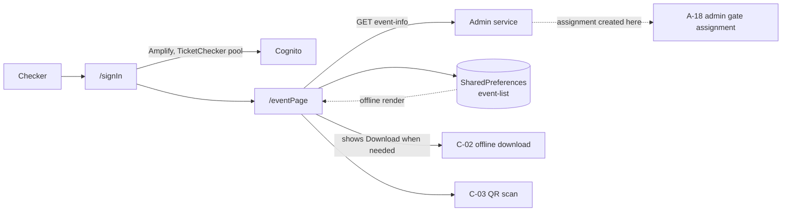

# C-01 · নির্ধারিত ইভেন্ট ও গেট

> **Bangla name:** নির্ধারিত ইভেন্ট ও গেট
>
> [← 40 · চেকার অ্যাপ](README.md) · [সূচিপত্র](../README.md) · [ওপেন কোয়ারি](../99-open-queries.md)

## 1. নাম ও উদ্দেশ্য

**নির্ধারিত ইভেন্ট ও গেট।** সাইন-ইন করার পর একজন চেকার দেখেন তাকে কোন ইভেন্ট ও কোন গেটে নির্ধারণ করা হয়েছে। এই নির্ধারণটি অ্যাডমিন পোর্টাল থেকে তৈরি হয় ([A-18](../10-admin-portal/A-18-gate-assignment.md)); অ্যাপ কেবল সেটি পড়ে। এই স্ক্রিনটি একই সঙ্গে ঠিক করে যে চেকারের এখনো টিকিট ডাউনলোড করার দরকার আছে কি না ([C-02](C-02-offline-ticket-download.md)), এবং এটি অ্যাপের **অফলাইন এন্ট্রি পয়েন্ট** — নির্ধারণটি `SharedPreferences`-এ `event-list` নামে ক্যাশ করা থাকে, তাই নেটওয়ার্ক ছাড়াই তা দেখানো যায়।

## 2. ট্রিগার ও অ্যাক্টর

**TicketChecker** Cognito pool-এর একজন টিকিট চেকার ([X-12](../60-cross-cutting/X-12-checker-login.md))। রুট `/signIn` → `/eventPage`।

## 3. ব্যবসায়িক প্রবাহ

1. চেকার তার চেকার ইউজারনেম ও পাসওয়ার্ড দিয়ে সাইন-ইন করেন।
2. অ্যাপ তার নির্ধারণ লোড করে। একাধিক থাকলে **প্রথম**টি নেওয়া হয় (`eventList.first`)।
3. স্ক্রিনটি ইভেন্টের নাম ও গেটের নাম দেখায়, সঙ্গে একটি **Download tickets** বাটন — যখন ডাউনলোড দরকার।
4. Download বাটনটি দেখানো হয় যখন: এখনো কিছু সেভ করা হয়নি, **অথবা** সেভ করা নির্ধারণের `eventId`/`ticketCheckerGateId` বর্তমানটির থেকে আলাদা, **অথবা** লোকাল ডাটাবেস খালি। এটি কেবল তখনই লুকানো থাকে যখন একই ইভেন্ট ও গেট আগেই ডাউনলোড করা আছে।
5. এখান থেকে চেকার QR স্ক্রিনে যান ([C-03](C-03-qr-scan-validation.md))।

## 4. কারিগরি প্রবাহ

1. **সাইন-ইন** — `signInUser()` (`sign_in_view_model.dart:71`) → `AuthRepositoryImpl` (`:50-77`) **TicketChecker** pool-এর বিপরীতে `awsAmplifyService.login(...)` কল করে; সফল হলে Cognito ইউজারনেম পড়ে (`getCognitoUserName()`, `:22`, `:65`); ব্যর্থ হলে `Cognito Login Failed` লগ করে (`:77`)।
2. **[HTTP + checker bearer] → Admin service:** `GET admin/api/v1/ticket-checker-gate/event-info` (`ticket_api_service_impl.dart:59-62`)।
3. **রেসপন্স ব্যবহারের আগেই ক্যাশ হয়** (`ticket_api_service_impl.dart:44-68`):
   ```dart
   final json = await ticketApiClient.get('admin/api/v1/ticket-checker-gate/event-info');
   await sharedPrefManager.saveValue('event-list', jsonEncode(json));
   ```
   পরবর্তী লঞ্চে ক্যাশ করা JSON আগে পড়ে নেটওয়ার্ক কলের **আগে** ঐচ্ছিক `onGetOfflineData` কলব্যাককে দিয়ে দেওয়া হয় (`:47-56`), যাতে স্ক্রিনটি অফলাইনে রেন্ডার করতে পারে। এরপর অনলাইন রেসপন্স ক্যাশটি ওভাররাইট করে।
4. **দুটি ব্যর্থতার ধরন টাইপড এক্সেপশনে মানচিত্রিত** (`ticket_api_service_impl.dart:29-38`): সার্ভারের মেসেজ `user_disabled_for_this_gate` → `TicketCheckerDisabledException`, এবং `ticket_checker_event_not_found` → `TicketCheckerEventNotFoundException`। এগুলোই সেই দুইভাবে যেভাবে একজন অ্যাডমিন একজন চেকারকে আটকে দিতে পারে: গেটে তাকে ডিজেবল করে, অথবা ইভেন্ট থেকে নির্ধারণ খুলে।
5. নির্বাচিত নির্ধারণটি `saveCurEvent(eventLongId:, ticketCheckerGateId:)` দিয়ে স্থায়ী হয় (`event_page_view_model.dart:171-189`)।
6. `_getDownloadStatus()` (`:97-118`) §3 নোট 4-এর বাটন-নিয়মটি বাস্তবায়ন করে।

## 5. কম্পোনেন্ট

| ধরন | কম্পোনেন্ট |
|---|---|
| ক্লায়েন্ট | `lib/presentation/feature/sign_in/`, `feature/event_page/` (`event_page_view_model.dart`, `screen/`, `widgets/` সহ) |
| ক্লায়েন্ট সার্ভিস | `AuthRepositoryImpl`, `EventRepository`/`VenueRepository` স্তর, `SharedPrefManager` |
| API service | `data/lib/remote/api_service/ticket_api_service/ticket_api_service_impl.dart:40-68` |
| API client | `data/lib/remote/api_client/ticket_api_client.dart` (`Authorization: Bearer <Cognito accessToken>` যোগ করে, `:17-27`) |
| সার্ভিস | **Admin** service (`ticket-checker-gate`) — নির্ধারণটি TicketChecker-এ নয়, Admin-এর টেবিলে থাকে |
| লোকাল | `SharedPreferences` key `event-list`; `EventSharedPrefEntity` |
| টেবিল | Admin-এর টিকিট-চেকার গেট নির্ধারণ টেবিলগুলো (read model) |

## 6. API কন্ট্রাক্ট

| মেথড | পাথ | অথ | অনুরোধ → রেসপন্স |
|---|---|---|---|
| GET | `/admin/api/v1/ticket-checker-gate/event-info` | checker bearer | — → `EventResponseList[]` যেখানে `eventId`, `eventLongId`, `ticketCheckerGateId`, ইভেন্টের নাম, গেটের নাম |

গ্রাহককে দেখানো ত্রুটি: `user_disabled_for_this_gate`, `ticket_checker_event_not_found`।

## 7. ডেটা ও পার্শ্বপ্রতিক্রিয়া

`SharedPreferences` (`event-list` এবং সেভ করা ইভেন্ট/গেট জোড়া)। কোনো `etp` টেবিলে লেখা হয় না — নির্ধারণটি এখানে read-only।

## 8. কোড রেফারেন্স

| কী | কোথায় |
|---|---|
| ইভেন্ট পেজ | `rvl-gobcb-checker-app/lib/presentation/feature/event_page/event_page_view_model.dart:60, 97-118, 171-189` |
| সাইন-ইন | `rvl-gobcb-checker-app/lib/presentation/feature/sign_in/sign_in_view_model.dart:71`; `data/lib/repository/auth_repository_impl.dart:22, 50-77` |
| API service | `rvl-gobcb-checker-app/data/lib/remote/api_service/ticket_api_service/ticket_api_service_impl.dart:40-68` |
| API client | `rvl-gobcb-checker-app/data/lib/remote/api_client/ticket_api_client.dart:17-27` |
| লোকাল ক্যাশ | `rvl-gobcb-checker-app/data/lib/local/shared_preference/shared_pref_manager.dart`, `entity/event_shared_pref_entity.dart` |
| রুট | `rvl-gobcb-checker-app/lib/presentation/navigation/route_path.dart` (`signIn`, `eventPage`) |
| Admin দিক | [A-18](../10-admin-portal/A-18-gate-assignment.md), [A-17](../10-admin-portal/A-17-ticket-checker-users.md) |

## 9. হ্যান্ডওভার নোট

1. **নির্ধারণের এন্ডপয়েন্টটি TicketChecker-এ নয়, Admin service-এ** (`admin/api/v1/…`)। তাই নিজের নির্ধারণ জানতে একজন চেকার Admin চালু থাকার উপর নির্ভরশীল — যা অ্যাপের অফলাইন-কাহিনীর ঠিক উল্টো।
2. **একাধিক নির্ধারণ নীরবে প্রথমটিতে সংক্ষিপ্ত হয়ে যায়** (`eventList.first`, `qr_page_view_model.dart:154` এবং `event_page_view_model.dart:60`)। দুটি ইভেন্টে নির্ধারিত একজন চেকার কেবল প্রথমটিতেই কাজ করতে পারেন, বদলানোর কোনো উপায় নেই `[UNCONFIRMED: Q-66]`। এটি গুরুত্বপূর্ণ কারণ অ্যাডমিন পোর্টাল many-to-many নির্ধারণের অনুমতি দেয় ([A-18](../10-admin-portal/A-18-gate-assignment.md))।
3. **অফলাইন ক্যাশ প্রতিটি লঞ্চে সার্ভার থেকে রিফ্রেশ হয় এবং ক্যাশটি ওভাররাইট করে** (`ticket_api_service_impl.dart:59-67`); নেটওয়ার্ক কল ব্যর্থ হলে এক্সেপশনটি উপরে ওঠে, আর অফলাইন কলব্যাক ততক্ষণে চলে গেছে — তাই স্ক্রিনটি স্টেল ডেটা দেখিয়ে তারপর এরর দিতে পারে।
4. **ডিজেবল করা একজন চেকার `user_disabled_for_this_gate` হিসেবে জানানো হয়**, যা সার্ভারের গেট-লেভেল ডিজেবল ([A-18](../10-admin-portal/A-18-gate-assignment.md)), Cognito-লেভেল ডিজেবল নয়।
5. **সাইন-ইন ব্যর্থতা শুধু লগ করা হয়** (`auth_repository_impl.dart:77`); এটিকে নেটওয়ার্ক এরর থেকে আলাদা বলে ধরে নেওয়ার আগে যাচাই করুন যে ভিউ মডেলটি গ্রাহককে কী দেখায়।
6. **রুট enum-এ এখনো থেকে যাওয়া "movie" নাম আছে** (`route_path.dart`-এ `movieList`, `movieDetails`, `movieSearch`, `movieBookmark`) — এগুলো একটি টেমপ্লেট থেকে এসেছে। `movieList`/`movieDetails`/`movieBookmark`-এর পেছনে কোনো ফিচার ফোল্ডার নেই। এটি মৃত নেভিগেশন কোড, চালু কার্যক্ষমতা নয় `[UNCONFIRMED: Q-67]`।

## 10. কম্পোনেন্ট সম্পর্ক



**নির্ভর করে:** [X-12](../60-cross-cutting/X-12-checker-login.md), [A-17](../10-admin-portal/A-17-ticket-checker-users.md), [A-18](../10-admin-portal/A-18-gate-assignment.md)। **প্রভাব ফেলে:** [C-02](C-02-offline-ticket-download.md), [C-03](C-03-qr-scan-validation.md), [C-05](C-05-ticket-sync.md)।

## 11. ডেভেলপার টেস্ট গাইড

**লোকালভাবে টেস্টযোগ্যতা: API কলের জন্য সম্পূর্ণ**; Cognito pool স্থানীয়ভাবে reachable অথবা seeded থাকতে হবে।

| বিষয় | বিবরণ |
|---|---|
| টেস্ট ডেটা ও অ্যাকাউন্ট | `scripts/Seed-EtpCognitoUsers.ps1` বা `scripts/generate-postman.py` থেকে একটি seeded চেকার অ্যাকাউন্ট (TicketChecker pool); আগে অ্যাডমিন পোর্টাল থেকে সেই চেকারকে একটি ইভেন্ট ও একটি গেটে নির্ধারণ করুন, অথবা `TicketCheckerGates` রো seed করুন |
| ব্রাউজার | একই নির্ধারণ অ্যাডমিন পোর্টালের গেট-নির্ধারণ স্ক্রিনে দেখা যায় (দেখুন [A-18](../10-admin-portal/A-18-gate-assignment.md)) |
| এমুলেটর | অ্যাপ চালান (`scripts/Setup-MobileApps.ps1`); সাইন-ইন করুন; অ্যাপকে `scripts/mobile-gateway.js`-এর মাধ্যমে Admin service-এ পৌঁছাতে হবে। নতুন ইনস্টলে Download বাটনটি আসে এবং ডাউনলোডের পর অদৃশ্য হয় তা নিশ্চিত করুন |
| Postman | `postman/services/etp-admin.postman_collection.json`: "GET /api/v1/ticket-checker-gate/event-info"; `{{access_token_checker}}` সেট করুন |
| Visual Studio ডিবাগ | Admin service-এর `TicketCheckerGateController` ও তার manager; ক্লায়েন্ট: `EventPageViewModel` |
| যাচাই | গেট-নির্ধারণ টেবিলগুলোতে `SELECT`; অ্যাপ ডেটা মুছে API বন্ধ করে পুনরায় লঞ্চ করুন — অফলাইন ক্যাশের পথ দেখতে (নোট 3) |