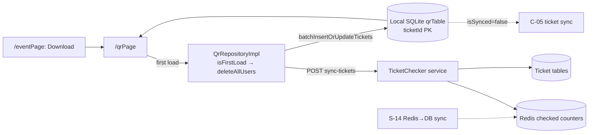

# C-02 · অফলাইন চেকিংয়ের জন্য টিকিট ডাউনলোড

> **Bangla name:** অফলাইন চেকিংয়ের জন্য টিকিট ডাউনলোড
>
> [← 40 · চেকার অ্যাপ](README.md) · [সূচিপত্র](../README.md) · [ওপেন কোয়ারি](../99-open-queries.md)

## 1. নাম ও উদ্দেশ্য

**অফলাইন চেকিংয়ের জন্য টিকিট ডাউনলোড।** গেট খোলার আগে চেকার তার নির্ধারিত ইভেন্টের টিকিট সেট একটি লোকাল SQLite ডাটাবেসে ডাউনলোড করেন। এরপর ফোনটি **একেবারেই নেটওয়ার্ক ছাড়া** QR কোড যাচাই করতে পারে — এটিই এই অ্যাপের পুরো উদ্দেশ্য: ইভেন্টের ভেন্যুতে নিয়মিতই ব্যবহারযোগ্য কানেক্টিভিটি থাকে না। এই ডাউনলোডটিই একই সঙ্গে প্রথম কল, যা লোকাল drift ডাটাবেস পূরণ করে।

## 2. ট্রিগার ও অ্যাক্টর

[C-01](C-01-assigned-event-gate.md)-এ একজন চেকার, যার ইভেন্ট ও গেট জানা আছে। রুট `/eventPage` (Download বাটন) এবং `/qrPage`-এর প্রাথমিক লোড।

## 3. ব্যবসায়িক প্রবাহ

1. চেকার তখনও কানেকশন থাকা অবস্থায় **Download tickets** চাপেন।
2. অ্যাপ সার্ভার থেকে ইভেন্টের সম্পূর্ণ টিকিট সেট তার স্ক্যান করা সংখ্যাসহ চায় এবং প্রতিটি টিকিট লোকাল ডাটাবেসে সংরক্ষণ করে।
3. এরপর স্ক্রিনটি মোট টিকিট সংখ্যা এবং কতগুলো এখনো স্ক্যান হয়নি তা দেখায়।
4. একটি **Delete** বাটন লোকাল ডাটাবেস মুছে ফেলে, যাতে একজন চেকার আবার ডাউনলোড করতে পারেন বা অন্য ইভেন্টে চলে যেতে পারেন।

## 4. কারিগরি প্রবাহ

1. **[HTTP + checker bearer] → TicketChecker service:** `POST ticketchecker/api/v1/tickets/sync-tickets` (`ticket_api_service_impl.dart:24-27`)।
2. **অনুরোধের বডিটি হলো চেকারের স্ক্যান করা টিকিটগুলোর পুরো ম্যাপ**, `{ticketId: 1 | -1}` হিসেবে encode করা — `qr_repository_impl.dart:24-26`:
   ```dart
   final mappedTickets = tickets.map(
     (ticketId, state) => MapEntry(ticketId, state.isManual ? -1 : 1),
   );
   ```
   অর্থাৎ একটি সাধারণ স্ক্যান `1` হিসেবে গোনা হয় আর একটি **ম্যানুয়াল** এন্ট্রি `-1` হিসেবে। `[UNCONFIRMED: Q-68]` — এই sign convention ব্যাকএন্ডে কোথাও নথিভুক্ত নয়; বদলানোর আগে BS23-এর কাছে জিজ্ঞাসা করুন সার্ভারের কাছে `-1` এর অর্থ কী।
3. **এটি একটিই অনুরোধ, কোনো পেজিং নেই এবং কোনো সাইন করা পেলোড নেই।** রেসপন্সটি হলো ইভেন্টের সম্পূর্ণ `{ticketId: checkedNumber}` ম্যাপ; কোনো cursor নেই এবং দ্বিতীয় পেজও নেই `[UNCONFIRMED: Q-69]` — খুব বড় একটি ইভেন্ট একটি খুব বড় রেসপন্স দেবে, আর কোনো chunking নেই।
4. **প্রথম লোড লোকাল ডাটাবেস মুছে ফেলে** — `if (isFirstLoad) qrDao.deleteAllUsers();` (`qr_repository_impl.dart:20`) — তাই ডাউনলোটি সবসময় সার্ভারের বর্তমান সত্য প্রতিফলিত করে।
5. রেসপন্সটি লেখা হয় **`batchInsertOrUpdateTickets`** (`:34`) দিয়ে, একটি upsert — সারি বারি insert নয়।
6. **আবার পড়া** — `getTicketList()` (`:36-54`) প্রতিটি রো লোড করে এবং `Map<String, TicketState>` তৈরি করে:
   | Drift কলাম | Dart টাইপ | অর্থ |
   |---|---|---|
   | `ticketId` | `TextColumn` | primary key |
   | `checkNumber` | `IntColumn` | কতবার স্ক্যান হয়েছে; `0` = এখনো ব্যবহার হয়নি |
   | `isSynced` | `BoolColumn`, ডিফল্ট `false` | স্থানীয়ভাবে বদলেছে, এখনো পাঠানো হয়নি |
   | `isScannedFromOurApp` | `BoolColumn`, ডিফল্ট `false` | এই ফোনে স্ক্যান করা হয়েছে |
   | `isManual` | `BoolColumn`, ডিফল্ট `false` | হাতে টাইপ করা, স্ক্যান করা নয় |
   `TicketState { count, isSynced, isScannedFromOurApp, isManual }` (`:40-46`)।
7. **স্ক্রিনের কাউন্টার** (`qr_page_view_model.dart:166-184`): `_totalTicketNumber` = রো সংখ্যা; `_remainingTickets` = যেসব রোতে `count == 0`; `_scannedTicket` = যেসব রোতে `isScannedFromOurApp` সত্য।
8. **Delete** — `onTapDeleteButton()` (`qr_page_view_model.dart:374-380`) `qrRepository.deleteAllData()` → `deleteAllUsers()` (`qr_dao.dart:59-61`) কল করে, এরপর রিলোড করে পিছনে ফিরে যায়।

## 5. কম্পোনেন্ট

| ধরন | কম্পোনেন্ট |
|---|---|
| ক্লায়েন্ট | `lib/presentation/feature/event_page/`, `feature/qr_page/qr_page_view_model.dart` |
| ক্লায়েন্ট | `data/lib/repository/qr_repository_impl.dart`, `data/lib/remote/api_service/ticket_api_service/` |
| লোকাল DB | SQLite-এর উপর **drift**: `data/lib/local/drift_database/app_database.dart`, `qr_database/qr_table.dart`, `qr_database/qr_dao.dart` (+ জেনারেটেড `.g.dart`) |
| সার্ভিস | TicketChecker (`sync-tickets`) |
| Redis | এন্ডপয়েন্ট যে চেক-করা-টিকিট কাউন্টারগুলো পড়ে, এবং [S-14](../50-system-initiated/S-14-checked-ticket-sync.md) যেগুলো ডাটাবেসে ফ্লাশ করে |
| টেবিল | TicketChecker-এর টিকিট টেবিলগুলো |

## 6. API কন্ট্রাক্ট

| মেথড | পাথ | অথ | অনুরোধ → রেসপন্স |
|---|---|---|---|
| POST | `/ticketchecker/api/v1/tickets/sync-tickets` | checker bearer | `{ "<ticketId>": 1 \| -1 }` → `{ "<ticketId>": <checkedNumber> }` |

ত্রুটি: `user_disabled_for_this_gate`, `ticket_checker_event_not_found` (`ticket_api_service_impl.dart:29-38`)।

নমুনা, দুটি স্ক্যান ও একটি ম্যানুয়াল এন্ট্রির পরের অনুরোধ:

```json
{ "TKT-0000000001": 1, "TKT-0000000002": 1, "TKT-0000000003": -1 }
```

নমুনা, রেসপন্স (একটি অংশ — সার্ভার পুরো ইভেন্টটি ফেরত দেয়):

```json
{ "TKT-0000000001": 1, "TKT-0000000002": 1, "TKT-0000000003": 0, "TKT-0000000004": 0 }
```

## 7. ডেটা ও পার্শ্বপ্রতিক্রিয়া

লোকাল SQLite `qrTable` প্রথম লোডে বদলে যায় এবং এরপর upsert হয়। সার্ভার দিকের পার্শ্বপ্রতিক্রিয়া কেবল অনুরোধে থাকা টিকিটগুলোর কাউন্টার — ডাউনলোডটি নিজে কিছুকে checked হিসেবে চিহ্নিত করে না।

## 8. কোড রেফারেন্স

| কী | কোথায় |
|---|---|
| রিপোজিটরি | `rvl-gobcb-checker-app/data/lib/repository/qr_repository_impl.dart:17-60` |
| টেবিল | `rvl-gobcb-checker-app/data/lib/local/drift_database/qr_database/qr_table.dart:3-12` |
| DAO | `rvl-gobcb-checker-app/data/lib/local/drift_database/qr_database/qr_dao.dart:12-81` |
| ডাটাবেস | `rvl-gobcb-checker-app/data/lib/local/drift_database/app_database.dart` |
| API service | `rvl-gobcb-checker-app/data/lib/remote/api_service/ticket_api_service/ticket_api_service_impl.dart:21-38` |
| কাউন্টার | `rvl-gobcb-checker-app/lib/presentation/feature/qr_page/qr_page_view_model.dart:166-184, 374-380` |
| ডোমেইন মডেল | `rvl-gobcb-checker-app/domain/lib/model/ticket_state.dart` |
| প্যাকেজ | `rvl-gobcb-checker-app/pubspec.yaml` (`drift`, drift-এর মাধ্যমে `sqflite`) |

## 9. হ্যান্ডওভার নোট

1. **ডাউনলোডে কোনো পেজিং নেই** (§4 নোট 3) `[UNCONFIRMED: Q-69]`। ৫০,০০০ টিকিটের একটি স্টেডিয়াম ইভেন্ট একটিমাত্র ৫০,০০০-এন্ট্রি অনুরোধ ও রেসপন্স তৈরি করে; কোনো chunking নেই এবং একটি সাধারণ loading ফ্ল্যাগ ছাড়া অগ্রগতির কোনো রিপোর্টিং নেই।
2. **`-1` ম্যানুয়াল convention নথিভুক্ত নয়** `[UNCONFIRMED: Q-68]`; এটিই wire-এ ম্যানুয়াল এন্ট্রি আলাদা করার একমাত্র জায়গা।
3. **`isFirstLoad` লোকাল ডাটাবেস মুছে ফেলে** (`:20`), তাই অর্ধেক ব্যর্থ হয়ে থাকা প্রথম লোড চেকারকে আংশিক সেট রেখে দেয় এবং বোঝার কোনো উপায় থাকে না — UI-এর `_isDatabaseEmpty` চেক ([C-01](C-01-assigned-event-gate.md) নোট 4) তবুও রো দেখতে পাবে।
4. **লোকাল সেট প্রতি ইভেন্টের জন্য, প্রতি গেটের জন্য নয়**, কিন্তু `getTicketList()` টেবিলের সবকিছু ফেরত দেয়। তাই সঠিকতা নির্ভর করে ডাউনলোডটি আগের ইভেন্টের রো মুছে ফেলেছে বলে।
5. **`checkNumber` একটি `IntColumn` এবং `0` মানে অব্যবহৃত**, তাই একটি টিকিট "কখনো স্ক্যান হয়নি" আর "অজানা সংখ্যকবার স্ক্যান হয়েছে" — এই দুটির পার্থক্য করতে পারে না; প্ল্যাটফর্মের কাছে কেবল শূন্য/শূন্য-নয় এই পার্থক্যটিই প্রয়োজন।
6. **স্টোরেজ-সাইজের কোনো গার্ড নেই**: বড় ডাউনলোডের আগে ফাঁকা জায়গা যাচাই করে এমন কিছুই নেই `[UNCONFIRMED: Q-69]`।
7. **drift ডাটাবেসের কোনো দৃশ্যমান migration কাহিনি নেই** — `app_database.dart` এবং জেনারেটেড `.g.dart` ফাইল, কিন্তু কোনো `migration` ধাপ নেই, তাই আগে থেকেই ইনস্টল করা অ্যাপে স্কিমা বদলালে স্পষ্ট ব্যবস্থা নিতে হবে `[UNCONFIRMED: Q-70]`।

## 10. কম্পোনেন্ট সম্পর্ক



**নির্ভর করে:** [C-01](C-01-assigned-event-gate.md) (ইভেন্ট ও গেট), [A-19](../10-admin-portal/A-19-gate-reports.md) (যে রিপোর্টগুলো এই কাউন্টারগুলোর উপর নির্ভরশীল)। **প্রভাব ফেলে:** [C-03](C-03-qr-scan-validation.md), [C-04](C-04-manual-entry.md), [C-05](C-05-ticket-sync.md)।

## 11. ডেভেলপার টেস্ট গাইড

**লোকালভাবে টেস্টযোগ্যতা: সম্পূর্ণ।** সবকিছু লোকাল TicketChecker service এবং একটি লোকাল SQLite ফাইলের বিপরীতে চলে।

| বিষয় | বিবরণ |
|---|---|
| টেস্ট ডেটা ও অ্যাকাউন্ট | একটি ইভেন্টে নির্ধারিত একজন চেকার ([C-01](C-01-assigned-event-gate.md)); `scripts/seed/*.sql` থেকে সেই ইভেন্টের বিক্রীত টিকিট seed করুন |
| ব্রাউজার | সমতুল্য কাউন্টারগুলো অ্যাডমিন পোর্টালের গেট রিপোর্টে দেখা যায় (দেখুন [A-19](../10-admin-portal/A-19-gate-reports.md)) |
| এমুলেটর | অ্যাপ চালান, **Download tickets** চাপুন, তারপর লগে `POST ticketchecker/api/v1/tickets/sync-tickets` দেখুন; এরপর QR স্ক্রিন মোট ও বাকি সংখ্যা দেখায় |
| Postman | `postman/services/etp-ticketchecker.postman_collection.json`: "POST /api/v1/tickets/sync-tickets"; `{{access_token_checker}}` সেট করুন |
| Visual Studio ডিবাগ | TicketChecker service-এর `TicketCheckerController` sync অ্যাকশন; ক্লায়েন্ট: `QrRepositoryImpl.getTicketFromServer` |
| যাচাই | অ্যাপের SQLite ফাইলে `SELECT * FROM qrTable`; এন্ডপয়েন্টের পিছনের Redis কাউন্টার; TicketChecker-এর টেবিলে টিকিটের রো |