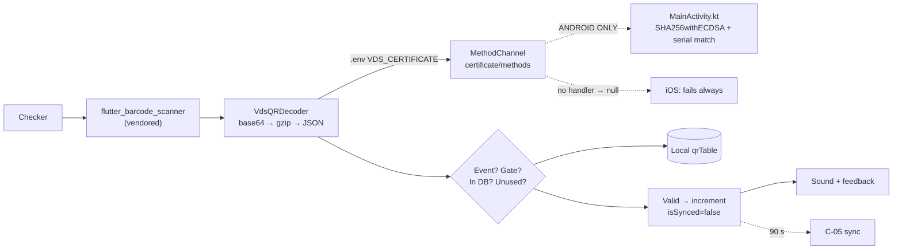

# C-03 · QR স্ক্যান যাচাই

> **Bangla name:** QR স্ক্যান যাচাই
>
> [← 40 · চেকার অ্যাপ](README.md) · [সূচিপত্র](../README.md) · [ওপেন কোয়ারি](../99-open-queries.md)

## 1. নাম ও উদ্দেশ্য

**QR স্ক্যান যাচাই।** পুরো ইভেন্ট জুড়ে একজন চেকার এই স্ক্রিনেই থাকেন। এটি একটি টিকিটের QR কোড স্ক্যান করে, **VDS ডিজিটাল সিগনেচার** যাচাই করে যাতে টিকিটটি আসল, দেখায় যে টিকিটটি এই ইভেন্ট ও এই গেটের, এবং দেখায় যে এটি এখনো ব্যবহার করা হয়নি। এর সবকিছুই **অফলাইনে** কাজ করে, [C-02](C-02-offline-ticket-download.md)-এ ডাউনলোড করা ডাটাবেস থেকে। প্রতিটি ফলাফল স্ক্রিনে দেখানো হয় এবং আলাদা আলাদা শব্দে জানানো হয়।

## 2. ট্রিগার ও অ্যাক্টর

গেটে একজন চেকার, রুট `/qrPage`।

## 3. ব্যবসায়িক প্রবাহ

1. চেকার স্ক্যানে চাপেন; ক্যামেরা খোলে; একটি QR কোড পড়া হয়।
2. অ্যাপ সিগনেচার এবং ইভেন্ট/গেটের মিল যাচাই করে।
3. ফলাফল এর যেকোনো একটি: **valid**, **already checked**, **wrong event**, **wrong gate**, **invalid ticket**, **incorrect QR**, অথবা একটি **অফলাইনে কেনা** টিকিটের জন্য নিশ্চিতকরণ ডায়ালগ।
4. সফল হলে টিকিটটি স্থানীয়ভাবে ব্যবহৃত হিসেবে চিহ্নিত হয়, বাকি সংখ্যা কমে যায় এবং একটি শব্দ বাজে।
5. চেকার পরের টিকিট স্ক্যান করতে চাপেন।

## 4. কারিগরি প্রবাহ

1. **স্ক্যানিং** — `scanBarcode()` (`qr_page_view_model.dart:232-242`) `FlutterBarcodeScanner.scanBarcode('#FF0000', 'Cancel', true, ScanMode.QR)` কল করে। প্যাকেজটি একটি **vendored path dependency** (`pubspec.yaml`: `flutter_barcode_scanner: path: flutter_barcode_scanner`), `mobile_scanner` বা `qr_code_scanner` **নয়**। ক্যান্সেল করলে স্ট্রিং `'-1'` ফেরত আসে, যা উপেক্ষা করা হয় (`:238`)।
2. **যাচাই** — `onQRCodeDetected` (`:244-251`) `certificateRepository.getQRObjects(qrCodeString: detectedCode)` কল করে, যা আসলে `VdsQRDecoder.verifyQrData` (`data/lib/service/vds_qr_decoder.dart:35-65`):
   - QR স্ট্রিংটি **base64-decode** হয়; প্রথম দুটি বাইট `0x1F 0x8B` হলে এটি **gzip-decompress** হয় (`_isCompressed`, `:67-71`; `GZipDecoder`, `:73-76`);
   - ফলাফল হলো চারটি ফিল্ডসহ JSON: `payload`, `signature`, `certSN`, `issuerDN` (`:19-22`);
   - `payload` নিজেই base64 এবং UTF-8 হিসেবে decode হয় (`:24-27`);
   - সার্টিফিকেট আসে **`.env` key `VDS_CERTIFICATE`** থেকে (`:40`) এবং **method channel `certificate/methods`** দিয়ে `platform.invokeMethod('verifyCertificate', …)`-এ প্ল্যাটফর্মে দেওয়া হয় (`:9, 43-51`);
   - payload কেবল তখনই ফেরত দেওয়া হয় যখন `verifiedData['verificationStatus'] == 'true'` (`:58-60`), নয়তো `null`।
3. **ক্রিপ্টো Android দিকে** — `MainActivity.kt`:
   ```kotlin
   private val CHANNEL = "certificate/methods"
   Security.removeProvider("BC"); Security.addProvider(BouncyCastleProvider())
   ...
   val verifier = Signature.getInstance("SHA256withECDSA", "BC")
   verifier.initVerify(certificate.publicKey)
   verifier.update(payloadRawBytes)
   val isValid = verifier.verify(signatureBytes)
   val serialNumber = certificate.serialNumber.toString(16).lowercase()
   ```
   (`MainActivity.kt:16, 21-22, 52-72`)। তাই অ্যালগরিদম **`SHA256withECDSA` BouncyCastle-এর মাধ্যমে**, RSA-SHA1 নয়, এবং `verificationStatus`-এ **দুটি** শর্ত আছে: সিগনেচার যাচাই হতে হবে **এবং** সার্টিফিকেটের সিরিয়াল নম্বর QR-এর `certSN`-এর সমান হতে হবে (`:64-72`)। ফলাফল ম্যাপে `serialNumber`, `issuer`, `signatureValid` ও `isSerialNumberMatch`-ও থাকে।
4. **ব্যবসায়িক চেকগুলো** — `_getTicketStatus` (`:282-344`), payload থেকে হুবহু স্ট্রিং মিলিয়ে তিনটি লেবেল পড়ে:
   | লেবেল | কী জন্য ব্যবহৃত |
   |---|---|
   | `Event ID` | `_eventLongId`-এর সমান হতে হবে → নয়তো `WrongEventQrCheckState` (`:293-297`) |
   | `Entry Gate` | `_entryGate`-এর সমান হতে হবে → নয়তো `WrongGateQrCheckState(entryGate)` (`:299-303`) |
   | `Ticket ID` | লোকাল ম্যাপে খোঁজা হয় (`:305`) |
   প্রতিটি `.where((e) => e.label == "…").toList().single.value` দিয়ে আনা হয়, তাই কোনো লেবেল অনুপস্থিত payload একটি বন্ধুতমূলক মেসেজের বদলে **throw** করে `[UNCONFIRMED: Q-71]`।
5. এরপর এই ক্রমে: টিকিট লোকাল ম্যাপে নেই → `WrongEventQrCheckState` (`:311-314`); `ticketState.count > 0` → `AlreadyCheckedQrCheckState` (`:316-320`)।
6. **অফলাইনে কেনা টিকিট একটি নিশ্চিতকরণ ডায়ালগ পায়** (`:322-341`): "This ticket was purchased offline. Does the ticket credential include a physical ticket?" — নিশ্চিত করলে সেটি ব্যবহৃত হিসেবে চিহ্নিত হয় এবং valid জানানো হয়; ক্যান্সেল করলে `null` জানানো হয়, যা `_setNewStateInQrStatus` "কিছুই দেখাও না" হিসেবে বোঝে (`:255-257`)।
7. **অন্যথায়** `_updateTicketStatus(ticketId)` (`:342-343`) কাউন্ট বাড়ায়, `isScannedFromOurApp: true`, `isSynced: false` সেট করে এবং লোকাল ডাটাবেসে লেখে (`:347-372`)।
8. **শব্দ** — `_playSound(state)` (`:275-280`) বর্তমান প্লেয়ার বন্ধ করে `audioplayers`-এর মাধ্যমে `qrCheckStatus.soundAsset` বাজায়, এরপর `qrCheckStatus.playFeedback()`; স্ক্যানারও ভাইব্রেশন/haptics-এর জন্য `qrCheckStatus.playFeedback()` কল করে (`_getTicketStatus`, `:211-225`)।

## 5. কম্পোনেন্ট

| ধরন | কম্পোনেন্ট |
|---|---|
| ক্লায়েন্ট | `lib/presentation/feature/qr_page/qr_page_view_model.dart`, `screen/`, `widgets/` |
| ক্লায়েন্ট | `data/lib/service/vds_qr_decoder.dart`, `data/lib/repository/certificate_repository_impl.dart` |
| ক্লায়েন্ট | `domain/lib/repository/certificate_repository.dart` |
| Android | `android/app/src/main/kotlin/com/mahfuznow/hello_flutter/MainActivity.kt` (BouncyCastle ECDSA যাচাই) |
| লোকাল DB | drift `qrTable` ([C-02](C-02-offline-ticket-download.md)) |
| Env | `.env` key **`VDS_CERTIFICATE`** (যে PEM সার্টিফিকেটের বিপরীতে সিগনেচার যাচাই হয়) |
| সার্ভিস | স্ক্যানের সময় কোনোটিই নয় — যাচাই সম্পূর্ণ স্থানীয় |

## 6. API কন্ট্রাক্ট

**কোনোটি নয়।** একটি স্ক্যান কোনো HTTP কল করে না। এটিই এই অ্যাপের মূল কথা। পরবর্তী সার্ভার যোগাযোগ হলো [C-05](C-05-ticket-sync.md)-এর ৯০-সেকেন্ডের sync।

## 7. ডেটা ও পার্শ্বপ্রতিক্রিয়া

প্রতি সফল স্ক্যানে একটি লোকাল রো আপডেট হয় (`checkNumber + 1`, `isScannedFromOurApp = true`, `isSynced = false`)। টিকিটের PDF কখনো ডাউনলোড হয় না এবং QR কখনো সার্ভারের বিপরীতে পুনরায় যাচাই হয় না।

## 8. কোড রেফারেন্স

| কী | কোথায় |
|---|---|
| স্ক্যান + যাচাই | `rvl-gobcb-checker-app/lib/presentation/feature/qr_page/qr_page_view_model.dart:232-372` |
| VDS ডিকোডার | `rvl-gobcb-checker-app/data/lib/service/vds_qr_decoder.dart:8-77` |
| সার্টিফিকেট রিপোজিটরি | `rvl-gobcb-checker-app/data/lib/repository/certificate_repository_impl.dart:1-5` |
| Android ক্রিপ্টো | `rvl-gobcb-checker-app/android/app/src/main/kotlin/com/mahfuznow/hello_flutter/MainActivity.kt:16, 21-22, 26-51, 52-79` |
| iOS (চ্যানেল অনুপস্থিত) | `rvl-gobcb-checker-app/ios/Runner/AppDelegate.swift:1-13` |
| Vendored স্ক্যানার | `rvl-gobcb-checker-app/flutter_barcode_scanner/`, `pubspec.yaml` |
| প্যাকেজ | `rvl-gobcb-checker-app/pubspec.yaml` (`audioplayers: 6.5.0`, `permission_handler: 12.0.1`, `archive`) |
| DI | `rvl-gobcb-checker-app/data/lib/di/data_module.dart:126, 161` |
| Admin দিক | [A-13](../10-admin-portal/A-13-ticket-layouts.md) (QR-এর অবস্থান কোথায় ঠিক হয়), [S-08](../50-system-initiated/S-08-ticket-signing.md) (সিগনেচার কোথায় তৈরি হয়) |

## 9. হ্যান্ডওভার নোট

1. **iOS কোনো QR কোডই যাচাই করতে পারে না।** `AppDelegate.swift` (`:1-13`) কেবল প্লাগইন রেজিস্টার করে — এর **`certificate/methods` হ্যান্ডলার নেই এবং Swift বাস্তবায়নও একেবারেই নেই**। তাই iOS-এ প্রতিটি `verifyQrData` কল throw করে, `vds_qr_decoder.dart:61-63`-এ ধরা পড়ে, `null` ফেরত দেয় এবং প্রতিটি টিকিট `IncorrectQrCheckState` হিসেবে জানানো হয়। এটি প্ল্যানে নথিভুক্ত "iOS QR channel gap"; এটি **barcode-scanner-এর সীমাবদ্ধতা নয়**, কারণ স্ক্যানারটি নিজে iOS-এ পুরোপুরি বাস্তবায়িত `[UNCONFIRMED: Q-72]`। তাই Swift `verifyCertificate` লেখা আগ পর্যন্ত চেকার অ্যাপ **আসল যাচাইয়ের জন্য Android-মাত্র**।
2. **ট্রাস্ট অ্যাংকর হলো `.env`-এ একটি একক PEM সার্টিফিকেট** (`:40`)। VDS সার্টিফিকেট রোটেট বা যোগ করা মানে অ্যাপ পুনরায় রিলিজ; আগের সার্টিফিকেটে সাইন করা যেকোনো টিকিট ব্যর্থ হবে `[UNCONFIRMED: Q-73]`।
3. **`SHA256withECDSA`, RSA-SHA1 নয়** (§4 নোট 3) — CloudFront-এর `CloudfrontTicketValidator` / RSA-SHA1 / signed-cookie মেকানিজমটি **অ্যাডমিন পোর্টালের** S3 ডাউনলোড সুরক্ষার অংশ ([X-20](../60-cross-cutting/X-20-file-storage.md)) এবং এই যাচাইয়ের সঙ্গে কোনো সম্পর্ক নেই। চেকার কখনো S3 পড়ে না এবং কখনো signed cookie দেখে না।
4. **ডুপ্লিকেট স্ক্যান শুধু স্থানীয়ভাবে শনাক্ত হয়**, `count > 0` দিয়ে। একই গেটে একই ডাউনলোড নিয়ে দুটি ডিভাইস একই টিকিট গ্রহণ করতে পারে; সার্ভারকে পরে জানানো হয় [C-05](C-05-ticket-sync.md) দিয়ে `[UNCONFIRMED: Q-74]`।
5. **অনুপস্থিত লেবেল throw করে** (§4 নোট 4) `[UNCONFIRMED: Q-71]`: `.toList().single` শূন্য বা একাধিক মিলে ত্রুটি দেয়, তাই ত্রুটিপূর্ণ বা তৃতীয়-পক্ষের QR একটি অ-ব্যবহৃত এক্সেপশন তৈরি করে, "incorrect QR" মেসেজ নয়।
6. **গেট মিলিয়ে দেখা হয় `Entry Gate` লেবেলকে লোকাল `_entryGate`-এর বিপরীতে**, যা এসেছে নির্ধারণ থেকে ([C-01](C-01-assigned-event-gate.md))। নির্ধারণ স্টেল হলে প্রতিটি টিকিট ভুল গেট হিসেবে জানানো হবে — এবং [C-01](C-01-assigned-event-gate.md)-এর নোট 2 (শুধু প্রথম নির্ধারণ) ভুল গেটে পড়া সহজ করে তোলে।
7. **gzip শনাক্তকরণ ২-বাইটের magic-number চেক** (`0x1F 0x8B`, `:67-71`) — gzip-এর জন্য সঠিক, আর অন্য কোনো কম্প্রেশন হলে ভুল পার্স হবে।
8. **`verifyQrData`-এর ভেতরের ত্রুটি `debugPrint` দিয়ে গিলে ফেলা হয়** (`:61-63`), তাই একটি সার্টিফিকেট সমস্যা আর একটি খারাপ QR চেকারের কাছে পার্থক্যহীন।
9. **`_playSound` প্রতিটি state-এর জন্য আলাদা asset বাজায়** (`qrCheckStatus.soundAsset`), যা একজন চেকারকে কানে শুনেই কাজ করতে দেয় — যেকোনো পুনর্নকাপনে এটি রক্ষা করা উচিত।
10. **অফলাইনে কেনা টিকিটের জন্য নিশ্চিতকরণ ডায়ালগটি আছে কারণ সেসব টিকিট কাগজেও থাকতে পারে**; ক্যান্সেল করলে কিছুই জানানো হয় না, অর্থাৎ ভুল করে করা স্ক্যানের কোনো চিহ্ন রাখে না।

## 10. কম্পোনেন্ট সম্পর্ক



**নির্ভর করে:** [C-02](C-02-offline-ticket-download.md) (লোকাল টিকিট সেট), [C-01](C-01-assigned-event-gate.md) (ইভেন্ট ও গেট), [S-08](../50-system-initiated/S-08-ticket-signing.md) এবং [A-13](../10-admin-portal/A-13-ticket-layouts.md) (কীভাবে স্ক্যানযোগ্য ও সঠিক অবস্থানে থাকা QR তৈরি হয়)। **প্রভাব ফেলে:** [C-05](C-05-ticket-sync.md), [A-19](../10-admin-portal/A-19-gate-reports.md)।

## 11. ডেভেলপার টেস্ট গাইড

**লোকালভাবে টেস্টযোগ্যতা: Android-এ সম্পূর্ণ; iOS-এ লোকালভাবে নয়** (নোট 1 — টেস্ট করার মতো কোনো iOS বাস্তবায়নই নেই)।

| বিষয় | বিবরণ |
|---|---|
| টেস্ট ডেটা ও অ্যাকাউন্ট | একজন চেকার, যার ডাউনলোড করা ইভেন্টে অন্তত একটি সাইন করা টিকিট আছে ([C-02](C-02-offline-ticket-download.md)); সাইন করা QR একটি seeded টিকিট PDF থেকে নেওয়া যায় |
| ব্রাউজার | প্রযোজ্য নয় |
| এমুলেটর | একটি Android ডিভাইসে চালান (এমুলেটরের ক্যামেরা ব্যবহার করা কঠিন হতে পারে — একটি QR ছবি ফিড করা সহজ); প্রতিটি ফলাফল টেস্ট করুন: valid, একই টিকিট আবার স্ক্যান, অন্য ইভেন্টের টিকিট স্ক্যান, ভুল গেটে স্ক্যান; নোট 5-এর জন্য `Event ID` লেবেল অনুপস্থিত একটি base64 blob ফিড করুন |
| Postman | কোনো এন্ডপয়েন্ট জড়িত নয় — লোকাল সেট নিশ্চিত করতে কেবল `sync-tickets` নিন |
| Visual Studio ডিবাগ | `VdsQRDecoder.verifyQrData`; `MainActivity.kt:52` `verifyCertificate`; `QrPageViewModel._getTicketStatus` |
| যাচাই | স্ক্যানের পরে `SELECT * FROM qrTable WHERE "isSynced" = 0`; লগে `verificationStatus` ম্যাপ; অন্য সার্টিফিকেটে সাইন করা একটি টিকিট `null` ফেরত দেওয়ার কথা (নোট 2) |