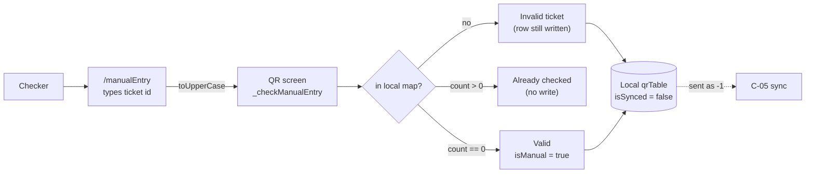

# C-04 · ম্যানুয়াল এন্ট্রি

> **Bangla name:** ম্যানুয়াল এন্ট্রি
>
> [← 40 · চেকার অ্যাপ](README.md) · [সূচিপত্র](../README.md) · [ওপেন কোয়ারি](../99-open-queries.md)

## 1. নাম ও উদ্দেশ্য

**ম্যানুয়াল এন্ট্রি।** টিকিট স্ক্যান না হলে যে পথটি বাকি থাকে: ক্ষতিগ্রস্ত প্রিন্ট, মাসলা-পড়া QR, কিংবা গ্রাহক সংখ্যাটি পড়ে শোনাচ্ছেন। চেকার টিকিট আইডিটি টাইপ করেন এবং অ্যাপ স্ক্যানারের মতোই একই "এই টিকিট কি আমার সেটে আছে এবং এখনো অব্যবহৃত?" পরীক্ষা প্রয়োগ করে — তবে **সিগনেচার যাচাই ছাড়া**, কারণ যাচাই করার মতো কিছুই নেই। এই পার্থক্যটিই হ্যান্ডওভারের গুরুত্বপূর্ণ বিষয়: একটি ম্যানুয়াল এন্ট্রি একটি মানবিক দাবি, ক্রিপ্টোগ্রাফিক দাবি নয়।

## 2. ট্রিগার ও অ্যাক্টর

QR স্ক্রিনে ([C-03](C-03-qr-scan-validation.md)) থাকা একজন চেকার, ম্যানুয়াল-এন্ট্রি আইকনের মাধ্যমে। রুট `/manualEntry`।

## 3. ব্যবসায়িক প্রবাহ

1. চেকার QR স্ক্রিনে ম্যানুয়াল-এন্ট্রি আইকনে চাপেন এবং টিকিট আইডি টাইপ করেন।
2. আইডিটি বড় হাতের অক্ষরে রূপান্তর করে QR স্ক্রিনে ফেরত পাঠানো হয়, যা সেটিকে লোকাল ম্যাপে খোঁজে।
3. তিনটি ফলাফল: **আমার সেটে নেই** → invalid ticket; **আগেই চেক করা হয়েছে** (`count > 0`) → already checked; অন্যথায় → **valid**, বাকি সংখ্যা কমে যায় এবং টিকিটটি ব্যবহৃত হিসেবে চিহ্নিত হয়।

## 4. কারিগরি প্রবাহ

1. `onTapManualEntryIcon()` (`qr_page_view_model.dart:187-196`) একটি কলব্যাক নিয়ে `ManualEntryRoute`-এ নেভিগেট করে।
2. `ManualEntryViewModel.onClickSubmit(ticketId)` (`manual_entry_view_model.dart:26-32`) **প্রথমে স্ক্রিনটি pop করে** এবং তারপর কলব্যাক কল করে:
   ```dart
   navigateBack();
   argument?.onReceivedTicketId(ticketId.toUpperCase());
   ```
3. **ইনপুটটি খোঁজার আগেই বড় হাতের অক্ষরে রূপান্তর হয়** (`:32`), তাই ইনপুটকে ফোল্ড করার মাধ্যমে টিকিট আইডি case-insensitively তুলনা হয় — সেভ করা মানগুলো নিচু হাতের অক্ষরে রূপান্তর করা হয় না।
4. `_checkManualEntry({required String ticketId})` (`qr_page_view_model.dart:198-231`):
   - `_allTicketList[ticketId] == null` → `_updateTicketStatus(ticketId: ticketId, isManual: true)`, তারপর একটি শব্দসহ `InvalidTicket()` (`:200-208`)। **রোটি তবুও লেখা হয়** যদিও টিকিটটি অজানা — ডাউনলোডে কখনোই না থাকা এমন টিকিটে ম্যানুয়াল চেষ্টা কীভাবে পরে সার্ভারে পৌঁছায়, সেটাই এর ফলে;
   - `ticketState.count > 0` → একটি শব্দসহ `AlreadyCheckedTicket()`, এবং **ইচ্ছাকৃতভাবে কোনো লেখা নেই** — কোডে এর টীকা দেওয়া আছে: "If we know this ticket is already checked, we don't need to send it to backend" (`:210-220`);
   - অন্যথায় → `_remainingTickets` কমানো, `_updateTicketStatus(ticketId: ticketId, isManual: true)`, তারপর একটি শব্দসহ `ValidTicket()` (`:222-230`)।
5. `_updateTicketStatus` লেখে `isManual: true` এবং `isSynced: false` (`:347-372`), যা [C-05](C-05-ticket-sync.md)-কে এটিকে `-1` হিসেবে পাঠাতে দেয়।
6. `checkTextFieldText` (`manual_entry_view_model.dart:22-24`) চেকার টাইপ করার সঙ্গে সঙ্গে `_manualEntryState.value.validateTicketId(text)` কল করে।

## 5. কম্পোনেন্ট

| ধরন | কম্পোনেন্ট |
|---|---|
| ক্লায়েন্ট | `lib/presentation/feature/manual_entry/manual_entry_view_model.dart` + স্ক্রিন |
| ক্লায়েন্ট | `lib/presentation/feature/qr_page/qr_page_view_model.dart:187-231` |
| লোকাল DB | drift `qrTable` ([C-02](C-02-offline-ticket-download.md)) |
| সার্ভিস | এন্ট্রির সময় কোনোটিই নয় — শুধু স্থানীয় |

## 6. API কন্ট্রাক্ট

**কোনোটি নয়।** একটি ম্যানুয়াল এন্ট্রি কোনো HTTP কল করে না; এটি পরে [C-05](C-05-ticket-sync.md) দিয়ে সিঙ্ক হয়।

## 7. ডেটা ও পার্শ্বপ্রতিক্রিয়া

প্রতি ম্যানুয়াল চেষ্টায় একটি লোকাল রো: `checkNumber + 1`, `isScannedFromOurApp = true`, **`isManual = true`**, `isSynced = false`। অজানা টিকিট আইডির ক্ষেত্রে একটি **নতুন রো তৈরি হয়** (`:200-208`), তাই লোকাল টেবিল এমন আইডিতে বড় হতে পারে যেগুলো কখনোই ইভেন্টে ছিল না।

## 8. কোড রেফারেন্স

| কী | কোথায় |
|---|---|
| ম্যানুয়াল এন্ট্রি ভিউ মডেল | `rvl-gobcb-checker-app/lib/presentation/feature/manual_entry/manual_entry_view_model.dart:22-32` |
| এন্ট্রি চেক | `rvl-gobcb-checker-app/lib/presentation/feature/qr_page/qr_page_view_model.dart:187-231` |
| স্ট্যাটাস লেখা | `rvl-gobcb-checker-app/lib/presentation/feature/qr_page/qr_page_view_model.dart:347-372` |
| wire-এ ম্যানুয়াল এনকোডিং | `rvl-gobcb-checker-app/data/lib/repository/qr_repository_impl.dart:24-26` |
| রুট | `rvl-gobcb-checker-app/lib/presentation/navigation/route_path.dart` (`manualEntry`) |
| Admin দিক | [A-11](../10-admin-portal/A-11-seat-reservation.md), [X-13](../60-cross-cutting/X-13-agent-pool.md) (এজেন্টের অফলাইন-বিক্রীত টিকিটের প্রবাহ — অফলাইন টিকিটগুলোর অস্তিত্বই এর ফল) |

## 9. হ্যান্ডওভার নোট

1. **একটি ম্যানুয়াল এন্ট্রি VDS সিগনেচার যাচাই সম্পূর্ণভাবে এড়িয়ে যায়।** সিগনেচারের পথ কেবল `onQRCodeDetected`-এ ([C-03](C-03-qr-scan-validation.md)); ম্যানুয়াল এন্ট্রি সরাসরি লোকাল ম্যাপের খোঁজায় যায়। তাই একজন চেকার ডাউনলোড করা সেটে থাকা যেকোনো টিকিট আইডি গ্রহণ করতে পারেন, প্রিন্ট করা হোক বা না হোক `[UNCONFIRMED: Q-75]`।
2. **অজানা টিকিট আইডিও লোকাল ডাটাবেসে লেখা হয়** (§4 নোট 4), তাই একটি টাইপিং ভুল নতুন রো হয়ে যায়, যা পরে এমন একটি টিকিটের জন্য `-1` ম্যানুয়াল চেক হিসেবে সার্ভারে জানানো হয় যেটি আসলে নেই `[UNCONFIRMED: Q-75]`।
3. **দৈর্ঘ্য যাচাইটি কমেন্ট করা আছে** (`manual_entry_view_model.dart:27-30` — `if (ticketId.length < 13)` ব্লকটি কমেন্ট করা), তাই ফিল্ডটি যেকোনো কিছু গ্রহণ করে; একমাত্র দ্বার হলো স্ট্রিংটি লোকাল ম্যাপে আছে কি না।
4. **শুধু ইনপুটটি বড় হাতের অক্ষরে রূপান্তর হয়**, তাই ছাপা টিকিটে থাকা নিচু হাতের অক্ষরের আইডি মিশ্র-কেস সেভ করা মানের সঙ্গে মিলবে, কিন্তু সেভ করা মানগুলো নিজেরা অক্ষত থাকে — case-সম্পর্কিত মিস ডিবাগ করার সময় এই অসমতা মনে রাখার মতো।
5. **খোঁজার আগে স্ক্রিনটি pop হয়**, তাই ফলাফলটি এন্ট্রি স্ক্রিনে নয়, QR স্ক্রিনে দেখা যায়; চেকার দ্রুত পিছনে ফিরে গেলে তিনি ফলাফলটি মিস করতে পারেন।
6. **সার্ভারে ম্যানুয়াল এন্ট্রি আর স্ক্যান কেবল `-1` convention দিয়ে আলাদা** ([Q-68](C-02-offline-ticket-download.md)), তাই sign বিবেচনা না করলে গেট রিপোর্টে দুটি মিশে যায় `[UNCONFIRMED: Q-68]`।

## 10. কম্পোনেন্ট সম্পর্ক



**নির্ভর করে:** [C-02](C-02-offline-ticket-download.md) (লোকাল সেট), [C-03](C-03-qr-scan-validation.md) (যে স্ক্রিন থেকে এটি খোলা হয়)। **প্রভাব ফেলে:** [C-05](C-05-ticket-sync.md), [A-19](../10-admin-portal/A-19-gate-reports.md)।

## 11. ডেভেলপার টেস্ট গাইড

**লোকালভাবে টেস্টযোগ্যতা: সম্পূর্ণ** — কোনো নেটওয়ার্ক জড়িত নয়।

| বিষয় | বিবরণ |
|---|---|
| টেস্ট ডেটা ও অ্যাকাউন্ট | ডাউনলোড করা ইভেন্টসহ একজন চেকার; একটি অব্যবহৃত টিকিট আইডি এবং একটি আগেই স্ক্যান করা টিকিট আইডি |
| ব্রাউজার | প্রযোজ্য নয় |
| এমুলেটর | QR স্ক্রিন খুলুন, ম্যানুয়াল-এন্ট্রি আইকনে চাপুন; একটি বৈধ অব্যবহৃত আইডি টাইপ করুন (Valid আশা করুন), একই আইডি আবার (Already checked আশা করুন), একটি অজানা আইডি (Invalid আশা করুন), এবং একটি নিচু হাতের অক্ষরের বৈধ আইডি (`toUpperCase`-এর কারণে Valid আশা করুন) |
| Postman | কোনো এন্ডপয়েন্ট জড়িত নয় |
| Visual Studio ডিবাগ | `ManualEntryViewModel.onClickSubmit`, `QrPageViewModel._checkManualEntry` |
| যাচাই | `SELECT * FROM qrTable WHERE "isManual" = 1`; এরপর ৯০-সেকেন্ডের sync চালান ([C-05](C-05-ticket-sync.md)) এবং নিশ্চিত করুন সেই রোগুলো `-1` হিসেবে বেরিয়ে যাচ্ছে |