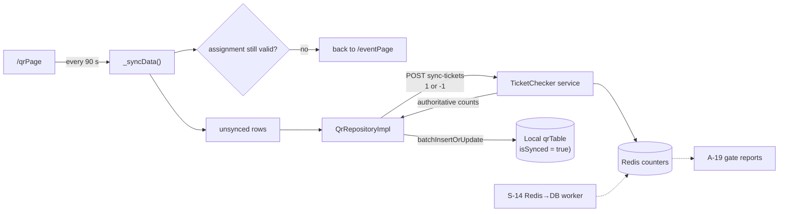

# C-05 · স্ক্যান সিঙ্ক

> **Bangla name:** স্ক্যান সিঙ্ক
>
> [← 40 · চেকার অ্যাপ](README.md) · [সূচিপত্র](../README.md) · [ওপেন কোয়ারি](../99-open-queries.md)

## 1. নাম ও উদ্দেশ্য

**স্ক্যান সিঙ্ক।** চেকারের অফলাইন সিদ্ধান্ত আর প্ল্যাটফর্মের রেকর্ডের মধ্যে সেতু। প্রতি ৯০ সেকেন্ডে অ্যাপ তার করা স্ক্যানগুলো TicketChecker service-এ পাঠায়, সেখান থেকে নির্ধারক (authoritative) কাউন্টার ফেরত নেয়, সেগুলো লোকাল ডাটাবেসে লেখে এবং সেই রোগুলো সিঙ্ক হিসেবে চিহ্নিত করে। এটি আরেকবার যাচাই করে যে চেকারের নির্ধারণ এখনো বৈধ কি না। এই অ্যাপের বাকি সবকিছু অফলাইন; এটিই একমাত্র অংশ যার নেটওয়ার্ক দরকার, আর এটি নেটওয়ার্ক না থাকলে নীরবে নিজেকে সামলাতে ডিজাইন করা।

## 2. ট্রিগার ও অ্যাক্টর

স্বয়ংক্রিয়, QR স্ক্রিনে ([C-03](C-03-qr-scan-validation.md))। রুট `/qrPage`।

## 3. ব্যবসায়িক প্রবাহ

1. QR স্ক্রিন **৯০ সেকেন্ড** থেকে একটি কাউন্ডউন চালায়।
2. সময় শেষ হলে অ্যাপ এখনো সিঙ্ক না হওয়া প্রতিটি স্ক্যান আপলোড করে, কাউন্টারগুলো নেয় এবং শেষ সফল সিঙ্কের সময় রেকর্ড করে।
3. এটি একই সঙ্গে সার্ভারকে জিজ্ঞাসা করে চেকার এখনো এই ইভেন্ট ও গেটে নির্ধারিত আছেন কি না। না থাকলে অ্যাপ চেকারকে আবার ইভেন্ট পেজে পাঠায় এবং স্ক্যানিং বন্ধ করে।
4. নেটওয়ার্ক না থাকলে কাউন্ডউন আবার শুরু হয়, স্ক্যানগুলো অসিঙ্ক হিসেবে চিহ্নিত থাকে এবং কিছুই হারায় না।

## 4. কারিগরি প্রবাহ

1. **ইন্টারভাল** — `static const _refreshInterval = Duration(seconds: 90)` (`qr_page_view_model.dart:22`), সঙ্গে `_remainingTime`, এক সেকেন্ডের `Timer.periodic` (`:86-97`) এবং UI-এর জন্য একটি `_lastSyncTime` মান। `_startTimer()` ভিউ-এর ready path থেকে কল হয় (`:81`)।
2. **`_syncData()`** (`:102-140`):
   - **প্রথমে** `_checkEventValidity()` কল করে (`:103`); এটি ব্যর্থ হলে `isClearBackStack: true` দিয়ে `EventPageRoute`-এ নেভিগেট করে এবং ফিরে যায় (`:105-111`);
   - `_scannedTicket` থেকে `!value.isSynced` ছাঁকিয়ে `notSynced` তৈরি করে (`:113-119`);
   - `loadData(() => qrRepository.getTicketFromServer(tickets: notSynced, isFirstLoad: false), showLoading: false)` (`:121-127`) — **কোনো স্পিনার নেই**, তাই sync চলাকালীন স্ক্যানিং চালু থাকে;
   - `_lastSyncTime.value = DateTime.now().toLocal()` রেকর্ড করে (`:129`);
   - মেমোরির ম্যাপে `notSynced`-এর প্রতিটি এন্ট্রিকে `isSynced: true` চিহ্নিত করে এবং UI রিফ্রেশ করে (`:131-138`)।
3. **[HTTP + checker bearer] → TicketChecker:** `POST ticketchecker/api/v1/tickets/sync-tickets` (`ticket_api_service_impl.dart:24-27`) — [C-02](C-02-offline-ticket-download.md)-এর একই এন্ডপয়েন্ট, যার বডি `qr_repository_impl.dart:24-26` দিয়ে `{ticketId: 1 | -1}` হিসেবে তৈরি হয়।
4. **রেসপন্সটি লোকালে upsert হয়** `batchInsertOrUpdateTickets` দিয়ে (`:34`), এবং তার দৈর্ঘ্য ফেরত দেওয়া হয়।
5. **`_checkEventValidity()`** (`:142-161`) `eventRepository.getTheEvents(onGetOfflineData: …)` কল করে এবং তুলনা করে:
   ```dart
   if (_checkerEvent.eventLongId != _eventLongId ||
       _checkerEvent.ticketCheckerGateId != _ticketCheckerGateId) return false;
   ```
   তাই কোনো অ্যাডমিন চেকারকে নির্ধারণ থেকে খুললে বা সরালে পরবর্তী টিক-এ স্ক্যান লুপ ৯০ সেকেন্ডের মধ্যে থামে। `onGetOfflineData`-এর বডি কার্যত ফাঁকা — এর একমাত্র বাক্য কমেন্ট করা (`:145-148`), তাই এই সিদ্ধান্তের জন্য ক্যাশ করা নির্ধারণ ব্যবহার হয় না।
6. **ব্যর্থতা ধ্বংসাত্মক নয়**: `loadData` ধরে ফেলে, এবং যেহেতু `notSynced`-কে `isSynced: true`-তে ফ্লিপ করা হয় শুধু সফল কলের পরেই (`:131-134`), তাই অপাঠানো স্ক্যান অপাঠানোই থাকে এবং পরবর্তী টিকে আবার চেষ্টা করা হয়। `[UNCONFIRMED: Q-76]` — `_lastSyncTime` `:129`-এ শর্তহীনভাবে সেট হয়, তাই ব্যর্থ সিঙ্কের পরেও এটি এমন সময় দেখাতে পারে যা আসলে কখনো সিঙ্ক হয়নি।
7. সার্ভার দিকে কাউন্টারগুলো থাকে Redis-এ এবং [S-14](../50-system-initiated/S-14-checked-ticket-sync.md) দিয়ে ডাটাবেসে ফ্লাশ করা হয়।

## 5. কম্পোনেন্ট

| ধরন | কম্পোনেন্ট |
|---|---|
| ক্লায়েন্ট | `lib/presentation/feature/qr_page/qr_page_view_model.dart:22, 81-161` |
| ক্লায়েন্ট | `data/lib/repository/qr_repository_impl.dart:17-35` |
| API service | `data/lib/remote/api_service/ticket_api_service/ticket_api_service_impl.dart:21-38` |
| সার্ভিস | TicketChecker (`sync-tickets`), Admin (নির্ধারণ যাচাইয়ের জন্য `event-info`) |
| Redis | এন্ডপয়েন্টের লেখা চেক-করা-টিকিট কাউন্টার |
| কিউ / ওয়ার্কার | [S-14](../50-system-initiated/S-14-checked-ticket-sync.md) Redis → ডাটাবেস সরায় |
| লোকাল DB | drift `qrTable`, `isSynced` কলাম |

## 6. API কন্ট্রাক্ট

| মেথড | পাথ | অথ | অনুরোধ → রেসপন্স |
|---|---|---|---|
| POST | `/ticketchecker/api/v1/tickets/sync-tickets` | checker bearer | অসিঙ্ক রোগুলোর জন্য `{ "<ticketId>": 1 \| -1 }` → `{ "<ticketId>": <checkedNumber> }` |
| GET | `/admin/api/v1/ticket-checker-gate/event-info` | checker bearer | নির্ধারণ যাচাই ([C-01](C-01-assigned-event-gate.md)) |

## 7. ডেটা ও পার্শ্বপ্রতিক্রিয়া

লোকাল: যেসব রোর আপলোড সফল হয় তাদের `isSynced` `true` হয় এবং সার্ভারের কাউন্টারগুলো লোকাল মানের উপরে লেখা হয়। সার্ভার: সিঙ্ক হওয়া টিকিটগুলোর Redis কাউন্টার, যা পরে [S-14](../50-system-initiated/S-14-checked-ticket-sync.md) দিয়ে স্থায়ী হয়। গেট রিপোর্ট ([A-19](../10-admin-portal/A-19-gate-reports.md)) যতটাই সম্পূর্ণ ততটাই এই sync সম্পন্ন।

## 8. কোড রেফারেন্স

| কী | কোথায় |
|---|---|
| ইন্টারভাল ও কাউন্ডউন | `rvl-gobcb-checker-app/lib/presentation/feature/qr_page/qr_page_view_model.dart:22-23, 32, 81-97` |
| সিঙ্ক | `rvl-gobcb-checker-app/lib/presentation/feature/qr_page/qr_page_view_model.dart:102-140` |
| ইভেন্টের বৈধতা | `rvl-gobcb-checker-app/lib/presentation/feature/qr_page/qr_page_view_model.dart:142-161` |
| রিপোজিটরি | `rvl-gobcb-checker-app/data/lib/repository/qr_repository_impl.dart:17-35` |
| API service | `rvl-gobcb-checker-app/data/lib/remote/api_service/ticket_api_service/ticket_api_service_impl.dart:21-38` |
| DAO upsert | `rvl-gobcb-checker-app/data/lib/local/drift_database/qr_database/qr_dao.dart:26-36` |
| সার্ভার ওয়ার্কার | [S-14](../50-system-initiated/S-14-checked-ticket-sync.md) |

## 9. হ্যান্ডওভার নোট

1. **সিঙ্ক ব্যর্থ হলেও "last sync time" আপডেট হয়** (§4 নোট 6) `[UNCONFIRMED: Q-76]`, তাই UI এমন একটি সফল সিঙ্কের দাবি করতে পারে যা কখনো হয়নি। স্ক্যানগুলো নিজেরা নিরাপদ — শুধু প্রদর্শিত সময় মিথ্যা বলে।
2. **কোনো retry backoff নেই এবং কোনো ব্যর্থতার কাউন্টারও নেই**: প্রতি ৯০ সেকেন্ডে অ্যাপ অগ্রাহ্য করেই আবার চেষ্টা করে, যা একটি ভেন্যুর জন্য ঠিক আছে, কিন্তু দীর্ঘ আউটেজ মানে বারবার ব্যর্থ কল। `[UNCONFIRMED: Q-76]`
3. **সিঙ্ক ডাউনলোডের সঙ্গে একই এন্ডপয়েন্ট ভাগ করে** ([C-02](C-02-offline-ticket-download.md)), শুধু `isFirstLoad` দিয়ে আলাদা। তাই সার্ভার পার্থক্য বুঝতে পারে না ডাউনলোড নাকি ধাপে ধাপে সিঙ্ক — এটি একই POST।
4. **নির্ধারণ খোলার সাড়া কার্যকর হতে ৯০ সেকেন্ড লাগতে পারে** (§4 নোট 5), এবং তবু শুধু তখনই যখন অ্যাপের নেটওয়ার্ক আছে। যে চেকার অফলাইনে গেটে নির্ধারণ-বিহীন হয়ে পড়েন তিনি সিগ্যাল ফেরা পর্যন্ত স্ক্যান করতেই থাকেন।
5. **এই যাচাইয়ের জন্য `onGetOfflineData` কার্যত নিষ্ক্রিয়** (`:145-148`, বডি কমেন্ট করা), তাই অফলাইন sync চেষ্টা নির্ধারণ যাচাই করতে পারে না এবং নেটওয়ার্ক কলেই ব্যর্থ হবে।
6. **মেমোরির `_scannedTicket` ম্যাপই "অসিঙ্ক"-এর নির্ধারক উৎস**, এবং এটি `_getTicketList()`-এ (`:166-184`) ডাটাবেস থেকে `isScannedFromOurApp` দিয়ে ছেঁকে পুনর্গঠিত হয়। ওই ফ্ল্যাগ ছাড়া তৈরি কোনো রো কখনোই সিঙ্ক হবে না।
7. **ম্যানুয়াল এন্ট্রি `-1` হিসেবে যায়** ([Q-68](C-02-offline-ticket-download.md)) — সার্ভার একটি নেতিবাচক কাউন্টার কীভাবে একত্র করে তা BS23-এর কাছে যাচাই করুন, তারপরই এ নিয়ে রিপোর্ট করুন।
8. **`isSynced`-এর কোনো মেয়াদ নেই**, যা সার্ভার দিকের সংশ্লিষ্ট ফ্ল্যাগ-ফাইন্ডিংয়ের সঙ্গে মেলে ([Q-17](../50-system-initiated/S-14-checked-ticket-sync.md))।

## 10. কম্পোনেন্ট সম্পর্ক



**নির্ভর করে:** [C-02](C-02-offline-ticket-download.md), [C-03](C-03-qr-scan-validation.md), [C-04](C-04-manual-entry.md)। **প্রভাব ফেলে:** [S-14](../50-system-initiated/S-14-checked-ticket-sync.md), [A-19](../10-admin-portal/A-19-gate-reports.md)।

## 11. ডেভেলপার টেস্ট গাইড

**লোকালভাবে টেস্টযোগ্যতা: সম্পূর্ণ।**

| বিষয় | বিবরণ |
|---|---|
| টেস্ট ডেটা ও অ্যাকাউন্ট | ডাউনলোড করা ইভেন্টসহ একজন চেকার এবং অন্তত একটি অপেক্ষমাণ স্ক্যান ([C-02](C-02-offline-ticket-download.md)) |
| ব্রাউজার | প্রযোজ্য নয় |
| এমুলেটর | অ্যাপ চালান, একটি টিকিট স্ক্যান করুন, তারপর ৯০-সেকেন্ডের চিহ্নে কাউন্ডউন ও লগে `POST ticketchecker/api/v1/tickets/sync-tickets` লক্ষ্য করুন; এরপর TicketChecker service বন্ধ করে নিশ্চিত করুন স্ক্যানগুলো অসিঙ্ক থাকে এবং আবার চেষ্টা করা হয় |
| Postman | `postman/services/etp-ticketchecker.postman_collection.json`: "POST /api/v1/tickets/sync-tickets"; `etp-admin.postman_collection.json`: "GET /api/v1/ticket-checker-gate/event-info"; `{{access_token_checker}}` সেট করুন |
| Visual Studio ডিবাগ | `TicketCheckerController` sync অ্যাকশন; ক্লায়েন্ট: `QrPageViewModel._syncData` |
| যাচাই | সিঙ্কের আগে ও পরে `SELECT * FROM qrTable WHERE "isSynced" = 0`; Redis কাউন্টার; অ্যাডমিন পোর্টালে চেকারের নির্ধারণ খুলে নিশ্চিত করুন অ্যাপ ৯০ সেকেন্ডের মধ্যে `/eventPage`-এ ফিরে যায় (নোট 4) |