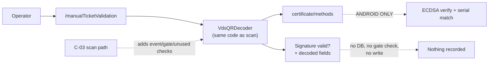

# C-06 · শুধু-সিগনেচার টিকিট যাচাই

> **Bangla name:** শুধু-সিগনেচার টিকিট যাচাই
>
> [← 40 · চেকার অ্যাপ](README.md) · [সূচিপত্র](../README.md) · [ওপেন কোয়ারি](../99-open-queries.md)

## 1. নাম ও উদ্দেশ্য

**শুধু-সিগনেচার টিকিট যাচাই।** একটি ডায়াগনস্টিক স্ক্রিন যা একটিমাত্র একটি প্রশ্নের উত্তর দেয়: *এই QR স্ট্রিংটি কি আসল, সঠিকভাবে সাইন করা একটি GoBCB টিকিট?* এটি চেকার যে মান পেস্ট করেন তার উপর VDS সিগনেচার যাচাই চালায়, **লোকাল টিকিট ডাটাবেস দেখে না**, ইভেন্ট বা গেট যাচাই করে না, এবং কিছুই রেকর্ড করে না। এটি কেবল "এই টিকিটটি কি আমরাই ছাপিয়েছি এবং এতে হস্তক্ষেপ হয়নি?" — এই প্রশ্নের উত্তর দেয়, এর বাইরে কিছু নয়। এটি একটি সাপোর্ট ও ট্রাবলশুটিং টুল, অ্যাডমিশন চেক নয়।

[C-03](C-03-qr-scan-validation.md)-এর সঙ্গে পার্থক্য ঠিক এটিই: স্ক্যানিং প্রমাণ করে সিগনেচার **এবং** ইভেন্ট **এবং** গেট **এবং** অব্যবহৃত; এই স্ক্রিন কেবল সিগনেচার প্রমাণ করে।

## 2. ট্রিগার ও অ্যাক্টর

একজন চেকার বা একজন সাপোর্ট ইঞ্জিনিয়ার, রুট `/manualTicketValidation`। সেটিংস স্ক্রিন থেকে পৌঁছানো যায়।

## 3. ব্যবসায়িক প্রবাহ

1. অপারেটর QR স্ট্রিংটি পেস্ট বা টাইপ করেন — টিকিটের QR কোডে যেভাবে দেখা যায় ঠিক সেভাবে পুরো base64 blob।
2. অ্যাপ স্ক্যানারের ব্যবহৃত একই কোড পথ দিয়ে সেটি ডিকোড ও যাচাই করে।
3. এটি জানায় সিগনেচারটি বৈধ কি না এবং সফল হলে ডিকোড করা টিকিটের ফিল্ডগুলো দেখায়।
4. **কিছুই সংরক্ষিত হয় না এবং কোনো টিকিট ব্যবহৃত হিসেবে চিহ্নিত হয় না**, ফলাফল যাই হোক।

## 4. কারিগরি প্রবাহ

1. `ManualTicketValidationViewModel` (`:34`) স্ক্যানারের মতো একই রিপোজিটরি মেথড কল করে:
   ```dart
   final ticketCredential = await _certificateRepository.getQRObjects(qrCodeString: …);
   ```
   অর্থাৎ `VdsQRDecoder.verifyQrData` ([C-03](C-03-qr-scan-validation.md) §4): base64-decode → হেডার `0x1F 0x8B` হলে gzip-decompress → `payload` / `signature` / `certSN` / `issuerDN` পার্স → `.env` সার্টিফিকেট দিয়ে `certificate/methods` চ্যানেলের মাধ্যমে যাচাই।
2. **স্ক্যান পথ থেকে একমাত্র পার্থক্য হলো এরপর কী ঘটে**: `_allTicketList`-এ কোনো খোঁজা নেই, ইভেন্ট বা গেটের কোনো তুলনা নেই, `_updateTicketStatus` নেই, কোনো শব্দ নেই এবং কোনো sync নেই। এখানে বৈধ সিগনেচার মানে **নয়** যে টিকিটটি এই ইভেন্টের, এবং একটি ব্যবহৃত টিকিটও এখানে valid জানানো হবে।
3. ফলাফলটি স্ক্যানারের মতোই তার শব্দ/হ্যাপ্টিক ফিডব্যাকসহ দেখানো হয়।
4. ডিকোড বা যাচাই ব্যর্থ হওয়া যেকোনো কিছুর জন্য `getQRObjects` `null` ফেরত দেয়, এবং স্ক্রিনটি incorrect-QR state দেখায় — iOS-এ এটি **সবসময়** ব্যর্থ হয় ([C-03](C-03-qr-scan-validation.md) নোট 1)।

## 5. কম্পোনেন্ট

| ধরন | কম্পোনেন্ট |
|---|---|
| ক্লায়েন্ট | `lib/presentation/feature/manual_ticket_validation/manual_ticket_validation_view_model.dart` + স্ক্রিন |
| ক্লায়েন্ট | `data/lib/repository/certificate_repository_impl.dart`, `data/lib/service/vds_qr_decoder.dart` |
| Android | `MainActivity.kt` (`certificate/methods`, `SHA256withECDSA`) |
| লোকাল DB | **ব্যবহার করা হয় না** — এই স্ক্রিন কিছুই পড়ে না |
| সার্ভিস | কোনোটিই নয় |

## 6. API কন্ট্রাক্ট

**কোনোটি নয়।** স্ক্যানের মতোই সম্পূর্ণ স্থানীয়।

## 7. ডেটা ও পার্শ্বপ্রতিক্রিয়া

**কোনোটি নয়।** কোনো রো লেখা হয় না, কোনো স্ক্যান রেকর্ড হয় না, কিছুই সিঙ্ক হয় না। চেকার অ্যাপের এটিই একমাত্র স্ক্রিন যা গেট রিপোর্টকে প্রভাবিত করতে পারে না।

## 8. কোড রেফারেন্স

| কী | কোথায় |
|---|---|
| ভিউ মডেল | `rvl-gobcb-checker-app/lib/presentation/feature/manual_ticket_validation/manual_ticket_validation_view_model.dart:34` |
| ভাগ করা ডিকোডার | `rvl-gobcb-checker-app/data/lib/service/vds_qr_decoder.dart:8-77` |
| Android ক্রিপ্টো | `rvl-gobcb-checker-app/android/app/src/main/kotlin/com/mahfuznow/hello_flutter/MainActivity.kt:52-79` |
| iOS ফাঁক | `rvl-gobcb-checker-app/ios/Runner/AppDelegate.swift:1-13` |
| তুলনার জন্য স্ক্যান পথ | `rvl-gobcb-checker-app/lib/presentation/feature/qr_page/qr_page_view_model.dart:244-251, 282-344` |
| রুট | `rvl-gobcb-checker-app/lib/presentation/navigation/route_path.dart` (`manualTicketValidation`) |

## 9. হ্যান্ডওভার নোট

1. **এখানকার "valid" ফলাফল কেবল authenticity প্রমাণ করে, entitlement নয়।** এটি ইভেন্ট, গেট, বা টিকিট আগে ব্যবহৃত হয়েছে কি না — কোনোটিই যাচাই করে না। এই স্ক্রিনটি অ্যাডমিশনের জন্য ব্যবহার করলে যেকোনো ব্যবহৃত বা ভুল-গেটের টিকিট ঢুকে যাবে `[UNCONFIRMED: Q-77]`।
2. **এটি স্ক্যানারের সঙ্গে পুরো ক্রিপ্টো পথ ভাগ করে**, তাই iOS-এর ব্যর্থতা ([C-03](C-03-qr-scan-validation.md) নোট 1) হুবহু এখানেও প্রযোজ্য: iOS-এ এই স্ক্রিন সবসময় incorrect QR জানায়, যা সেখানে যেকোনো কিছু ডায়াগনোজ করার জন্য অকার্যকর করে তোলে।
3. **ট্রাস্ট অ্যাংকর হলো `.env` `VDS_CERTIFICATE`**, তাই সিগনেচার ব্যর্থতা মানে ফরজারি টিকিট নয়, বরং রোটেট করা সার্টিফিকেটও হতে পারে ([Q-73](C-03-qr-scan-validation.md))।
4. **রোটেশনের পরে সার্টিফিকেট পরীক্ষা করার ব্যবহারিক উপায় হলো এই স্ক্রিন**: নতুন করে ইস্যু করা টিকিটের QR স্ট্রিং পেস্ট করে স্ক্যানারকে দোষ দেওয়ার আগে যাচাই করে নিন যে সেটি সত্যিই যাচাই হচ্ছে।
5. **ডিকোড ত্রুটি আর সিগনেচার ব্যর্থতা গ্রাহকের কাছে পার্থক্যহীন**, কারণ `vds_qr_decoder.dart:61-63` এক্সেপশন গিলে ফেলে `null` ফেরত দেয়।

## 10. কম্পোনেন্ট সম্পর্ক



**নির্ভর করে:** [C-03](C-03-qr-scan-validation.md) (এটি একই ডিকোডার ও একই `.env` সার্টিফিকেট পুনর্ব্যবহার করে)। **প্রভাব ফেলে:** কিছু নয় — ডিজাইন অনুযায়ী এটি read-only।

## 11. ডেভেলপার টেস্ট গাইড

**লোকালভাবে টেস্টযোগ্যতা: Android-এ সম্পূর্ণ; iOS-এ সবসময় ব্যর্থ** (নোট 2)।

| বিষয় | বিবরণ |
|---|---|
| টেস্ট ডেটা ও অ্যাকাউন্ট | একটি seeded টিকিট থেকে আসল সাইন করা QR স্ট্রিং, সঙ্গে হস্তক্ষেপ করা একটি কপি (base64 payload-এর একটি অক্ষর বদলান) এবং অন্য সার্টিফিকেটের একটি QR |
| ব্রাউজার | প্রযোজ্য নয় |
| এমুলেটর | `/manualTicketValidation` খুলুন, আসল স্ট্রিংটি পেস্ট করুন (ডিকোড করা ফিল্ডসহ valid আশা করুন), এরপর হস্তক্ষেপ করা স্ট্রিং (incorrect আশা করুন), এরপর একটি এলোমেলো base64 blob (incorrect আশা করুন) |
| Postman | কোনো এন্ডপয়েন্ট জড়িত নয় |
| Visual Studio ডিবাগ | `ManualTicketValidationViewModel`, `VdsQRDecoder.verifyQrData`, `MainActivity.kt:52` |
| যাচাই | লগে `verificationStatus` / `signatureValid` / `isSerialNumberMatch` মান; সার্টিফিকেট-রোটেশনের ক্ষেত্রটি পুনরায় তৈরি করতে `.env`-এ `VDS_CERTIFICATE` বদলে আবার চালান (নোট 4) |