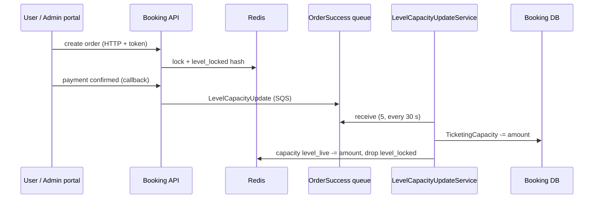

# S-01 · লেভেল ধারণক্ষমতা হালনাগাদ (OrderSuccess কিউ)

> **Bangla name:** লেভেল ধারণক্ষমতা হালনাগাদ (OrderSuccess কিউ)
>
> [← 50 · System-initiated](README.md) · [সূচিপত্র](../README.md) · [ওপেন কোয়ারি](../99-open-queries.md)

## 1. নাম ও উদ্দেশ্য

**লেভেল ধারণক্ষমতা হালনাগাদ।** একটি আসন লেভেলের (একটি ইভেন্টের একটি গ্যালারি, ব্লক ও লেভেল) ডাটাবেসে একটি ধারণক্ষমতা থাকে আর Redis-এ একটি *লাইভ* ধারণক্ষমতা থাকে। পরিশোধিত অর্ডার বা অ্যাডমিনের কোনো কাজে আসনের সংখ্যা বদলালে সেই পরিবর্তনটি `OrderSuccess` কিউতে পাঠানো হয়; Booking-এর ওয়ার্কার `LevelCapacityUpdateService` সেটি পড়ে, নতুন ধারণক্ষমতা ডাটাবেসে লেখে, এবং Redis-এর বাকিস্ট লেখালেখি শেষ করে। ধারণাগুলো: [কিউ-চালিত প্রক্রিয়াকরণ](../00-platform-primer.md#explainer-queue-driven), [Redis লাইভ ধারণক্ষমতা](../00-platform-primer.md#explainer-redis-live-capacity), [ব্যাকগ্রাউন্ড ওয়ার্কার](../00-platform-primer.md#explainer-background-workers), [ডিস্ট্রিবিউটেড লক](../00-platform-primer.md#explainer-distributed-locks)।

## 2. ট্রিগার ও অ্যাক্টর

- **প্রোডিউসার (ইউজার অর্ডার):** Booking, পেমেন্ট নিশ্চিত হওয়ার সময়: DgePay callback `HandleDgePayment`, re-check জব `RevaildateRecentPendingBookingsAsync` ([S-05](S-05-pending-failed-revalidation.md)), এবং অ্যানোনিমাস `GET payment-status-bypass`-এর পেছনের হ্যান্ডলার, যা গেটওয়ে না জিজ্ঞেস করেই অর্ডারকে `Paid` চিহ্নিত করে (`HandleDgePaymentBypass`, দেখুন [X-18](../60-cross-cutting/X-18-endpoints-without-auth.md))। SSLCommerz হ্যান্ডলার একই মেসেজ প্রকাশ করে কিন্তু নিষ্ক্রিয় ([Appendix A](../90-appendix-a-legacy.md))।
- **প্রোডিউসার (অ্যাডমিন):** অ্যাডমিন ধারণক্ষমতা সমন্বয় ও আসন রিজার্ভেশনের জন্য `CapacityManager.BookLevelCapacity` ([A-10](../10-admin-portal/A-10-capacity-adjustment.md), [A-11](../10-admin-portal/A-11-seat-reservation.md))।
- **কনজিউমার:** Booking সার্ভিস, `LevelCapacityUpdateService` (কোনো ইউজার নেই; কোনো টোকেন নেই)।

## 3. ব্যবসায়িক প্রবাহ

একজন গ্রাহক আসন রিজার্ভ করেন; পেমেন্ট করার সময় আসনগুলো ১২ মিনিটের একটি ছোট "লকড" তালিকায় আটকে থাকে। পেমেন্ট সফল হলে আসনগুলো স্থায়ীভাবে লেভেলের উপলভ্যতা থেকে সরে যায়। গ্রাহকটি অ্যাডমিন হলে (কম্প্লিমেন্টারি বা পার্টনার টিকিট), লাইভ সংখ্যা সঙ্গে সঙ্গে বদলায় এবং কিউয়ের মাধ্যমে ডাটাবেস তার পরে আপডেট হয়।

## 4. কারিগরি প্রবাহ

1. **অর্ডার তৈরির সময় হোল্ড** **[HTTP + user token]** `UserBookingOrderManager.CreateAsync` লক `user_booking:{userId}` ও `level_booking_{event}_{gallery}_{block}_{level}` নেয় ([X-25](../60-cross-cutting/X-25-redis.md)) এবং `CapacityManager.BookLevelCapacity` কল করে। একটি **ইউজার** অর্ডারের ক্ষেত্রে এটি কেবল Redis হ্যাশ `level_locked:{event}_{gallery}_{block}_{level}`-এ অর্ডারটি লেখে (ফিল্ড = অর্ডার আইডি); ১২ মিনিটের পুরনো এন্ট্রিগুলো আগে সরানো হয়, আর সংখ্যা মিল না গেলে কলটি `no_seats_available`, `order_limit_exceeded` বা `seat_limit_exceeded` দিয়ে ব্যর্থ হয়।
2. **সফল হলে প্রকাশ** **[SQS: OrderSuccess]** একটি `LevelCapacityUpdate` মেসেজ সহ: `orderType`, `amount`, `hasSeats`, `seats`, `isIncrease`, `groupId` (`{event}_{gallery}_{block}_{level}`), `orderId`, `capacityAction` (`Booking`, `Allocation` বা `Reservation`)। ইউজার অর্ডারের ক্ষেত্রে মেসেজটি কেবল তখনই পাঠানো হয় যখন পেমেন্ট `Paid` (DgePay callback: কেবল তখনই যখন অর্ডার ১২ মিনিটের বেশি পুরনো নয়)।
3. **অ্যাডমিনের কাজের ক্ষেত্রে** `BookLevelCapacity` সরাসরি Redis হ্যাশ `capacity`-এর `level_live:{...}` ফিল্ড বদলায় (পরমাণুসংখ্যা অনুযায়ী increment/decrement, লকের দরকার নেই), লাইভ আসনের স্ট্রিং আপডেট করে, তারপর একই মেসেজ প্রকাশ করে যাতে ডাটাবেস পিছিয়ে আসে।
4. **ওয়ার্কার** **[Worker: ১ মিনিট স্টার্ট ডিলে, তারপর প্রতি ৩০ সেকেন্ডে; RedLock `level_capacity_updater_{0..49}`, মেয়াদ ৩০ সে, ১০ সে অপেক্ষা]**: `LevelCapacityUpdateService` একটি র‍্যান্ডম স্লট লক নেয় এবং `LevelCapacityUpdateTaskManager` একবার চালায়। টাস্ক ম্যানেজার দীর্ঘ-পোলিং করে কিউ পড়ে (`MaxNumberOfMessages` 5, `WaitTimeSeconds` 0, visibility ৬০ সে) এবং প্রতিটি মেসেজের জন্য:
   - `CapacityManager.UpdateLevelCapacityAsync` লক `database_update_{event}_{gallery}_{block}_{level}` নেয় (মেয়াদ ৫ সে, ৩০ সে অপেক্ষা), ডাটাবেসে `TicketingCapacity`-তে `amount` যোগ বা বিয়োগ করে (০-এর নিচে নামলে ত্রুটি), এবং `hasSeats` হলে সংরক্ষিত আসনের তালিকা সমন্বয় করে;
   - `orderType = User` হলে: `amount`-এর পরিমাণে `HashDecrement capacity level_live:{groupId}`, অর্ডার আইডির জন্য `HashDelete level_locked:{groupId}`, এবং আসন থাকলে লাইভ আসনের স্ট্রিং থেকে আসনগুলো সরানো হয়;
   - মেসেজটি কেবল সফল হওয়ার পরে মুছে ফেলা হয়। কোনো এক্সেপশন হলে মেসেজটি মোছা হয় **না**; ৬০ সেকেন্ড পর এটি আবার দৃশ্যমান হয়।
5. সমান্তরালে, `BookLevelCapacity` একটি `EventCapacity` মেসেজও প্রকাশ করে ([S-02](S-02-event-live-capacity.md))।

## 5. কম্পোনেন্ট

| ধরন | কম্পোনেন্ট |
|---|---|
| Services | Booking (API, ওয়ার্কার); কনজিউমার ও প্রোডিউসার একই সার্ভিস |
| Queue | `OrderSuccess` (`AWS:Queue:OrderSuccess`) |
| Tables | Booking স্কিমার `Capacities` সারি (`TicketingCapacity`, `Seats`, `LockedSeats`), `UserBookingOrder` |
| Redis | `capacity` হ্যাশ (`level_live:*`, `level_live_seats:*`), `level_locked:*` হ্যাশ, `refresh` সেট, লক |
| Code | `Services/Booking/ETP.Booking.Service/Workers/BackgroundServices/LevelCapacityUpdateService.cs`, `.../TaskManagers/LevelCapacityUpdateTaskManager.cs`, `Services/Booking/ETP.Booking.Domain/Managers/CapacityManager.cs` |
| Config | `AWS:Queue:OrderSuccess`, `Cache:Redis:*`, `DistributedLock:Redis:*` ([X-26](../60-cross-cutting/X-26-configuration.md)) |

## 6. API কন্ট্র্যাক্ট

এর নিজস্ব কোনো endpoint নেই। কিউ মেসেজ (`Core/ETP.Core/Queue/Messages/LevelCapacityUpdate.cs`), `System.Text.Json`-এর ডিফল্ট দিয়ে সিরিয়ালাইজড (PascalCase প্রপার্টি নাম, এনাম সংখ্যা হিসেবে):

```json
{
  "OrderType": 0,
  "Amount": 2,
  "HasSeats": false,
  "Seats": null,
  "IsIncrease": false,
  "GroupId": "101_5_12_33",
  "OrderId": "<order public id>",
  "CapacityAction": 0
}
```

(উদাহরণমূলক মান; `OrderType` ও `CapacityAction` এনাম সংখ্যা, যার নাম আসে `Enums.OrderType` ও `CapacityAction` থেকে)। কিউটি FIFO কিউ কেবল তখনই, যখন তার কনফিগার করা নাম `fifo` দিয়ে শেষ হয়; তখন `GroupId` হলো `MessageGroupId` (তাই একটি লেভেল ক্রমানুসারে প্রক্রিয়া হয়) এবং `OrderId` হলো ডুপ্লিকেশন আইডি (`SqsPublisher`)।

## 7. ডেটা ও পার্শ্বপ্রতিক্রিয়া

- ডাটাবেস: একটি লেভেল সারির `TicketingCapacity` (ও আসন কলাম)।
- Redis: লাইভ ধারণক্ষমতা কমানো, লকড অর্ডার সরানো, লাইভ আসন ছোট করা।
- ব্যর্থতা ব্যবস্থাপনা: ব্যর্থ মেসেজ visibility timeout-এর পর আবার চেষ্টা করা হয়; কোডে কোনো dead-letter ব্যবস্থাপনা নেই `[UNCONFIRMED: Q-09]`।

## 8. কোড রেফারেন্স

| কী | কোথায় |
|---|---|
| Worker loop | `rvl-gobcb-backend/Services/Booking/ETP.Booking.Service/Workers/BackgroundServices/LevelCapacityUpdateService.cs:25-66` |
| Message handling | `rvl-gobcb-backend/Services/Booking/ETP.Booking.Service/Workers/TaskManagers/LevelCapacityUpdateTaskManager.cs:45-118` |
| Hold and publish | `rvl-gobcb-backend/Services/Booking/ETP.Booking.Domain/Managers/CapacityManager.cs:35-262` |
| Database update | `rvl-gobcb-backend/Services/Booking/ETP.Booking.Domain/Managers/CapacityManager.cs:539-715` |
| Payment publishers | `rvl-gobcb-backend/Services/Booking/ETP.Booking.Domain/Managers/UserBookingOrderManager.cs:345, 514, 1072, 1361` |
| Publisher class | `rvl-gobcb-backend/Core/ETP.Core/Queue/Services/SqsPublisher.cs` |

## 9. হ্যান্ডওভার নোট

1. **পোলিং ডিজাইনের কারণে থ্রুপুট সীমিত।** প্রতিটি ইনস্ট্যান্স একটি ৫-মেসেজের ব্যাচ চালায় (দীর্ঘ পোলিং নয়), তারপর ৩০ সেকেন্ড ঘুমায়। প্রতি ইনস্ট্যান্সে সর্বোচ্চ প্রতি মিনিটে ১০টি মেসেজ, তাই পরিশোধিত অর্ডারের একটি ঢেউ ডাটাবেসে বিলম্বিতে পৌঁছায় (উপরের ধ্রুবগুলো থেকে নির্ণীত; আপনার পরিবেশে পর্যবেক্ষণ করুন)।
2. **একটি লেভেলের জন্য দুটি সত্যের উৎস।** Redis decrement ও ডাটাবেস আপডেটের মধ্যে দুটো অসম্পর্কিত অবস্থায় থাকে; লক-অ্যান্ড-কিউ ডিজাইন এটি মেনে নেয়। Redis flush করলে লাইভ কাউন্টার হারায় ([X-25](../60-cross-cutting/X-25-redis.md))।
3. **১২ মিনিটের নিয়ম তিন জায়গায় আছে** (callback-এর বয়সের যাচাই, `BookLevelCapacity`, রিফ্রেশ ওয়ার্কার)। ১২ মিনিটের পরে আসা DgePay callback না অর্ডারের স্ট্যাটাস বদলায়, না `OrderSuccess` প্রকাশ করে; কোডের মন্তব্য বলছে এমন অর্ডার "is cancelled by BG service" ([S-05](S-05-pending-failed-revalidation.md))।
4. **bypass হ্যান্ডলারে key অমিল।** `Failed` হলে `HandleDgePaymentBypass` `level_locked_{EventId}_...` (আন্ডারস্কোর, পাবলিক ইভেন্ট আইডি) থেকে ফিল্ডটি মোছে, অথচ বাকি কোড `level_locked:{EventLongId}_...` ব্যবহার করে; ফলে সেখানে এন্ট্রিটি সরে না এবং ১২ মিনিটের নিয়মে মেয়াদোত্তীর্ণ হয় `[UNCONFIRMED: Q-10]`।
5. **কোডে কোনো dead-letter কিউ দৃশ্যমান নয়**; একটি বিষাক্ত মেসেজ প্রতি মিনিটে চিরকাল রিট্রাই হয়। কিউ কনফিগারেশন (redrive policy) AWS-এ, রিপোজিটরিতে নয়।
6. মেসেজের বডি deserialize করা না গেলে (`null`), টাস্ক ম্যানেজার `continue` দিয়ে সেটি এড়িয়ে যায় এবং মোছে না, তাই সেটিও কিউতে ফিরে আসে।

## 10. কম্পোনেন্ট সম্পর্ক



**নির্ভর করে:** অর্ডার তৈরি ([P-06](../20-user-portal/P-06-booking-payment.md)), প্রকাশিত ইভেন্ট ও লেভেল ([A-07](../10-admin-portal/A-07-events.md))। **প্রভাব ফেলে:** প্রতিটি গ্রাহককে দেখানো আসনের উপলভ্যতা ([P-04](../20-user-portal/P-04-seat-selection.md)), [S-02](S-02-event-live-capacity.md), [S-04](S-04-scheduler-capacity-update.md), ধারণক্ষমতার রিপোর্ট।

## 11. ডেভেলপার টেস্ট গাইড

**লোকালে টেস্টযোগ্যতা: সম্পূর্ণ।** Booking, Redis ও Floci কিউ লোকালে চলে।

| বিষয় | বিবরণ |
|---|---|
| Test data and accounts | `pwsh ./scripts/Seed-EtpData.ps1`; ইউজার টোকেনের জন্য ইউজার ফোন …11 (`Passw0rd!23`) ([X-07](../60-cross-cutting/X-07-user-password-login.md)) |
| Browser | ইউজার পোর্টাল `http://localhost:4201`: আসন বেছে বুকিং শুরু করুন; পেমেন্ট ডামি (DgePay), তাই সফল callback Postman দিয়ে সিমুলেট করতে হবে |
| Emulator | লোকালে নয় (লগইন করা সম্ভব নয়, `docs/mobile-local.md` §8-এ পরিচিত ঘাটতি) |
| Postman | `postman/services/etp-booking.postman_collection.json`: অর্ডার তৈরির রিকোয়েস্ট, তারপর DgePay callback/bypass রিকোয়েস্ট অর্ডারের transaction id সহ; অ্যাডমিনের জন্য: `{{access_token_admin}}` দিয়ে ক্যাপাসিটি-অ্যাডজাস্ট রিকোয়েস্ট |
| Visual Studio debug | ব্রেকপয়েন্ট: `CapacityManager.BookLevelCapacity`, তারপর `LevelCapacityUpdateTaskManager.ExecuteAsync` (সার্ভিস চালু হওয়ার প্রায় ১ মিনিট পর শুরু; পরের চক্র প্রতি ৩০ সে) |
| Verify | ওয়ার্কার নেওয়ার আগে `aws --endpoint-url http://localhost:4566 sqs receive-message --queue-url <OrderSuccess url>`; `redis-cli HGET capacity "level_live:<e>_<g>_<b>_<l>"`; Capacity টেবিলের `TicketingCapacity`-তে SQL |