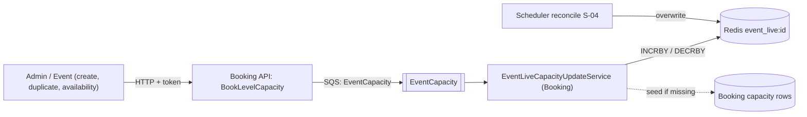

# S-02 · ইভেন্ট লাইভ ধারণক্ষমতা (EventCapacity কিউ)

> **Bangla name:** ইভেন্ট লাইভ ক্যাপাসিটি (EventCapacity কিউ)
>
> [← 50 · System-initiated](README.md) · [সূচিপত্র](../README.md) · [ওপেন কোয়ারি](../99-open-queries.md)

## 1. নাম ও উদ্দেশ্য

**ইভেন্ট লাইভ ধারণক্ষমতা।** প্রতিটি ইভেন্টের জন্য Redis একটি সংখ্যা রাখে, `event_live:{eventId}`, যা পুরো ইভেন্টে এখনও উপলভ্য আসন। প্রতিটি ধারণক্ষমতা পরিবর্তন `EventCapacity` কিউতে একটি ছোট মেসেজ প্রকাশ করে; Booking-এর ওয়ার্কার `EventLiveCapacityUpdateService` সেটি পরমাণুসংখ্যা Redis increment বা decrement দিয়ে প্রয়োগ করে। ধারণাগুলো: [কিউ-চালিত প্রক্রিয়াকরণ](../00-platform-primer.md#explainer-queue-driven), [Redis লাইভ ধারণক্ষমতা](../00-platform-primer.md#explainer-redis-live-capacity)।

## 2. ট্রিগার ও অ্যাক্টর

- **প্রোডিউসার:** Booking `CapacityManager.BookLevelCapacity`, প্রতিটি কলেই — **ইউজার** অর্ডারের (অর্ডার তৈরির সময়) এবং **অ্যাডমিনের** কাজের জন্যই ([S-01](S-01-level-capacity-update.md) ধাপ ১ ও ৩)।
- **কনজিউমার:** Booking সার্ভিসের ওয়ার্কার; কোনো ইউজার নেই, কোনো টোকেন নেই।

## 3. ব্যবসায়িক প্রবাহ

গ্রাহক ও অ্যাডমিনরা একটি ইভেন্টের বাকি আসন দেখেন। সেই মোট একটি কাউন্টারে রাখা হয় যাতে সহজে পড়া যায়, প্রতিবার প্রতিটি লেভেল যোগ না করেই।

## 4. কারিগরি প্রবাহ

1. `BookLevelCapacity` প্রকাশ করে `EventLiveCapacityUpdate {EventId, Amount, IsIncrease, GroupId = eventId, OrderId}` **[SQS: EventCapacity]**। এটি প্রকাশ হয় ইউজার লক লেখার পর **অথবা** অ্যাডমিনের পরিবর্তন প্রয়োগের পর, তাই একটি ইউজার অর্ডার ইভেন্টের মোট **অর্ডার তৈরির সময়ই** কমায়, আর লেভেলের লাইভ ধারণক্ষমতা কমে কেবল পেমেন্টের পর ([S-01](S-01-level-capacity-update.md))।
2. `EventLiveCapacityUpdateService` **[Worker: ১ মিনিট স্টার্ট ডিলে, তারপর প্রতি ৩০ সে; RedLock `event_capacity_updater_{0..19}`, মেয়াদ ৩০ সে, অপেক্ষা নেই]** একটি র‍্যান্ডম স্লট লক নেয় এবং `EventLiveCapacityUpdateTaskManager` একবার চালায়।
3. টাস্ক ম্যানেজার সর্বোচ্চ ১০টি মেসেজ পড়ে (`WaitTimeSeconds` 0, visibility ৩০ সে)। প্রতিটি মেসেজের জন্য সে আগে `CapacityManager.GetEventLiveCapacity(eventId)` কল করে, যা `event_live:{eventId}` না থাকলে কাউন্টারটি **ডাটাবেস থেকে তৈরি করে** (`GetEventCapacityCount`), তারপর `Amount`-এর পরিমাণে `INCRBY` বা `DECRBY` চালায়, তারপর মেসেজটি মোছে। কোনো এক্সেপশন হলে মেসেজটি রাখা হয় এবং ৩০ সেকেন্ড পর আবার আসে।
4. পাঠকারা: `GET /booking/api/v1/capacity/event-live-capacity?eventId=` কাউন্টারটি ফেরত দেয় (একই মেথড), আর Admin একটি ইভেন্ট তৈরি বা ডুপ্লিকেট হলে সেটিকে `IBookingClient`-এর মাধ্যমে কল করে, এবং Event যখন কোনো ইভেন্টের উপলভ্যতা স্ট্যাটাস বের করে, তখন কাউন্টারটি না থাকলে তা তৈরি করে ([A-07](../10-admin-portal/A-07-events.md))।

## 5. কম্পোনেন্ট

| ধরন | কম্পোনেন্ট |
|---|---|
| Services | Booking (প্রোডিউসার, কনজিউমার, API); Admin ও Event (`IBookingClient`-এর মাধ্যমে সিড করে) |
| Queue | `EventCapacity` (`AWS:Queue:EventCapacity`) |
| Redis | `event_live:{eventId}` (string), লক `event_capacity_updater_{n}` |
| Tables | কাউন্টার সিড করার জন্য Booking-এর ধারণক্ষমতা সারিগুলোর পড়া |
| Code | `Services/Booking/ETP.Booking.Service/Workers/BackgroundServices/EventLiveCapacityUpdateService.cs`, `.../TaskManagers/EventLiveCapacityUpdateTaskManager.cs`, `Services/Booking/ETP.Booking.Domain/Managers/CapacityManager.cs:241-282` |

## 6. API কন্ট্র্যাক্ট

| মেথড | পাথ | Auth | রিকোয়েস্ট | রেসপন্স |
|---|---|---|---|---|
| GET | `/booking/api/v1/capacity/event-live-capacity` | none (`CapacityController`-এ কোনো `[Authorize]` নেই, দেখুন [X-18](../60-cross-cutting/X-18-endpoints-without-auth.md)) | query `eventId` (long) | `int` |

কিউ মেসেজ (`Core/ETP.Core/Queue/Messages/EventLiveCapacityUpdate.cs`, `System.Text.Json` ডিফল্ট):

```json
{ "EventId": 0, "Amount": 2, "IsIncrease": false, "GroupId": "101", "OrderId": "<order public id>" }
```

(`EventId` ঘোষণা করা আছে কিন্তু `BookLevelCapacity` সেটি সেট করে না; কনজিউমার `GroupId` ব্যবহার করে।)

## 7. ডেটা ও পার্শ্বপ্রতিক্রিয়া

শুধু Redis: `event_live:{eventId}` বদলায়। এই ওয়ার্কার ডাটাবেসে কিছু লেখে না।

## 8. কোড রেফারেন্স

| কী | কোথায় |
|---|---|
| Producer | `rvl-gobcb-backend/Services/Booking/ETP.Booking.Domain/Managers/CapacityManager.cs:246-256` |
| Worker | `rvl-gobcb-backend/Services/Booking/ETP.Booking.Service/Workers/BackgroundServices/EventLiveCapacityUpdateService.cs:26-58` |
| Task manager | `rvl-gobcb-backend/Services/Booking/ETP.Booking.Service/Workers/TaskManagers/EventLiveCapacityUpdateTaskManager.cs:46-90` |
| Read and seed | `rvl-gobcb-backend/Services/Booking/ETP.Booking.Domain/Managers/CapacityManager.cs:270-282` |
| Endpoint | `rvl-gobcb-backend/Services/Booking/ETP.Booking.Service/Api/CapacityController.cs:66-76` |
| Seed callers | `rvl-gobcb-backend/Services/Admin/ETP.Admin.Domain/Managers/EventManager.cs:294` (`CreateAsync`), `:986` (`DuplicateAsync`); `Services/Event/ETP.Event.Domain/Managers/EventManager.cs:759` (`DetermineAvailabilityStatus`) |

## 9. হ্যান্ডওভার নোট

1. **ব্যর্থ বা বাতিল পেমেন্ট এই কিউয়ের মাধ্যমে ইভেন্টের মোট ফেরত দেয় না।** `EventCapacity`-এর একমাত্র প্রকাশক `BookLevelCapacity`, আর লক ছাড়া (`ReleaseLockedCapacity`, মেয়াদোত্তীর্ণতা) কেবল `level_locked` হ্যাশ সম্পাদনা করে। ইভেন্ট কাউন্টার সংশোধন করে [S-04](S-04-scheduler-capacity-update.md)-এর পর্যায়গত মিলানো, যা প্রতি ১৫ মিনিটে লেভেলগুলো আবার যোগ করে।
2. **মন্তব্য ও কোডে অমিল**: ওয়ার্কারের মন্তব্য বলছে একসঙ্গে "50 capacity updater services" চলতে পারে, কিন্তু স্লটের পরিসর ০ থেকে ১৯ (২০টি স্লট)।
3. টাস্ক ম্যানেজার পার্শ্বপ্রতিক্রিয়ার জন্য (না থাকলে তৈরি করা) `GetEventLiveCapacity` কল করে কিন্তু ফেরত পাওয়া মান উপেক্ষা করে।
4. [S-01](S-01-level-capacity-update.md)-এর মতো একই পোলিং সীমা: প্রতি ৩০ সে চক্রে প্রতি ইনস্ট্যান্সে সর্বোচ্চ ১০টি মেসেজ; কোনো dead-letter ব্যবস্থাপনা দৃশ্যমান নয় `[UNCONFIRMED: Q-09]`।

## 10. কম্পোনেন্ট সম্পর্ক



**নির্ভর করে:** [S-01](S-01-level-capacity-update.md) (একই ট্রিগার), ইভেন্ট তৈরি ([A-07](../10-admin-portal/A-07-events.md))। **প্রভাব ফেলে:** ইভেন্ট পাতায় বাকি আসনের সংখ্যা ([P-02](../20-user-portal/P-02-browse-events.md)), [S-04](S-04-scheduler-capacity-update.md)।

## 11. ডেভেলপার টেস্ট গাইড

**লোকালে টেস্টযোগ্যতা: সম্পূর্ণ।**

| বিষয় | বিবরণ |
|---|---|
| Test data and accounts | `pwsh ./scripts/Seed-EtpData.ps1`; বুকিংয়ের জন্য ইউজার ফোন …11, ধারণক্ষমতা পরিবর্তনের জন্য অ্যাডমিন …01 |
| Browser | ইউজার পোর্টাল `http://localhost:4201`: একটি বুকিং শুরু করুন, তারপর `event_live:*` বদলাতে দেখুন |
| Emulator | লোকালে নয় (পরিচিত লগইন ঘাটতি, `docs/mobile-local.md` §8) |
| Postman | `postman/services/etp-booking.postman_collection.json`: "GET /api/v1/capacity/event-live-capacity" (`/booking` প্রিফিক্সসহ `base_url` দিয়ে দিন, Appendix D দেখুন) এবং অর্ডার তৈরির রিকোয়েস্ট |
| Visual Studio debug | ওয়ার্কারের ১ মিনিটের স্টার্ট ডিলের পর `EventLiveCapacityUpdateTaskManager.ExecuteAsync`-এ ব্রেকপয়েন্ট |
| Verify | `redis-cli GET event_live:<eventId>`; `EventCapacity`-তে SQS-এর `ApproximateNumberOfMessages` (`aws --endpoint-url http://localhost:4566 sqs get-queue-attributes ...`) |