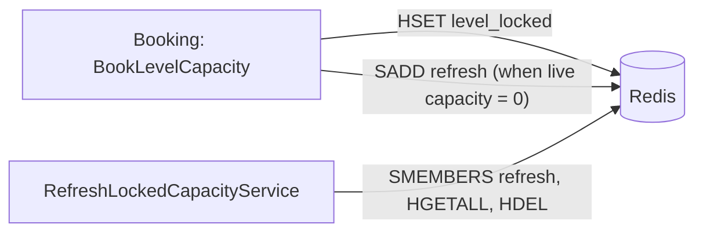

# S-03 · লক করা ধারণক্ষমতা রিফ্রেশ

> **Bangla name:** লকড ক্যাপাসিটি রিফ্রেশ
>
> [← 50 · System-initiated](README.md) · [সূচিপত্র](../README.md) · [ওপেন কোয়ারি](../99-open-queries.md)

## 1. নাম ও উদ্দেশ্য

**লক করা ধারণক্ষমতা রিফ্রেশ।** একজন গ্রাহক যখন পেমেন্ট করেন, তখন আসনগুলো ১২ মিনিটের জন্য Redis হ্যাশ `level_locked:{event}_{gallery}_{block}_{level}`-এ আটকে থাকে। Booking-এর ওয়ার্কার `RefreshLockedCapacityService`-এর উদ্দেশ্য হলো হোল্ড নেওয়ার সময় যেসব লেভেল বিক্রি শেষ ছিল সেগুলোর মেয়াদোত্তীর্ণ হোল্ড মুক্ত করা, যাতে আসনগুলো আবার বুকযোগ্য হয়। ধারণাগুলো: [Redis লাইভ ধারণক্ষমতা](../00-platform-primer.md#explainer-redis-live-capacity), [ব্যাকগ্রাউন্ড ওয়ার্কার](../00-platform-primer.md#explainer-background-workers), [ডিস্ট্রিবিউটেড লক](../00-platform-primer.md#explainer-distributed-locks)।

## 2. ট্রিগার ও অ্যাক্টর

- **কাজের প্রোডিউসার:** বুকিং ধাপের পর লেভেলের লাইভ ধারণক্ষমতা `0` হলে `CapacityManager.BookLevelCapacity` Redis সেট `refresh`-এ একটি key যোগ করে।
- **কনজিউমার:** Booking ওয়ার্কার, টাইমার-চালিত; কোনো ইউজার নেই, কোনো টোকেন নেই।

## 3. ব্যবসায়িক প্রবাহ

অপরিশোধিত অর্ডার চিরকাল আসন আটকে রাখতে পারে না। ১২ মিনিট পর হোল্ড আর গণনা হয় না, এবং আসনগুলো পুলে ফিরে আসে। সাধারণত এটি ঘটে ওই লেভেলের পরবর্তী বুকিং চেষ্টার সময় অলসভাবে (ধাপ ১ দেখুন); কেউ আবার চেষ্টা না করলে এই ওয়ার্কারটিই নিরাপত্তা-জাল।

## 4. কারিগরি প্রবাহ

1. **অলস ক্লিনআপ (কাজ করে)।** প্রতিটি `BookLevelCapacity` কল `level_locked:{...}` পড়ে, ১২ মিনিটের পুরনো এন্ট্রি মোছে এবং কেবল নতুনগুলোকেই লকড হিসেবে গোনে (`CapacityManager.cs:100-110`)।
2. **চিহ্নিত করা।** `BookLevelCapacity`-এর শেষে, `liveLevelCapacity == 0` হলে কোড `SADD refresh {liveLevelCapacityKey}` চালায় (`CapacityManager.cs:256-260`)।
3. **ওয়ার্কার** **[Worker: ১ মিনিট স্টার্ট ডিলে; তারপর লক `locked_order_refresher_{0..4}` মেয়াদ ১৫ মিনিট ও অপেক্ষা নেই; দুই রানের মাঝে ৩০ মিনিট ঘুম, ত্রুটির পর অতিরিক্ত ৫ মিনিট]**: `RefreshLockedCapacityTaskManager` `refresh`-এর সব সদস্য পড়ে; প্রতিটি key-এর জন্য সে লক `refresh_level_locks_{key}` নেয় (মেয়াদ ৩০ সে), ওই key-এর হ্যাশ `LockedCapacity` এন্ট্রি হিসেবে পড়ে, ১২ মিনিটের পুরনো এন্ট্রি মোছে, এবং কোনোটি মোছা হলে সেই key `refresh` থেকে সরায়।

## 5. কম্পোনেন্ট

| ধরন | কম্পোনেন্ট |
|---|---|
| Services | Booking |
| Redis | `refresh` (সেট), `level_locked:*` (হ্যাশ), লক `locked_order_refresher_{n}`, `refresh_level_locks_{key}` |
| Code | `Services/Booking/ETP.Booking.Service/Workers/BackgroundServices/RefreshLockedCapacityService.cs`, `.../TaskManagers/RefreshLockedCapacityTaskManager.cs`, `Services/Booking/ETP.Booking.Domain/Managers/CapacityManager.cs` |
| Config | `DistributedLock:Redis:*` ([X-26](../60-cross-cutting/X-26-configuration.md)) |

## 6. API কন্ট্র্যাক্ট

None.

## 7. ডেটা ও পার্শ্বপ্রতিক্রিয়া

শুধু Redis (`level_locked:*` এন্ট্রি সরানো, `refresh` এন্ট্রি সরানো)।

## 8. কোড রেফারেন্স

| কী | কোথায় |
|---|---|
| Loop | `rvl-gobcb-backend/Services/Booking/ETP.Booking.Service/Workers/BackgroundServices/RefreshLockedCapacityService.cs:26-58` |
| Work | `rvl-gobcb-backend/Services/Booking/ETP.Booking.Service/Workers/TaskManagers/RefreshLockedCapacityTaskManager.cs:30-62` |
| Marking | `rvl-gobcb-backend/Services/Booking/ETP.Booking.Domain/Managers/CapacityManager.cs:256-260` |
| Lazy clean-up | `rvl-gobcb-backend/Services/Booking/ETP.Booking.Domain/Managers/CapacityManager.cs:100-110` |

## 9. হ্যান্ডওভার নোট

1. **ওয়ার্কারটি ভুল key-তে কাজ করছে বলে মনে হচ্ছে।** `BookLevelCapacity` `refresh`-এ `level_live:{...}` রাখে, কিন্তু লাইভ ধারণক্ষমতা হ্যাশ `capacity`-এর একটি *ফিল্ড*, নিজে থেকে কোনো Redis key নয়; লকড হোল্ডগুলো `level_locked:{...}`-এ। এরপর ওয়ার্কারটি `level_live:{...}` key-এর ওপর `HGETALL` কল করে, যা অস্তিত্বে নেই, ফলে কিছুই পায় না, কিছুই মোছে না, এবং কখনোই `refresh` থেকে এন্ট্রিটি সরায় না। কোড থেকে দেখা যায় সেট কেবল বড়তেই থাকে, আর ধাপ ১-এর ক্লিনআপটিই আসলে কাজ করে `[UNCONFIRMED: Q-10]`। একটি লাইভ Redis-এ যাচাই করুন (`SMEMBERS refresh`, `TYPE level_live:...`)।
2. **রানের হার কম**: প্রতি ইনস্ট্যান্সে প্রতি ৩০ মিনিটে একবার, যখন হোল্ড ১২ মিনিটের।
3. ১২ মিনিটের ধ্রুবটি দুইবার লেখা আছে (`CapacityManager`, পেমেন্ট callback, এই ওয়ার্কার); বদলালে সমান রাখুন ([S-01](S-01-level-capacity-update.md))।
4. `ReservationStatusUpdateService` আলাদা একটি ওয়ার্কার ক্লাস যা রেজিস্টার করা নেই ([Appendix A](../90-appendix-a-legacy.md))।

## 10. কম্পোনেন্ট সম্পর্ক

**নির্ভর করে:** [S-01](S-01-level-capacity-update.md)। **প্রভাব ফেলে:** বিক্রি শেষ লেভেলে আসনের উপলভ্যতা ([P-04](../20-user-portal/P-04-seat-selection.md))।

## 11. ডেভেলপার টেস্ট গাইড

**লোকালে টেস্টযোগ্যতা: সম্পূর্ণ।**

| বিষয় | বিবরণ |
|---|---|
| Test data and accounts | `pwsh ./scripts/Seed-EtpData.ps1`; ইউজার …11 |
| Browser | ইউজার পোর্টাল: একটি লেভেলের শেষ আসন বুক করে পেমেন্ট ছেড়ে দিন |
| Emulator | লোকালে নয় (পরিচিত লগইন ঘাটতি) |
| Postman | `etp-booking` কলেকশন: পেমেন্ট শেষ না করে অর্ডার তৈরির রিকোয়েস্ট |
| Visual Studio debug | `RefreshLockedCapacityTaskManager.ExecuteAsync`-এ ব্রেকপয়েন্ট; প্রথম রান সার্ভিস শুরুর ১ মিনিট পর আসে এবং পরের রানগুলো ৩০ মিনিট ব্যবধানে, তাই আবার চালাতে সার্ভিসটি রিস্টার্ট করুন |
| Verify | `redis-cli SMEMBERS refresh`; `redis-cli HGETALL level_locked:<e>_<g>_<b>_<l>`; `redis-cli TYPE level_live:<e>_<g>_<b>_<l>` (`none` আসার কথা, যা নোট ১-কে সমর্থন করে) |