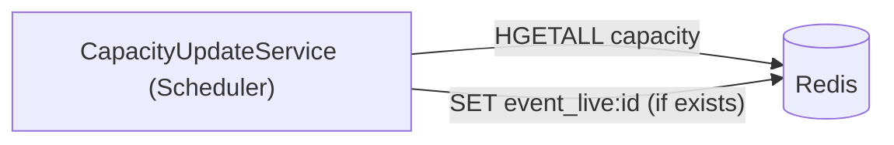

# S-04 · শিডিউলার ধারণক্ষমতা মিলানো

> **Bangla name:** Scheduler ক্যাপাসিটি রিকনসাইল
>
> [← 50 · System-initiated](README.md) · [সূচিপত্র](../README.md) · [ওপেন কোয়ারি](../99-open-queries.md)

## 1. নাম ও উদ্দেশ্য

**শিডিউলার ধারণক্ষমতা মিলানো।** প্রতি ১৫ মিনিটে Scheduler সার্ভিস প্রতিটি ইভেন্টের লাইভ ধারণক্ষমতা **তার লেভেলগুলোর লাইভ ধারণক্ষমতার যোগফল** হিসেবে আবার হিসাব করে এবং সেটি `event_live:{eventId}`-এর ওপর লেখে। এটি [S-02](S-02-event-live-capacity.md)-এর কিউ-ভিত্তিক আপডেটের ফলে যে ছাঁচ থেকে যায় তা ঠিক করে। ধারণাগুলো: [Redis লাইভ ধারণক্ষমতা](../00-platform-primer.md#explainer-redis-live-capacity), [ব্যাকগ্রাউন্ড ওয়ার্কার](../00-platform-primer.md#explainer-background-workers), [ডিস্ট্রিবিউটেড লক](../00-platform-primer.md#explainer-distributed-locks)।

## 2. ট্রিগার ও অ্যাক্টর

Scheduler সার্ভিসের একটি টাইমার (`CapacityUpdateService`); কোনো ইউজার নেই, কোনো টোকেন নেই। এটি অন্য কোনো সার্ভিস কল করে না; কেবল Redis পড়ে ও লেখে।

## 3. ব্যবসায়িক প্রবাহ

একটি ইভেন্টের "বাকি আসন" সংখ্যা তার লেভেলগুলোর সঙ্গে মেলানো উচিত। কারণ একটি ইউজার অর্ডার অর্ডার তৈরির সময়ই ইভেন্টের মোট কমায়, কিন্তু লেভেলের মোট কমে কেবল পেমেন্টের পর, তাই অসমাপিত ও ব্যর্থ অর্ডার ইভেন্টের মোটকে খুব কমিয়ে রাখে যতক্ষণ না এই জব চলে।

## 4. কারিগরি প্রবাহ

**[Worker: ১ মিনিট স্টার্ট ডিলে, তারপর প্রতি ১৫ মিনিটে; RedLock `event_live_capacity_refresher`, মেয়াদ ১৫ মিনিট, অপেক্ষা নেই; ত্রুটির পর অতিরিক্ত ১৫ মিনিট বিলম্ব]**

1. `CapacityUpdateService` লকটি নেয়; পেলে `CapacityUpdateTaskManager.ExecuteAsync` একবার চলে।
2. সম্পূর্ণ Redis হ্যাশ `capacity` পড়ে (`HGETALL`)। যেসব এন্ট্রির মান পূর্ণসংখ্যা নয় সেগুলো একটি সতর্কবার্তা দিয়ে বাদ পড়ানো হয় (লাইভ আসনের স্ট্রিংগুলো একই হ্যাশে থাকে এবং প্রতিটি রানে এই সতর্কবার্তা ট্রিগার করে)।
3. `_` দিয়ে ঠিক ৫টি অংশে ভাঙা যায় এমন key রাখে (`level_live:{event}_{gallery}_{block}_{level}`); দ্বিতীয় অংশ (`live:{event}`) ইভেন্টের নাম বোঝায়, তাই লক্ষ্য key হলো `event_live:{event}`। প্রতি ইভেন্টে লেভেলের মান যোগ করে।
4. প্রতিটি লক্ষ্য key-এর জন্য যেটি **আগে থেকেই আছে** (`EXISTS`), সেটিকে যোগফল দিয়ে বদলে দেয় (`SET`)। অনুপস্থিত key তৈরি করা হয় না।

## 5. কম্পোনেন্ট

| ধরন | কম্পোনেন্ট |
|---|---|
| Services | Scheduler |
| Redis | হ্যাশ `capacity`, স্ট্রিং `event_live:{eventId}`, লক `event_live_capacity_refresher` |
| Code | `Services/Scheduler/ETP.Scheduler.Service/Workers/BackgroundServices/CapacityUpdateService.cs`, `.../TaskManagers/CapacityUpdateTaskManager.cs` |
| Config | `Cache:Redis:*`, `DistributedLock:Redis:*` ([X-26](../60-cross-cutting/X-26-configuration.md)) |

## 6. API কন্ট্র্যাক্ট

None.

## 7. ডেটা ও পার্শ্বপ্রতিক্রিয়া

শুধু Redis: `event_live:{eventId}` বদলে লেখা হয়। ডাটাবেসে কোনো প্রবেশ নেই।

## 8. কোড রেফারেন্স

| কী | কোথায় |
|---|---|
| Loop | `rvl-gobcb-backend/Services/Scheduler/ETP.Scheduler.Service/Workers/BackgroundServices/CapacityUpdateService.cs:26-52` |
| Work | `rvl-gobcb-backend/Services/Scheduler/ETP.Scheduler.Service/Workers/TaskManagers/CapacityUpdateTaskManager.cs:19-70` |
| Registration | `rvl-gobcb-backend/Services/Scheduler/ETP.Scheduler.Service/Configurations/DependencyConfig.cs:63` |

## 9. হ্যান্ডওভার নোট

1. **এটি সমন্বয়হীন মান দিয়ে বদলে লেখে।** জবটি প্রতি লেভেলের বুকিং লক নেয় না, আর [S-02](S-02-event-live-capacity.md)-এর কিউ ওয়ার্কার পড়া ও লেখার মধ্যে একটি decrement প্রয়োগ করতে পারে। পরের রান যেকোনো পার্থক্য ঠিক করে।
2. **শুধু লাইভ লেভেল ধারণক্ষমতা যোগ হয়**, লকড হোল্ড নয়, তাই ইভেন্টের মোট হলো "ফ্রি আসন"-এর সংখ্যা — অপরিশোধিত অর্ডারে আটকে থাকা আসন বাদ দেওয়া হয় না; S-02-এর অর্ডার-তৈরি decrement-এর সঙ্গে তুলনা করুন।
3. key পার্সিং নির্ভর করে স্ট্রিং ফরম্যাট `level_live:{e}_{g}_{b}_{l}`-এর (ঠিক চারটি সংখ্যা) ওপর; ফরম্যাট বদলালে এটি নীরবে ভেঙে যায় (যেসব key মেলে না সেগুলো উপেক্ষা করা হয়)।
4. সার্ভিসের মন্তব্য বলছে এটি "booking status pending/failed to cancel" আপডেট করে ([S-05](S-05-pending-failed-revalidation.md) থেকে কপি করা); বাস্তবে তা করে না।
5. যেহেতু এটি কেবল অস্তিত্বে থাকা `event_live` key আপডেট করে, তাই এমন কোনো ইভেন্ট যা এখনও কেউ পড়েনি তা স্পর্শ হয় না।

## 10. কম্পোনেন্ট সম্পর্ক

**নির্ভর করে:** [S-01](S-01-level-capacity-update.md), [S-02](S-02-event-live-capacity.md)। **প্রভাব ফেলে:** ইভেন্ট পাতায় বাকি আসনের সংখ্যা ([P-02](../20-user-portal/P-02-browse-events.md))।

## 11. ডেভেলপার টেস্ট গাইড

**লোকালে টেস্টযোগ্যতা: সম্পূর্ণ।** Aspire-এর অধীনে Scheduler ৫১০৬ পোর্টে চলে।

| বিষয় | বিবরণ |
|---|---|
| Test data and accounts | `pwsh ./scripts/Seed-EtpData.ps1` |
| Browser | None (কোনো endpoint নেই); ইউজার পোর্টালে একটি ইভেন্ট পাতায় প্রভাব দেখুন |
| Emulator | — |
| Postman | None (কোনো endpoint নেই) |
| Visual Studio debug | Scheduler চালু করে `CapacityUpdateTaskManager.ExecuteAsync`-এ ব্রেকপয়েন্ট দিন; প্রথম রান স্টার্টের ১ মিনিট পর, তারপর প্রতি ১৫ মিনিটে |
| Verify | `redis-cli HGETALL capacity` এবং `redis-cli GET event_live:<id>`; আসনের key-এর জন্য Scheduler লগ করে `Invalid Redis value for key ...` |