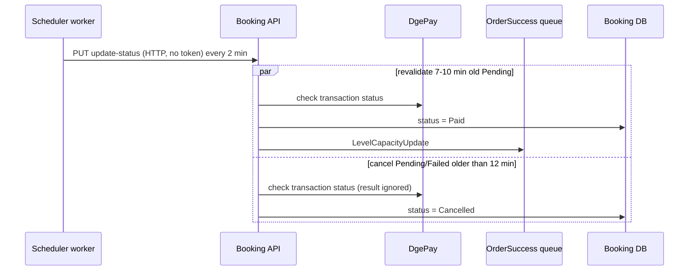

# S-05 · পেন্ডিং/ব্যর্থ পেমেন্ট পুনঃযাচাই

> **Bangla name:** পেন্ডিং/ব্যর্থ পেমেন্ট পুনঃযাচাই
>
> [← 50 · System-initiated](README.md) · [সূচিপত্র](../README.md) · [ওপেন কোয়ারি](../99-open-queries.md)

## 1. নাম ও উদ্দেশ্য

**পেন্ডিং/ব্যর্থ পেমেন্ট পুনঃযাচাই।** প্রতি ২ মিনিটে Scheduler Booking সার্ভিসকে কল করে, যা (ক) সাম্প্রতিক পেন্ডিং অর্ডারগুলো পেমেন্ট গেটওয়ে DgePay-এর কাছে পুনরায় যাচাই করে পরিশোধিতগুলো চিহ্নিত করে, এবং (খ) ১২ মিনিটের বেশি সময় ধরে `Pending` বা `Failed` থাকা অর্ডার বাতিল করে। এতে যেসব গ্রাহক পেমেন্ট করেছেন কিন্তু তাঁদের callback আসেনি, এবং যেসব অর্ডার অসমাপ্ত রয়ে গেছে — সবই আড়াল থাকে। ধারণাগুলো: [ব্যাকগ্রাউন্ড ওয়ার্কার](../00-platform-primer.md#explainer-background-workers), [টোকেন ফরওয়ার্ডিং](../00-platform-primer.md#explainer-token-forwarding) (এখানে: কোনো টোকেন নেই), [ডিস্ট্রিবিউটেড লক](../00-platform-primer.md#explainer-distributed-locks)।

## 2. ট্রিগার ও অ্যাক্টর

Scheduler-এর একটি টাইমার (`PendingOrFailedBookingStatusUpdateService`); কোনো টোকেন ছাড়াই Booking-এর `PUT /booking/api/v1/user-booking-order/update-status` কল করে **[HTTP, no token / internal]**।

## 3. ব্যবসায়িক প্রবাহ

একটি অর্ডার `Pending` হিসেবে তৈরি হয় এবং গ্রাহকের পেমেন্টের সময় ১২ মিনিট থাকে। DgePay callback না এলে প্ল্যাটফর্ম তৈরির ৭ থেকে ১০ মিনিটের মধ্যে DgePay-এর কাছে লেনদেনের স্ট্যাটাস জিজ্ঞেস করে এবং পরিশোধিত হলে অর্ডার সম্পূর্ণ করে। ১২ মিনিট পরেও যে অর্ডার `Pending` বা `Failed` থাকে তা বাতিল হয়।

## 4. কারিগরি প্রবাহ

1. **[Worker: ১ মিনিট স্টার্ট ডিলে, তারপর প্রতি ২ মিনিটে; RedLock `pending_cancel_booking_status_updater`, মেয়াদ ২ মিনিট, অপেক্ষা নেই; ত্রুটির পর অতিরিক্ত ২ মিনিট]** `PendingOrFailedBookingStatusUpdateTaskManager` হিসাব করে `cutoffTime = UtcNow - 12 min` এবং কল করে `IBookingClient.UpdatePendingOrFailedBookingStatusToCancelAsync` → `PUT /booking/api/v1/user-booking-order/update-status`, বডি `{ "CutoffTime": "<UTC time>" }`।
2. এই endpoint (কোনো `[Authorize]` নেই; মন্তব্য বলছে "don't expose to gateway") **সমান্তরালে দুটি টাস্ক** শুরু করে, প্রতিটি নিজস্ব DI scope-এ:
   - **`RevaildateRecentPendingBookingsAsync`**: স্ট্যাটাস `Pending` এবং `cutoff + 2 min` থেকে `cutoff + 5 min`-এর মধ্যে তৈরি অর্ডার লোড করে (অর্থাৎ ১০ থেকে ৭ মিনিট আগে)। প্রতিটির জন্য `dgePayPaymentManager.GetPaymentStatus(PaymentTransactionId)` DgePay-কে জিজ্ঞেস করে; গেটওয়ে `Paid` বললে অর্ডার `Paid` হয়, পেমেন্ট তথ্য সংরক্ষিত হয়, একটি `OrderSuccess` মেসেজ প্রকাশিত হয় **[SQS: OrderSuccess]** ([S-01](S-01-level-capacity-update.md)) এবং পরিবর্তনটি সেভ হয়। যেকোনো এক্সেপশন সেই অর্ডারটি নীরবে এড়িয়ে যায়।
   - **`CancelBookingAsync`**: `cutoff`-এর আগে তৈরি, স্ট্যাটাস `Pending` বা `Failed` অর্ডার লোড করে। প্রতিটির জন্য DgePay-এর স্ট্যাটাস জিজ্ঞেস করে, ফেরত পাওয়া পেমেন্ট তথ্য সংরক্ষণ করে, `Cancelled` এবং `CancelledAt = now` সেট করে এবং সেভ করে। গেটওয়েের পরিশোধিত/ব্যর্থ ফলাফল **বিস্মৃত** করা হয় (`var (_, paymentInfo)`)।
3. দুটি টাস্ক একসঙ্গে অপেক্ষা করা হয় এবং endpoint `true` ফেরত দেয়।

## 5. কম্পোনেন্ট

| ধরন | কম্পোনেন্ট |
|---|---|
| Services | Scheduler (টাইমার), Booking (লজিক) |
| External | DgePay `check_transaction_status` ([P-06](../20-user-portal/P-06-booking-payment.md)) |
| Queue | `OrderSuccess` |
| Tables | `UserBookingOrder` (`Status`, `PaymentInfo`, `CancelledAt`) |
| Redis | লক `pending_cancel_booking_status_updater`; DgePay auth টোকেন ক্যাশ `dgepay_auth_token` |
| Code | `Services/Scheduler/ETP.Scheduler.Service/Workers/*/PendingOrFailedBookingStatusUpdate*.cs`, `Core/ETP.Core/ServiceClient/BookingClient/BookingClient.cs:196`, `Services/Booking/ETP.Booking.Service/Api/UserBookingOrderController.cs:392-417`, `Services/Booking/ETP.Booking.Domain/Managers/UserBookingOrderManager.cs:1044-1140` |

## 6. API কন্ট্র্যাক্ট

| মেথড | পাথ | Auth | রিকোয়েস্ট | রেসপন্স |
|---|---|---|---|---|
| PUT | `/booking/api/v1/user-booking-order/update-status` | none | `UpdateBookingStatusRequest { cutoffTime }` | `true` |

```json
{ "CutoffTime": "2026-10-22T10:48:00Z" }
```

(Scheduler প্রপার্টিটি `CutoffTime` হিসেবে পাঠায়; মানটি উদাহরণমূলক)। অর্ডারের স্ট্যাটাস: `Pending`, `Paid`, `Failed`, `Cancelled`, এবং পরের `Requested`, `Generated`।

## 7. ডেটা ও পার্শ্বপ্রতিক্রিয়া

- `UserBookingOrder`: স্ট্যাটাস `Paid` বা `Cancelled`, `PaymentInfo`, `CancelledAt`।
- পরিশোধিত পাওয়া অর্ডারের জন্য `OrderSuccess` কিউ মেসেজ।
- লকড আসন এখানে **মুক্ত** করা হয় না; সেগুলো ১২ মিনিটের নিয়মে মেয়াদোত্তীর্ণ হয় ([S-03](S-03-locked-capacity-refresh.md))।

## 8. কোড রেফারেন্স

| কী | কোথায় |
|---|---|
| Worker loop | `rvl-gobcb-backend/Services/Scheduler/ETP.Scheduler.Service/Workers/BackgroundServices/PendingOrFailedBookingStatusUpdateService.cs:26-52` |
| Task manager | `rvl-gobcb-backend/Services/Scheduler/ETP.Scheduler.Service/Workers/TaskManagers/PendingOrFailedBookingStatusUpdateTaskManager.cs:24-39` |
| Client | `rvl-gobcb-backend/Core/ETP.Core/ServiceClient/BookingClient/BookingClient.cs:196-210` |
| Endpoint | `rvl-gobcb-backend/Services/Booking/ETP.Booking.Service/Api/UserBookingOrderController.cs:392-417` |
| Revalidate and cancel | `rvl-gobcb-backend/Services/Booking/ETP.Booking.Domain/Managers/UserBookingOrderManager.cs:1044-1112` |

## 9. হ্যান্ডওভার নোট

1. **বাতিল করার সময় গেটওয়ের ফলাফল উপেক্ষা করা হয়।** `CancelBookingAsync` DgePay-কে জিজ্ঞেস করে কিন্তু স্ট্যাটাস ছুঁড়ে দেয় এবং ১২ মিনিটের পুরনো প্রতিটি `Pending` বা `Failed` অর্ডারকে `Cancelled` সেট করে। যে গ্রাহক ৭-১০ মিনিটের যাচাই-উইন্ডোর পরে পেমেন্ট করেছেন (অথবা যার যাচাই ব্যর্থ হয়েছে), তার শেষ পর্যন্ত বাতিল অর্ডার ও সফল পেমেন্ট দুটোই থাকতে পারে। এটি হাতে মিলিয়ে সমন্বয় করা হয় কি না, রিপোজিটরিতে দেখা যায় না `[UNCONFIRMED: Q-11]`।
2. **পুনঃযাচাই-র উইন্ডো মাত্র ৩ মিনিট চওড়া** (তৈরির ৭ থেকে ১০ মিনিট পরে) এবং প্রতি ২ মিনিটে চলে, তাই একটি অর্ডার এক বা দুইবার দেখা হয়; গেটওয়ের ত্রুটি হলে সেটি নীরবে এড়িয়ে যায় (`catch { continue; }`)।
3. **দেরি আসা callback-ও উপেক্ষা করা হয়**: DgePay callback ১২ মিনিটের পুরনো অর্ডার হালনাগাদ করে না ([S-01](S-01-level-capacity-update.md) নোট ৩)।
4. **Endpoint অ্যানোনিমাস ও ব্যয়বহুল।** যে কেউ এটিতে পৌঁছাতে পারে সে যেকোনো `cutoffTime` দিয়ে একটি বাতিল রান চালু করতে পারে (যেমন বর্তমান সময়, যা প্রতিটি `Pending` বা `Failed` অর্ডার বাতিল করবে — কয়েক সেকেন্ড আগে তৈরি হওয়াগুলোও, যতক্ষণ DgePay উত্তর দেয়)। এটি গেটওয়ের মাধ্যমে প্রকাশ করা উচিত নয় ([X-18](../60-cross-cutting/X-18-endpoints-without-auth.md) বিভাগ C; architecture §2.3 B)।
5. দুটি টাস্ক সমান্তরালে চলে এবং কোনো একই অর্ডারে দুটোই স্পর্শ করতে পারে কেবল যদি তার তৈরির সময় উভয় পরিসরে পড়ে, যা পরিসরগুলো আটকায়; দুটির মধ্যে কোনো লক নেই।
6. `Failed` অর্ডার ১২ মিনিট পর বাতিল হয়, কিন্তু `Failed` স্ট্যাটাস callback বা bypass হ্যান্ডলার থেকে আসতে পারে ([P-06](../20-user-portal/P-06-booking-payment.md))।
7. **বাতিল করা নির্ভর করে DgePay পৌঁছানোর ওপর।** স্ট্যাটাস বদলানোর আগে `GetPaymentStatus` চলে; DgePay ডাউন থাকলে বা non-200 উত্তর দিলে (২ বার রিট্রাই, ৩ সেকেন্ড ব্যবধানে, ৫ সেকেন্ড টাইমআউট) এক্সেপশন অর্ডারটি এড়িয়ে যায়, এবং সেটি পরের সফল রান পর্যন্ত `Pending` থাকে।

## 10. কম্পোনেন্ট সম্পর্ক



**নির্ভর করে:** অর্ডার তৈরি ও পেমেন্ট ([P-06](../20-user-portal/P-06-booking-payment.md))। **প্রভাব ফেলে:** [S-01](S-01-level-capacity-update.md), [S-06](S-06-booking-status-generated.md), আমার বুকিং ([P-07](../20-user-portal/P-07-my-bookings.md))।

## 11. ডেভেলপার টেস্ট গাইড

**লোকালে টেস্টযোগ্যতা: আংশিক।** ওয়ার্কার ও endpoint চলে; DgePay লোকালে ডামি (`docs/local-dev.md`), তাই `GetPaymentStatus` সফল হতে পারে না (যেকোনো non-200 উত্তরে এটি `ArgumentException("Unknown error occurred in DGePay")` ছুঁড়ে)। যেহেতু কলটি `try { ... } catch { continue; }`-এর ভেতরে, পুনঃযাচাই কিছুই করে না এবং `CancelBookingAsync`-ও প্রতিটি অর্ডার এড়িয়ে যায়, তাই লোকালে অর্ডার `Pending` থাকে (নোট ৭ দেখুন)।

| বিষয় | বিবরণ |
|---|---|
| Test data and accounts | `pwsh ./scripts/Seed-EtpData.ps1`; বুকিং প্রবাহ থেকে একটি `Pending` অর্ডার |
| Browser | ইউজার পোর্টাল: একটি বুকিং শুরু করে পেমেন্ট না করে; ১২ মিনিট পর "my bookings" দেখুন |
| Emulator | লোকালে নয় (পরিচিত লগইন ঘাটতি) |
| Postman | `postman/services/etp-booking.postman_collection.json`: "PUT /api/v1/user-booking-order/update-status" `{"CutoffTime": "<time>"}` দিয়ে (কোনো টোকেন লাগে না) |
| Visual Studio debug | ব্রেকপয়েন্ট: `PendingOrFailedBookingStatusUpdateTaskManager.ExecuteAsync` (Scheduler), তারপর `UserBookingOrderManager.RevaildateRecentPendingBookingsAsync` ও `CancelBookingAsync` (Booking); দুটি সার্ভিসই চালু করুন |
| Verify | বুকিং অর্ডার টেবিলে SQL: `Status`, `CancelledAt`; দুটি সার্ভিসের Aspire লগ |