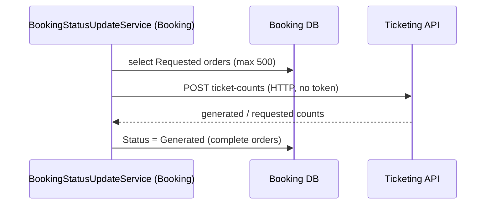

# S-06 · বুকিং স্ট্যাটাস → Generated

> **Bangla name:** বুকিং স্ট্যাটাস → Generated
>
> [← 50 · System-initiated](README.md) · [সূচিপত্র](../README.md) · [ওপেন কোয়ারি](../99-open-queries.md)

## 1. নাম ও উদ্দেশ্য

**বুকিং স্ট্যাটাসকে Generated করা।** একজন গ্রাহক তাঁর টিকিট চাওয়ার পর অর্ডারটি `Requested` স্ট্যাটাসে থাকে। এই Booking ওয়ার্কার প্রতি ২ মিনিটে Ticketing-কে জিজ্ঞেস করে সেই অর্ডারগুলোর জন্য কতগুলো টিকিট আছে, এবং যেসব অর্ডারের সব টিকিট তৈরি হয়ে গেছে তাদের `Generated`-এ সরায়। গ্রাহকের "my bookings" স্ক্রিন এই স্ট্যাটাসই পোল করে যাতে বুঝতে পারে টিকিট প্রস্তুত। ধারণাগুলো: [ব্যাকগ্রাউন্ড ওয়ার্কার](../00-platform-primer.md#explainer-background-workers), [টোকেন ফরওয়ার্ডিং](../00-platform-primer.md#explainer-token-forwarding) (এখানে: কোনো টোকেন নেই)।

## 2. ট্রিগার ও অ্যাক্টর

Booking সার্ভিসের একটি টাইমার (`BookingStatusUpdateService`); কোনো টোকেন ছাড়াই HTTP-তে Ticketing-কে কল করে **[HTTP, no token / internal]**।

## 3. ব্যবসায়িক প্রবাহ

অর্ডারের জীবন: `Pending` → `Paid` → (গ্রাহক টিকিট চান) `Requested` → (সব টিকিট সাইন হয়) `Generated`। গ্রাহক "টিকিট প্রস্তুত" অবস্থা কেবল `Generated` হওয়ার পরই দেখেন ([P-07](../20-user-portal/P-07-my-bookings.md), [P-08](../20-user-portal/P-08-ticket-generation-request.md))।

## 4. কারিগরি প্রবাহ

**[Worker: ১ মিনিট স্টার্ট ডিলে, তারপর প্রতি ২ মিনিটে; RedLock `booking_status_updater`, মেয়াদ ২ মিনিট, অপেক্ষা নেই]**

1. `BookingStatusUpdateTaskManager` লক নেয়, তারপর `GetRequestedBookingsAsync` সর্বোচ্চ **৫০০**টি `Status == Requested` অর্ডার বাছে (তারিখ-পরিসরের আর্গুমেন্ট উপেক্ষা করা হয়; রিপোজিটরিতে তারিখ শর্তটি কমেন্ট করা)।
2. `ITicketingClient.GetTicketsCountAsync(ids, onlyGenerated: true, createdBy: "user")` → `POST /ticketing/api/v1/booking-order-ticket/ticket-counts?createdBy=user`, বুকিং আইডির তালিকা সহ **[HTTP, no token / internal]**। Ticketing একটি ডিকশনারি ফেরত দেয় `bookingId → { generatedCount, requestedCount }`।
3. যেসব অর্ডারে `generatedCount == NumberOfSeats`, সেগুলো একটি স্টেটমেন্টে আপডেট হয়: `UPDATE ... SET Status = Generated WHERE Id IN (...) AND Status = Requested` (`ExecuteUpdateAsync`)।
4. যেকোনো এক্সেপশন লগ হয় এবং ম্যানেজার ১ মিনিট অপেক্ষা করে আবার চেষ্টা করে।

স্ট্যাটাস পরিবর্তনটি [টিকিট-তৈরি নোটিফিকেশন](S-12-ticket-generated-notification.md)-ও ব্যবহার করে: S-12 সেসব অর্ডার বাছে যেগুলো `Generated` কিন্তু এখনও নোটিফাই করা হয়নি।

## 5. কম্পোনেন্ট

| ধরন | কম্পোনেন্ট |
|---|---|
| Services | Booking (ওয়ার্কার, ডেটা), Ticketing (সংখ্যা) |
| Tables | `UserBookingOrder.Status`; Ticketing টিকিট (পড়া) |
| Redis | লক `booking_status_updater` |
| Code | `Services/Booking/ETP.Booking.Service/Workers/BackgroundServices/BookingStatusUpdateService.cs`, `.../TaskManagers/BookingStatusUpdateTaskManager.cs`, `Services/Booking/ETP.Booking.Storage/Repositories/UserBookingOrderRepository.cs:97-127`, `Core/ETP.Core/ServiceClient/TicketingClient/TicketingClient.cs:83` |

## 6. API কন্ট্র্যাক্ট

| মেথড | পাথ | Auth | রিকোয়েস্ট | রেসপন্স |
|---|---|---|---|---|
| POST | `/ticketing/api/v1/booking-order-ticket/ticket-counts?onlyGenerated=true&createdBy=user` | none | বুকিং আইডির JSON অ্যারে (`[12, 13]`) | `{ "<bookingId>": { "generatedCount": n, "requestedCount": n } }` |

(আকৃতিটি `BookingOrderTicketController.cs:126-139`-এর `TicketCount` থেকে এসেছে; আইডি মানগুলো উদাহরণ)। endpoint-এ কোনো `[Authorize]` নেই ([X-18](../60-cross-cutting/X-18-endpoints-without-auth.md) বিভাগ C)।

## 7. ডেটা ও পার্শ্বপ্রতিক্রিয়া

সম্পূর্ণ অর্ডারগুলোর জন্য `UserBookingOrder.Status` `Requested` থেকে `Generated` হয়।

## 8. কোড রেফারেন্স

| কী | কোথায় |
|---|---|
| Loop | `rvl-gobcb-backend/Services/Booking/ETP.Booking.Service/Workers/BackgroundServices/BookingStatusUpdateService.cs:22-33` |
| Work | `rvl-gobcb-backend/Services/Booking/ETP.Booking.Service/Workers/TaskManagers/BookingStatusUpdateTaskManager.cs:28-62` |
| Queries | `rvl-gobcb-backend/Services/Booking/ETP.Booking.Storage/Repositories/UserBookingOrderRepository.cs:97-106, 121-127` |
| Ticket counts | `rvl-gobcb-backend/Services/Ticketing/ETP.Ticketing.Service/Api/BookingOrderTicketController.cs:126-139` |
| Client | `rvl-gobcb-backend/Core/ETP.Core/ServiceClient/TicketingClient/TicketingClient.cs:83-110` |

## 9. হ্যান্ডওভার নোট

1. **প্রতি রানে কেবল প্রথম ৫০০টি `Requested` অর্ডার দেখা হয়**, কোনো নির্ধারিত ক্রমে নয় (কোনো `OrderBy` নেই)। ৫০০-এর বেশি `Requested` থাকলে কিছু অপেক্ষা করে; আর যেসব অর্ডারের টিকিট সম্পূর্ণ নয়, সেগুলো প্রতি রানে আবার দেখা হয় এবং ৫০০-এর ঘাটতি ভরায়।
2. আংশিক অর্ডার সব আসনের টিকিট তৈরি না হওয়া পর্যন্ত `Requested` থাকে; `Requested`-এ আটকে থাকা অর্ডারের জন্য কোনো টাইমআউট বা অ্যালার্ট নেই `[UNCONFIRMED: Q-12]`।
3. সফল হওয়ার লগটি প্রকৃত আপডেট সংখ্যা নয়, `bookingIds.Count` (দেখা অর্ডারের সংখ্যা) ছাপে।
4. `GetRequestedBookingsAsync`-এর তারিখ-পরিসরের প্যারামেটারগুলো গ্রহণ করা হয় কিন্তু ব্যবহার হয় না (ফিল্টারটি কমেন্ট করা); ইন্টারফেস একটি সময়-উইন্ডোর কথা বলে যা বাস্তবে নেই।
5. Booking-এর দুটি ইনস্ট্যান্স একসঙ্গে এই লুপ চালাতে পারে; লক `booking_status_updater` ও সুরক্ষিত `UPDATE ... WHERE Status = Requested` এটি নিরাপদ রাখে।

## 10. কম্পোনেন্ট সম্পর্ক

**নির্ভর করে:** [S-07](S-07-initiate-user-ticket-generation.md) ও [S-08](S-08-ticket-signing.md) (টিকিটের অস্তিত্ব)। **প্রভাব ফেলে:** [P-07](../20-user-portal/P-07-my-bookings.md), [S-12](S-12-ticket-generated-notification.md), [S-10](S-10-vat-challan.md) (VAT পরিশোধিত অর্ডারে স্বাধীনভাবে চলে)।

## 11. ডেভেলপার টেস্ট গাইড

**লোকালে টেস্টযোগ্যতা: আংশিক।** ওয়ার্কার ও Ticketing লোকালে চলে; আসল টিকিট সাইনিংয়ের জন্য TSP (ডামি) দরকার, তাই সাইনিং সিমুলেট না করলে অর্ডার `Generated`-এ পৌঁছায় না `[UNCONFIRMED: Q-06]`।

| বিষয় | বিবরণ |
|---|---|
| Test data and accounts | `pwsh ./scripts/Seed-EtpData.ps1`-এ অর্ডার থাকতে পারে; ইউজার …11 |
| Browser | ইউজার পোর্টাল: my bookings; জেনারেশনের স্ট্যাটাস পোল করা হয় ([P-07](../20-user-portal/P-07-my-bookings.md)) |
| Emulator | লোকালে নয় (পরিচিত লগইন ঘাটতি) |
| Postman | `postman/services/etp-ticketing.postman_collection.json`-এর "POST /api/v1/booking-order-ticket/ticket-counts", বডি `[<id>]` |
| Visual Studio debug | `BookingStatusUpdateTaskManager.ExecuteAsync` (Booking) ও `GetTicketCountsAsync` (Ticketing)-এ ব্রেকপয়েন্ট |
| Verify | SQL: বুকিং অর্ডার টেবিলে `Status`-ভিত্তিক সংখ্যা; Aspire লগে "Booking status: Updated N bookings to generated" |