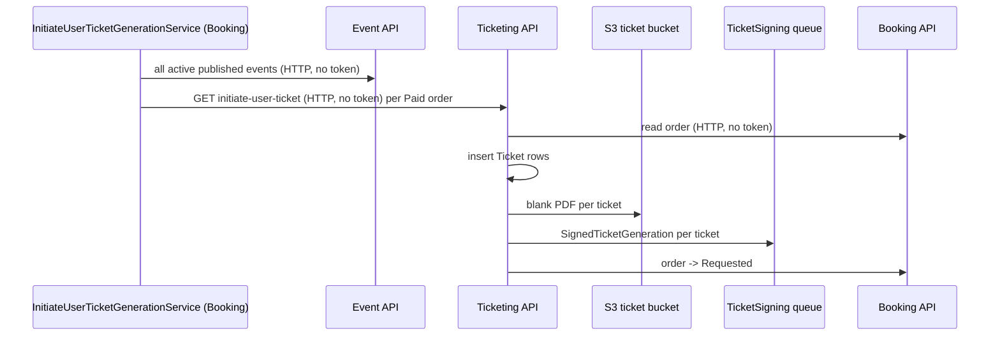

# S-07 · ইউজার টিকিট তৈরি শুরু

> **Bangla name:** ইউজার টিকিট জেনারেশন শুরু করা
>
> [← 50 · System-initiated](README.md) · [সূচিপত্র](../README.md) · [ওপেন কোয়ারি](../99-open-queries.md)

## 1. নাম ও উদ্দেশ্য

**ইউজার টিকিট জেনারেশন শুরু করা।** একটি পরিশোধিত অর্ডার কেবল কেউ Ticketing-কে সেগুলো তৈরি করতে বললেই টিকিটে পরিণত হয়। গ্রাহকরা পোর্টাল বা অ্যাপ থেকে বলতে পারেন ([P-08](../20-user-portal/P-08-ticket-generation-request.md)); এই Booking ওয়ার্কার সেটি স্বয়ংক্রিয়ভাবে করে সেসব পরিশোধিত অর্ডারের জন্য যেগুলোর কোনো কেউ চায়নি। এটি টিকিটের সারি তৈরি করে, প্রতিটি টিকিটের জন্য একটি খালি PDF রেন্ডার করে, সেটি S3-তে রাখে এবং প্রতি টিকিটের জন্য একটি করে সাইনিং জব `TicketSigning` কিউতে দেয় ([S-08](S-08-ticket-signing.md))। ধারণাগুলো: [ব্যাকগ্রাউন্ড ওয়ার্কার](../00-platform-primer.md#explainer-background-workers), [কিউ-চালিত প্রক্রিয়াকরণ](../00-platform-primer.md#explainer-queue-driven), [ডিস্ট্রিবিউটেড লক](../00-platform-primer.md#explainer-distributed-locks)।

## 2. ট্রিগার ও অ্যাক্টর

Booking সার্ভিসের একটি টাইমার (`InitiateUserTicketGenerationService`)। একই Ticketing কল `initiate-user-ticket` পেমেন্ট নিশ্চিত হওয়ার সঙ্গে সঙ্গে DgePay callback থেকেও করা হয় (`UserBookingOrderManager.HandleDgePayment`, প্রায় ৩৮৮ নম্বর লাইনে; সেখানে ব্যর্থতা কেবল লগ হয়), তাই ওয়ার্কারটি মূলত সেসব অর্ডার ধরে যেগুলোর ক্ষেত্রে সেই কল হয়নি বা ব্যর্থ হয়েছিল। এটি কোনো টোকেন ছাড়াই HTTP-তে Event সার্ভিস ও Ticketing সার্ভিসকে কল করে **[HTTP, no token / internal]**।

## 3. ব্যবসায়িক প্রবাহ

একটি ইভেন্টের টিকিট বিক্রি শুরু হলে (`TicketAvailabilityStartDateTime` পেরিয়ে গেছে), ওই ইভেন্টের প্রতিটি `Paid` অর্ডার টিকিট পায় — গ্রাহক অ্যাপ খুলুক বা না খুক। টিকিটগুলোর নম্বর `{TicketNumberPrefix}{unique code}` এবং বুকিংয়ের সময় দেওয়া বাহকের নাম ও ফোন থাকে।

## 4. কারিগরি প্রবাহ

1. **[Worker: স্টার্টের ১০ মিনিট পর প্রথম রান, তারপর প্রতি ১৫ মিনিটে; RedLock `user_ticket_generator_{eventId}`, মেয়াদ ১২ মিনিট, অপেক্ষা নেই]** `InitiateUserTicketGenerationTaskManager.ExecuteAsync` `IEventClient.GetAllActivePublishedEvents()`-এর মাধ্যমে সব সক্রিয়, প্রকাশিত ইভেন্ট চান এবং সেগুলোর মধ্যে যাদের `TicketAvailabilityStartDateTime` ভবিষ্যতে নয় তাদের রাখে।
2. এমন প্রতিটি ইভেন্টের জন্য এটি লক নেয় এবং ওই ইভেন্টের জন্য স্ট্যাটাস `Paid` এমন সর্বোচ্চ **২০০**টি অর্ডার লোড করে (`GetPaidBookingsAsync`)।
3. প্রতিটি অর্ডারের জন্য এটি `ITicketingClient.InitiateUserTicket(publicId)` কল করে → `GET /ticketing/api/v1/booking-order-ticket/initiate-user-ticket?orderId={publicId}` **[HTTP, no token / internal]**।
4. Ticketing-এর `TicketManager.InitiateUserTicket`: Booking থেকে অর্ডারটি পড়ে (**[HTTP, no token]** `IBookingClient`); স্ট্যাটাস `Paid` বা `Requested` চাই; `Paid`-এর ক্ষেত্রে এটি লক `create_user_ticket_{orderId}` (৩০ সে) নেয় এবং
   - কোনো টিকিট না থাকলে **`InitiateBulkTicketForNewlyPaidOrder`** প্রতি আসনের জন্য একটি করে `Ticket` সারি ঢোকায় (স্ট্যাটাস `Active`, ধরন `User`, নম্বর `eventSettings.TicketNumberPrefix` + একটি ইউনিক কোড, বাহক বুকিংয়ের ইউজার রেকর্ড থেকে);
   - তারপর **`TicketGenerateRequest`**: প্রতি টিকিটের জন্য খালি PDF রেন্ডার করে (`GetBlankPdf`) এবং টিকিট বাকেটে `{BlankBase}/user/{userId}/{orderPublicId}/{ticketNumber}.pdf`-এ আপলোড করে ([X-20](../60-cross-cutting/X-20-file-storage.md)), টিকিটকে `Requested` সেট করে, প্রতি টিকিটের জন্য একটি করে `SignedTicketGeneration` মেসেজ প্রকাশ করে **[SQS: TicketSigning]** (লেআউটের আকার অনুযায়ী QR অবস্থান, `Platform=user-ticket`, নাম, ফোন, তারিখ, টিকিট আইডি, গ্যালারি, ব্লক, লেভেল, গেট, আসন-এর মতো ফিল্ড), এবং Booking-কে অর্ডারটি `Requested`-এ সরাতে বলে (**[HTTP, no token]** `IBookingClient.TicketGenerateRequest`)।
5. [S-08](S-08-ticket-signing.md) টিকিটগুলো সাইন করে; [S-06](S-06-booking-status-generated.md) অর্ডারটিকে `Generated`-এ সরায়।

গ্রাহকের বাটন থেকেও একই Ticketing কোড পথে পৌঁছানো যায়: `PATCH /ticketing/api/v1/booking-order-ticket/generate-request/{publicId}` সরাসরি `TicketGenerateRequest` চালায় ([P-08](../20-user-portal/P-08-ticket-generation-request.md))।

## 5. কম্পোনেন্ট

| ধরন | কম্পোনেন্ট |
|---|---|
| Services | Booking (ওয়ার্কার), Event (ইভেন্টের তালিকা), Ticketing (তৈরি), Admin/Event-এর ভেন্যু ও লেআউটের ডেটা |
| Queue | `TicketSigning` |
| Tables | বুকিং অর্ডার (`Status`), Ticketing `Tickets` (`TicketNumber`, `Status`, `BlankTicketUrl`, `BackPageTicketUrl`) |
| Storage | S3 টিকিট বাকেট (খালি PDF), টেমপ্লেট ([X-20](../60-cross-cutting/X-20-file-storage.md)) |
| Redis | লক `user_ticket_generator_{eventId}`, `create_user_ticket_{orderId}` |
| Code | `Services/Booking/ETP.Booking.Service/Workers/*/InitiateUserTicketGeneration*.cs`, `Services/Ticketing/ETP.Ticketing.Domain/Managers/TicketManager.cs:79-143, 261-356, 2105-2133` |

## 6. API কন্ট্র্যাক্ট

| মেথড | পাথ | Auth | রিকোয়েস্ট | রেসপন্স |
|---|---|---|---|---|
| GET | `/ticketing/api/v1/booking-order-ticket/initiate-user-ticket?orderId=` | none | query `orderId` (Guid) | অর্ডারের `UserBooking` |
| GET | `/ticketing/api/v1/booking-order-ticket/initiate?orderId=` | none | query `orderId` | `200` খালি; কেবল টিকিট তৈরি করে (`InitiateBulkTicketForNewlyPaidOrder`) |
| PATCH | `/ticketing/api/v1/booking-order-ticket/generate-request/{publicId}` | none | path | তার টিকিটসহ অর্ডার |

কিউ মেসেজ `SignedTicketGeneration`: `FileName`, `GateId`, `OrderId` (টিকিট আইডি), `QRPosition` (৩টি সংখ্যা), `UnsignedTicketUrl`, `Data` (`label`/`value` ফিল্ডের ডিকশনারি)। কনজিউমারের জন্য [S-08](S-08-ticket-signing.md) দেখুন।

## 7. ডেটা ও পার্শ্বপ্রতিক্রিয়া

- নতুন `Ticket` সারি; S3-তে খালি PDF; `TicketSigning`-এ প্রতি টিকিটে একটি মেসেজ; অর্ডারের স্ট্যাটাস `Paid` → `Requested` হয়।
- ভারী কাজ: প্রতি টিকিটে একটি PDF রেন্ডার ও একটি S3 আপলোড, HTTP কলের ভেতরেই চলে।

## 8. কোড রেফারেন্স

| কী | কোথায় |
|---|---|
| Loop | `rvl-gobcb-backend/Services/Booking/ETP.Booking.Service/Workers/BackgroundServices/InitiateUserTicketGenerationService.cs:21-36` |
| Work | `rvl-gobcb-backend/Services/Booking/ETP.Booking.Service/Workers/TaskManagers/InitiateUserTicketGenerationTaskManager.cs:42-120` |
| Endpoints | `rvl-gobcb-backend/Services/Ticketing/ETP.Ticketing.Service/Api/BookingOrderTicketController.cs:37-64, 112-117` |
| Ticket creation | `rvl-gobcb-backend/Services/Ticketing/ETP.Ticketing.Domain/Managers/TicketManager.cs:79-143` |
| Generation request | `rvl-gobcb-backend/Services/Ticketing/ETP.Ticketing.Domain/Managers/TicketManager.cs:261-356` |
| Client | `rvl-gobcb-backend/Core/ETP.Core/ServiceClient/TicketingClient/TicketingClient.cs:40-54` |

## 9. হ্যান্ডওভার নোট

1. **কোনো ইভেন্ট যোগ্য না হলে সম্ভবত busy loop।** `ExecuteAsync`-তে, যদি টিকিটিং শুরু করা এমন কোনো সক্রিয় প্রকাশিত ইভেন্ট না থাকে, কোডটি "No active and published events available for ticketing." লগ করে এবং `while` লুপের ভেতরে `continue` চালায়, যা লুপ বডির শেষে থাকা ১৫ মিনিটের `Task.Delay` এড়িয়ে যায়, ফলে লুপ সঙ্গে সঙ্গে আবার শুরু হয়। ওই বার্তাটি পুনরাবৃত্ত হচ্ছে কি না Booking লগ দেখুন; এটি কোড থেকে পড়া, পর্যবেক্ষণ করা নয় `[UNCONFIRMED: Q-12]`।
2. **টাস্ক ম্যানেজারে ডেড কোড।** `ProcessVatInvoice` ও তার ইনজেক্ট করা নির্ভরতা (NBR ম্যানেজার, নোটিফিকেশন ক্লায়েন্ট, ইভেন্ট ডেটা) এই ক্লাস থেকে কল করা হয় না; VAT করে [S-10](S-10-vat-challan.md)।
3. **ইডেমপোটেন্সি।** কেবল `InitiateBulkTicketForNewlyPaidOrder` সরাসরি কল করলে টিকিট থাকলে সেটি "Ticket is already generated." ছুঁড়ে দেয়; `InitiateUserTicket` সেটি এড়ায় আগে বিদ্যমান টিকিট খুঁজে দেখে। অর্ডার `Requested` হওয়ার পর বারবার কল করলে আর কিছুই হয় না।
4. **অ্যানোনিমাস endpoint।** `initiate`, `initiate-user-ticket` ও `generate-request/{publicId}`-এর কোনোটিতেই `[Authorize]` নেই; অর্ডারের পাবলিক আইডি জানা যে কেউ জেনারেশন চালু করতে পারে ([X-18](../60-cross-cutting/X-18-endpoints-without-auth.md))। অ্যানোনিমাস `payment-status-bypass`-এর ([S-01](S-01-level-capacity-update.md)) সঙ্গে মিলিয়ে এটি অপরিশোধিত অর্ডারকে টিকিটে পরিণত করতে দেয়।
5. **লকের মেয়াদ কাজের চেয়ে ছোট।** প্রতি ইভেন্টের লক ১২ মিনিট পরে মেয়াদোত্তীর্ণ হয়, অথচ ২০০ পর্যন্ত অর্ডার একটির পর একটি PDF রেন্ডার করে প্রক্রিয়া হয়; রান বেশি সময় নিলে দ্বিতীয় ইনস্ট্যান্স একই ইভেন্ট শুরু করতে পারে (প্রতি-অর্ডার লক `create_user_ticket_*` ও বিদ্যমান-টিকিট পরীক্ষা ক্ষতি সীমিত রাখে)।
6. অর্ডারগুলো ডাটাবেসের ক্রমে সাজানো ছাড়াই প্রক্রিয়া হয়; প্রতি ইভেন্টে ২০০-এর বেশি `Paid` অর্ডার থাকলে বাকিগুলো পরের রানের জন্য অপেক্ষা করে।
7. ১০ মিনিটের প্রথম-রান বিলম্বের কারণে Booking রিস্টার্টের প্রথম ১০ মিনিটে স্বয়ংক্রিয় পথ কখনোই চলে না।

## 10. কম্পোনেন্ট সম্পর্ক

**নির্ভর করে:** পরিশোধিত অর্ডার ([P-06](../20-user-portal/P-06-booking-payment.md), [S-05](S-05-pending-failed-revalidation.md)), টিকিট লেআউট ([A-13](../10-admin-portal/A-13-ticket-layouts.md)), `TicketNumberPrefix`-সহ ইভেন্ট সেটিংস ([A-08](../10-admin-portal/A-08-event-settings.md))। **প্রভাব ফেলে:** [S-08](S-08-ticket-signing.md), [S-06](S-06-booking-status-generated.md), [P-07](../20-user-portal/P-07-my-bookings.md), [P-09](../20-user-portal/P-09-ticket-details-downloads.md)।

## 11. ডেভেলপার টেস্ট গাইড

**লোকালে টেস্টযোগ্যতা: আংশিক।** টিকিট ও খালি PDF লোকালে তৈরি হয় (Floci-তে S3); সাইনিং ধাপের জন্য TSP দরকার, যা ডামি ([S-08](S-08-ticket-signing.md))।

| বিষয় | বিবরণ |
|---|---|
| Test data and accounts | `pwsh ./scripts/Seed-EtpData.ps1`; এমন একটি ইভেন্টের `Paid` অর্ডার যার `TicketAvailabilityStartDateTime` পেরিয়ে গেছে |
| Browser | ইউজার পোর্টাল: my bookings → generate tickets; Network-এ `PATCH .../generate-request/{id}` দেখা যাবে |
| Emulator | লোকালে নয় (পরিচিত লগইন ঘাটতি) |
| Postman | `postman/services/etp-ticketing.postman_collection.json`: "GET /api/v1/booking-order-ticket/initiate-user-ticket" (কোনো টোকেন লাগে না) |
| Visual Studio debug | Booking: `InitiateUserTicketGenerationTaskManager.ExecuteAsync` (১০ মিনিট পর প্রথম রান); Ticketing: `TicketManager.InitiateUserTicket`, `TicketGenerateRequest` |
| Verify | SQL: Ticketing টিকিট টেবিলে অর্ডারের সারি, `Status = Requested`; `aws --endpoint-url http://localhost:4566 s3 ls s3://etp-local/blank/ --recursive`; `TicketSigning` কিউর মেসেজ সংখ্যা |