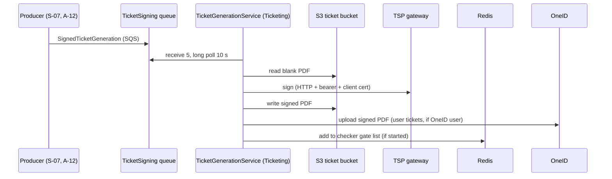

# S-08 · TSP-এর মাধ্যমে টিকিট সাইনিং (TicketSigning কিউ)

> **Bangla name:** TSP-এর মাধ্যমে টিকিট সাইনিং (TicketSigning কিউ)
>
> [← 50 · System-initiated](README.md) · [সূচিপত্র](../README.md) · [ওপেন কোয়ারি](../99-open-queries.md)

## 1. নাম ও উদ্দেশ্য

**টিকিট সাইনিং।** প্রতিটি টিকিট PDF-এ একটি QR কোড থাকে যা চেকার অ্যাপ অফলাইনে যাচাই করে। কোডটি একটি **ট্রাস্ট সার্ভিস প্রোভাইডার (TSP)** তৈরি করে, যা PDF সাইন করে এবং একটি দৃশ্যমান ডিজিটাল সিল (VDS) QR সেতে বসায়। Ticketing ওয়ার্কার `TicketGenerationService` `TicketSigning` কিউ থেকে সাইনিং জব পড়ে, প্রতিটি খালি PDF TSP গেটওয়েতে পাঠায়, সাইন করা PDF S3-তে রাখে এবং টিকিটকে `Generated` চিহ্নিত করে। ধারণাগুলো: [কিউ-চালিত প্রক্রিয়াকরণ](../00-platform-primer.md#explainer-queue-driven), [ব্যাকগ্রাউন্ড ওয়ার্কার](../00-platform-primer.md#explainer-background-workers), [ডিস্ট্রিবিউটেড লক](../00-platform-primer.md#explainer-distributed-locks)।

## 2. ট্রিগার ও অ্যাক্টর

- **প্রোডিউসার:** Ticketing `TicketManager`: ইউজার টিকিট ([S-07](S-07-initiate-user-ticket-generation.md) এবং গ্রাহকের বাটন, `TicketGenerateRequest`) এবং রিজার্ভড টিকিট (`PublishBulkTicketToSign`, `CreateReservationTicketsAsync`; [A-12](../10-admin-portal/A-12-reserved-tickets.md))।
- **কনজিউমার:** Ticketing সার্ভিসের ওয়ার্কার; কোনো ইউজার নেই, কোনো টোকেন নেই।

## 3. ব্যবসায়িক প্রবাহ

গ্রাহকের টিকিট কেবল সাইন হলেই গেটে ব্যবহারযোগ্য। তার আগে টিকিট `Requested` থাকে এবং অর্ডারও `Requested`; অর্ডারের সব টিকিট `Generated` হলে অর্ডারটি `Generated` হয় ([S-06](S-06-booking-status-generated.md)) এবং গ্রাহক ডাউনলোড করতে পারেন।

## 4. কারিগরি প্রবাহ

**[Worker: স্টার্টের ১ মিনিট পর প্রথম রান, তারপর ক্রমাগত; RedLock `signed_ticket_generator_{0..9}`, মেয়াদ ১ মিনিট, অপেক্ষা নেই]** `TicketGenerationService` বিরতিহীনভাবে লুপ করে: একটি র‍্যান্ডম স্লট লক নেয়, `TicketGenerationTaskManager` একবার চালায়, আবার শুরু করে। টাস্ক ম্যানেজার দীর্ঘ-পোলিং করে `TicketSigning` পড়ে (`MaxNumberOfMessages` 5, `WaitTimeSeconds` 10, visibility ৬০ সে); খালি উত্তর এলে ১০ সেকেন্ড অপেক্ষা করে ফেরত দেয়।

`SignedTicketGeneration` বডি-সহ প্রতিটি মেসেজের জন্য (৫টি **সমান্তরালে** প্রক্রিয়া করা হয়):

1. `IsTicketSigned(OrderId)`: `OrderId`-তে **টিকিট আইডি** থাকে। আগে থেকেই সাইন হলে মেসেজটি মুছে ফেলা হয় এবং থামা হয়।
2. S3 থেকে খালি PDF নামানো হয় (`UnsignedTicketUrl`), সেটি base64-এনকোড করা হয়, এবং `TicketSigningPayload` তৈরি হয়: `TSP:*` থেকে `DigitalIdentityId` ও `UserId`, একটি `Document { Data, FileName, VdsData { QrCodeData = Data, QrCodeSize, QrCodeXPosition, QrCodeYPosition } }` (অবস্থানের মান `QRPosition[0..2]` থেকে)।
3. `TspSignedTicketProvider.GetSignedBase64TicketAsync` **[HTTP, static key / client certificate]**: `POST {TSP:SignUrl}`। ক্লায়েন্ট `TspAuthProvider` থেকে একটি bearer টোকেন যোগ করে (`GET {TSP:AuthUrl}`, ক্লায়েন্ট সার্টিফিকেট সহ, Redis-এ `tsp_token` হিসেবে ১ মিনিট ক্যাশ করা)। স্ট্যাটাস 2xx না হলে, বা `Data.SignedData` খালি হলে ব্যর্থতা।
4. `TicketManager.GenerateSignedTicketAsync(ticketId, signedBase64, complimentaryType, gateId)`:
   - **ইউজার টিকিট** (`Complimentary` ফিল্ড নেই): `{SignedBase}/user/{createdBy}/{orderPublicId}/{ticketNumber}.pdf`-এ আপলোড;
   - **রিজার্ভড টিকিট** (`Complimentary` ফিল্ড আছে): লেআউট ও টিকিট অ্যাট্রিবিউট ব্যবহার করে PDF-তে টিকিটের তথ্য আঁকে (`DrawTicketInfo`) এবং `{SignedBase}/reserved/{createdBy}/{orderPublicId}/{ticketNumber}-{type}.pdf`-এ আপলোড;
   - টিকিটকে `SignedTicketUrl`-সহ `Generated` সেট করে;
   - **শুধু ইউজার টিকিট:** অর্ডারে OneID user id থাকলে সাইন করা PDF OneID-তে আপলোড করে (`SyncDocumentWithVdsQrAsync`; VDS QR আর্গুমেন্ট হার্ড-কোড করা `null`, TODO হিসেবে চিহ্নিত), এবং সফল হলে `OneIdSync = true` সেট করে; ত্রুটি লগ করে উপেক্ষা করা হয় ([P-10](../20-user-portal/P-10-oneid-ticket-sync.md));
   - টিকিটের গেট ম্যাপ করা থাকলে এবং ওই গেটের জন্য চেকার ডাউনলোড তালিকা Redis-এ আগে থেকেই থাকলে, টিকিট নম্বরটি `ticket_checker_tickets:event_{e}_gate_{g}`-এ যোগ করা হয় যাতে অফলাইন চেকাররা পরের সিঙ্কে পায় ([C-02](../40-checker-app/C-02-offline-ticket-download.md), [C-05](../40-checker-app/C-05-ticket-sync.md))।
5. মেসেজটি মুছে ফেলা হয়। যেকোনো এক্সেপশনে মেসেজটি **মোছা হয় না** এবং ৬০ সেকেন্ড পর ফিরে আসে।

## 5. কম্পোনেন্ট

| ধরন | কম্পোনেন্ট |
|---|---|
| Services | Ticketing |
| Queue | `TicketSigning` |
| External | TSP gateway (auth URL ও sign URL), OneID ডকুমেন্ট সিঙ্ক ([P-10](../20-user-portal/P-10-oneid-ticket-sync.md)) |
| Storage | S3 টিকিট বাকেট (খালি ঢোকে, সাইন করা বের হয়) |
| Tables | Ticketing `Tickets` (`Status`, `SignedTicketUrl`, `OneIdSync`, `OneIdSyncedAt`) |
| Redis | `signed_ticket_generator_{n}` লক, `tsp_token`, `ticket_checker_tickets:*`, `TicketCheckerLevelGateMap` |
| Code | `Services/Ticketing/ETP.Ticketing.Service/Workers/*`, `Services/Ticketing/ETP.Ticketing.Domain/TspClient/*`, `.../Managers/TicketManager.cs:375-513` |
| Config | `TSP:AuthUrl`, `TSP:SignUrl`, `TSP:UserId`, `TSP:DigitalIdentityId`, `AWS:Queue:TicketSigning`, `AWS:Ticket:*`; ক্লায়েন্ট সার্টিফিকেট ফাইল `Cert/tspgw_client.pfx` ([X-26](../60-cross-cutting/X-26-configuration.md)) |

## 6. API কন্ট্র্যাক্ট

এর নিজস্ব কোনো endpoint নেই। কিউ মেসেজ `SignedTicketGeneration` (`Core/ETP.Core/Queue/Messages`): `FileName`, `GateId`, `OrderId` (টেক্সট হিসেবে টিকিট আইডি), `QRPosition` `[x, y, size]`, `UnsignedTicketUrl`, `Data` (নাম → `{ Label, Value }`, উদাহরণ: `Platform`, `Name`, `Phone`, `Date`, `Time`, `Ticket ID`, `Event ID`, `Gallery`, `Block`, `Level`, `Entry Gate`, `Mini Gate`, ঐচ্ছিক `Seat`, এবং রিজার্ভড টিকিটের জন্য `Complimentary`)। ইউজার টিকিটের জন্য `TicketGenerateRequest` `QRPosition` সেট করে `[900, 650, 650]` (ডিফল্ট ও ভার্টিক্যাল লেআউট), `[1650, 915, 650]` (A4) বা `[2494, 1055, 650]` (হরাইজন্টাল)।

TSP রিকোয়েস্ট ও রেসপন্স বডি `TicketSigningPayload.cs` ও `TspResponse`-এ আছে (`Data.Token`, `Data.SignedData[]`, `Code`, `Message`)।

## 7. ডেটা ও পার্শ্বপ্রতিক্রিয়া

S3-তে সাইন করা PDF, আপডেট হওয়া টিকিট সারি, ঐচ্ছিক OneID আপলোড, Redis চেকার তালিকার আপডেট। অর্ডার [S-06](S-06-booking-status-generated.md)-এর মাধ্যমে এগিয়ে যায়।

## 8. কোড রেফারেন্স

| কী | কোথায় |
|---|---|
| Loop | `rvl-gobcb-backend/Services/Ticketing/ETP.Ticketing.Service/Workers/BackgroundServices/TicketGenerationService.cs:27-52` |
| Message handling | `rvl-gobcb-backend/Services/Ticketing/ETP.Ticketing.Service/Workers/TaskManagers/TicketGenerationTaskManager.cs:46-128` |
| TSP client | `rvl-gobcb-backend/Services/Ticketing/ETP.Ticketing.Domain/TspClient/TspSignedTicketProvider.cs`, `TspAuthProvider.cs`, `TspTokenHandler.cs` |
| Client registration (certificate) | `rvl-gobcb-backend/Services/Ticketing/ETP.Ticketing.Service/Configurations/DependencyConfig.cs:177-225` |
| After-sign handling | `rvl-gobcb-backend/Services/Ticketing/ETP.Ticketing.Domain/Managers/TicketManager.cs:380-513` |
| Producers | `.../TicketManager.cs:346` (ইউজার), `:1421`, `:1520` (রিজার্ভড) |

## 9. হ্যান্ডওভার নোট

1. **TSP ক্লায়েন্ট সার্টিফিকেট রিপোজিটরিতে নেই।** ক্লায়েন্টরা সার্ভিসের আউটপুট ফোল্ডার থেকে `Cert/tspgw_client.pfx` লোড করে; কোনো প্রজেক্ট বা Dockerfile এন্ট্রি সেটি কপি করে না, আর কোনো ডকুমেন্টও বলে না এটি pod-এ কীভাবে পৌঁছায় `[UNCONFIRMED: Q-13]`। এটি ছাড়া TSP ক্লায়েন্ট প্রথমবার তৈরি হওয়ার সময় Ticketing সার্ভিস ব্যর্থ হয়।
2. **সার্ভার সার্টিফিকেট যাচাই বন্ধ** — দুটি TSP ক্লায়েন্টের জন্যই (`ServerCertificateCustomValidationCallback` `true` ফেরত দেয়), তাই সংযোগ এনক্রিপ্টেড হলেও TSP-এর পরিচয় যাচাই করা হয় না।
3. **রিট্রাই অন্ধ ও সীমাহীন।** ব্যর্থ সাইনিং মেসেজটি কিউতে রেখে দেয়; এটি ৬০ সেকেন্ড পর চিরকাল ফিরে আসে, কোনো dead-letter ব্যবস্থাপনা দৃশ্যমান নয় `[UNCONFIRMED: Q-09]`। যে টিকিট কখনোই সাইন হতে না পারে (যেমন ত্রুটিপূর্ণ PDF), সেটি প্রতি চক্রে পাঁচটির মধ্যে একটি স্লট আটকে রাখে।
4. **প্রতি মেসেজে পাঁচটি সাইনিং কল সমান্তরালে**, এবং ১০টি লক স্লট পর্যন্ত, তাই থ্রুপুট নির্ভর করে TSP-এর latency-এর ওপর। অন্যথায় মেসেজ কিউতেই অপেক্ষা করে।
5. **এই মেসেজে `OrderId` আসলে টিকিট আইডি**, অর্ডার আইডি নয় (প্রোডিউসার `OrderId = ticket.Id` সেট করে)। FIFO কিউতে এটি ডুপ্লিকেশন আইডিও ([S-01](S-01-level-capacity-update.md))।
6. **সাইন করা ইউজার টিকিটের ব্যাক পেজ হারিয়ে যায়।** ইউজার পথে সাইন করা PDF যেমন আছে তেমনই আপলোড হয় (ব্যাক-পেজ মার্জ কমেন্ট করা: "skipping ticket back for now"); ব্যাক পেজ ডাউনলোড বা ইমেইলের সময় যোগ হয় (`GetUserTicketStreamAsync`, `GetZippedTicketStreamAsync`)।
7. টিকিটের গেটের জন্য চেকার ডাউনলোড তালিকা আগে থেকেই থাকলে, `GenerateSignedTicketAsync` সেটিতে টিকিট যোগ করার আগে দুইবার ১ সেকেন্ড অপেক্ষা করে; কোড এই অপেক্ষার কোনো কারণ দেয় না।
8. `tsp_token` Redis key সব Ticketing ইনস্ট্যান্সের জন্য ভাগ করা; ১ মিনিটের মেয়াদে ব্যস্ত সিস্টেম প্রায় প্রতি মিনিটেই TSP-কে টোকেন চান।

## 10. কম্পোনেন্ট সম্পর্ক

**নির্ভর করে:** [S-07](S-07-initiate-user-ticket-generation.md), টিকিট লেআউট ([A-13](../10-admin-portal/A-13-ticket-layouts.md))। **প্রভাব ফেলে:** [S-06](S-06-booking-status-generated.md), [P-09](../20-user-portal/P-09-ticket-details-downloads.md), চেকার অ্যাপ ([C-03](../40-checker-app/C-03-qr-scan-validation.md)), রিজার্ভড টিকিটের ক্ষেত্রে [S-09](S-09-ticket-merge-zip.md)।

## 11. ডেভেলপার টেস্ট গাইড

**লোকালে টেস্টযোগ্যতা: আংশিক / আসল সাইনিংয়ের জন্য লোকালে সম্ভব নয়।** `TSP:AuthUrl` ও `TSP:SignUrl` হলো `https://tsp.invalid/...`, আর সার্টিফিকেট ফাইল দেওয়া হয়নি, তাই লোকালে সাইনিং সফল হতে পারে না; এর আগের সব কিছু (টিকিট সারি, খালি PDF, কিউ মেসেজ) টেস্ট করা যায় (`docs/local-dev.md`-এ TSP ডামি হিসেবে তালিকাভুক্ত)।

| বিষয় | বিবরণ |
|---|---|
| Test data and accounts | একটি `Paid` অর্ডার; [S-07](S-07-initiate-user-ticket-generation.md) দেখুন |
| Browser | সরাসরি কোনোটি নেই |
| Emulator | — |
| Postman | `etp-ticketing` কলেকশনের `GET /api/v1/booking-order-ticket/initiate-user-ticket?orderId=` দিয়ে চালু করুন |
| Visual Studio debug | `TicketGenerationTaskManager.ExecuteAsync`-এ ব্রেকপয়েন্ট; প্রথম পোল সার্ভিস শুরুর ১ মিনিট পর |
| Verify | `aws --endpoint-url http://localhost:4566 sqs receive-message --queue-url <TicketSigning url>` একটি অপেক্ষমাণ জব দেখায়; TSP না পৌঁছালে Ticketing লগে দেখায় `Ticket generation: signing exception ...`; SQL: টিকিটের `Status` `Requested` থাকে |