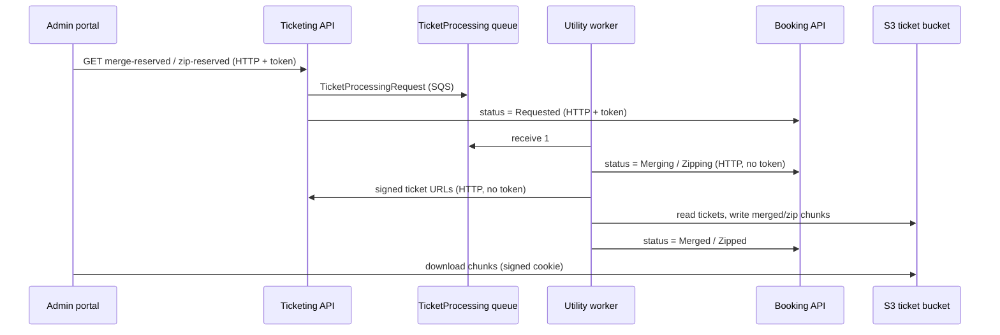

# S-09 · রিজার্ভড টিকিট merge/zip (TicketProcessing কিউ)

> **Bangla name:** রিজার্ভড টিকিট merge/zip (TicketProcessing কিউ)
>
> [← 50 · System-initiated](README.md) · [সূচিপত্র](../README.md) · [ওপেন কোয়ারি](../99-open-queries.md)

## 1. নাম ও উদ্দেশ্য

**রিজার্ভড টিকিট merge/zip।** একটি রিজার্ভেশনে (কম্প্লিমেন্টারি বা পার্টনার টিকিট) কয়েকশো সাইন করা টিকিট থাকতে পারে। অ্যাডমিন সেগুলো মার্জ করা PDF (একটি PDF-এ অনেক টিকিট) বা zip ফাইল হিসেবে চান। কাজটি ধীর, তাই Ticketing `TicketProcessing` কিউতে একটি জব দেয় এবং **Utility** সার্ভিসের ওয়ার্কার `TicketProcessingService` S3-তে ফাইলগুলো তৈরি করে, অগ্রগতি Booking-কে জানায়। ধারণাগুলো: [কিউ-চালিত প্রক্রিয়াকরণ](../00-platform-primer.md#explainer-queue-driven), [ব্যাকগ্রাউন্ড ওয়ার্কার](../00-platform-primer.md#explainer-background-workers), [ডিস্ট্রিবিউটেড লক](../00-platform-primer.md#explainer-distributed-locks)।

## 2. ট্রিগার ও অ্যাক্টর

- **প্রোডিউসার:** একজন অ্যাডমিন (**admin** পুল) Ticketing-এর `GET /ticketing/api/v1/booking-order-ticket/merge-reserved?reservationId=` বা `zip-reserved?reservationId=` দিয়ে ([A-12](../10-admin-portal/A-12-reserved-tickets.md))।
- **কনজিউমার:** Utility সার্ভিসের ওয়ার্কার; কোনো ইউজার নেই, কোনো টোকেন নেই। Utility-ই একমাত্র সার্ভিস যার প্রধান কাজ এই ওয়ার্কার।

## 3. ব্যবসায়িক প্রবাহ

রিজার্ভড টিকিট সাইন হওয়ার পর অ্যাডমিন একটি রিজার্ভেশনের জন্য "merge" বা "zip" বেছে নেন, স্ট্যাটাস `Requested` → `Merging`/`Zipping` → `Merged`/`Zipped` হওয়া পর্যন্ত অপেক্ষা করেন, তারপর সাইন করা টোকেন ও কুকি দিয়ে চাং্কগুলো ডাউনলোড করেন ([X-20](../60-cross-cutting/X-20-file-storage.md))।

## 4. কারিগরি প্রবাহ

1. **রিকোয়েস্ট** **[HTTP + user token]** `RequestMergeTicketsAsync` / `RequestZipTicketsAsync` যাচাই করে যে রিজার্ভেশনের প্রতিটি টিকিট সাইন করা (টিকিট সংখ্যা রিজার্ভেশনের `TicketCount`-এর সমান, নয়তো "Some tickets are not signed yet."), যে আউটপুট ফাইল আগে থেকেই নেই, তারপর `TicketProcessingRequest { ReservationId, ProcessingType = Merge | Zip, GroupId = "{id}_{type}", OrderId = "{id}_{type}" }` প্রকাশ করে **[SQS: TicketProcessing]** এবং Booking-এ রিজার্ভেশনের স্ট্যাটাস `Requested` সেট করে (**[HTTP + user token]** `UpdateReservationMergeStatusAsync` / `UpdateReservationZipStatusAsync`)।
2. **ওয়ার্কার** **[Worker: স্টার্টের ১ মিনিট পর প্রথম রান; এরপর টাস্ক ম্যানেজার চিরকাল লুপ করে; RedLock `ticket_processing_service_{reservationId}`, মেয়াদ ১ ঘণ্টা]**: `TicketProcessingService` `TicketProcessingTaskManager` চালু করে, যা **একবারে একটি মেসেজ** নেয় (`MaxNumberOfMessages` 1; রিকোয়েস্টে কোনো অপেক্ষার সময় বা visibility timeout সেট করা নেই, তাই কিউর ডিফল্ট প্রযোজ্য) এবং কিউ খালি থাকলে ১০ সেকেন্ড ঘুমায়। বাইরের লুপ কেবল (১ মিনিট পর) আবার শুরু হয় যদি টাস্ক ম্যানেজার কোনো এক্সেপশন ছুঁড়ে।
3. প্রতিটি মেসেজের জন্য: লক নিন; `ShouldSkipProcessing` Booking-এর কাছে বর্তমান স্ট্যাটাস জিজ্ঞেস করে এবং ইতিমধ্যে `Merged`/`Merging` (বা `Zipped`/`Zipping`) হলে এড়িয়ে যায়; নইলে:
   - **Merge:** স্ট্যাটাস `Merging` → `UtilityService.MergeTicketsAsync` → স্ট্যাটাস `Merged`;
   - **Zip:** স্ট্যাটাস `Zipping` → `UtilityService.ZipTicketsAsync` → স্ট্যাটাস `Zipped`।
4. `MergeTicketsAsync` Ticketing থেকে সাইন করা টিকিটের URL পড়ে (**[HTTP, no token]** `GetTicketUrlsAsync`), তারপর `AWS:Ticket:MergeSize` টিকিটের প্রতিটি চাং্কের জন্য PdfSharp দিয়ে একটি করে PDF তৈরি করে (`PdfReader.Open` দিয়ে প্রতিটি পেজ import), সেটি একটি টেম্প ফাইলে সেভ করে এবং `{MergeBase}/{reservationId}/{reservationNumber}_Merged_PDF_{i}.pdf` আপলোড করে। S3-তে আগে থেকেই থাকা চাং্ক বাদ পড়ানো হয়, তাই রিট্রাই যেখানে থেমেছিল সেখান থেকেই শুরু হয়। `ZipTicketsAsync` একই কাজ করে `ZipFile.CreateFromDirectory` দিয়ে এবং `..._Individual_Zipped_{i}.zip` আপলোড করে।
5. **সফল** হলে মেসেজ মোছে। **ব্যর্থ** হলে Booking-এ স্ট্যাটাস `Failed` সেট হয় এবং মেসেজটি রাখা হয় (মন্তব্য: "let it go to dead letter queue")। লক না পেলে মেসেজটি পরের চেষ্টার জন্য রাখা হয়।

## 5. কম্পোনেন্ট

| ধরন | কম্পোনেন্ট |
|---|---|
| Services | Ticketing (রিকোয়েস্ট), Utility (ওয়ার্কার), Booking (স্ট্যাটাস) |
| Queue | `TicketProcessing` |
| Storage | S3 টিকিট বাকেট (`MergeBase/{reservationId}/...`) ([X-20](../60-cross-cutting/X-20-file-storage.md)) |
| Tables | Booking রিজার্ভেশনের স্ট্যাটাস কলাম (`MergeStatus`, `ZipStatus`) |
| Redis | লক `ticket_processing_service_{reservationId}` |
| Code | `Services/Ticketing/ETP.Ticketing.Domain/Managers/TicketManager.cs:1707-1743, 1825-1861`, `Services/Utility/ETP.Utility.Service/Workers/*`, `Services/Utility/ETP.Utility.Domain/Managers/UtilityService.cs` |
| Config | `AWS:Queue:TicketProcessing`, `AWS:Ticket:MergeBase`, `AWS:Ticket:MergeSize` (`MergeBuffer` `AwsOptions`-এ ঘোষণা করা আছে কিন্তু কোথাও ব্যবহৃত হয় না), `Services:Booking`, `Services:Ticketing`, `Services:Admin` ([X-26](../60-cross-cutting/X-26-configuration.md)) |

## 6. API কন্ট্র্যাক্ট

| মেথড | পাথ | Auth | রিকোয়েস্ট | রেসপন্স |
|---|---|---|---|---|
| GET | `/ticketing/api/v1/booking-order-ticket/merge-reserved` | `admin` policy | query `reservationId` (Guid) | `202 Accepted` "Pdf merge request accepted." |
| GET | `/ticketing/api/v1/booking-order-ticket/zip-reserved` | `admin` policy | query `reservationId` | `202 Accepted` "Zip request accepted." |
| GET | `/ticketing/api/v1/booking-order-ticket/merged-ticket-number`, `zipped-ticket-number` | `admin` policy | query `reservationId` | শেষ চাং্কের index |
| GET | `/booking/api/v1/seat-reservation/merge-status/{publicId}`, `zip-status/{publicId}` | [X-18](../60-cross-cutting/X-18-endpoints-without-auth.md) দেখুন | path | স্ট্যাটাস |
| PATCH | `/booking/api/v1/seat-reservation/update-merge-status/{publicId}`, `update-zip-status/{publicId}` | X-18 দেখুন | স্ট্যাটাস | হালনাগাদ |

স্ট্যাটাস: `MergeStatus` = `None`, `Requested`, `Merging`, `Merged`, `Failed`; `ZipStatus` = `None`, `Requested`, `Zipping`, `Zipped`, `Failed`। কিউ মেসেজ (`TicketProcessingRequest`, System.Text.Json ডিফল্ট): `ReservationId`, `ProcessingType` (এনাম সংখ্যা), `GroupId`, `OrderId`।

## 7. ডেটা ও পার্শ্বপ্রতিক্রিয়া

S3 চাং্ক, Booking স্ট্যাটাস কলাম, Utility pod-এ টেম্প ফাইল (টেম্প ফোল্ডারে `pdfs_merge_{id}`, `pdfs_{id}`, `finally`-তে সরানো হয়)।

## 8. কোড রেফারেন্স

| কী | কোথায় |
|---|---|
| Request | `rvl-gobcb-backend/Services/Ticketing/ETP.Ticketing.Domain/Managers/TicketManager.cs:1707-1743` (merge), `:1825-1861` (zip) |
| Endpoints | `rvl-gobcb-backend/Services/Ticketing/ETP.Ticketing.Service/Api/BookingOrderTicketController.cs:262-310` |
| Worker | `rvl-gobcb-backend/Services/Utility/ETP.Utility.Service/Workers/BackgroundServices/TicketProcessingService.cs:23-43` |
| Task manager | `rvl-gobcb-backend/Services/Utility/ETP.Utility.Service/Workers/TaskManagers/TicketProcessingTaskManager.cs:41-170` |
| Merge and zip | `rvl-gobcb-backend/Services/Utility/ETP.Utility.Domain/Managers/UtilityService.cs:26-190` |
| Status endpoints | `rvl-gobcb-backend/Services/Booking/ETP.Booking.Service/Api/SeatReservationController.cs:182-225` |

## 9. হ্যান্ডওভার নোট

1. **রিকোয়েস্ট পরীক্ষায় চাং্ক index অমিল।** `RequestMergeTicketsAsync` ও `RequestZipTicketsAsync` শেষ চাং্কের index বের করে `reservationCounts.Count` (লেভেলের রিজার্ভেশন সংখ্যা) থেকে, অথচ `UtilityService` ব্যবহার করে এই রিজার্ভেশনের টিকিট সংখ্যা। ফলে রিকোয়েস্টে "আগে তৈরি হয়েছে" যাচাইটি ওয়ার্কার যে ফাইল নাম লেখে তার চেয়ে ভিন্ন ফাইল খোঁজে, ফলে ভুলভাবে পাস বা ফেল হতে পারে `[UNCONFIRMED: Q-14]`। `MergeSize`-এর চেয়ে বেশি টিকিটের একটি রিজার্ভেশন দিয়ে যাচাই করুন।
2. **মেমরি।** মার্জ করার সময় প্রতিটি সোর্স PDF লোড হয় এবং প্রতি ৫০টি টিকিটে `GC.Collect(... Aggressive)` চালে; বড় `MergeSize` pod-এর মেমরি বাড়ায়। Utility-র নিজস্ব deployment আছে (`deployment/k8s/<env>/utility_service.yaml`); সীমা সেখানে।
3. প্রতি Utility ইনস্ট্যান্সে **একবারে একটি মেসেজ**, এবং লক (১ ঘণ্টা) প্রতি রিজার্ভেশনের জন্য। কয়েক ইনস্ট্যান্স সমান্তরালে ভিন্ন রিজার্ভেশনে কাজ করে।
4. **রিট্রাই।** ব্যর্থ জব স্ট্যাটাস `Failed` করে কিন্তু মেসেজটি কিউর visibility timeout-এর পর ফিরে আসে এবং আবার প্রক্রিয়া হয়; `ShouldSkipProcessing` কেবল `Merged`/`Merging` এড়ায়, তাই একটি `Failed` জব কিউর redrive policy তা থামানোর আগে রিট্রাই হতে থাকে, যা রিপোজিটরিতে দেখা যায় না `[UNCONFIRMED: Q-09]`।
5. **`Merging` অবস্থায় আটকে যাওয়া।** স্ট্যাটাস `Merging` থাকাকালে pod মারা গেলে স্ট্যাটাস `Merging`-ই থেকে যায়, আর `ShouldSkipProcessing` তখন রিট্রাই হওয়া মেসেজটিকে "already in progress" ধরে এড়িয়ে যায়, ফলে স্ট্যাটাস হাতে রিসেট না করা পর্যন্ত রিজার্ভেশন আটকা থাকে।
6. Utility সার্ভিসের `GetVenueDetailsAsync` কমেন্ট করা; ফাইল নামে শুধু রিজার্ভেশন নম্বর ব্যবহার করা হয়।
7. Booking-এর স্ট্যাটাস endpoint ওয়ার্কার অভ্যন্তরে ব্যবহার করে (কোনো টোকেন নেই), [X-18](../60-cross-cutting/X-18-endpoints-without-auth.md) দেখুন।

## 10. কম্পোনেন্ট সম্পর্ক

**নির্ভর করে:** [S-08](S-08-ticket-signing.md), আসন রিজার্ভেশন ([A-11](../10-admin-portal/A-11-seat-reservation.md)), রিজার্ভড টিকিট ([A-12](../10-admin-portal/A-12-reserved-tickets.md))। **প্রভাব ফেলে:** অ্যাডমিন ডাউনলোড ([X-20](../60-cross-cutting/X-20-file-storage.md))।

## 11. ডেভেলপার টেস্ট গাইড

**লোকালে টেস্টযোগ্যতা: আংশিক।** Aspire-এর অধীনে Utility ৫১১১ পোর্টে চলে; আগে রিজার্ভড টিকিট সাইন করতে হয়, আর সাইনিংয়ের জন্য TSP (ডামি, [S-08](S-08-ticket-signing.md)) লাগে, তাই পূর্ণ রান কেবল হাতে S3-তে সাইন করা PDF বসিয়ে সম্ভব `[UNCONFIRMED: Q-06]`।

| বিষয় | বিবরণ |
|---|---|
| Test data and accounts | অ্যাডমিন …01, সাইন করা টিকিটসহ একটি রিজার্ভেশন |
| Browser | অ্যাডমিন পোর্টাল `http://localhost:4200` → ইভেন্ট → reserved tickets → merge / zip |
| Emulator | — |
| Postman | `postman/services/etp-ticketing.postman_collection.json`: `{{access_token_admin}}` ও `reservationId` সহ merge ও zip রিকোয়েস্ট |
| Visual Studio debug | Utility: `TicketProcessingTaskManager.ExecuteAsync`, `UtilityService.MergeTicketsAsync`; Utility, Ticketing ও Booking চালু করুন |
| Verify | `aws --endpoint-url http://localhost:4566 s3 ls s3://etp-local/merge/ --recursive`; স্ট্যাটাস কল `GET .../seat-reservation/merge-status/{id}`; Utility লগে "Completed Merge processing for reservation ..." |