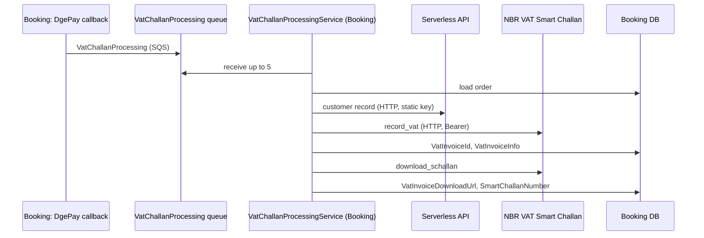

# S-10 · NBR-এ VAT চালান (VatChallanProcessing কিউ)

> **Bangla name:** NBR-এ VAT চালান (VatChallanProcessing কিউ)
>
> [← 50 · System-initiated](README.md) · [সূচিপত্র](../README.md) · [ওপেন কোয়ারি](../99-open-queries.md)

## 1. নাম ও উদ্দেশ্য

**NBR-এ VAT চালান।** প্রতিটি পরিশোধিত অর্ডারের জন্য প্ল্যাটফর্ম বাংলাদেশ জাতীয় রাজস্ব বোর্ডের (NBR) "VAT Smart Challan" open API ব্যবহার করে বিক্রয়টিকে একটি VAT ইনভয়েস হিসেবে নথিভুক্ত করে, তারপর স্মার্ট চালান (একটি ডাউনলোড লিংক ও একটি চালান নম্বর) ডাউনলোড করে এবং দুটোই অর্ডারে সংরক্ষণ করে। Booking-এর ওয়ার্কার `VatChallanProcessingService` `VatChallanProcessing` কিউ থেকে এটি করে। ধারণাগুলো: [কিউ-চালিত প্রক্রিয়াকরণ](../00-platform-primer.md#explainer-queue-driven), [ব্যাকগ্রাউন্ড ওয়ার্কার](../00-platform-primer.md#explainer-background-workers), [ডিস্ট্রিবিউটেড লক](../00-platform-primer.md#explainer-distributed-locks)।

## 2. ট্রিগার ও অ্যাক্টর

- **প্রোডিউসার:** Booking-এর `UserBookingOrderManager.HandleDgePayment` (DgePay callback) পেমেন্ট নিশ্চিত হলে একটি মেসেজ প্রকাশ করে; নিষ্ক্রিয় SSLCommerz হ্যান্ডলার একই মেসেজ প্রকাশ করে ([Appendix A](../90-appendix-a-legacy.md))।
- **কনজিউমার:** Booking ওয়ার্কার; কোনো ইউজার নেই, কোনো টোকেন নেই।

## 3. ব্যবসায়িক প্রবাহ

ব্যবসাকে প্রতিটি টিকিট বিক্রয়ে VAT রিপোর্ট করতে হয়। গ্রাহক পেমেন্ট করার পর প্ল্যাটফর্ম NBR-কে পাঠায় — ইনভয়েস নম্বর (`OrderNumber`), সময়, পেমেন্ট লেনদেন রেফারেন্স, গ্রাহক আইডি ও যোগাযোগ, পরিমাণ, ছাড়, VAT এবং আসন সংখ্যাসহ ইভেন্টের নাম — এবং অর্ডারে NBR-এর ইনভয়েস আইডি ও স্মার্ট চালান লিংক রাখে।

## 4. কারিগরি প্রবাহ

1. **প্রকাশ** **[SQS: VatChallanProcessing]** `VatChallanProcessing` মেসেজ: `GroupId = "vat_processing_{eventLongId}"`, `OrderId = bookingPublicId`, `BookingPublicId`, `UserId`, `EventLongId`, `EventId`, `EventName`, `OrderNumber`, `PaymentTransactionId`, `TotalCharge`, `PricePerSeat`, `NumberOfSeats`, `Vat`, `Discount`, `PromoDiscount`, `IsVatInclusive`, `CreatedAt`, `RetryCount`, `LastErrorMessage`। প্রকাশে ব্যর্থতা লগ করে উপেক্ষা করা হয়।
2. **ওয়ার্কার** **[Worker: ১ মিনিট স্টার্ট ডিলে, তারপর প্রতি ৪৫ সেকেন্ডে; RedLock `vat_challan_processor_{0..9}`, মেয়াদ ৫ মিনিট, ১০ সে অপেক্ষা, প্রতি ১ সে রিট্রাই]** একটি র‍্যান্ডম স্লট লক নেয় এবং `VatChallanProcessingTaskManager` একবার চালায়: সর্বোচ্চ ৫টি মেসেজ নেয় (`WaitTimeSeconds` 0, visibility ৩০০ সে), আর খালি থাকলে ৩০ সেকেন্ড ঘুমায়।
3. প্রতিটি মেসেজের জন্য `ProcessVatChallan`:
   - অর্ডার লোড করে; `VatInvoiceDownloadUrl` আগে থেকেই সেট থাকলে শেষ (সফল);
   - গ্রাহকের তথ্য Serverless API থেকে পড়ে (**[HTTP, static key]** `GetUserByIdAsync`) এবং ইভেন্টের নাম Event সার্ভিস থেকে;
   - **যদি অর্ডারে ইতিমধ্যে `VatInvoiceId` থাকে কিন্তু ডাউনলোড URL না থাকে:** কেবল `DownloadSChallanAsync` কল করে;
   - **নইলে (এখনও ইনভয়েস নেই):** `NBRVatInvoiceRequest` তৈরি করে (ইনভয়েস নম্বর, Unix সেকেন্ডে তারিখ, ক্রেতার নাম, ইমেইল, ডায়াল কোড `+88` দিয়ে স্বাভাবিকীকৃত ফোন, পরিমাণ, ছাড়ের শতাংশ ও পরিমাণ, `VatInclusive`, `ServiceTypeId`, সেটিংস থেকে `RetailerId`) এবং `RecordVatInvoiceAsync` কল করে **[HTTP, static key]**; `VatInvoiceId` ও `VatInvoiceInfo` (JSON হিসেবে রেসপন্স) সেভ করে; তারপর `DownloadSChallanAsync` কল করে এবং `VatInvoiceDownloadUrl` ও `SmartChallanNumber` সেভ করে।
4. **ফলাফল:** সফল হলে মেসেজ মোছে। `false` ফলাফল মেমরির মধ্যের কপিতে `RetryCount` বাড়ায়; ৩-এর নিচে থাকলে মেসেজের visibility `2^RetryCount × 60` সেকেন্ডে সেট হয়; ৩ হলে মেসেজটি একটি ত্রুটি লগ লিখে মুছে ফেলা হয়। কোনো এক্সেপশন মেসেজটি রেখে দেয়, যাতে visibility timeout-এর পর আবার আসে।

NBR অ্যাক্সেস (`NBROpenApiManager`): vendor client id ও secret থেকে Basic auth দিয়ে `POST {BaseUrl}/vschallan/v3/integration/vendor_authenticate`; access টোকেন Redis-এ `NBR:AuthToken` হিসেবে ক্যাশ হয়; `record_vat` ও `download_schallan` পাঠায় `Authorization: Bearer <token>` এবং `companyID` হেডার; ৪০১ হলে একবার টোকেন রিফ্রেশ করে আবার চেষ্টা হয়।

## 5. কম্পোনেন্ট

| ধরন | কম্পোনেন্ট |
|---|---|
| Services | Booking (প্রোডিউসার, ওয়ার্কার); Event (ইভেন্টের নাম); Ticketing-এর কোনো ভূমিকা নেই |
| Queue | `VatChallanProcessing` |
| External | NBR VAT Smart Challan open API; গ্রাহক রেকর্ডের জন্য Serverless API |
| Tables | বুকিং অর্ডারের কলাম `VatInvoiceId`, `VatInvoiceInfo`, `VatInvoiceDownloadUrl`, `SmartChallanNumber` |
| Redis | লক `vat_challan_processor_{n}`, টোকেন `NBR:AuthToken` |
| Code | `Services/Booking/ETP.Booking.Service/Workers/BackgroundServices/VatChallanProcessingService.cs`, `.../TaskManagers/VatChallanProcessingTaskManager.cs`, `Services/Booking/ETP.Booking.Domain/Managers/NBROpenApiManager.cs` |
| Config | `AWS:Queue:VatChallanProcessing`, `PaymentSettings:NBROpenApi:{BaseUrl, CompanyId, RetailerId, ServiceTypeId, client id and secret}` ([X-26](../60-cross-cutting/X-26-configuration.md)) |

## 6. API কন্ট্র্যাক্ট

এর নিজস্ব কোনো endpoint নেই। NBR কল (বাইরিগামী):

| মেথড | `NBROpenApi:BaseUrl`-এর অধীনে পাথ | Auth | উদ্দেশ্য |
|---|---|---|---|
| POST | `/vschallan/v3/integration/vendor_authenticate` | Basic (client id:secret) | access token |
| POST | `/vschallan/v3/integration/record_vat` | Bearer + `companyID` | ইনভয়েস নথিভুক্ত করা |
| POST | `/vschallan/v3/integration/download_schallan` | Bearer + `companyID` | স্মার্ট চালান লিংক |

রিকোয়েস্ট বডি ক্লাস: `NBRVatInvoiceRequest`, `NBRDownloadChallanRequest` (`VatInvoiceId`), `Services/Booking/ETP.Booking.Domain/Models/NBR/`-এ।

## 7. ডেটা ও পার্শ্বপ্রতিক্রিয়া

চারটি অর্ডার কলাম (উপরেরগুলো)। NBR-এর রাইমার্জ রেসপন্স `VatInvoiceInfo`-তে সংরক্ষিত থাকে। গ্রাহকের নাম, ইমেইল ও ফোন থাকা সম্পূর্ণ রিকোয়েস্ট ও রেসপন্স বডি অ্যাপ্লিকেশন লগে লেখা হয়।

## 8. কোড রেফারেন্স

| কী | কোথায় |
|---|---|
| Loop | `rvl-gobcb-backend/Services/Booking/ETP.Booking.Service/Workers/BackgroundServices/VatChallanProcessingService.cs:26-62` |
| Message handling and retry | `rvl-gobcb-backend/Services/Booking/ETP.Booking.Service/Workers/TaskManagers/VatChallanProcessingTaskManager.cs:44-117` |
| NBR calls | `rvl-gobcb-backend/Services/Booking/ETP.Booking.Service/Workers/TaskManagers/VatChallanProcessingTaskManager.cs:119-267` |
| NBR client | `rvl-gobcb-backend/Services/Booking/ETP.Booking.Domain/Managers/NBROpenApiManager.cs` |
| Publisher | `rvl-gobcb-backend/Services/Booking/ETP.Booking.Domain/Managers/UserBookingOrderManager.cs:398-436` |
| Message | `rvl-gobcb-backend/Core/ETP.Core/Queue/Messages/VatChallanProcessing.cs` |

## 9. হ্যান্ডওভার নোট

1. **রিট্রাই সীমা কখনোই ট্রিগার হয় না।** `RetryCount` কেবল deserialize করা কপিতে বাড়ে; মেসেজটি নতুন গণনা দিয়ে আবার প্রকাশ হয় না, তাই প্রতিটি রিডেলিভারিতে গণনা আবার মূল মান (০) থেকে শুরু হয়। `MAX_RETRY_COUNT = 3` কখনোই পৌঁছায় না, আর বারবার ব্যর্থ হওয়া মেসেজ ২ মিনিটের back-off নিয়ে চিরকাল রিট্রাই হয় (কিউর redrive নিয়ম থাকলে তা থামাবে, যদি থাকে `[UNCONFIRMED: Q-09]`)।
2. **আধা-সম্পন্ন ইনভয়েস রিট্রাই হয় না।** `record_vat` সফল হওয়ার পর `download_schallan` কিছু না ফেরত দিলেও কোড `true` ফেরত দেয়: মেসেজটি মোছে, `VatInvoiceId` সংরক্ষিত হয় কিন্তু `VatInvoiceDownloadUrl` খালি থাকে। কেবল একই অর্ডারের নতুন মেসেজ (এমন কোনো মেসেজ প্রকাশ হয় না) সেটি শুরু করতে পারত।
3. **"catch-up" নেই।** প্রোডিউসারের মন্তব্য বলছে একটি ব্যাকগ্রাউন্ড সার্ভিস প্রক্রিয়াবদ্ধ নয় এমন VAT রেকর্ড ধরবে; একমাত্র প্রার্থী (`ProcessVatInvoice`, টিকিট-ইনিসিয়েশন টাস্ক ম্যানেজারে, [S-07](S-07-initiate-user-ticket-generation.md)) কখনোই কল করা হয় না। যেসব অর্ডারের মেসেজ হারিয়ে গেছে বা প্রকাশ ব্যর্থ হয়েছে তাদের কোনো VAT রেকর্ড নেই, এবং রিপোজিটরিতে এমন কিছু খুঁজে বের করে না।
4. **লগে ব্যক্তিগত তথ্য।** গ্রাহকের যোগাযোগের তথ্যসহ রিকোয়েস্ট ও রেসপন্স বডি information লেভেলে লগ হয়।
5. **তথ্য না থাকলে প্লেসহোল্ডার**: Serverless lookup কিছু না ফেরত দিলে NBR-কে গ্রাহকের নাম `Customer`, ইমেইল `customer@email.com` ও ফোন `00000000000` পাঠানো হয়।
6. **কেবল DgePay-নিশ্চিত অর্ডারই প্রকাশ করে।** re-check ([S-05](S-05-pending-failed-revalidation.md)) বা অ্যানোনিমাস `payment-status-bypass`-এ পরিশোধিত চিহ্নিত অর্ডার কোনো VAT মেসেজ প্রকাশ করে না `[UNCONFIRMED: Q-15]` (`UserBookingOrderManager.cs:398-436`-এর callback পথই একমাত্র সক্রিয় প্রোডিউসার; SSLCommerz হ্যান্ডলার নিষ্ক্রিয়)।
7. **দেরি আসা callback-ও VAT রিপোর্ট করে।** `HandleDgePayment`-এ অর্ডারের স্ট্যাটাস কেবল তখনই বদলায় যখন অর্ডার সর্বোচ্চ ১২ মিনিটের পুরনো, কিন্তু VAT মেসেজ প্রতিটি `Paid` বলা callback-এ প্রকাশ হয়, বয়স মাপা ছাড়াই। তাই দেরি আসা `Paid` callback এমন অর্ডারের জন্য VAT রেকর্ড পাঠায় যা `Pending` থাকে বা পরে বাতিল হয় ([S-05](S-05-pending-failed-revalidation.md)) `[UNCONFIRMED: Q-15]`।
8. ওয়ার্কার প্রতি ৪৫ সেকেন্ড চক্রে প্রতি ইনস্ট্যান্সে সর্বোচ্চ ৫টি মেসেজ নেয় এবং তার স্লট সংখ্যা ১০, যা কিউ FIFO হলে প্রতি ইভেন্টের `GroupId`-এর সঙ্গে মেলে।

## 10. কম্পোনেন্ট সম্পর্ক

**নির্ভর করে:** পেমেন্ট নিশ্চিত হওয়া ([P-06](../20-user-portal/P-06-booking-payment.md))। **প্রভাব ফেলে:** "my bookings"-এ গ্রাহকের VAT চালান লিংক ([P-07](../20-user-portal/P-07-my-bookings.md)), রিপোর্ট ([A-22](../10-admin-portal/A-22-reports.md))।

## 11. ডেভেলপার টেস্ট গাইড

**লোকালে টেস্টযোগ্যতা: আংশিক।** কিউ, ওয়ার্কার ও ডাটাবেসের অংশ লোকালে চলে; NBR ও Serverless ডামি (`https://*.invalid`), তাই `RecordVatInvoiceAsync` ব্যর্থ হয় এবং মেসেজটি চিরকাল রিট্রাই হয় `[UNCONFIRMED: Q-06]`।

| বিষয় | বিবরণ |
|---|---|
| Test data and accounts | একটি পরিশোধিত অর্ডার (DgePay callback সিমুলেশন, [S-01](S-01-level-capacity-update.md) দেখুন) |
| Browser | None |
| Emulator | — |
| Postman | `postman/services/etp-booking.postman_collection.json`: DgePay callback রিকোয়েস্ট |
| Visual Studio debug | ব্রেকপয়েন্ট: `UserBookingOrderManager`-এর publish ব্লক (প্রায় ৪৩০ নম্বর লাইন), `VatChallanProcessingTaskManager.ProcessVatChallan` |
| Verify | `aws --endpoint-url http://localhost:4566 sqs get-queue-attributes --queue-url <VatChallanProcessing url> --attribute-names All`; অর্ডারের `VatInvoiceId`-তে SQL; Booking লগে লাইন "Sending VAT invoice request for booking ..." |