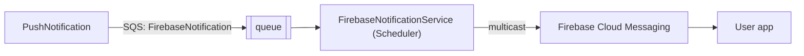

# S-11 · FCM-এ পুশ পাঠানো (FirebaseNotification কিউ)

> **Bangla name:** FCM-এ পুশ ডেলিভারি (FirebaseNotification কিউ)
>
> [← 50 · System-initiated](README.md) · [সূচিপত্র](../README.md) · [ওপেন কোয়ারি](../99-open-queries.md)

## 1. নাম ও উদ্দেশ্য

**FCM-এ পুশ ডেলিভারি।** পুশ-নোটিফিকেশন ফিচারের ওয়ার্কার অংশ: Scheduler সার্ভিস `FirebaseNotification` কিউ থেকে ডিভাইস টোকেনের ব্যাচ পড়ে এবং প্রতিটি ব্যাচ একটি multicast হিসেবে Firebase Cloud Messaging-এ পাঠায়। টোকেন রেজিস্ট্রেশন ও প্রেরক দিকসহ পুরো ফিচারটি [X-23](../60-cross-cutting/X-23-push-firebase.md)-এ বর্ণিত; এই এন্ট্রিটি ওয়ার্কারটিকে আড়াল করে। ধারণাগুলো: [কিউ-চালিত প্রক্রিয়াকরণ](../00-platform-primer.md#explainer-queue-driven), [ব্যাকগ্রাউন্ড ওয়ার্কার](../00-platform-primer.md#explainer-background-workers)।

## 2. ট্রিগার ও অ্যাক্টর

- **প্রোডিউসার:** PushNotification `NotificationManager` (Admin ইভেন্ট প্রকাশের সময় `send-to-all` কল করার পরে, [A-07](../10-admin-portal/A-07-events.md))।
- **কনজিউমার:** Scheduler `FirebaseNotificationService`; কোনো ইউজার নেই, কোনো টোকেন নেই, কোনো লক নেই।

## 3. ব্যবসায়িক প্রবাহ

অ্যাপ ব্যবহারকার্রীরা তাঁদের ফোনে "New Event Available!" পান। ডেলিভারি সর্বোচ্চ প্রচেষ্টা নির্ভর (best effort)।

## 4. কারিগরি প্রবাহ

**[Worker: ১ মিনিট স্টার্ট ডিলে, তারপর প্রতি ১ মিনিটে লুপ; কোনো ডিস্ট্রিবিউটেড লক নেই]**

1. `FirebaseNotificationService` একটি scope তৈরি করে `FirebaseNotificationTaskManager.ExecuteAsync` চালায়; সেটি ফিরে আসার পর (বা এক্সেপশন ছুঁড়ে দেওয়ার পর) ১ মিনিট অপেক্ষা করে।
2. টাস্ক ম্যানেজার একটি কলের ভেতরেই চিরকাল লুপ করে: `ReceiveMessage` (৫টি মেসেজ, ১০ সে দীর্ঘ পোল, visibility ৬০ সে); উত্তর খালি হলে ১০ সেকেন্ড অপেক্ষা করে আবার পোল করে।
3. প্রতিটি মেসেজের জন্য ক্রমে: `FirebaseNotificationRequest { Title, Body, Data, DeviceTokens, CreatedAt, GroupId, OrderId }` deserialize করে; পড়া যায় না এমন বডি লগ করে মুছে ফেলে।
4. `IPushNotificationService.SendNotificationToMultipleAsync(tokens, title, body, data)` → `FirebaseMessaging.SendEachForMulticastAsync`। কমপক্ষে একটি টোকেন সফল হলে সেটি `true` ফেরত দেয়; যেকোনো এক্সেপশনে `false` (গিলে ফেলা হয়)।
5. মেসেজটি `finally`-তে **সবসময় মোছা হয়**, পাঠানো কাজ করুক বা না।

Firebase প্রতি প্রসেসে একবার `FirebasePushNotificationConfig:*` (service-account ফিল্ড) থেকে ইনিশিয়ালাইজ হয়, তৈরি হয় `FirebasePushNotificationService`-এর কনস্ট্রাক্টরে।

## 5. কম্পোনেন্ট

| ধরন | কম্পোনেন্ট |
|---|---|
| Services | Scheduler |
| Queue | `FirebaseNotification` |
| External | Firebase Cloud Messaging |
| Code | `Services/Scheduler/ETP.Scheduler.Service/Workers/BackgroundServices/FirebaseNotificationService.cs`, `.../TaskManagers/FirebaseNotificationTaskManager.cs`, `Core/ETP.Core/PushNotification/FirebasePushNotificationService.cs` |
| Config | `FirebasePushNotificationConfig:*`, `AWS:Queue:FirebaseNotification` ([X-26](../60-cross-cutting/X-26-configuration.md)) |

## 6. API কন্ট্র্যাক্ট

কোনো endpoint নেই। কিউ মেসেজ: [X-23](../60-cross-cutting/X-23-push-firebase.md) §6 দেখুন।

## 7. ডেটা ও পার্শ্বপ্রতিক্রিয়া

ডিভাইসে FCM মেসেজ। ডাটাবেসে কোনো লেখা হয় না, এবং কী পাঠানো হয়েছে তার কোনো রেকর্ড রাখা হয় না।

## 8. কোড রেফারেন্স

| কী | কোথায় |
|---|---|
| Loop | `rvl-gobcb-backend/Services/Scheduler/ETP.Scheduler.Service/Workers/BackgroundServices/FirebaseNotificationService.cs:26-48` |
| Consumer | `rvl-gobcb-backend/Services/Scheduler/ETP.Scheduler.Service/Workers/TaskManagers/FirebaseNotificationTaskManager.cs:40-112` |
| FCM sender | `rvl-gobcb-backend/Core/ETP.Core/PushNotification/FirebasePushNotificationService.cs:35-104` |
| Registration | `rvl-gobcb-backend/Services/Scheduler/ETP.Scheduler.Service/Configurations/DependencyConfig.cs:46-55` |

## 9. হ্যান্ডওভার নোট

1. **কোনো রিট্রাই নেই।** পাঠানো ব্যর্থ হলে বা কেবল কিছু টোকেন কাজ করলেও মেসেজ মোছা হয়; কোনো রিডেলিভারি নেই, কোনো dead-letter কিউ নেই, আর FCM যেসব টোকেনকে অবৈধ বলে সেগুলোর কোনো পরিষ্কারও নেই ([X-23](../60-cross-cutting/X-23-push-firebase.md) নোট ৩)।
2. **ত্রুটি অদৃশ্য।** `SendNotificationToMultipleAsync` লগ না করেই প্রতিটি এক্সেপশন ধরে ফেলে; টাস্ক ম্যানেজার কেবল `false` পেলে "Failed to send Firebase notification for group ..." লগ করে।
3. **একাধিক ইনস্ট্যান্স।** কোনো লক নেই, যা এখানে নিরাপদ কারণ SQS প্রতিটি মেসেজ একজন কনজিউমারকেই দেয়; কয়েকটি Scheduler pod একই কিউ ভাগ করে নেয়।
4. **ব্যাচের আকার।** প্রতিটি কিউ মেসেজে সর্বোচ্চ ২০০টি টোকেন থাকে; FCM-এর multicast সীমা আলাদা, বাইরের সীমা (রিপোজিটরিতে দেখা যায় না)।
5. Scheduler এই ওয়ার্কারটি রাখে যদিও এটি কেবল SQS ও FCM-এর সঙ্গে কথা বলে।
6. লোকালে Firebase নেই: `docs/local-dev.md` ("Some log noise is expected") বলছে Scheduler Firebase সতর্কবার্তা লগ করে চলতে থাকে।

## 10. কম্পোনেন্ট সম্পর্ক

**নির্ভর করে:** [X-23](../60-cross-cutting/X-23-push-firebase.md) (প্রোডিউসার), [U-09](../30-user-app/U-09-device-token.md)। **প্রভাব ফেলে:** [U-10](../30-user-app/U-10-push-receipt.md)।

## 11. ডেভেলপার টেস্ট গাইড

**লোকালে টেস্টযোগ্যতা: আংশিক / ডেলিভারির জন্য লোকালে সম্ভব নয়।** কিউ ও ওয়ার্কার চলে (Scheduler পোর্ট ৫১০৬); Firebase ডামি, তাই কোনো পুশ পৌঁছায় না (`docs/local-dev.md`, `docs/mobile-local.md` §8)।

| বিষয় | বিবরণ |
|---|---|
| Test data and accounts | একটি রেজিস্টার করা টোকেন সারি (`POST /pushnotification/api/v1/device-token`) |
| Browser | `http://localhost:5105/pushnotification/swagger` → `send-to-all` |
| Emulator | ডামি Firebase: কোনো পুশ আসে না |
| Postman | `etp-pushnotification` কলেকশন: `POST /api/v1/push-notification/send-to-all` |
| Visual Studio debug | Scheduler: `FirebaseNotificationTaskManager.ExecuteAsync` (১ মিনিটের বিলম্বের পর) |
| Verify | `FirebaseNotification` কিউয়ের মেসেজ সংখ্যা ০ হয়; Scheduler লগ করে "Processing Firebase notification for group ..." |