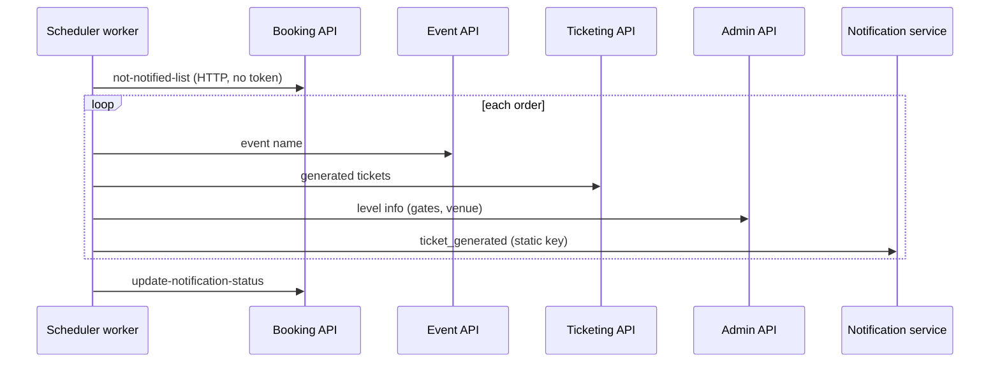

# S-12 · টিকিট-তৈরি নোটিফিকেশন

> **Bangla name:** টিকিট তৈরি হওয়ার নোটিফিকেশন
>
> [← 50 · System-initiated](README.md) · [সূচিপত্র](../README.md) · [ওপেন কোয়ারি](../99-open-queries.md)

## 1. নাম ও উদ্দেশ্য

**টিকিট-তৈরি নোটিফিকেশন।** একটি অর্ডারের সব টিকিট তৈরি হওয়ার পর (অর্ডারের স্ট্যাটাস `Generated`, [S-06](S-06-booking-status-generated.md)) Scheduler বাইরের নোটিফিকেশন সার্ভিসের মাধ্যমে গ্রাহককে জানায় (`ticket_generated`, [X-22](../60-cross-cutting/X-22-sms-notification.md) দেখুন), তারপর অর্ডারটিকে নোটিফাই হয়ে চিহ্নিত করে যাতে একবারে দুইবার না যায়। ধারণাগুলো: [ব্যাকগ্রাউন্ড ওয়ার্কার](../00-platform-primer.md#explainer-background-workers), [ডিস্ট্রিবিউটেড লক](../00-platform-primer.md#explainer-distributed-locks), [টোকেন ফরওয়ার্ডিং](../00-platform-primer.md#explainer-token-forwarding) (এখানে: কোনোটিই নেই)।

## 2. ট্রিগার ও অ্যাক্টর

Scheduler সার্ভিসের একটি টাইমার (`SendNotificationAfterGeneratedTicketService`)। এটি কোনো টোকেন ছাড়াই HTTP-তে Booking, Event, Ticketing ও Admin কল করে, আর static key দিয়ে নোটিফিকেশন সার্ভিসকে কল করে।

## 3. ব্যবসায়িক প্রবাহ

প্রতি অর্ডারে গ্রাহক একটি বার্তা পান: অর্ডার নম্বর, ইভেন্টের নাম, ভেন্যু, গ্যালারি, ব্লক, লেভেল, টিকিট নম্বর, এন্ট্রি গেট ও মিনি গেট, যাতে তিনি জানেন কোথায় যেতে হবে। টেক্সট ও চ্যানেল (SMS, in-app, push) বাইরের সার্ভিস ঠিক করে `[UNCONFIRMED: Q-05]`।

## 4. কারিগরি প্রবাহ

**[Worker: ১ মিনিট স্টার্ট ডিলে, তারপর প্রতি ৩ মিনিটে; RedLock `notification_for_ticket_generated`, মেয়াদ ৩ মিনিট, ৩০ সে অপেক্ষা, ১ সে রিট্রাই; ত্রুটির পর অতিরিক্ত ৩ মিনিট বিলম্ব]**

1. লক নেওয়ার পর `IBookingClient.GetNotNotifiedUserBookings(100)` → `GET /booking/api/v1/user-booking-order/not-notified-list?limit=100` **[HTTP, no token / internal]**। রিপোজিটরি এমন অর্ডার ফেরত দেয় যাদের `Status = Generated` এবং `IsTicketStatusNotified = false`।
2. প্রতিটি অর্ডারের জন্য, একটির পর একটি করে:
   - ইভেন্টের নামের জন্য `IEventClient.GetEventByPublicId` (খালি হলে এড়িয়ে যান);
   - টিকিট নম্বরের জন্য `ITicketingClient.GetGeneratedTicketByOrderId` (কোনোটি না থাকলে এড়িয়ে যান), কমা দিয়ে জোড়া করা;
   - ভেন্যু, গ্যালারি, ব্লক, লেভেল, এন্ট্রি গেট, মিনি গেটের জন্য `IAdminClient.GetEventLevelInfoAsync(eventLongId, levelId)` (কোনোটি না থাকলে এড়িয়ে যান);
   - `INotificationClient.SendTicketGeneratedNotification` → `POST {Notification:Endpoint}/notification/request` **[HTTP, static key]**; সফল হলে অর্ডার আইডি সংগ্রহ করা হয়।
3. সবশেষে `IBookingClient.UpdateNotifiedUserBookings(ids)` → `PUT /booking/api/v1/user-booking-order/update-notification-status`, অর্ডারের পাবলিক আইডির তালিকা সহ, যা সেগুলোর জন্য `IsTicketStatusNotified = true` সেট করে।

## 5. কম্পোনেন্ট

| ধরন | কম্পোনেন্ট |
|---|---|
| Services | Scheduler (ওয়ার্কার); Booking, Event, Ticketing, Admin (ডেটা) |
| External | নোটিফিকেশন সার্ভিস ([X-22](../60-cross-cutting/X-22-sms-notification.md)) |
| Tables | বুকিং অর্ডার `IsTicketStatusNotified` |
| Redis | লক `notification_for_ticket_generated` |
| Code | `Services/Scheduler/ETP.Scheduler.Service/Workers/BackgroundServices/SendNotificationAfterGeneratedTicketService.cs`, `.../TaskManagers/SendNotificationAfterGeneratedTicketServiceTaskManager.cs`, `Services/Booking/ETP.Booking.Storage/Repositories/UserBookingOrderRepository.cs:162-178` |

## 6. API কন্ট্র্যাক্ট

| মেথড | পাথ | Auth | রিকোয়েস্ট | রেসপন্স |
|---|---|---|---|---|
| GET | `/booking/api/v1/user-booking-order/not-notified-list?limit=` | none | query `limit` | `UserBooking`-এর তালিকা |
| PUT | `/booking/api/v1/user-booking-order/update-notification-status` | none | অর্ডারের পাবলিক আইডির JSON অ্যারে | `200` |
| POST | `{Notification:Endpoint}/notification/request` | static `Authorization` | `TicketGeneratedNotification` (snake_case, [X-22](../60-cross-cutting/X-22-sms-notification.md) দেখুন) | কেবল স্ট্যাটাস |

## 7. ডেটা ও পার্শ্বপ্রতিক্রিয়া

প্রতি অর্ডারে একটি বাইরের নোটিফিকেশন; যেগুলো সফল হয় তার জন্য `IsTicketStatusNotified` সত্যে সেট হয়।

## 8. কোড রেফারেন্স

| কী | কোথায় |
|---|---|
| Loop | `rvl-gobcb-backend/Services/Scheduler/ETP.Scheduler.Service/Workers/BackgroundServices/SendNotificationAfterGeneratedTicketService.cs:29-48` |
| Work | `rvl-gobcb-backend/Services/Scheduler/ETP.Scheduler.Service/Workers/TaskManagers/SendNotificationAfterGeneratedTicketServiceTaskManager.cs:24-125` |
| Booking endpoints | `rvl-gobcb-backend/Services/Booking/ETP.Booking.Service/Api/UserBookingOrderController.cs:424-436` |
| Client | `rvl-gobcb-backend/Core/ETP.Core/ServiceClient/BookingClient/BookingClient.cs:218-250` |
| Notification client | `rvl-gobcb-backend/Core/ETP.Core/ServiceClient/NotificationClient/NotificationClient.cs` |

## 9. হ্যান্ডওভার নোট

1. **অ্যানোনিমাস অভ্যন্তরীণ endpoint।** `not-notified-list` গ্রাহকের অর্ডারের তথ্য ফেরত দেয় এবং `update-notification-status` ফ্ল্যাগ উল্টায় — দুটোই অনুমোদন ছাড়া ([X-18](../60-cross-cutting/X-18-endpoints-without-auth.md) বিভাগ C; architecture §2.3 B)।
2. **যেকোনো ব্যাচ।** রিপোজিটরি `Take(limit)` `OrderBy(UpdatedAt)`-এর আগে প্রয়োগ করে, তাই ১০০টি সারি সবচেয়ে পুরনো ১০০টি নয়। যেসব অর্ডার সবসময় ব্যর্থ হয় (ইভেন্ট বা লেভেল নেই), সেগুলো প্রতি রানে এড়িয়ে যায় এবং কখনো চিহ্নিত হয় না, তাই প্রতিবার আবার পড়া হয় এবং ১০০ বা তার বেশি হলে অন্যদের জায়গা নিতে পারে।
3. **ডুপ্লিকেট সম্ভব।** ফ্ল্যাগটি লুপ শেষ হওয়ার পরেই লেখা হয়; পাঠানোর পর কিন্তু `PUT`-এর আগে প্রসেস থেমে গেলে সেই গ্রাহকরা পরের রানে আবার বার্তা পান। ব্যর্থ `PUT`-ও একই প্রভাব ফেলে।
4. **ধীর নোটিফিকেশন সার্ভিস পুরো রানকে ধীর করে।** অর্ডারগুলো একটির পর একটি প্রক্রিয়া হয়, আর প্রতিটি বাইরের কল ব্যর্থ হলে exponential back-off (২, ৪, ৮ সে) দিয়ে ৩ বার রিট্রাই হয়।
5. **শুধু ইউজার অর্ডার।** রিজার্ভড টিকিট ঘোষণা করা হয় না (অ্যাডমিনের অনুরোধে ইমেইলে পাঠানো হয়, [X-21](../60-cross-cutting/X-21-email-ses.md))।

## 10. কম্পোনেন্ট সম্পর্ক

**নির্ভর করে:** [S-06](S-06-booking-status-generated.md), [S-08](S-08-ticket-signing.md)। **প্রভাব ফেলে:** গ্রাহকের প্রস্তুত টিকিট সম্পর্কে সচেতনতা ([P-07](../20-user-portal/P-07-my-bookings.md))।

## 11. ডেভেলপার টেস্ট গাইড

**লোকালে টেস্টযোগ্যতা: আংশিক।** ওয়ার্কার ও Booking-এর endpoint চলে; `Notification:Endpoint` ডামি, তাই পাঠানো ব্যর্থ হয় এবং কিছু চিহ্নিত হয় না (লগ করে `Failed to send notification for BookingId ...`)।

| বিষয় | বিবরণ |
|---|---|
| Test data and accounts | `Status = Generated` এমন একটি অর্ডার (SQL আপডেট বা seeded ডেটা) |
| Browser | None |
| Emulator | — |
| Postman | `postman/services/etp-booking.postman_collection.json`: "GET /api/v1/user-booking-order/not-notified-list" |
| Visual Studio debug | Scheduler: `SendNotificationAfterGeneratedTicketServiceTaskManager.ExecuteAsync` |
| Verify | SQL: অর্ডারের `IsTicketStatusNotified`; Scheduler লগে "Successfully updated notification status for N bookings" |