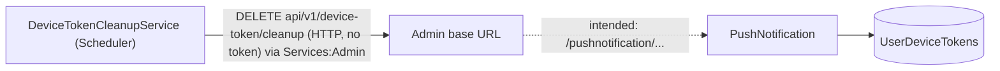

# S-13 · ডিভাইস-টোকেন পরিষ্কার

> **Bangla name:** ডিভাইস টোকেন ক্লিনআপ
>
> [← 50 · System-initiated](README.md) · [সূচিপত্র](../README.md) · [ওপেন কোয়ারি](../99-open-queries.md)

## 1. নাম ও উদ্দেশ্য

**ডিভাইস-টোকেন পরিষ্কার।** PushNotification সার্ভিস প্রতিটি FCM ডিভাইস টোকেনের জন্য একটি সারি রাখে ([X-23](../60-cross-cutting/X-23-push-firebase.md))। একটি Scheduler ওয়ার্কারের উদ্দেশ্য হলো ৩০ দিন ধরে তৈরি বা হালনাগাদ না হওয়া টোকেনগুলো মুছে ফেলা, যাতে মৃত ইনস্টলে পুশ বার্তা না যায়। ধারণাগুলো: [ব্যাকগ্রাউন্ড ওয়ার্কার](../00-platform-primer.md#explainer-background-workers), [ডিস্ট্রিবিউটেড লক](../00-platform-primer.md#explainer-distributed-locks)।

## 2. ট্রিগার ও অ্যাক্টর

Scheduler সার্ভিসের একটি টাইমার (`DeviceTokenCleanupService`); কোনো ইউজার নেই। মুছে ফেলার কলটি করা হয় ভাগ করে ব্যবহৃত `IEventClient` HTTP ক্লায়েন্ট দিয়ে **[HTTP, no token / internal]**।

## 3. ব্যবসায়িক প্রবাহ

মোবাইল অ্যাপগুলো মাঝে মাঝে তাঁদের FCM টোকেন রিফ্রেশ করে ([U-09](../30-user-app/U-09-device-token.md))। ৩০ দিন ধরে রিফ্রেশ না হওয়া টোকেনকে পুরনো (stale) ধরা হয় এবং সরিয়ে ফেলা হয়।

## 4. কারিগরি প্রবাহ

**[Worker: ১ মিনিট স্টার্ট ডিলে; তারপর ০২:০০ UTC পর্যন্ত অপেক্ষা; RedLock `device_token_cleanup`, মেয়াদ ২ ঘণ্টা, অপেক্ষা নেই; একটি রানের পর ২৪ ঘণ্টা ঘুম, ত্রুটির পর ১ ঘণ্টা]**

1. `DeviceTokenCleanupService` পরবর্তী ০২:০০ UTC-এর সময় বের করে, অপেক্ষা করে, লক নেয়, এবং `DeviceTokenCleanupTaskManager` চালায়।
2. টাস্ক ম্যানেজার কল করে `IEventClient.CleanupOldDeviceTokensAsync(30)` → `DELETE api/v1/device-token/cleanup?retentionDays=30`, ওই ক্লায়েন্টের base address-এর সাপেক্ষে, যা Scheduler-এ **`Services:Admin`** ([X-19](../60-cross-cutting/X-19-service-to-service.md))।
3. সফল নয় এমন স্ট্যাটাসে এটি ত্রুটি লগ করে এক্সেপশন ছুঁড়ে দেয় (ফলে সার্ভিস আবার লগ করে এবং লুপের আগে ১ ঘণ্টা অপেক্ষা করে); সফল হলে রেসপন্স লগ করে।
4. উদ্দিষ্ট গ্রহক হলো PushNotification `DELETE /pushnotification/api/v1/device-token/cleanup?retentionDays=` (`DeviceTokenController.CleanupOldDeviceTokens`), যা যেসব সারির `UpdatedAt ?? CreatedAt` cutoff-এর চেয়ে পুরনো তা মোছে এবং `{ message, deletedCount, cutoffDate, retentionDays }` ফেরত দেয়।

## 5. কম্পোনেন্ট

| ধরন | কম্পোনেন্ট |
|---|---|
| Services | Scheduler (টাইমার); PushNotification (মুছে ফেলা) |
| Tables | `UserDeviceTokens` |
| Redis | লক `device_token_cleanup` |
| Code | `Services/Scheduler/ETP.Scheduler.Service/Workers/BackgroundServices/DeviceTokenCleanupService.cs`, `.../TaskManagers/DeviceTokenCleanupTaskManager.cs`, `Core/ETP.Core/ServiceClient/EventClient/EventClient.cs:166-174`, `Services/PushNotification/ETP.PushNotification.Service/Api/DeviceTokenController.cs:75-100` |
| Config | `Services:Admin` (ক্লায়েন্ট ব্যবহার করা base URL), `Services:PushNotification` (এই কলে ব্যবহৃত হয় না) |

## 6. API কন্ট্র্যাক্ট

| মেথড | পাথ | Auth | রিকোয়েস্ট | রেসপন্স |
|---|---|---|---|---|
| DELETE | `/pushnotification/api/v1/device-token/cleanup?retentionDays=30` | none | query `retentionDays` (> 0) | `200 { message, deletedCount, cutoffDate, retentionDays }`; `<= 0` হলে `400`; `500` |

## 7. ডেটা ও পার্শ্বপ্রতিক্রিয়া

cutoff-এর চেয়ে পুরনো ডিভাইস-টোকেন সারি মোছে (মেমরিতে লোড করে একটি `SaveChanges`-এ সরানো হয়)।

## 8. কোড রেফারেন্স

| কী | কোথায় |
|---|---|
| Schedule | `rvl-gobcb-backend/Services/Scheduler/ETP.Scheduler.Service/Workers/BackgroundServices/DeviceTokenCleanupService.cs:26-80` |
| Call | `rvl-gobcb-backend/Services/Scheduler/ETP.Scheduler.Service/Workers/TaskManagers/DeviceTokenCleanupTaskManager.cs:24-52` |
| Client method | `rvl-gobcb-backend/Core/ETP.Core/ServiceClient/EventClient/EventClient.cs:166-174` |
| Client base address | `rvl-gobcb-backend/Services/Scheduler/ETP.Scheduler.Service/Configurations/DependencyConfig.cs:96-104` |
| Delete | `rvl-gobcb-backend/Services/PushNotification/ETP.PushNotification.Storage/Repositories/UserDeviceTokenRepository.cs:99-111` |

## 9. হ্যান্ডওভার নোট

1. **কলটি তার লক্ষ্যভুক্তকে খুঁজে পাচ্ছে না বলে মনে হচ্ছে।** ক্লায়েন্টটি `Services:Admin`-এ `api/v1/device-token/cleanup` পাঠায়, `pushnotification/` প্রিফিক্স ছাড়া, অথচ এই endpoint কেবল PushNotification সার্ভিসেই আছে (Admin বা Event কোনোটিতেই নেই, আর প্রতিটি সার্ভিস নিজস্ব প্রিফিক্স যোগ করে)। ডিপ্লয় করা সেটিংসে base URL যদি এই পথটি PushNotification-এ ম্যাপ না করে, প্রতিদিনের কলটি ৪০৪ পাবে এবং কিছুই মোছা হবে না `[UNCONFIRMED: Q-16]`। "Device token cleanup failed. Status: ..." বার্তার জন্য Scheduler লগ এবং `UserDeviceTokens`-এর সারি সংখ্যা দেখুন।
2. **এটি সম্ভবত প্রতি দ্বিতীয় দিন, প্রতিদিন নয়, চলে।** একটি রানের পর লুপ ২৪ ঘণ্টা ঘুমায়, তারপর `GetDelayUntilNextRun()` কল করে; তখন ঠিক ০২:০০ পেরিয়ে যাওয়ার পর, তাই পরের রান পরের দিনের ০২:০০-এ নির্ধারিত হয়, প্রথম রানের প্রায় ৪৮ ঘণ্টা পরে। এটি কোড থেকে নির্ণীত, পর্যবেক্ষণ করা নয়।
3. মেথডটির মালিক ক্লাসের নাম `IEventClient`, যদিও মেথডটি PushNotification-এর সঙ্গে কথা বলে; নামটি একটি অবশিষ্টাভূতি।
4. endpoint অ্যানোনিমাস এবং যেকোনো কলেই ডেটা মোছে; কলারা `retentionDays` বেছে নিতে পারে (যেকোনো ধনাত্মক সংখ্যা), তাই `retentionDays=1` প্রায় প্রতিটি টোকেন সরিয়ে দেয় ([X-23](../60-cross-cutting/X-23-push-firebase.md) নোট ১)।
5. টোকেনগুলো মুছে ফেলার আগে মেমরিতে লোড হয়; অনেক টোকেন থাকলে রিকোয়েস্টটি ভারী হয়।

## 10. কম্পোনেন্ট সম্পর্ক

**নির্ভর করে:** টোকেন রেজিস্ট্রেশন ([U-09](../30-user-app/U-09-device-token.md))। **প্রভাব ফেলে:** [S-11](S-11-firebase-notification.md) (কম মৃত টোকেন)।

## 11. ডেভেলপার টেস্ট গাইড

**লোকালে টেস্টযোগ্যতা: আংশিক।** লোকালে `Services:Admin` হলো `http://localhost:5101/`, তাই কোডে থাকা পথটি Admin সার্ভিসেই পৌঁছায়, PushNotification-এ নয়; আপনি সরাসরি PushNotification-এর endpoint কল করতে পারেন।

| বিষয় | বিবরণ |
|---|---|
| Test data and accounts | ৩০ দিনের পুরনো একটি টোকেন সারি (`UserDeviceTokens`-এ `UpdatedAt` SQL আপডেট) |
| Browser | `http://localhost:5105/pushnotification/swagger` → `DELETE /api/v1/device-token/cleanup` |
| Emulator | — |
| Postman | `postman/services/etp-pushnotification.postman_collection.json`: "DELETE /api/v1/device-token/cleanup" |
| Visual Studio debug | Scheduler: `DeviceTokenCleanupTaskManager.ExecuteAsync`; টাইমার ০২:০০ UTC-তে চলে, তাই ব্রেকপয়েন্ট দিয়ে ডিবাগ সেশন থেকে টাস্ক ম্যানেজার চালান, অথবা সরাসরি PushNotification-এর endpoint কল করুন |
| Verify | SQL: `select count(*) from etp."UserDeviceTokens"` আগে ও পরে; Scheduler লগে "Device token cleanup failed. Status: NotFound" নোট ১ দেখায় |