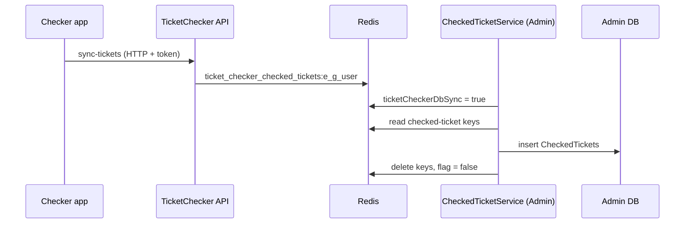

# S-14 · চেকড-টিকিট সিঙ্ক (Redis → ডাটাবেস)

> **Bangla name:** চেকড-টিকিট সিঙ্ক (Redis → ডাটাবেস)
>
> [← 50 · System-initiated](README.md) · [সূচিপত্র](../README.md) · [ওপেন কোয়ারি](../99-open-queries.md)

## 1. নাম ও উদ্দেশ্য

**চেকড-টিকিট সিঙ্ক।** চেকার অ্যাপগুলো স্ক্যান করা টিকিটগুলো TicketChecker সার্ভিসকে জানায় ([C-05](../40-checker-app/C-05-ticket-sync.md)), যা সেগুলো কেবল Redis-এ রাখে। প্রতি ৩০ মিনিটে একটি **Admin** ওয়ার্কার সেগুলো `CheckedTickets` টেবিলে কপি করে, যাতে গেট রিপোর্ট ([A-19](../10-admin-portal/A-19-gate-reports.md)) ও ডুপ্লিকেট প্রবেশ যাচাই সেগুলো পড়তে পারে। ধারণাগুলো: [ব্যাকগ্রাউন্ড ওয়ার্কার](../00-platform-primer.md#explainer-background-workers), [ডিস্ট্রিবিউটেড লক](../00-platform-primer.md#explainer-distributed-locks), [Redis লাইভ ধারণক্ষমতা](../00-platform-primer.md#explainer-redis-live-capacity)।

## 2. ট্রিগার ও অ্যাক্টর

Admin সার্ভিসের একটি টাইমার (`CheckedTicketService`); কোনো ইউজার নেই। এটি সরাসরি Redis ও ডাটাবেস পড়ে, কোনো HTTP কল নেই।

## 3. ব্যবসায়িক প্রবাহ

প্রতি গেটে প্রবেশের সংখ্যা, ম্যানুয়াল প্রবেশ এবং ডুপ্লিকেট স্ক্যান অ্যাডমিন রিপোর্টে কেবল এই জব চলার পরই দেখা যায়, তাই সেগুলো সর্বোচ্চ প্রায় ৩০ মিনিট পিছিয়ে থাকে।

## 4. কারিগরি প্রবাহ

**[Worker: ১ মিনিট স্টার্ট ডিলে, তারপর প্রতি ৩০ মিনিটে; RedLock `checked_ticket`, মেয়াদ ২০ মিনিট, অপেক্ষা নেই; ত্রুটির পর অতিরিক্ত ৩০ মিনিট]**

1. লক নিয়ে `CheckedTicketServiceTaskManager` একবার চালায়।
2. Redis ফ্ল্যাগ `ticketCheckerDbSync = true` সেট করে, ১০ সেকেন্ড অপেক্ষা করে (যাতে চলমান চেকার সিঙ্কগুলো শেষ হতে পারে)।
3. `GetEventDetailsAsyncForTicketChecker()` প্রতিটি ইভেন্ট তার গেট ও প্রতি গেটের চেকার ইউজারসহ তালিকাভুক্ত করে। প্রতিটি (ইভেন্ট, গেট, ইউজার)-এর জন্য Redis স্ট্রিং `ticket_checker_checked_tickets:{eventLongId}_{gateId}_{userId}` পড়ে — এটি একটি JSON ডিকশনারি `ticketNumber → { Value (scan count), IsManual, EntryTime }` — এবং প্রতিটি এন্ট্রিকে একটি `CheckedTicket` সারিতে রূপান্তর করে (`EventLongId`, `EventId`, `TicketCheckerGateId`, `TicketCheckerGateName`, `TicketCheckerId`, `TicketCheckerName`, `TicketNumber`, `EntryCount`, `IsManualEntry`, `EntryTime`)।
4. `CheckedTicketManager.SaveCheckedTicketsAsync` সব সারি বাল্কে (১০০টির ব্যাচে) ঢোকায় `CreatedBy = "System"` সহ।
5. প্রক্রিয়াকৃত Redis key মোছে; `ticketCheckerDbSync = false` সেট করে। যেকোনো এক্সেপশনে ফ্ল্যাগটি আবার `false` করে ফিরে আসে (key থেকে যায়)।

ফ্ল্যাগ `true` থাকা অবস্থায় TicketChecker সার্ভিসের চেকার সিঙ্ক রিকোয়েস্ট প্রত্যাখ্যান করে বলে "Database sync is running.." ([C-05](../40-checker-app/C-05-ticket-sync.md))।

## 5. কম্পোনেন্ট

| ধরন | কম্পোনেন্ট |
|---|---|
| Services | Admin (ওয়ার্কার); TicketChecker (Redis key লেখে) |
| Tables | `CheckedTickets` (Admin স্কিমা: টিকিট নম্বর, গেট, চেকার, প্রবেশ সংখ্যা, ম্যানুয়াল ফ্ল্যাগ, প্রবেশের সময়) |
| Redis | `ticket_checker_checked_tickets:*`, ফ্ল্যাগ `ticketCheckerDbSync`, লক `checked_ticket` |
| Code | `Services/Admin/ETP.Admin.Service/Workers/BackgroundServices/CheckedTicketService.cs`, `.../TaskManagers/CheckedTicketServiceTaskManager.cs`, `Services/Admin/ETP.Admin.Domain/Managers/CheckedTicketManager.cs:46-58`, `Services/TicketChecker/ETP.TicketChecker.Domain/Managers/TicketsManager.cs` |

## 6. API কন্ট্র্যাক্ট

কোনো endpoint নেই। এটি যে ডেটা তৈরি করে তা [A-19](../10-admin-portal/A-19-gate-reports.md)-এর রিপোর্ট endpoint-গুলোর মাধ্যমে পড়া হয়।

## 7. ডেটা ও পার্শ্বপ্রতিক্রিয়া

প্রতি রানে নতুন `CheckedTickets` সারি (ওই সময়সীমার জন্য প্রতি টিকিট, গেট ও চেকারে একটি সারি); Redis key সরানো হয়; ফ্ল্যাগ বদলায়।

## 8. কোড রেফারেন্স

| কী | কোথায় |
|---|---|
| Loop | `rvl-gobcb-backend/Services/Admin/ETP.Admin.Service/Workers/BackgroundServices/CheckedTicketService.cs:22-49` |
| Work | `rvl-gobcb-backend/Services/Admin/ETP.Admin.Service/Workers/TaskManagers/CheckedTicketServiceTaskManager.cs:28-104` |
| Save | `rvl-gobcb-backend/Services/Admin/ETP.Admin.Domain/Managers/CheckedTicketManager.cs:46-58` |
| Writer of the keys | `rvl-gobcb-backend/Services/TicketChecker/ETP.TicketChecker.Domain/Managers/TicketsManager.cs:28-155` |

## 9. হ্যান্ডওভার নোট

1. **প্রতিটি রানের সময় চেকার সিঙ্ক আটকে থাকে।** `ticketCheckerDbSync` সত্য থাকা অবস্থায় (কমপক্ষে ১০ সেকেন্ডের অপেক্ষা ও সেভ সহ), চেকার অ্যাপ সিঙ্কে ত্রুটি পায়; অ্যাপকে আবার চেষ্টা করতে হয়। `catch` দিয়ে ফ্ল্যাগ `true` অবস্থায় আটকে যাওয়া আটকানো হয়, তবে মাঝখানে মারা একটি pod ফ্ল্যাগকে মেয়াদ ছাড়াই `true` রেখে দেবে, আর ফ্ল্যাগ হাতে পরিষ্কার না করা পর্যন্ত (`SET ticketCheckerDbSync false`) সব সিঙ্ক আটকা থাকবে `[UNCONFIRMED: Q-17]`।
2. **স্ক্যান হারানো সম্ভব।** চেকার সিঙ্ক একজন ইউজারের পুরো JSON ডিকশনারি পড়ে ও আবার লেখে; ওয়ার্কার key পড়ে, সেভ করে, তারপর সেগুলো মোছে। পড়া ও মোছার মধ্যে লেখা একটি স্ক্যান হারায়; ফ্ল্যাগ ও ১০ সেকেন্ডের অপেক্ষা এই উইন্ডো সংকুচিত করে, কিন্তু মুছে ফেলে না।
3. **টেবিলে ডুপ্লিকেট ইচ্ছাকৃত।** প্রতি রানের পর Redis ডিকশনারি নতুন করে শুরু হয়, তাই দুটি সময়সীমায় স্ক্যান করা একটি টিকিট দুটি সারিতে দেখা যায়; রিপোর্ট সারি যোগ বা তুলনা করে ([A-19](../10-admin-portal/A-19-gate-reports.md))।
4. **কোনো ইডেমপোটেন্সি নেই।** সেভ সফল হলেও key মোছা ব্যর্থ হলে পরের রান একই সারি আবার ঢোকায়।
5. **সব ইভেন্টের সঙ্গে খরচ বাড়ে।** `GetEventDetailsAsyncForTicketChecker` সক্রিয় ইভেন্টে সীমাবদ্ধ নয়; প্রতি রানে key-এর জন্য প্রতিটি গেট ও ইউজার দেখা হয়।
6. ওয়ার্কার `CreatedBy = "System"` লেখে; অ্যাক্টিভিটি লগে এই ইনসার্টগুলো `System` হিসেবে দেখায় ([X-24](../60-cross-cutting/X-24-activity-logging.md))।

## 10. কম্পোনেন্ট সম্পর্ক

**নির্ভর করে:** [C-05](../40-checker-app/C-05-ticket-sync.md), [A-18](../10-admin-portal/A-18-gate-assignment.md)। **প্রভাব ফেলে:** [A-19](../10-admin-portal/A-19-gate-reports.md)।

## 11. ডেভেলপার টেস্ট গাইড

**লোকালে টেস্টযোগ্যতা: ওয়ার্কারের জন্য সম্পূর্ণ; চেকার অ্যাপ লোকালে লগইন করতে পারে না।**

| বিষয় | বিবরণ |
|---|---|
| Test data and accounts | সিড করা চেকার …21 ([X-12](../60-cross-cutting/X-12-checker-login.md)); চেকারকে দেওয়া একটি গেট (অ্যাডমিন পোর্টাল, [A-18](../10-admin-portal/A-18-gate-assignment.md)) |
| Browser | রানের পর অ্যাডমিন পোর্টালের গেট রিপোর্ট |
| Emulator | চেকার অ্যাপের লগইন একটি পরিচিত লোকাল ঘাটতি (`docs/mobile-local.md` §8) |
| Postman | `postman/services/etp-ticketchecker.postman_collection.json`-এর `{{access_token_ticket_operator}}`-সহ sync রিকোয়েস্ট, তারপর ওয়ার্কারের জন্য অপেক্ষা |
| Visual Studio debug | Admin: `CheckedTicketServiceTaskManager.ExecuteAsync` (১ মিনিট পর প্রথম রান) |
| Verify | `redis-cli --scan --pattern 'ticket_checker_checked_tickets:*'` আগে ও পরে; SQL: `select count(*) from etp."CheckedTickets"`; `redis-cli GET ticketCheckerDbSync` |