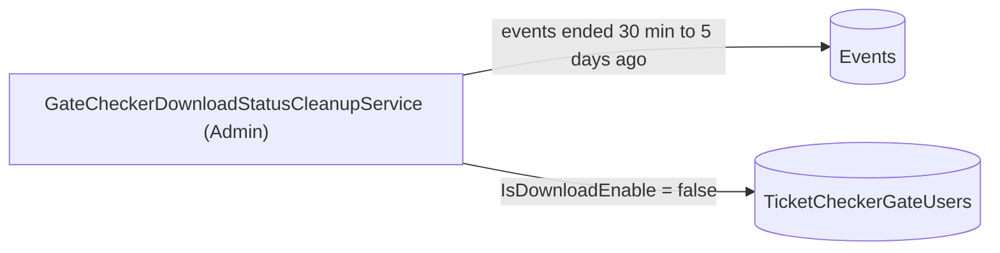

# S-15 · গেট ডাউনলোড-স্ট্যাটাস পরিষ্কার

> **Bangla name:** গেট ডাউনলোড-স্ট্যাটাস ক্লিনআপ
>
> [← 50 · System-initiated](README.md) · [সূচিপত্র](../README.md) · [ওপেন কোয়ারি](../99-open-queries.md)

## 1. নাম ও উদ্দেশ্য

**গেট ডাউনলোড-স্ট্যাটাস পরিষ্কার।** চেকার ব্যবহারকারীরা কোনো গেটে তাঁদের জন্য "download" চালু থাকলেই কেবল একটি ইভেন্টের টিকিট তালিকা ফোনে ডাউনলোড করতে পারেন ([A-18](../10-admin-portal/A-18-gate-assignment.md), [C-02](../40-checker-app/C-02-offline-ticket-download.md))। একটি Admin ওয়ার্কার শেষ হয়ে গেছে এমন প্রতিটি ইভেন্টের প্রতিটি গেটের প্রতিটি চেকারের জন্য এই ফ্ল্যাগ **বন্ধ** করে দেয়, যাতে ইভেন্ট শেষ হওয়ার পর টিকিট তালিকা ডাউনলোড করা না যায়। ধারণাগুলো: [ব্যাকগ্রাউন্ও ওয়ার্কার](../00-platform-primer.md#explainer-background-workers), [ডিস্ট্রিবিউটেড লক](../00-platform-primer.md#explainer-distributed-locks)।

## 2. ট্রিগার ও অ্যাক্টর

Admin সার্ভিসের একটি টাইমার (`GateCheckerDownloadStatusCleanupService`); কোনো ইউজার নেই, কোনো HTTP কল নেই।

## 3. ব্যবসায়িক প্রবাহ

একটি ম্যাচ বা শো শেষ হলে চেকার অ্যাকাউন্ট তাঁদের গেট অ্যাসাইনমেন্ট (রিপোর্টের জন্য) রাখে, কিন্তু টিকিট তালিকা ডাউনলোড করার অধিকার হারায়।

## 4. কারিগরি প্রবাহ

**[Worker: ৩০ সেকেন্ড স্টার্ট ডিলে, তারপর প্রতি ১৫ মিনিটে; RedLock `ticket_checker_status_reset`, মেয়াদ ৫ মিনিট, অপেক্ষা নেই; ত্রুটির পর ১ মিনিট বিরতি]**

1. `GateCheckerStatusCleanupTaskManager` লক নেয় এবং `TicketCheckerGateManager.DisableDownloadAccessForPastEventsAsync` কল করে।
2. এটি এমন প্রকাশিত, মোছা হয়নি এমন ইভেন্ট লোড করে যাদের `EndDateTime` অন্তত **৩০ মিনিট আগে এবং ৫ দিনের বেশি আগে নয়** (`GetEventsEndedBeforeAsync(now - 30 min)` ৫ দিন ফিরে তাকায়)।
3. প্রতিটি ইভেন্ট ও তার প্রতিটি গেটের জন্য যেখানে কমপক্ষে একজন ব্যবহারকারীর `IsDownloadEnable` সেট আছে, তা গেটের **একই** ব্যবহারকারী তালিকা `IsDownloadEnable = false` সহ `TicketCheckerGateUserRepository.AddOrRemoveAsync`-কে দেয়, যা ব্যবহারকারীদের রাখে এবং কেবল ফ্ল্যাগ আপডেট করে, এবং প্রতি ইভেন্টে সেভ করে।

## 5. কম্পোনেন্ট

| ধরন | কম্পোনেন্ট |
|---|---|
| Services | Admin |
| Tables | `TicketCheckerGateUsers` (`IsDownloadEnable`), `Events` (`EndDateTime`, `IsPublished`, `IsDeleted`) |
| Redis | লক `ticket_checker_status_reset` |
| Code | `Services/Admin/ETP.Admin.Service/Workers/BackgroundServices/GateCheckerDownloadStatusCleanupService.cs`, `.../TaskManagers/GateCheckerStatusCleanupTaskManager.cs`, `Services/Admin/ETP.Admin.Domain/Managers/TicketCheckerGateManager.cs:292-322`, `Services/Admin/ETP.Admin.Storage/Repositories/EventRepository.cs:319-331`, `.../TicketCheckerGateUserRepository.cs:12-42` |

## 6. API কন্ট্র্যাক্ট

None.

## 7. ডেটা ও পার্শ্বপ্রতিক্রিয়া

`TicketCheckerGateUsers.IsDownloadEnable` সত্য থেকে মিথ্যা হয়।

## 8. কোড রেফারেন্স

| কী | কোথায় |
|---|---|
| Loop | `rvl-gobcb-backend/Services/Admin/ETP.Admin.Service/Workers/BackgroundServices/GateCheckerDownloadStatusCleanupService.cs:11-24` |
| Work | `rvl-gobcb-backend/Services/Admin/ETP.Admin.Service/Workers/TaskManagers/GateCheckerStatusCleanupTaskManager.cs:11-34` |
| Logic | `rvl-gobcb-backend/Services/Admin/ETP.Admin.Domain/Managers/TicketCheckerGateManager.cs:292-322` |
| Event filter | `rvl-gobcb-backend/Services/Admin/ETP.Admin.Storage/Repositories/EventRepository.cs:319-331` |

## 9. হ্যান্ডওভার নোট

1. **ক্লাসের মন্তব্য বলছে "polling every 2 mins" কিন্তু বিলম্ব ১৫ মিনিট।** কোডই প্রাধান্য; সুযোগ পেলে মন্তব্য হালনাগাদ করুন।
2. **পাঁচ দিনের উইন্ডো।** ৫ দিনের বেশি আগে শেষ হওয়া ইভেন্ট কখনো স্পর্শ হয় না; এমন ইভেন্টের জন্য চালু থাকা চেকার চালুই থাকে।
3. **`EndDateTime`-হীন ইভেন্ট** (null) কখনো নির্বাচিত হয় না, তাই এই জব তাদের গেট কখনো বন্ধ করে না।
4. **Redis তালিকা মোছা হয় না।** অফলাইন টিকিট তালিকা `ticket_checker_tickets:event_{e}_gate_{g}` ও গেট ম্যাপ Redis-এই থাকে ([X-25](../60-cross-cutting/X-25-redis.md)); এই জব কেবল পরের ডাউনলোড আটকায়।
5. সার্ভিস ক্লাসের নাম বলছে "download status"; টাস্ক ম্যানেজার ও ম্যানেজার মেথড বলছে "disable download access"। এগুলো একই ফিচার।

## 10. কম্পোনেন্ট সম্পর্ক

**নির্ভর করে:** [A-18](../10-admin-portal/A-18-gate-assignment.md), ইভেন্টের শেষ সময় ([A-07](../10-admin-portal/A-07-events.md))। **প্রভাব ফেলে:** [C-02](../40-checker-app/C-02-offline-ticket-download.md) (এরপর ডাউনলোড প্রত্যাখ্যাত হয়)।

## 11. ডেভেলপার টেস্ট গাইড

**লোকালে টেস্টযোগ্যতা: সম্পূর্ণ।**

| বিষয় | বিবরণ |
|---|---|
| Test data and accounts | অ্যাডমিন …01; ৩০ মিনিট থেকে ৫ দিনের মধ্যে `EndDateTime`-এর একটি ইভেন্ট এবং একটি গেটে নিয়োজিত একজন চেকার |
| Browser | অ্যাডমিন পোর্টাল → গেট অ্যাসাইনমেন্ট: রানের পর "download" টগল বন্ধ |
| Emulator | — |
| Postman | `etp-admin` কলেকশন: গেট ও অ্যাসাইনমেন্ট রিকোয়েস্ট |
| Visual Studio debug | Admin: `GateCheckerStatusCleanupTaskManager.ExecuteAsync`, `TicketCheckerGateManager.DisableDownloadAccessForPastEventsAsync` (স্টার্টের ৩০ সেকেন্ড পর প্রথম রান) |
| Verify | SQL: ওই গেটের জন্য `select "IsDownloadEnable" from etp."TicketCheckerGateUsers"` |