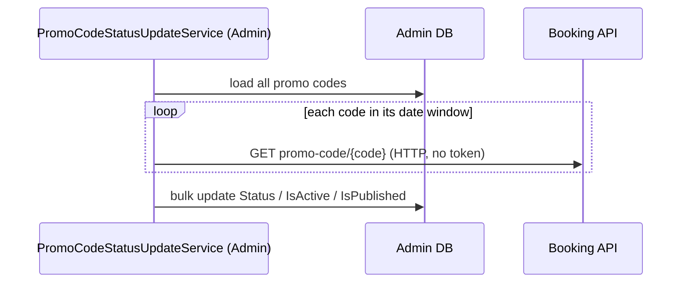

# S-16 · প্রোমো-কোড স্ট্যাটাস হালনাগাদ

> **Bangla name:** প্রোমো কোডের স্ট্যাটাস হালনাগাদ
>
> [← 50 · System-initiated](README.md) · [সূচিপত্র](../README.md) · [ওপেন কোয়ারি](../99-open-queries.md)

## 1. নাম ও উদ্দেশ্য

**প্রোমো-কোড স্ট্যাটাস হালনাগাদ।** প্রতি ২ মিনিটে একটি Admin ওয়ার্কার **প্রতিটি** প্রোমো কোডের স্ট্যাটাস (`Upcoming`, `Active`, `Expired`, `LimitReached`) তার শুরু ও শেষ সময় এবং এখনকার ব্যবহার থেকে আবার হিসাব করে এবং সেই অনুযায়ী `IsActive` ও `IsPublished` বদলায়। সংরক্ষিত স্ট্যাটাসটিই অ্যাডমিনরা প্রোমো-কোডের তালিকায় দেখেন ([A-15](../10-admin-portal/A-15-promo-codes.md))। গ্রাহকের *apply* ধাপ এটি পড়ে না: `ValidateApplyPromoCodeAsync` নিজে তারিখ যাচাই করে ও ব্যবহার গোনে ([P-05](../20-user-portal/P-05-apply-promo-code.md))। ধারণাগুলো: [ব্যাকগ্রাউন্ড ওয়ার্কার](../00-platform-primer.md#explainer-background-workers), [ডিস্ট্রিবিউটেড লক](../00-platform-primer.md#explainer-distributed-locks), [টোকেন ফরওয়ার্ডিং](../00-platform-primer.md#explainer-token-forwarding) (এখানে: কোনোটিই নেই)।

## 2. ট্রিগার ও অ্যাক্টর

Admin সার্ভিসের একটি টাইমার (`PromoCodeStatusUpdateService`); কোনো ইউজার নেই। এটি কোনো টোকেন ছাড়াই HTTP-তে Booking কল করে **[HTTP, no token / internal]**।

## 3. ব্যবসায়িক প্রবাহ

একটি প্রোমো কোড তার শুরু তারিখে কাজ করে, শেষ তারিখে বন্ধ হয়, এবং সেটি ব্যবহার করা অর্ডারের সংখ্যা মোট ব্যবহার সীমায় পৌঁছালে আর থামে।

## 4. কারিগরি প্রবাহ

**[Worker: ১ মিনিট স্টার্ট ডিলে, তারপর প্রতি ২ মিনিটে; RedLock `promo_code_status_updater`, মেয়াদ ২ মিনিট, অপেক্ষা নেই; ত্রুটির পর ১ মিনিট বিরতি]**

1. `PromoCodeStatusUpdateTaskManager` লক নেয় এবং `PromoCodeManager.UpdatePromoCodeStatusesAsync` কল করে।
2. সব প্রোমো কোড (তাদের অ্যাসাইনমেন্টসহ) লোড করে। প্রতিটির জন্য `GetPromoCodeStatusAsync(code, start, end, totalUsageLimit)`:
   - `now < StartDateTime` → `Upcoming`;
   - `now > EndDateTime` → `Expired`;
   - অন্যথায় Booking-কে জিজ্ঞেস করে `GET /booking/api/v1/user-booking-order/promo-code/{code}` **[HTTP, no token / internal]**, যা কোড ব্যবহার করা অর্ডারগুলো **স্ট্যাটাস `Paid`, `Requested` বা `Generated`** সহ ফেরত দেয়; সেগুলোর সংখ্যা কমপক্ষে `TotalUsageLimit` হলে → `LimitReached`;
   - অন্যথায় `Active`।
3. নতুন স্ট্যাটাস সংরক্ষিতটি থেকে আলাদা হলে `Status`, `IsActive = (status == Active)`, `IsPublished = (status == Active)`, `UpdatedAt` সেট করে এবং পরিবর্তিতগুলো একটি বাল্ক আপডেটে সেভ করে।

একটি অ্যাডমিন কোড তৈরি বা আপডেট করলেও (`CreateAsync`, `UpdateAsync`) একই স্ট্যাটাস ফাংশন চলে, তাই সংরক্ষিত স্ট্যাটাস সঙ্গে সঙ্গে সঠিক থাকে এবং ওয়ার্কার কেবল সময়ের সঙ্গে সঙ্গে তা হালনাগাদ রাখে।

## 5. কম্পোনেন্ট

| ধরন | কম্পোনেন্ট |
|---|---|
| Services | Admin (ওয়ার্কার), Booking (ব্যবহারের সংখ্যা) |
| Tables | `PromoCodes` (`Status`, `IsActive`, `IsPublished`), কোড অনুযায়ী Booking অর্ডারের পড়া |
| Redis | লক `promo_code_status_updater` |
| Code | `Services/Admin/ETP.Admin.Service/Workers/BackgroundServices/PromoCodeStatusUpdateService.cs`, `.../TaskManagers/PromoCodeStatusUpdateTaskManager.cs`, `Services/Admin/ETP.Admin.Domain/Managers/PromoCodeManager.cs:288-318, 442-457`, `Core/ETP.Core/ServiceClient/BookingClient/BookingClient.cs:346`, `Services/Booking/ETP.Booking.Domain/Managers/UserBookingOrderManager.cs:1195-1202` |

## 6. API কন্ট্র্যাক্ট

| মেথড | পাথ | Auth | রিকোয়েস্ট | রেসপন্স |
|---|---|---|---|---|
| GET | `/booking/api/v1/user-booking-order/promo-code/{code}` | none | path `code` | `UserBooking`-এর তালিকা (কোড ব্যবহার করা পরিশোধিত, অনুরোধিত বা জেনারেটেড অর্ডার) |

স্ট্যাটাসের মান (`PromoCodeStatus`): `Active` 1, `Expired` 2, `Upcoming` 3, `LimitReached` 4।

## 7. ডেটা ও পার্শ্বপ্রতিক্রিয়া

প্রোমো-কোড সারি হালনাগাদ; ব্যবহারকারী `System` সহ অ্যাক্টিভিটি লগ এন্ট্রি ([X-24](../60-cross-cutting/X-24-activity-logging.md))।

## 8. কোড রেফারেন্স

| কী | কোথায় |
|---|---|
| Loop | `rvl-gobcb-backend/Services/Admin/ETP.Admin.Service/Workers/BackgroundServices/PromoCodeStatusUpdateService.cs:14-26` |
| Work | `rvl-gobcb-backend/Services/Admin/ETP.Admin.Service/Workers/TaskManagers/PromoCodeStatusUpdateTaskManager.cs:24-48` |
| Status rules | `rvl-gobcb-backend/Services/Admin/ETP.Admin.Domain/Managers/PromoCodeManager.cs:288-318, 442-457` |
| Usage count | `rvl-gobcb-backend/Services/Booking/ETP.Booking.Domain/Managers/UserBookingOrderManager.cs:1195-1202` |
| Enum | `rvl-gobcb-backend/Services/Admin/ETP.Admin.Domain/Enums/Enums.cs:67-73` |

## 9. হ্যান্ডওভার নোট

1. **প্রতি ২ মিনিটে প্রতিটি সক্রিয় কোডে একটি HTTP কল।** তারিখ-উইন্ডোর ভেতরের প্রতিটি কোডের জন্য ওয়ার্কারটি Booking কল করে, যা কোডের সব অর্ডার মেমরিতে লোড করে; অনেক কোড ও অর্ডার হলে এটি বাড়ে। ব্যর্থ কল ফাঁকা তালিকা ফেরত দেয় (`BookingClient` non-success স্ট্যাটাসে `new List<UserBooking>()` ফেরত দেয়), তাই Booking বন্ধ থাকলে `LimitReached` কোডগুলো পরের সফল রান পর্যন্ত আবার `Active` দেখায়।
2. **ওয়ার্কারটি apply ধাপ নিয়ন্ত্রণ করে না।** `UserBookingOrderManager.ValidateApplyPromoCodeAsync` কোডটি লোড করে (কেবল `!IsDeleted`), তারিখ মিলিয়ে দেখে, মোট ও প্রতি-ইউজার সীমার জন্য পরিশোধিত, অনুরোধিত ও জেনারেটেড অর্ডার আবার গোনে এবং প্রোগ্রাম, ইভেন্ট ও গ্যালারি অ্যাসাইনমেন্ট যাচাই করে। এটি কখনোই `Status`, `IsActive` বা `IsPublished` পড়ে না, তাই সেগুলো কেবল অন্য স্ক্রিন বা তালিকায় যা দেখায় তা বদলায় `[UNCONFIRMED: Q-18]` (ইউজার পোর্টাল কেবল প্রকাশিত কোড তালিকাভুক্ত করে কি না)।
3. **ম্যানুয়াল নিষ্ক্রিয়করণ মুছে যেতে পারে।** স্ট্যাটাস বদলালে প্রতিবার ওয়ার্কারটি গণনা করা স্ট্যাটাস থেকে `IsActive` ও `IsPublished` সেট করে, তাই এই ফ্ল্যাগগুলোতে হাতে করা পরিবর্তন পরের স্ট্যাটাস পরিবর্তনের পর ফিরে যেতে পারে।
4. **প্রতি চক্রে সব কোড আবার লোড হয়**, `GetAllAsync` ফেরত দিলে মেয়াদোত্তীর্ণ ও মোছা কোডগুলোও; কোনো ধাপে ধাপে (incremental) কোয়েরি নেই।
5. Admin ওয়ার্কার ভাগ করা টেবিলের বদলে HTTP-তে Booking-এর ডেটা পড়ে, কারণ সার্ভিসগুলোর নিজস্ব আলাদা কনটেক্সট আছে, যদিও টেবিলগুলো `etp` স্কিমা ভাগ করে ([X-19](../60-cross-cutting/X-19-service-to-service.md), `[UNCONFIRMED: Q-02]`)।

## 10. কম্পোনেন্ট সম্পর্ক

**নির্ভর করে:** প্রোমো-কোড সেটআপ ([A-15](../10-admin-portal/A-15-promo-codes.md)), পরিশোধিত অর্ডার ([P-06](../20-user-portal/P-06-booking-payment.md))। **প্রভাব ফেলে:** [A-15](../10-admin-portal/A-15-promo-codes.md)-এ দেখানো স্ট্যাটাস; [P-05](../20-user-portal/P-05-apply-promo-code.md) এর ওপর নির্ভর করে না।

## 11. ডেভেলপার টেস্ট গাইড

**লোকালে টেস্টযোগ্যতা: সম্পূর্ণ।**

| বিষয় | বিবরণ |
|---|---|
| Test data and accounts | অ্যাডমিন …01; অ্যাডমিন পোর্টালে তৈরি একটি প্রোমো কোড (সিড স্ক্রিপ্ট `scripts/seed/01-catalog.sql`-ও প্রোমো কোডের উল্লেখ আছে) স্বল্প তারিখ-উইন্ডো সহ |
| Browser | অ্যাডমিন পোর্টাল → প্রোমো কোড: পরের রানের পর স্ট্যাটাস কলাম বদলায়; ইউজার পোর্টাল: চেকআউটে কোড প্রয়োগ |
| Emulator | লোকালে নয় (পরিচিত লগইন ঘাটতি) |
| Postman | `etp-admin` কলেকশন: প্রোমো-কোড রিকোয়েস্ট; `etp-booking`: "GET /api/v1/user-booking-order/promo-code/{code}" |
| Visual Studio debug | Admin: `PromoCodeStatusUpdateTaskManager.ExecuteAsync`, `PromoCodeManager.GetPromoCodeStatusAsync` |
| Verify | SQL: `select "Code","Status","IsActive","IsPublished" from etp."PromoCodes"` |