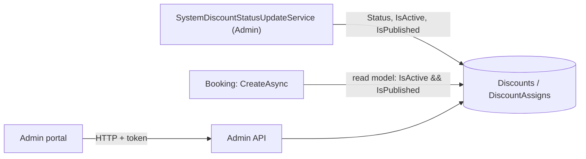

# S-17 · সিস্টেম-ডিসকাউন্ট স্ট্যাটাস হালনাগাদ

> **Bangla name:** সিস্টেম ডিসকাউন্টের স্ট্যাটাস হালনাগাদ
>
> [← 50 · System-initiated](README.md) · [সূচিপত্র](../README.md) · [ওপেন কোয়ারি](../99-open-queries.md)

## 1. নাম ও উদ্দেশ্য

**সিস্টেম-ডিসকাউন্ট স্ট্যাটাস হালনাগাদ।** একটি সিস্টেম ডিসকাউন্টের (একটি ইভেন্ট বা গ্যালারির জন্য অ্যাডমিন যে মূল্য কমায়, [A-16](../10-admin-portal/A-16-discounts.md)) একটি শুরু ও একটি শেষ সময় থাকে। প্রতি ২ মিনিটে একটি Admin ওয়ার্কার প্রতিটি ডিসকাউন্টের স্ট্যাটাস (`Upcoming`, `Active`, `Expired`) আবার হিসাব করে এবং `IsActive` ও `IsPublished` বদলায়। প্রোমো কোডের তুলনায় এটি মূল্যের জন্য গুরুত্বপূর্ণ: Booking অর্ডার তৈরি করার সময় ডিসকাউন্ট **কেবল তখনই** প্রয়োগ করে যখন `IsActive` ও `IsPublished` সত্য। ধারণাগুলো: [ব্যাকগ্রাউন্ড ওয়ার্কার](../00-platform-primer.md#explainer-background-workers), [ডিস্ট্রিবিউটেড লক](../00-platform-primer.md#explainer-distributed-locks), [ভাগ করা ডাটাবেস](../00-platform-primer.md#explainer-shared-database)।

## 2. ট্রিগার ও অ্যাক্টর

Admin সার্ভিসের একটি টাইমার (`SystemDiscountStatusUpdateService`); কোনো ইউজার নেই, কোনো HTTP কল নেই।

## 3. ব্যবসায়িক প্রবাহ

একটি ডিসকাউন্ট কোনো বোতাম চাপা ছাড়াই তার শুরু সময়ে কাজ করতে শুরু করে এবং শেষ সময়ে থেমে যায়। গ্রাহক আসন বাছাইয়ের সময় ও অর্ডারে কম দাম দেখেন ([P-04](../20-user-portal/P-04-seat-selection.md), [P-06](../20-user-portal/P-06-booking-payment.md))।

## 4. কারিগরি প্রবাহ

**[Worker: ১ মিনিট স্টার্ট ডিলে, তারপর প্রতি ২ মিনিটে; RedLock `system_discount_status_updater`, মেয়াদ ২ মিনিট, অপেক্ষা নেই; ত্রুটির পর ১ মিনিট বিরতি]**

1. `SystemDiscountStatusUpdateTaskManager` লক নেয় এবং `DiscountManager.UpdateSystemDiscountStatusesAsync` কল করে।
2. সব ডিসকাউন্ট (অ্যাসাইনমেন্টসহ) লোড করে। `GetDiscountStatus(start, end)`: `start > now` → `Upcoming`; `end < now` → `Expired`; অন্যথায় `Active`। (`DiscountStatus.LimitReached` এনামে আছে কিন্তু তৈরি হয় না।)
3. যেসব ডিসকাউন্টের স্ট্যাটাস বদলেছে, সেগুলোর `Status`, `IsActive` ও `IsPublished` (দুটোই কেবল `Active`-এর জন্য সত্য) এবং `UpdatedAt` সেট করে, তারপর বাল্ক আপডেট করে।
4. **Booking ব্যবহার করে:** `UserBookingOrderManager.CreateAsync` Booking সার্ভিসে `DiscountRepository.GetDiscountByIdsAsync(programId, eventId, galleryId)` কল করে, যা নিজস্ব read-model কনটেক্সটের মাধ্যমে একই `Discounts` টেবিল পড়ে এবং `!IsDeleted && IsActive && IsPublished` ও মিলে যাওয়া একটি প্রোগ্রাম চাই, এবং ইভেন্ট বা গ্যালারি অ্যাসাইনমেন্ট চাই। এরপর ডিসকাউন্টের মান ও ধরন অর্ডারের `Discount` পরিমাণে যায়।

## 5. কম্পোনেন্ট

| ধরন | কম্পোনেন্ট |
|---|---|
| Services | Admin (ওয়ার্কার, টেবিলের মালিক); Booking (টেবিল পড়ে) |
| Tables | `Discounts`, `DiscountAssigns` (Admin-এর মালিকানা; Booking এগুলো read model হিসেবে পড়ে) |
| Redis | লক `system_discount_status_updater` |
| Code | `Services/Admin/ETP.Admin.Service/Workers/BackgroundServices/SystemDiscountStatusUpdateService.cs`, `.../TaskManagers/SystemDiscountStatusUpdateTaskManager.cs`, `Services/Admin/ETP.Admin.Domain/Managers/DiscountManager.cs:245-273, 439-450`, `Services/Booking/ETP.Booking.Storage/Repositories/DiscountRepository.cs:14-31` |

## 6. API কন্ট্র্যাক্ট

ওয়ার্কারের জন্য কোনোটিই নেই।

## 7. ডেটা ও পার্শ্বপ্রতিক্রিয়া

`Discounts.Status`, `IsActive`, `IsPublished` হালনাগাদ; `System` ব্যবহারকারী হিসেবে অ্যাক্টিভিটি লগ সারি ([X-24](../60-cross-cutting/X-24-activity-logging.md))।

## 8. কোড রেফারেন্স

| কী | কোথায় |
|---|---|
| Loop | `rvl-gobcb-backend/Services/Admin/ETP.Admin.Service/Workers/BackgroundServices/SystemDiscountStatusUpdateService.cs:20-32` |
| Work | `rvl-gobcb-backend/Services/Admin/ETP.Admin.Service/Workers/TaskManagers/SystemDiscountStatusUpdateTaskManager.cs:24-48` |
| Status rules | `rvl-gobcb-backend/Services/Admin/ETP.Admin.Domain/Managers/DiscountManager.cs:245-273, 439-450` |
| Booking lookup | `rvl-gobcb-backend/Services/Booking/ETP.Booking.Storage/Repositories/DiscountRepository.cs:14-31`; `.../UserBookingOrderManager.cs:189`-এ ব্যবহৃত |

## 9. হ্যান্ডওভার নোট

1. **মূল্যে সর্বোচ্চ ২ মিনিটের ছাঁচ।** Booking কেবল ফ্ল্যাগ দেখে, তারিখ নয়। একটু আগে শেষ হওয়া ডিসকাউন্ট পরের ওয়ার্কার রান ফ্ল্যাগ বদলানোর আগ পর্যন্ত প্রয়োগ করা হয়, আর একটু আগে শুরু হওয়া ডিসকাউন্ট তখন পর্যন্ত প্রয়োগ হয় না।
2. **Admin ওয়ার্কার থেমে গেলে ডিসকাউন্ডের অবস্থা আর বদলায় না।** মেয়াদোত্তীর্ণ ডিসকাউন্ট প্রয়োগ করা হতে থাকে; নতুন কোনো শুরু হয় না। ওয়ার্কারটি পর্যবেক্ষণ করুন (লগ "System discount status: Updated system discounts status.") ও লক `system_discount_status_updater`।
3. **`FirstOrDefault` একটি ডিসকাউন্ট বাছে।** একই ইভেন্ট বা গ্যালারির সঙ্গে দুটি সক্রিয় ডিসকাউন্ট মেলে, `FirstOrDefault` যেকোনো একটি ফেরত দেয়। Admin দিকে একটি overlap পরীক্ষা আছে, `DiscountManager.DiscountExistsForEventIds`; প্রতিটি সেভ পথ সেটি কল করে কি না এখানে যাচাই করা হয়নি।
4. **ম্যানুয়াল ফ্ল্যাগ ও ওয়ার্কার।** গণনা করা স্ট্যাটাস বদলালে ওয়ার্কারটি `IsActive` ও `IsPublished` আবার লেখে, তাই এই ফ্ল্যাগগুলোতে ম্যানুয়াল পরিবর্তন ফিরিয়ে আনা হতে পারে।
5. **ক্রস-সার্ভিস টেবিল পড়া।** Booking নিজস্ব `DbContext`-এর মাধ্যমে Admin-এর মালিকানাধীন `Discounts` টেবিল পড়ে (read model হিসেবে ম্যাপ করা, `ExcludeFromMigrations`)। Admin-এ স্কিমা বদলালে Booking-এর ম্যাপিংয়ে তা প্রতিফলিত করতে হবে `[UNCONFIRMED: Q-02]` (ডাটাবেস বিন্যাস)।

## 10. কম্পোনেন্ট সম্পর্ক

**নির্ভর করে:** ডিসকাউন্ট সেটআপ ([A-16](../10-admin-portal/A-16-discounts.md))। **প্রভাব ফেলে:** অর্ডারের মূল্য ([P-06](../20-user-portal/P-06-booking-payment.md)), ইনভয়েস PDF ও রিপোর্টে ডিসকাউন্টের লাইন ([A-22](../10-admin-portal/A-22-reports.md)), এবং VAT রেকর্ড ([S-10](S-10-vat-challan.md))।

## 11. ডেভেলপার টেস্ট গাইড

**লোকালে টেস্টযোগ্যতা: সম্পূর্ণ।**

| বিষয় | বিবরণ |
|---|---|
| Test data and accounts | অ্যাডমিন …01; নিকট ভবিষ্যতের `StartDateTime`-এর একটি ডিসকাউন্ট, সিড করা একটি ইভেন্টে অ্যাসাইন করা (`scripts/seed/01-catalog.sql`) |
| Browser | অ্যাডমিন পোর্টাল → ডিসকাউন্ট: পরের রানের পর স্ট্যাটাস বদলায়; ইউজার পোর্টাল: আসন বাছাইয়ের সময় মূল্য বদলায় |
| Emulator | লোকালে নয় (পরিচিত লগইন ঘাটতি) |
| Postman | `etp-admin` কলেকশন: ডিসকাউন্ট রিকোয়েস্ট; `etp-booking`: ডিসকাউন্ট দেখতে অর্ডার তৈরি |
| Visual Studio debug | Admin: `DiscountManager.UpdateSystemDiscountStatusesAsync`; Booking: `DiscountRepository.GetDiscountByIdsAsync` |
| Verify | SQL: `select "Status","IsActive","IsPublished" from etp."Discounts"` |