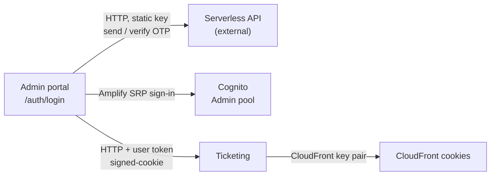

# X-01 · অ্যাডমিন লগইন (ফোন OTP + পাসওয়ার্ড)

> **Bangla name:** অ্যাডমিন লগইন (ফোন OTP + পাসওয়ার্ড)
>
> [← 60 · ক্রস-কাটিং](README.md) · [সূচিপত্র](../README.md) · [ওপেন কোয়ারি](../99-open-queries.md)

## 1. নাম ও উদ্দেশ্য

**অ্যাডমিন লগইন।** BCB ও BS23-এর কর্মীরা (রোল `admin`, `event_manager`, `ticket_manager`, `ticket_operator`,
`customer_support`) অ্যাডমিন পোর্টালে সাইন ইন করতে পারেন। এই স্ক্রিনটি একে একে তিনটি জিনিস চায়: ১০ সংখ্যার ফোন নম্বর, ৬ সংখ্যার
SMS কোড, এবং Cognito পাসওয়ার্ড। সফল লগইনে ব্রাউজার **Admin** user pool থেকে Cognito টোকেন পায়, যা বার্তা প্রতিটি অ্যাডমিন API
কলে বহন করে।

## 2. ট্রিগার ও অ্যাক্টর

| বিষয় | মান |
|---|---|
| অ্যাক্টর | Admin Cognito pool-এ অ্যাকাউন্ট থাকা একজন কর্মী ([X-05](X-05-admin-provisioning.md) দিয়ে তৈরি) |
| ক্লায়েন্ট ও স্ক্রিন | অ্যাডমিন পোর্টাল, রুট `/auth/login` (`LoginComponent`) |
| Cognito pool | Admin (`environment.aws.userPoolId` / `userPoolWebClientId`) |
| রোল / প্রোগ্রাম স্কোপ | লগইনের জন্য কিছু লাগে না; ল্যান্ডিং পেজ নির্ধারণ করে রোল |

## 3. ব্যবসায়িক প্রবাহ

১. কর্মী `+880` ছাড়া ফোন নম্বরটি লেখেন।
২. পোর্টাল "Serverless" API-কে SMS-এ ৬ সংখ্যার কোড পাঠাতে বলে। নম্বরটি অজানা হলে বার্তা আসে "User not found."
৩. কর্মী কোডটি লেখেন; পোর্টাল Serverless API-কে সেটি যাচাই করতে বলে। ২ মিনিট পর আবার পাঠানো যায়।
৪. কোড বৈধ হলে পাসওয়ার্ড ফিল্ড দেখা যায়। পোর্টাল `+880<phone>` ও পাসওয়ার্ড দিয়ে Cognito-তে সাইন ইন করে।
৫. পোর্টাল রোল (`custom:role`) পড়ে ল্যান্ডিং পেজ খোলে: `admin`, `event_manager`
   (একা বা `ticket_manager`-এর সাথে) হলে `/program-management`; বাকিদের জন্য `/home`।
৬. `admin`, `ticket_manager` ও `ticket_operator` রোলের জন্য পোর্টাল আরও Ticketing-এর কাছ থেকে CloudFront signed cookie
   চায়, যাতে পরে রিজার্ভড-টিকিটের ফাইল ডাউনলোড করা যায় ([A-12](../10-admin-portal/A-12-reserved-tickets.md))।

## 4. প্রযুক্তিগত প্রবাহ

| # | থেকে → পর্যন্ত | হপ | কী ঘটে |
|---|---|---|---|
| ১ | অ্যাডমিন পোর্টাল → Serverless API `POST {serverless.baseUrl}/admin/login-2fa-send-otp` | **[HTTP, static key]** | বডি `{ otp_type: "sms", destination: "+880…" }`, হেডার `Authorization: <environment.serverless.authorization>`। সফল যখন `status_message == "otp_generated_and_enqueued_successfully"` |
| ২ | অ্যাডমিন পোর্টাল → Serverless API `POST …/admin/login-2fa-verify-otp` | **[HTTP, static key]** | বডিতে `otp` যোগ হয়। সফল যখন `status_message == "sms_otp_verified_successfully"`; নয়তো `invalid_otp` |
| ৩ | অ্যাডমিন পোর্টাল → Cognito (Admin pool) | Amplify `Auth.signIn(phone, password)` | SRP সাইন ইন (Amplify-এর ডিফল্ট ফ্লো; লোকালে সেটআপ স্ক্রিপ্ট `ALLOW_USER_SRP_AUTH` চালু করে)। টোকেন ফেরত দেয়, অথবা একটি challenge |
| 3a | | challenge `NEW_PASSWORD_REQUIRED` | পোর্টাল `Auth.completeNewPassword(response, <same password>)` দিয়ে উত্তর দেয়, ফলে অস্থায়ী পাসওয়ার্ড স্থায়ী হয়ে যায় |
| 3b | | challenge `SMS_MFA` | কলার কাছে একটি মান হিসেবে ফেরত যায়, কোনো ব্যবস্থা নেই (নোট দেখুন) |
| ৪ | অ্যাডমিন পোর্টাল → Cognito | `Auth.currentSession()`, `Auth.currentUserInfo()` | অ্যাক্সেস টোকেন ৫৫ মিনিট ক্যাশ হয়; ইউজার অ্যাট্রিবিউট (`custom:role`-সহ) ৫৫ মিনিট ক্যাশ হয় |
| ৫ | অ্যাডমিন পোর্টাল → Ticketing `GET /ticketing/api/v1/booking-order-ticket/signed-cookie` | **[HTTP + user token]** | শুধু `admin`, `ticket_manager`, `ticket_operator` রোলের জন্য; রেসপন্সের `CloudFront-*` কুকি `document.cookie` দিয়ে লেখা হয় |

ধাপ ১–৪-এ কোনো ব্যাকএন্ড সার্ভিস জড়িত নেই। সার্ভিসগুলো গ্রাহককে কেবল পরের API কলে দেখে, যখন তারা Admin-pool অ্যাক্সেস
টোকেন যাচাই করে ([X-14](X-14-authz-pool-policies.md))।

## 5. কম্পোনেন্ট

| ধরন | কম্পোনেন্ট |
|---|---|
| ক্লায়েন্ট | অ্যাডমিন পোর্টাল: `LoginComponent`, `CognitoService`, `EventService.setSignedCookie()` |
| বাহ্যিক | "Serverless" API (`environment.serverless.baseUrl`), কোনো রিপোজিটরিতে সোর্স নেই `[UNCONFIRMED: Q-03]` |
| AWS | Cognito Admin user pool |
| সার্ভিস | Ticketing (শুধু signed cookie) |
| ডেটা | ব্রাউজার: Amplify টোকেন স্টোরেজ (local storage), `sessionStorage.lastKnownUserRole`, `localStorage.globalProgramId`, CloudFront কুকি |

## 6. API কন্ট্রাক্ট

| মেথড | পাথ | অথ | রিকোয়েস্ট | রেসপন্স | প্রধান এরর |
|---|---|---|---|---|---|
| POST | `{serverless}/admin/login-2fa-send-otp` | হেডার `Authorization: <static key>` | `{ otp_type, destination }` | `{ status_message }` | `status_message: "user_not_found"` |
| POST | `{serverless}/admin/login-2fa-verify-otp` | একই | `{ otp_type, destination, otp }` | `{ status_message, user_id? }` | `status_message: "invalid_otp"` |
| — | Cognito `InitiateAuth` / `RespondToAuthChallenge` (Amplify) | নেই (public client) | ফোন + পাসওয়ার্ড | Cognito টোকেন | `NotAuthorizedException`, `UserNotFoundException`, … (`getCognitoErrorMessage`-এ টেক্সটে রূপান্তরিত) |
| GET | `/ticketing/api/v1/booking-order-ticket/signed-cookie` | `Policy = admin` | নেই | CloudFront কুকি ভ্যালু | 401 |

Serverless রিকোয়েস্ট ও রেসপন্সের শেপ হলো পোর্টাল যা পাঠায় ও পড়ে; API নিজে রিপোজিটরিতে নেই।

```json
// POST {serverless}/admin/login-2fa-send-otp
{ "otp_type": "sms", "destination": "+8801700000001" }

// 200
{ "status_message": "otp_generated_and_enqueued_successfully" }
```

```json
// POST {serverless}/admin/login-2fa-verify-otp
{ "otp_type": "sms", "destination": "+8801700000001", "otp": "123456" }

// 200
{ "status_message": "sms_otp_verified_successfully" }
```

## 7. ডেটা ও পার্শ্বপ্রতিক্রিয়া

- লগইনের সময় GoBCB ব্যাকএন্ড কিছু লেখে না।
- Serverless API একটি SMS পাঠায় (রিপোজিটরির বাইরে)।
- ব্রাউজার Amplify-এর টোকেন, `sessionStorage.lastKnownUserRole` (রোল পরিবর্তন শনাক্তকরণে ব্যবহৃত, [X-17](X-17-authz-client-side.md)),
  এবং তিনটি রোলের জন্য CloudFront কুকি সংরক্ষণ করে।

## 8. কোড রেফারেন্স

| কী | কোথায় |
|---|---|
| লগইন স্ক্রিনের লজিক (৩ ধাপ, ল্যান্ডিং রুট, signed cookie) | `rvl-gobcb-admin-portal/src/app/modules/auth/login/login.component.ts:124-249` |
| Serverless OTP কল | `rvl-gobcb-admin-portal/src/app/core/services/cognito.service.ts:444-472` |
| Cognito সাইন ইন ও challenge | `rvl-gobcb-admin-portal/src/app/core/services/cognito.service.ts:213-246` |
| টোকেন ও ইউজার-ইনফো ক্যাশ (৫৫ মিনিট) | `rvl-gobcb-admin-portal/src/app/core/services/cognito.service.ts:261-302`, `:353-377` |
| Amplify কনফিগারেশন | `rvl-gobcb-admin-portal/src/app/core/config/aws-exports.ts` |
| Signed cookie রিকোয়েস্ট | `rvl-gobcb-admin-portal/src/app/features/events/services/event.service.ts:234` |
| OTP URL বাদ দেওয়া ইন্টারসেপ্টর | `rvl-gobcb-admin-portal/src/app/core/interceptors/auth.interceptor.ts:19-29`, `src/app/interceptors/program-id.interceptor.ts:15` |

## 9. হ্যান্ডওভার নোট

১. **SMS কোড শুধু ব্রাউজার যাচাই করে।** ধাপ ৩ শুধু ফোন ও পাসওয়ার্ড Cognito-তে পাঠায়; OTP ধাপের কোনো কিছু Cognito বা সার্ভিসে
   পৌঁছায় না। যে কেউ কর্মীর পাসওয়ার্ড জানে, সরাসরি Cognito-তে কল করে Admin-pool টোকেন পেতে পারে (লোকালে Postman রিকোয়েস্ট
   "Login as admin" যেমন করে)। Admin pool নিজে MFA প্রয়োগ করে কি না তা রিপোজিটরিতে দেখা যায় না `[UNCONFIRMED: Q-03]`।
২. **Serverless key ব্রাউজার বান্ডলে আছে।** `environment.serverless.authorization` জেনারেট করা `environment.ts`-এর অংশ,
   তাই অ্যাডমিন পোর্টালের প্রতিটি দর্শক তা পড়তে পারে।
৩. **`NEW_PASSWORD_REQUIRED` নীরবে টাইপ করা পাসওয়ার্ডটিই ব্যবহার করে।** Admin সার্ভিস তৈরি করা অ্যাকাউন্ট ইতিমধ্যেই স্থায়ী
   পাসওয়ার্ড পায় ([X-05](X-05-admin-provisioning.md)), তাই এই শাখা শুধু অন্য ভাবে তৈরি অ্যাকাউন্টের জন্য তাৎপর্যপূর্ণ।
৪. **`SMS_MFA` ব্যবস্থা করা হয় না।** `signIn` `{ challengeName: 'SMS_MFA', … }` দিয়ে রিজলভ করে; `onLogin` সেটিকে সফলতা ধরে নেয়,
   তারপর ইউজার সাইন ইন না থাকায় রোল পড়তে ব্যর্থ হয়। `confirmMFA(user, code)` আছে কিন্তু কোনো স্ক্রিন তা কোনো করে।
৫. **Signed-cookie রোলগুলো হুবহু মিল খোঁজে।** `allowedRoles.includes(role)` পুরো `custom:role` স্ট্রিং তুলনা করে, তাই যে ইউজারের
   অ্যাট্রিবিউটে দুটি রোল আছে (যেমন `event_manager,ticket_manager`) তার লগইনে কোনো কুকি পায় না। টপ বারে একটি "refresh cookie"
   অ্যাকশন আছে (`app.topbar.component.ts`-এ `RefreshCookie()`)।
৬. **রোল ক্যাশ।** মেনুতে দেখানো ও ব্যবহৃত হওয়া রোল ব্রাউজারে ৫৫ মিনিট ক্যাশ থাকে; অ্যাডমিন করলে রোল বদলাতে সেই সময় পর্যন্ত
   লাগতে পারে ([X-17](X-17-authz-client-side.md))। ব্যাকএন্ডেরও নিজস্ব ক্যাশ আছে ([X-15](X-15-authz-roles.md))।

## 10. কম্পোনেন্ট সম্পর্ক



**নির্ভর করে:** [X-05](X-05-admin-provisioning.md) (অ্যাকাউন্ট আছে), Serverless API, Cognito Admin pool।
**প্রভাব ফেলে:** প্রতিটি `A-xx` ফিচার (টোকেন), [X-04](X-04-admin-session.md) (সেশন), [X-17](X-17-authz-client-side.md) (রোল অনুযায়ী মেনু),
[A-12](../10-admin-portal/A-12-reserved-tickets.md) (signed cookie)।

## 11. ডেভেলপার টেস্ট গাইড

**লোকাল টেস্টযোগ্যতা: আংশিক।** OTP ধাপটি একটি লোকাল স্টাবের বিপরীতে চলে (যেকোনো ফোন, কোড `123456`); Cognito হলো Floci।
আসল SMS, আসল MFA ও CloudFront কুকি লোকালে পরীক্ষা করা যায় না।

| বিষয় | বিবরণ |
|---|---|
| টেস্ট ডেটা ও অ্যাকাউন্ট | `floci/seed-users.ps1` থেকে Admin-pool ইউজার: `+8801700000001` admin, `…02` event_manager, `…03` ticket_manager, `…04` ticket_operator, `…05` customer_support। পাসওয়ার্ড `Passw0rd!23` (`docs/local-dev.md` ধাপ ৩) |
| ব্রাউজার | ব্যাকএন্ড চালু করুন (`dotnet run --project aspire/Etp.AppHost`) এবং পোর্টাল কপি (`pwsh ./scripts/Setup-AdminPortal.ps1 -Start`)। খুলুন `http://localhost:4200/auth/login`; ফোন `1700000001`, OTP `123456`, পাসওয়ার্ড `Passw0rd!23` (`docs/admin-portal-local.md` §5)। DevTools → Network-এ `p/` দিয়ে ফিল্টার করুন: `/p/serverless/admin/login-2fa-send-otp`, `…verify-otp`, তারপর `/p/cognito`-এর কল, শেষে `Authorization: Bearer …`-সহ প্রথম `/p/admin/...` কল দেখা যাবে |
| ইমুলেটর | প্রযোজ্য নয় (অ্যাডমিন পোর্টাল শুধু ওয়েব) |
| Postman | কলেকশন `postman/etp-login-all-pools.postman_collection.json`, ফোল্ডার "Admin pool", রিকোয়েস্ট "Login as admin" (Floci-র বিপরীতে USER_PASSWORD_AUTH, এনভায়রনমেন্ট `postman/etp-local-services.postman_environment.json`)। এটি সার্ভিস কলেকশনের জন্য টোকেন সংরক্ষণ করে। নেগেটিভ কেস: `postman/etp-cognito-auth.postman_collection.json` ফোল্ডার "02 - Cognito negative auth" |
| Visual Studio ডিবাগ | লগইনের জন্য সার্ভারে ডিবাগ করার কিছু নেই। টোকেন আসতে দেখতে `ETP.Admin.Service`-এ অ্যাট্যাচ করুন (`docs/local-dev.md` §6.1) এবং `admin` স্কিমের `OnTokenValidated`-এ ব্রেকপয়েন্ট দিন, `rvl-gobcb-backend/Core/ETP.Core/Configuration/DefaultAuthenticationConfig.cs:101` |
| যাচাই | ল্যান্ডিং পেজ §3-এর রোল টেবিলের সাথে মেলে কি না। `sessionStorage.lastKnownUserRole`-এ রোল থাকে। `GET /admin/api/v1/events`-এর মতো সুরক্ষিত কল 200 দেয় (`pwsh ./scripts/Test-EtpLocal.ps1` টোকেন ছাড়া 401 ও টোকেনসহ 200 যাচাই করে) |