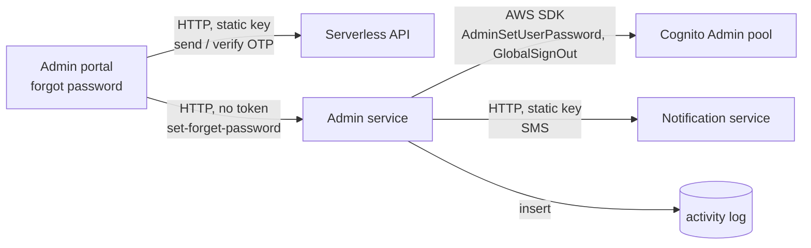

# X-02 · অ্যাডমিন পাসওয়ার্ড ভুলে যাওয়া

> **Bangla name:** অ্যাডমিন পাসওয়ার্ড ভুলে যাওয়া
>
> [← 60 · ক্রস-কাটিং](README.md) · [সূচিপত্র](../README.md) · [ওপেন কোয়ারি](../99-open-queries.md)

## 1. নাম ও উদ্দেশ্য

**অ্যাডমিন পাসওয়ার্ড ভুলে যাওয়া।** পাসওয়ার্ড ভুলে যাওয়া একজন কর্মী SMS কোড দিয়ে ফোনের নিয়ন্ত্রণ প্রমাণ করে নতুন পাসওয়ার্ড
নির্ধারণ করতে পারেন। নতুন পাসওয়ার্ডটি Admin সার্ভিস সরাসরি Admin Cognito pool-এ লেখে এবং SMS-এও ফোনে পাঠায়।

## 2. ট্রিগার ও অ্যাক্টর

| বিষয় | মান |
|---|---|
| অ্যাক্টর | Admin-pool অ্যাকাউন্ট থাকা একজন কর্মী, সাইন ইন না করা |
| ক্লায়েন্ট ও স্ক্রিন | অ্যাডমিন পোর্টাল, লগইন পেজের লিংক → `ForgotPasswordComponent` (রুট `/auth/forgot-password`, লগইন পেজ থেকে ডায়ালগ হিসেবেও দেখা যায়) |
| Cognito pool | Admin |
| রোল / প্রোগ্রাম স্কোপ | নেই (anonymous) |

## 3. ব্যবসায়িক প্রবাহ

১. কর্মী ১০ সংখ্যার ফোন নম্বর দেন।
২. পোর্টাল Serverless API-এর মাধ্যমে একটি SMS কোড পাঠায় (লগইনের মতো একই কল, [X-01](X-01-admin-login.md))।
৩. কর্মী কোডটি দেন; Serverless API সেটি যাচাই করে ইউজারের id ফেরত দেয়।
৪. কর্মী নতুন পাসওয়ার্ড দেন ও নিশ্চিত করেন (সর্বনিম্ন ৮ অক্ষর, বড় হাতের অক্ষর, ছোট হাতের অক্ষর, সংখ্যা, এবং `!@#$%^&*`-এর একটি)।
৫. পোর্টাল ইউজার id ও পাসওয়ার্ড Admin সার্ভিসে পাঠায়, যা পাসওয়ার্ড নির্ধারণ করে, ইউজারকে সব জায়গা থেকে সাইন আউট করায় এবং
   নতুন পাসওয়ার্ডসহ একটি SMS পাঠায়। পোর্টাল ২ সেকেন্ড পর লগইন পেজে ফিরে যায়।
৬. এই স্ক্রিনে "Resend" একটি আলাদা কাজ করে: এটি Cognito-এর নিজস্ব forgot-password ফ্লো কল করে, ডেলিভারি হয় ইমেইলে।

## 4. প্রযুক্তিগত প্রবাহ

| # | থেকে → পর্যন্ত | হপ | কী ঘটে |
|---|---|---|---|
| ১ | অ্যাডমিন পোর্টাল → Serverless `POST …/admin/login-2fa-send-otp` | **[HTTP, static key]** | [X-01](X-01-admin-login.md) ধাপ ১-এর মতো |
| ২ | অ্যাডমিন পোর্টাল → Serverless `POST …/admin/login-2fa-verify-otp` | **[HTTP, static key]** | `sms_otp_verified_successfully` হলে পোর্টাল `response.user_id` রাখে |
| ৩ | অ্যাডমিন পোর্টাল → Admin `POST /admin/api/v1/admin-users/set-forget-password` | **[HTTP, no token]** (`[AllowAnonymous]`; পোর্টালের অথ ইন্টারসেপ্টর এই URL বাদ দেয়) | বডি `{ userId, password }` |
| ৪ | Admin সার্ভিস → Cognito (Admin pool) | static key-সহ AWS SDK | `phone_number` পড়তে `AdminGetUser(userId)`, তারপর `AdminUserGlobalSignOut`, `AdminSetUserPassword(Permanent = true)` |
| ৫ | Admin সার্ভিস → Notification সার্ভিস `Notification:Endpoint` | **[HTTP, static key]** | SMS "Your password has been changed successfully.New Password is …" |
| ৬ | Admin সার্ভিস → ডেটাবেস | — | অ্যাক্টিভিটি লগ রো `AdminUser / PasswordResetCompleted` ([X-24](X-24-activity-logging.md)) |
| R | (Resend) অ্যাডমিন পোর্টাল → Cognito | Amplify `Auth.forgotPassword(phone, { DeliveryMedium: 'EMAIL' })` | Cognito ইমেইলে নিজস্ব কোড পাঠায়; এই স্ক্রিন কখনো সেই কোড জমা দেয় না (`confirmForgotPassword` কোনো করে বলা হয় না) |

## 5. কম্পোনেন্ট

| ধরন | কম্পোনেন্ট |
|---|---|
| ক্লায়েন্ট | অ্যাডমিন পোর্টাল `ForgotPasswordComponent`, `CognitoService.submitPassword()` |
| বাহ্যিক | Serverless API (OTP), Notification সার্ভিস (SMS) `[UNCONFIRMED: Q-05]` |
| সার্ভিস | Admin: `AdminUsersController.ForgetSetPasswordAsync` → `AdminUserManager` → `AdminUserProvider` |
| AWS | Cognito Admin pool |
| ডেটা | `etp` অ্যাক্টিভিটি লগ টেবিল ([X-24](X-24-activity-logging.md)) |

## 6. API কন্ট্রাক্ট

| মেথড | পাথ | অথ | রিকোয়েস্ট DTO | রেসপন্স | প্রধান এরর |
|---|---|---|---|---|---|
| POST | `/admin/api/v1/admin-users/set-forget-password` | নেই (`[AllowAnonymous]`) | `AdminForgetSetPassword { UserId, Password }` | বডি `200` সহ `200` | 400 `ArgumentException` (Cognito এরর টেক্সট, যেমন পাসওয়ার্ড পলিসি) |
| GET | `/admin/api/v1/admin-users/forget-password?phoneNo=` | নেই (`[AllowAnonymous]`) | query `phoneNo` | `true` / `false` | — (এরর চাপা পড়ে `false` ফেরত দেয়) |
| POST | `{serverless}/admin/login-2fa-send-otp`, `…/verify-otp` | static key | [X-01](X-01-admin-login.md) দেখুন | `{ status_message, user_id }` | `invalid_otp` |

বর্তমান পোর্টাল `GET forget-password` কোনো করে বলা হয় না (`CognitoService.sendOtp()` আছে কিন্তু কোনো কলার নেই); এটি তালিকাভুক্ত
কারণ এটি পৌঁছানো যায়: এটি ওই ফোন নম্বরের অ্যাকাউন্টের জন্য Cognito `AdminResetUserPassword` চালায়।

```json
// POST /admin/api/v1/admin-users/set-forget-password
{ "userId": "3f6c2a8e-0000-4000-8000-000000000001", "password": "N3w!Passw0rd" }

// 200
200
```

```json
// 400 when Cognito rejects the password
{ "status": 400, "title": "Password did not conform with policy: Password must have symbol characters" }
```

400-এর title হলো `ArgumentException` দিয়ে পাঠানো Cognito এক্সেপশন মেসেজ; উদাহরণের টেক্সটটি ওই শেপ নির্দেশ করে, সঠিক
বাক্যানিসম Cognito থেকে আসে।

## 7. ডেটা ও পার্শ্বপ্রতিক্রিয়া

- Cognito: পাসওয়ার্ড বদলে যায় (স্থায়ী), ইউজারের সব সেশন বাতিল হয় (`AdminUserGlobalSignOut`)।
- নতুন পাসওয়ার্ড স্পষ্ট লেখায় SMS, Notification সার্ভিসের মাধ্যমে।
- অ্যাক্টিভিটি লগ এন্ট্রি `PasswordResetCompleted`, entity id = ইউজার id।
- `GET forget-password` (কোনো করে বলা হলে): Cognito ইউজারকে `RESET_REQUIRED` চিহ্নিত করে এবং Cognito-এর নিজস্ব কোড পাঠায়;
  অ্যাক্টিভিটি লগ এন্ট্রি `PasswordResetRequested`, entity id হিসেবে ফোন নম্বর।

## 8. কোড রেফারেন্স

| কী | কোথায় |
|---|---|
| স্ক্রিনের প্রবাহ | `rvl-gobcb-admin-portal/src/app/modules/auth/forgot-password/forgot-password.component.ts:123-263` |
| পোর্টালের API কল | `rvl-gobcb-admin-portal/src/app/core/services/cognito.service.ts:432-434` |
| কন্ট্রোলার (anonymous এন্ডপয়েন্ট) | `rvl-gobcb-backend/Services/Admin/ETP.Admin.Service/Api/AdminUsersController.cs:28-39`, `:185-196` |
| ম্যানেজার | `rvl-gobcb-backend/Services/Admin/ETP.Admin.Domain/Managers/AdminUserManager.cs:197-231` |
| Cognito কল ও SMS | `rvl-gobcb-backend/Services/Admin/ETP.Admin.Integration/Services/AdminUserProvider.cs:508-586` |

## 9. হ্যান্ডওভার নোট

১. **ব্যাকএন্ড OTP যাচাই করে না।** `set-forget-password` anonymous এবং বডিতে থাকা `userId`-কে বিশ্বাস করে। OTP শুধু ব্রাউজার
   ও Serverless API-এর মধ্যে যাচাই হয়। যে কেউ কোনো অ্যাডমিনের Cognito user id জানে বা অনুমান করতে পারে (মানে `sub`, অথবা
   ইউজারনেম যা ফোন নম্বর), সেই অ্যাডমিনের পাসওয়ার্ড নির্ধারণ করতে পারে। লোকাল Postman কলেকশন এটি দেখায়
   ("Set known password (set-forget-password)")। সার্ভিসের সামনে কিছু (API Gateway) এই রুট আটকায় কি না তা রিপোজিটরিতে নেই
   `[UNCONFIRMED: Q-04]`।
২. **পাসওয়ার্ড SMS-এ যায়।** নতুন পাসওয়ার্ড স্পষ্ট লেখায় ফেরত পাঠানো হয়। একই প্যাটার্ন অ্যাকাউন্ট তৈরির সময় এবং কোনো
   অ্যাডমিন যখন অন্যের পাসওয়ার্ড রিসেট করে তখনও ব্যবহৃত হয় ([X-05](X-05-admin-provisioning.md))।
৩. **"Resend" অসামঞ্জস্যপূর্ণ।** এটি Cognito-এর ইমেইল-ভিত্তিক ফ্লো শুরু করে, যার কোড এই স্ক্রিন গ্রহণ করতে পারে না। বাস্তবে ইউজারকে
   "Send OTP" দিয়ে নতুন করে শুরু করতে হয়।
৪. **`GET forget-password` একটি অব্যবহৃত কিন্তু খোলা এন্ডপয়েন্ট** যা যেকোনো অ্যাডমিন অ্যাকাউন্টকে `RESET_REQUIRED`-এ ফোর্স করতে
   পারে (এতে শুধু ফোন নম্বর লাগে)। সরানোর প্রার্থী; [X-18](X-18-endpoints-without-auth.md)-এ তালিকাভুক্ত।
৫. **রেসপন্স বডি।** অ্যাডমিন-ইউজারের দুটি রাইট এন্ডপয়েন্টই বডি হিসেবে সাক্ষরাল সংখ্যা `200` ফেরত দেয় (`Ok(200)`), কোনো
   অবজেক্ট নয়।

## 10. কম্পোনেন্ট সম্পর্ক



**নির্ভর করে:** [X-05](X-05-admin-provisioning.md), Serverless API, Notification সার্ভিস।
**প্রভাব ফেলে:** [X-01](X-01-admin-login.md) (পুরোনো সেশন বাতিল; নতুন পাসওয়ার্ড প্রয়োজন)।

## 11. ডেভেলপার টেস্ট গাইড

**লোকাল টেস্টযোগ্যতা: আংশিক।** লোকাল OTP স্টাব `user_id` ফেরত দেয় না, তাই ব্রাউজারের প্রবাহ "User ID and
password are required."-এ থেমে যায়। ব্যাকএন্ড এন্ডপয়েন্টটি নিজে Floci-র বিপরীতে কাজ করে। SMS ডামি `Notification:Endpoint`-এ
পাঠানো হয় (`https://notification.invalid/`, `scripts/user-secrets.example.json`), তাই SMS ধাপটি ব্যর্থ হয় এবং পাসওয়ার্ড
পরিবর্তিত হওয়ার পরেই এন্ডপয়েন্টটি 400 ফেরত দেয়।

| বিষয় | বিবরণ |
|---|---|
| টেস্ট ডেটা ও অ্যাকাউন্ট | `scripts/Seed-EtpCognitoUsers.ps1` থেকে Admin-pool ইউজার; একবার ব্যবহারের পরে ফেলে দেওয়া অ্যাকাউন্টের জন্য Postman ভ্যারিয়েবল `tmp_phone` (`+8801700009999`) ব্যবহার করুন |
| ব্রাউজার | `http://localhost:4200/auth/login` → "Forgot password", ফোন `1700000001`, OTP `123456`। উপরে বর্ণিত থামার আশা করুন; DevTools দুটি `/p/serverless/...` কল দেখায় |
| ইমুলেটর | প্রযোজ্য নয় |
| Postman | `postman/etp-cognito-auth.postman_collection.json`, ফোল্ডার "06 - Admin user lifecycle (creates and deletes tmp_phone)", রিকোয়েস্ট "Set known password (set-forget-password)"; তারপর "Login as new user" পরিবর্তন প্রমাণ করে। এনভায়রনমেন্ট `postman/etp-local-floci.postman_environment.json`। লক্ষ্য করুন: কলেকশনের `admin_base_url` হলো `http://localhost:5101` এবং রিকোয়েস্ট পাথ `/api/v1/...`; 404 পেলে `/admin` প্রিফিক্স যোগ করুন ([Appendix D](../93-appendix-d-local-test-reference.md)) |
| Visual Studio ডিবাগ | `ETP.Admin.Service`-এ অ্যাট্যাচ করুন; ব্রেকপয়েন্ট `AdminUsersController.cs:194` এবং `AdminUserProvider.cs:541`-এ |
| যাচাই | `aws --endpoint-url http://localhost:4566 cognito-idp admin-get-user --user-pool-id <AdminPoolId> --username +8801700009999` দেখায় `UserStatus: CONFIRMED`; নতুন পাসওয়ার্ড দিয়ে USER_PASSWORD_AUTH লগইন সফল হয়; SQL `select * from etp."ActivityLogs" order by "Id" desc limit 5;` দেখায় `PasswordResetCompleted` (টেবিলের নাম: [X-24](X-24-activity-logging.md) দেখুন) |