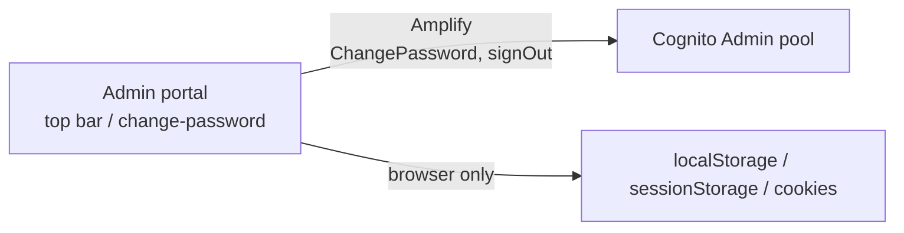

# X-03 · অ্যাডমিন পাসওয়ার্ড পরিবর্তন ও লগআউট

> **Bangla name:** অ্যাডমিন পাসওয়ার্ড পরিবর্তন ও লগআউট
>
> [← 60 · ক্রস-কাটিং](README.md) · [সূচিপত্র](../README.md) · [ওপেন কোয়ারি](../99-open-queries.md)

## 1. নাম ও উদ্দেশ্য

**পাসওয়ার্ড পরিবর্তন** সাইন ইন করা একজন কর্মীকে পাসওয়ার্ড বদলে দিতে দেয়, এরপর পোর্টাল সাইন আউট করায়।
**লগআউট** ব্রাউজারে সেশন শেষ করে এবং প্রোগ্রাম নির্বাচন ও CloudFront কুকি মুছে ফেলে।
দুটিই সম্পূর্ণ ব্রাউজার ও Cognito-এর মধ্যে চলে; কোনো GoBCB সার্ভিস কোনো করা হয় না।

## 2. ট্রিগার ও অ্যাক্টর

| বিষয় | মান |
|---|---|
| অ্যাক্টর | অ্যাডমিন পোর্টালের যেকোনো সাইন ইন করা ব্যবহারকারী |
| ক্লায়েন্ট ও স্ক্রিন | অ্যাডমিন পোর্টাল টপ বার → প্রোফাইল মেনু → "Change Password" (রুট `/change-password`, `ChangePasswordComponent`) এবং "Logout" (`AppTopBarComponent.logout()`) |
| Cognito pool | Admin |
| রোল / প্রোগ্রাম স্কোপ | যেকোনো রোল; কোনো প্রোগ্রাম লাগে না |

## 3. ব্যবসায়িক প্রবাহ

**পাসওয়ার্ড পরিবর্তন**
১. ইউজার বর্তমান পাসওয়ার্ড এবং নতুন পাসওয়ার্ড দুবার লেখেন (নতুন পাসওয়ার্ড অন্তত ৮ অক্ষরের, পুরোনোটির থেকে আলাদা হতে হবে)।
২. সফল হলে পোর্টাল "Your password has been successfully updated." দেখায়, সাইন আউট করে এবং এক সেকেন্ড পর লগইন পেজ খোলে।
৩. বর্তমান পাসওয়ার্ড ভুল হলে বার্তা আসে "Current password is wrong."

**লগআউট**
১. ইউজার "Are you sure you want to log out?" নিশ্চিত করে।
২. পোর্টাল Cognito থেকে সাইন আউট করে, নির্বাচিত প্রোগ্রাম 0-এ রিসেট করে (গ্লোবাল মেনু), তিনটি `CloudFront-*` কুকির মেয়াদ শেষ করে এবং `/auth/login` খোলে।

## 4. প্রযুক্তিগত প্রবাহ

| # | থেকে → পর্যন্ত | হপ | কী ঘটে |
|---|---|---|---|
| C1 | অ্যাডমিন পোর্টাল → Cognito | Amplify `Auth.currentAuthenticatedUser()` তারপর `Auth.changePassword(user, old, new)` | ইউজারের অ্যাক্সেস টোকেন দিয়ে Cognito `ChangePassword` |
| C2 | অ্যাডমিন পোর্টাল → Cognito | Amplify `Auth.signOut()` | লোকাল সাইন আউট (Amplify ডিফল্ট, গ্লোবাল নয়) |
| L1 | অ্যাডমিন পোর্টাল → Cognito | `CognitoService.signOut()` → `Auth.signOut()` | Amplify স্টোরেজ, টোকেন ক্যাশ, ইউজার-ইনফো ক্যাশ ও `sessionStorage.lastKnownUserRole` মুছে ফেলে |
| L2 | অ্যাডমিন পোর্টাল (শুধু ব্রাউজার) | `ProgramService.setProgramId(0)`; `clearSignedCookie()` | `localStorage.globalProgramId = 0`; `CloudFront-Policy`, `CloudFront-Signature`, `CloudFront-Key-Pair-Id`-এর মেয়াদ শেষ |

## 5. কম্পোনেন্ট

| ধরন | কম্পোনেন্ট |
|---|---|
| ক্লায়েন্ট | অ্যাডমিন পোর্টাল `ChangePasswordComponent`, `AppTopBarComponent`, `CognitoService`, `ProgramService` |
| AWS | Cognito Admin pool |
| সার্ভিস | নেই |

## 6. API কন্ট্রাক্ট

কোনো GoBCB এন্ডপয়েন্ট ব্যবহার হয় না। Amplify-এর মাধ্যমে কোনো Cognito API কোনো করা হয় না: `ChangePassword`, এবং সাইন আউটের
সময় Amplify যে টোকেন বাতিলকরণ করে।

ব্যাকএন্ডে অ্যাডমিনের জন্য সার্ভার-সাইড পাসওয়ার্ড পরিবর্তনের বাস্তবায়ন আছে (`AdminUserManager.ChangePasswordAsync`, যা
অ্যাক্সেস টোকেন দিয়ে Cognito `ChangePassword` কল করে) কিন্তু **কোনো কন্ট্রোলার সেটিকে এক্সপোজ করে না**। পোর্টালের
`ChangePasswordService` `PUT /admin/api/v1/Users/change-password` কল করে যা অস্তিত্বে নেই; স্ক্রিনটি সেই সার্ভিস ব্যবহার করে
না। দুটিই [Appendix A](../90-appendix-a-legacy.md)-তে তালিকাভুক্ত।

## 7. ডেটা ও পার্শ্বপ্রতিক্রিয়া

- Cognito: পাসওয়ার্ড বদলায়। বিদ্যমান refresh token মেয়াদ শেষ হওয়া বা বাতিল হওয়া পর্যন্ত বৈধ থাকে; পোর্টাল শুধু লোকালভাবে সাইন আউট করে।
- ব্রাউজার: লগআউটের সময় টোকেন, ক্যাশ, প্রোগ্রাম নির্বাচন ও CloudFront কুকি সরানো হয়।

## 8. কোড রেফারেন্স

| কী | কোথায় |
|---|---|
| পাসওয়ার্ড-পরিবর্তন স্ক্রিন | `rvl-gobcb-admin-portal/src/app/modules/auth/change-password/change-password.component.ts:50-85` |
| Cognito পাসওয়ার্ড পরিবর্তন ও সাইন আউট | `rvl-gobcb-admin-portal/src/app/core/services/cognito.service.ts:303-352` |
| লগআউট ও কুকি পরিষ্কার করা | `rvl-gobcb-admin-portal/src/app/layout/app.topbar.component.ts:80-120` |
| অব্যবহৃত সার্ভার-সাইড পাসওয়ার্ড পরিবর্তন | `rvl-gobcb-backend/Services/Admin/ETP.Admin.Domain/Managers/AdminUserManager.cs:181-195` |
| ভুল URL-সহ অব্যবহৃত পোর্টাল সার্ভিস | `rvl-gobcb-admin-portal/src/app/modules/auth/change-password/change-password.service.ts:20-22` |

## 9. হ্যান্ডওভার নোট

১. **সাইন আউট লোকাল।** `{ global: true }` ছাড়া Amplify-এর `Auth.signOut()` অন্য সেশন বাতিল করে না। কোনো ইউজারের সব সেশন
   শেষ করতে একজন অ্যাডমিনকে অ্যাকাউন্ট নিষ্ক্রিয় করতে হবে বা এর পাসওয়ার্ড রিসেট করতে হবে ([X-05](X-05-admin-provisioning.md)),
   যেগুলো `AdminUserGlobalSignOut` কল করে।
২. **প্রোগ্রাম নির্বাচন `localStorage`-এ টিকে থাকে** রিলোডের পরেও; লগআউট সেটিকে 0-এ রিসেট করে যাতে পরের ইউজার গ্লোবাল
   মেনু থেকে শুরু করে ([A-01](../10-admin-portal/A-01-program-selection.md))।
৩. **কুকি পরিষ্কার করা আসল কুকি মিস করতে পারে।** কুকিগুলো `domain=environment.cloudFront.mainDomain` দিয়ে লেখা হয়েছিল
   ([X-01](X-01-admin-login.md)); `clearSignedCookie()` সেগুলোর মেয়াদ শেষ করে কিন্তু `domain` অ্যাট্রিবিউট ছাড়াই। ব্রাউজাররা
   `Domain` অ্যাট্রিবিউট দিয়ে সেট করা কুকি আর একই নামের host-only কুকিকে আলাদা কুকি ধরে, তাই CloudFront কুকি লগআউটের পরেও
   তার নিজস্ব মেয়াদ শেষ না হওয়া পর্যন্ত বেঁচে থাকতে পারে। ডিপ্লয় করা পরিবেশে DevTools → Application → Cookies-এ দেখুন।

## 10. কম্পোনেন্ট সম্পর্ক

**নির্ভর করে:** [X-01](X-01-admin-login.md)। **প্রভাব ফেলে:** [X-04](X-04-admin-session.md), [A-01](../10-admin-portal/A-01-program-selection.md)।

## 11. ডেভেলপার টেস্ট গাইড

**লোকাল টেস্টযোগ্যতা: লগআউটের জন্য সম্পূর্ণ;** পাসওয়ার্ড পরিবর্তনের জন্য **আংশিক** (ওয়ার্কস্পেস ডকুমেন্টে Floci-র
`ChangePassword`-এর Cognito অনুকরণ যাচাই করা নেই; সেখানে পাসওয়ার্ড-পরিবর্তনের ফ্লো "untested here" হিসেবে তালিকাভুক্ত,
`docs/admin-portal-local.md` "Limits")।

| বিষয় | বিবরণ |
|---|---|
| টেস্ট ডেটা ও অ্যাকাউন্ট | যেকোনো Admin-pool ইউজার, যেমন `+8801700000005` / `Passw0rd!23`। শেয়ার করা টেস্ট পাসওয়ার্ড বদলে না যায় তাই একবার ব্যবহারের পরে ফেলে দেওয়া ইউজার বেছে নিন |
| ব্রাউজার | `http://localhost:4200`, সাইন ইন করুন ([X-01](X-01-admin-login.md)), প্রোফাইল মেনু → Change Password। DevTools → Network-এ `/p/cognito`-এর একটি কল দেখায় হেডার `X-Amz-Target: AWSCognitoIdentityProviderService.ChangePassword` সহ। লগআউট: Application ট্যাব → Local Storage-এ `globalProgramId` হয় `0`; Session Storage-এ `lastKnownUserRole` অদৃশ্য হয় |
| ইমুলেটর | প্রযোজ্য নয় |
| Postman | সেশন বাতিলকরণের আচরণ: `postman/etp-cognito-auth.postman_collection.json` ফোল্ডার "08 - Session revocation (run last)" (GlobalSignOut, তারপর refresh ব্যর্থ) |
| Visual Studio ডিবাগ | প্রযোজ্য নয় (কোনো ব্যাকএন্ড কল নেই) |
| যাচাই | পাসওয়ার্ড পরিবর্তনের পর, পুরোনো পাসওয়ার্ড দিয়ে USER_PASSWORD_AUTH লগইন (Postman "Login as …") `NotAuthorizedException` দিয়ে ব্যর্থ হয় |