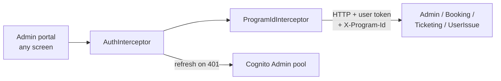

# X-04 · অ্যাডমিন সেশন ব্যবস্থাপনা (টোকেন সংযুক্তি ও রিফ্রেশ)

> **Bangla name:** অ্যাডমিন সেশন ব্যবস্থাপনা (টোকেন সংযুক্তি ও রিফ্রেশ)
>
> [← 60 · ক্রস-কাটিং](README.md) · [সূচিপত্র](../README.md) · [ওপেন কোয়ারি](../99-open-queries.md)

## 1. নাম ও উদ্দেশ্য

**অ্যাডমিন সেশন ব্যবস্থাপনা।** ব্যাখ্যা করে যে অ্যাডমিন পোর্টাল কীভাবে প্রতিটি API কলে Cognito অ্যাক্সেস টোকেন ও
প্রোগ্রাম id যুক্ত করে, টোকেন মেয়াদ শেষ হওয়ার আগে বা পরে কীভাবে রিফ্রেশ করে, এবং কখন লজ্জা ছেড়ে ইউজারকে লগইন পেজে
পাঠায়। প্রতিটি `A-xx` ফিচার এর উপর নির্ভর করে।

## 2. ট্রিগার ও অ্যাক্টর

| বিষয় | মান |
|---|---|
| অ্যাক্টর | অ্যাডমিন পোর্টালের যেকোনো সাইন ইন করা ব্যবহারকারী; পোর্টালের করা প্রতিটি HTTP কল একে ট্রিগার করে |
| ক্লায়েন্ট | অ্যাডমিন পোর্টাল: `AuthInterceptor`, `ProgramIdInterceptor`, `LoaderInterceptor` (`app.module.ts`-এ রেজিস্টার করা) |
| Cognito pool | Admin |
| রোল / প্রোগ্রাম স্কোপ | প্রতিটি রিকোয়েস্টে `X-Program-Id` যোগ হয় ([X-16](X-16-authz-program-scope.md)) |

## 3. ব্যবসায়িক প্রবাহ

সেশন বৈধ থাকা অবস্থায় ইউজার কিছুই বুঝতে পারেন না। refresh token আর বৈধ না থাকলে (মেয়াদ শেষ, পাসওয়ার্ড রিসেট বা অ্যাকাউন্ট
নিষ্ক্রিয় করায় বাতিল), পরের কলটি ব্যর্থ হয়, পোর্টাল সাইন আউট করে এবং লগইন পেজ খোলে।

## 4. প্রযুক্তিগত প্রবাহ

| # | ধাপ | বিবরণ |
|---|---|---|
| ১ | স্কিপ লিস্ট | `/admin-users/forget-password`, `admin/login-2fa-send-otp`, `admin/login-2fa-verify-otp`, `/admin-users/set-forget-password` ধরা যুক্ত URL পায় না |
| ২ | টোকেন নিন | `CognitoService.getAccessToken()`: অ্যাক্সেস টোকেন ৫৫ মিনিটের কম বয়সী হলে এবং তার `exp` থেকে ২ মিনিটের বেশি বাকি থাকলে ক্যাশ করা টোকেন ফেরত দেয়; নয়তো রিফ্রেশ করে |
| ৩ | সংযুক্ত করুন | ক্লোন করা রিকোয়েস্টে `Authorization: Bearer <access token>` |
| ৪ | প্রোগ্রাম হেডার | `ProgramIdInterceptor` `/admin/login-2fa*` ছাড়া প্রতিটি রিকোয়েস্টে `X-Program-Id: <localStorage.globalProgramId>` যোগ করে। গ্লোবাল মেনুতে মান `0` |
| ৫ | কল | Admin, Booking, Ticketing বা UserIssue-এর কাছে **[HTTP + user token]** |
| ৬ | 401 হলে | একবারে একটি রিফ্রেশ (`isRefreshing` ফ্ল্যাগ + `BehaviorSubject`): `Auth.currentSession()` refresh token দিয়ে রিফ্রেশ করে; ব্যর্থ রিকোয়েস্টটি নতুন টোকেন দিয়ে একবার আবার চালানো হয়; ইতিমধ্যে আসা রিকোয়েস্টগুলো তার জন্য অপেক্ষা করে |
| ৭ | রিফ্রেশ ব্যর্থ | `handleRefreshFailure()`: ক্যাশ ও `lastKnownUserRole` মোছে, `Auth.signOut()`, `/auth/login`-এ নেভিগেট করে |

`app.module.ts`-এ ইন্টারসেপ্টরের ক্রম: `AuthInterceptor`, `LoaderInterceptor`, `ProgramIdInterceptor`।

## 5. কম্পোনেন্ট

| ধরন | কম্পোনেন্ট |
|---|---|
| ক্লায়েন্ট | `AuthInterceptor`, `ProgramIdInterceptor`, `CognitoService` (টোকেন ক্যাশ, রিফ্রেশ), `ProgramService` |
| AWS | Cognito Admin pool (টোকেন রিফ্রেশ) |
| সার্ভিস | অ্যাডমিন পোর্টাল যে সব সার্ভিস কল করে; তারা টোকেন যাচাই করে ([X-14](X-14-authz-pool-policies.md)) |

## 6. API কন্ট্রাক্ট

এটি নিজস্ব এন্ডপয়েন্ট থাকা একটি ফিচার নয়। অ্যাডমিন পোর্টালের প্রতিটি API কলে যুক্ত হেডার:

| হেডার | মান | কে পড়ে |
|---|---|---|
| `Authorization` | `Bearer <Cognito access token>` | প্রতিটি সার্ভিসের JWT bearer handler ([X-14](X-14-authz-pool-policies.md)) |
| `X-Program-Id` | নির্বাচিত প্রোগ্রাম id, `0` = কোনোটি নয় | Admin সার্ভিসের `ProgramIdMiddleware` ও `[AuthorizeProgram]` ([X-16](X-16-authz-program-scope.md)); অন্য সার্ভিসগুলো উপেক্ষা করে |

## 7. ডেটা ও পার্শ্বপ্রতিক্রিয়া

শুধু ব্রাউজার: Amplify টোকেন স্টোরেজ, মেমরির টোকেন ক্যাশ (`cachedAccessToken`, ৫৫ মিনিট), ইউজার-ইনফো ক্যাশ (৫৫ মিনিট)।

## 8. কোড রেফারেন্স

| কী | কোথায় |
|---|---|
| টোকেন সংযুক্তি, 401 ব্যবস্থাপনা, স্কিপ লিস্ট | `rvl-gobcb-admin-portal/src/app/core/interceptors/auth.interceptor.ts:14-102` |
| প্রোগ্রাম হেডার | `rvl-gobcb-admin-portal/src/app/interceptors/program-id.interceptor.ts:14-29` |
| টোকেন ক্যাশ ও রিফ্রেশ | `rvl-gobcb-admin-portal/src/app/core/services/cognito.service.ts:88-211`, `:261-302` |
| ইন্টারসেপ্টর রেজিস্ট্রেশন | `rvl-gobcb-admin-portal/src/app/app.module.ts:22-33` |

## 9. হ্যান্ডওভার নোট

১. **দুটি রিফ্রেশ গার্ড।** `AuthInterceptor` ও `CognitoService` দুটোই নিজস্ব `isRefreshing` ফ্ল্যাগ ও সাবজেক্ট রাখে। আজ তারা
   একসাথে কাজ করে, কিন্তু একটি বদলালে অপরটির কথা মাথায় রাখতে হবে।
২. **SignalR চ্যাট সংযোগ ইন্টারসেপ্টরের বাইরে।** এটি টোকেন query string-এ পাঠায় ([A-24](../10-admin-portal/A-24-user-issues-admin.md))।
৩. **`X-Program-Id` প্রতিটি সার্ভিসে যায়।** শুধু Admin সার্ভিস এটি পড়ে; Booking, Ticketing ও UserIssue উপেক্ষা করে।
৪. **কোনো idle timeout নেই।** সেশন চলে যতক্ষণ না Cognito-র refresh token বৈধ (pool সেটিং, রিপোজিটরিতে নেই)।

## 10. কম্পোনেন্ট সম্পর্ক

**নির্ভর করে:** [X-01](X-01-admin-login.md), [A-01](../10-admin-portal/A-01-program-selection.md) (প্রোগ্রাম id)। **প্রভাব ফেলে:** প্রতিটি `A-xx` ফিচার।

## 11. ডেভেলপার টেস্ট গাইড

**লোকাল টেস্টযোগ্যতা: সম্পূর্ণ।**

| বিষয় | বিবরণ |
|---|---|
| টেস্ট ডেটা ও অ্যাকাউন্ট | যেকোনো Admin-pool ইউজার (`docs/admin-portal-local.md` §5) |
| ব্রাউজার | `http://localhost:4200`-এ সাইন ইন করুন। DevTools → Network → যেকোনো `/p/admin/...` রিকোয়েস্ট → Request Headers-এ `Authorization: Bearer …` ও `X-Program-Id` দেখা যায়। একটি প্রোগ্রাম নির্বাচন করুন ([A-01](../10-admin-portal/A-01-program-selection.md)) এবং `X-Program-Id` বদলাতে দেখুন। 401-এর পথ জোর করে আনতে Postman দিয়ে (নিচে) সেশন বাতিল করুন এবং যেকোনো মেনু আইটেমে ক্লিক করুন: পোর্টাল সাইন আউট করে লগইন পেজ খোলে |
| ইমুলেটর | প্রযোজ্য নয় |
| Postman | `postman/etp-cognito-auth.postman_collection.json` ফোল্ডার "03 - Token lifecycle" ("Refresh token -> new access token") এবং "08 - Session revocation (run last)" |
| Visual Studio ডিবাগ | `ETP.Admin.Service`-এ অ্যাট্যাচ করুন; `ProgramIdMiddleware.InvokeAsync`-এ ব্রেকপয়েন্ট দিন (`rvl-gobcb-backend/Services/Admin/ETP.Admin.Service/Middleware/ProgramIdMiddleware.cs:12`) যাতে হেডার আসতে দেখা যায় |
| যাচাই | Aspire ড্যাশবোর্ড → Admin → Structured logs: রিফ্রেশের পরের রিকোয়েস্টগুলো 200 দিয়ে সফল হয় |