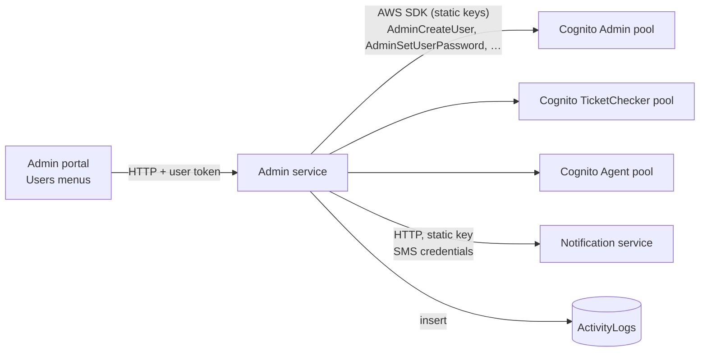

# X-05 · স্টাফ অ্যাকাউন্ট তৈরি

> **Bangla name:** স্টাফ অ্যাকাউন্ট তৈরি
>
> [← 60 · ক্রস-কাটিং](README.md) · [সূচিপত্র](../README.md) · [ওপেন কোয়ারি](../99-open-queries.md)

## 1. নাম ও উদ্দেশ্য

**স্টাফ অ্যাকাউন্ট তৈরি।** কর্মীরা কখনো নিজেরা সাইন আপ করেন না। একজন অ্যাডমিনিস্ট্রেটর অ্যাডমিন পোর্টাল থেকে প্রতিটি
অ্যাডমিন, টিকিট-চেকার ও এজেন্ট অ্যাকাউন্ট তৈরি করেন; এরপর Admin সার্ভিস সরাসরি মিলে যাওয়া Cognito pool-এ ব্যবহারকারী তৈরি করে,
একটি জেনারেট করা **স্থায়ী** পাসওয়ার্ড নির্ধারণ করে, এবং ইউজারনেম ও পাসওয়ার্ড SMS-এ ফোনে পাঠায়। একই সার্ভিস এই
অ্যাকাউন্টগুলো নিষ্ক্রিয় করে, সক্রিয় করে, মোছে ও রিসেট করে। এই ফাইলটি যে সাধারণ মেকানিক্স বর্ণনা করে; স্ক্রিনগুলো রয়েছে
[A-25](../10-admin-portal/A-25-admin-users.md) (অ্যাডমিন), [A-17](../10-admin-portal/A-17-ticket-checker-users.md) (চেকার) ও
[A-26](../10-admin-portal/A-26-agent-users.md) (এজেন্ট)।

## 2. ট্রিগার ও অ্যাক্টর

| বিষয় | মান |
|---|---|
| অ্যাক্টর | গ্লোবাল মেনুতে (প্রোগ্রাম 0) থাকা অ্যাডমিন-পোর্টাল ব্যবহারকারী। অ্যাডমিন অ্যাকাউন্ট: রোল `admin`। চেকার অ্যাকাউন্ট: `admin`, `event_manager`, `ticket_manager`, `ticket_operator` (কন্ট্রোলার রোল)। এজেন্ট অ্যাকাউন্ট: সার্ভার-সাইড কোনো সীমাবদ্ধতা নেই (নোট দেখুন) |
| ক্লায়েন্ট ও স্ক্রিন | অ্যাডমিন পোর্টাল → Users → "Regular Admins" (`/users`), "Ticket Checkers" (`/ticket-checker`), "Seller Agents" (`/agent-user`); মেনু শুধু `admin`-এর জন্য দেখা যায় ([X-17](X-17-authz-client-side.md)) |
| যে Cognito pool-এ লেখা হয় | Admin, TicketChecker, Agent |

## 3. ব্যবসায়িক প্রবাহ

১. অ্যাডমিনিস্ট্রেটর নাম, ফোন (ফরমটি `+880` যোগ করে), ইমেইল এবং অ্যাডমিনদের ক্ষেত্রে এক বা একাধিক রোল ও ব্যবহারকারী যে
   প্রোগ্রামগুলোতে কাজ করতে পারবে তা পূরণ করেন।
২. অ্যাকাউন্ট তৈরি হয় এবং নতুন ব্যবহারকারী একটি SMS পান: "Your account has been created successfully. Your user name is
   <phone> and password is <password>"।
৩. পরে অ্যাডমিনিস্ট্রেটর নাম/রোল/প্রোগ্রাম সম্পাদনা করতে, অ্যাকাউন্ট নিষ্ক্রিয় বা সক্রিয় করতে, মুছতে, বা "Set
   Password" করতে পারেন, যা নতুন পাসওয়ার্ড জেনারেট করে SMS-এ পাঠায়।
৪. অ্যাকাউন্ট নিষ্ক্রিয় করলে (এবং পাসওয়ার্ড রিসেট করলে) ইউজার প্রতিটি ডিভাইস থেকে সাইন আউট হয়ে যায়।

## 4. প্রযুক্তিগত প্রবাহ

| # | থেকে → পর্যন্ত | হপ | কী ঘটে |
|---|---|---|---|
| ১ | অ্যাডমিন পোর্টাল → Admin `POST /admin/api/v1/admin-users` (বা `/ticket-checker`, `/agent-users`) | **[HTTP + user token]** | নাম, ফোন, ইমেইল, রোল, প্রোগ্রাম id-সহ বডি |
| ২ | Admin সার্ভিস → Cognito | AWS SDK, static keys `AWS:AccessKey` / `AWS:SecretAccessKey` | অ্যাডমিন ইউজার: ডুপ্লিকেট ইমেইল প্রত্যাখ্যান করতে `ListUsers(email = …)`; তারপর অস্থায়ী পাসওয়ার্ড দিয়ে `AdminCreateUser(Username = phone, attributes)`, তারপর একই পাসওয়ার্ড দিয়ে `AdminSetUserPassword(Permanent = true)` |
| ৩ | Admin সার্ভিস → Notification সার্ভিস `POST /notification/send-message` | **[HTTP, static key]** | ইউজারনেম ও পাসওয়ার্ডসহ SMS |
| ৪ | Admin সার্ভিস → ডেটাবেস | — | অ্যাক্টিভিটি লগ `AdminUser / Created` (অ্যাডমিন অ্যাকাউন্টের জন্য) ([X-24](X-24-activity-logging.md)) |
| U | আপডেট | `AdminUpdateUserAttributes` | `name`, `custom:role`, `custom:program_ids` (কোনো প্রোগ্রাম না থাকলে খালি স্ট্রিং), `email_verified`, `phone_number_verified`; ক্যাশ করা অ্যাট্রিবিউট `user_{id}` সরানো হয় |
| D | নিষ্ক্রিয় / সক্রিয় | `AdminDisableUser` / `AdminEnableUser` + `AdminUserGlobalSignOut` | একজন অ্যাডমিন নিজেকে নিষ্ক্রিয় বা মুছতে পারে না (`ArgumentNullException("Invalid permission")` → 400) |
| P | পাসওয়ার্ড নির্ধারণ | `AdminUserGlobalSignOut`, `AdminSetUserPassword(generated, Permanent)`, নতুন পাসওয়ার্ডসহ SMS | অ্যাডমিন: বডি `{ userId }`; চেকার ও এজেন্ট: query `?userId=` |
| X | মুছে ফেলা | `AdminDeleteUser`, ক্যাশ এন্ট্রি সরানো | |

**প্রতি pool-এ লেখা অ্যাট্রিবিউট**

| Pool | ইউজারনেম | অ্যাট্রিবিউট |
|---|---|---|
| Admin | ফোন | `phone_number`, `name`, `email`, `custom:role` (কমা-আলাদা রোল), `custom:program_ids` (কমা-আলাদা id, ঐচ্ছিক), `email_verified=true`, `phone_number_verified=true` |
| TicketChecker | ফোন | `phone_number`, `name`, `email` = `<phone without +>@gobcbticket.com`, `custom:role = "TicketChecker"` |
| Agent | ফোন | `phone_number`, `name`, `custom:branch_location`, `custom:company_name`, `custom:company_branch`, `phone_number_verified=true`, ঐচ্ছিক `custom:email` |

জেনারেট করা পাসওয়ার্ড: ৮ অক্ষর, কমপক্ষে একটি বড় হাতের অক্ষর, ছোট হাতের অক্ষর, সংখ্যা এবং `!@#$`-এর একটি,
`System.Random` দিয়ে তৈরি (`AdminUserProvider.GeneratePassword`)।

## 5. কম্পোনেন্ট

| ধরন | কম্পোনেন্ট |
|---|---|
| ক্লায়েন্ট | অ্যাডমিন পোর্টাল `UserService`, `TicketCheckerService`, `AgentUserService` ও তাদের তালিকা পেজ |
| সার্ভিস | Admin: `AdminUsersController`, `TicketCheckerController`, `AgentController` → `*UserManager` → `AdminUserProvider`, `TicketCheckerUserProvider`, `AgentUserProvider` |
| AWS | Cognito Admin, TicketChecker ও Agent pool (static IAM key দিয়ে admin API) |
| বাহ্যিক | Notification সার্ভিস (`Notification:Endpoint`, `Notification:Authorization`) `[UNCONFIRMED: Q-05]` |
| ক্যাশ | `User` ক্যাশ, key `user_{userId}` ([X-25](X-25-redis.md)) |

## 6. API কন্ট্রাক্ট

| মেথড | পাথ | অথ | রিকোয়েস্ট | রেসপন্স | প্রধান এরর |
|---|---|---|---|---|---|
| POST | `/admin/api/v1/admin-users` | Admin pool, রোল `admin` | `AdminCreateUser { Name, Phone, Email, Role, ProgramIds? }` | `AdminUserResponse` | 400 "User Account already exists", Cognito এরর |
| PUT | `/admin/api/v1/admin-users/{id}` | রোল `admin` | `AdminUpdateUser { UserId, Name, Role, ProgramIds? }` | খালি `AdminUserResponse` | 400 user not found |
| POST | `/admin/api/v1/admin-users/disable/{id}`, `/enable/{id}` | রোল `admin` | — | `200` | 400 নিজের অ্যাকাউন্ট |
| POST | `/admin/api/v1/admin-users/set-password` | রোল `admin` | `AdminSetPasswordRequest { UserId }` | `200` | 400 |
| DELETE | `/admin/api/v1/admin-users/{id}` | রোল `admin` | — | `200` | 400 নিজের অ্যাকাউন্ট |
| POST | `/admin/api/v1/ticket-checker` | রোল `admin,event_manager,ticket_manager,ticket_operator` | `TicketCheckerCreateUser` | খালি | 400 |
| POST | `/admin/api/v1/ticket-checker/set-password?userId=` | একই | query `userId` | `200` | 400 |
| POST | `/admin/api/v1/agent-users` | **নেই** | `AgentCreateUser { Name, Phone, Email?, CompanyName, CompanyBranch, BranchLocation }` | খালি | 400 |
| POST | `/admin/api/v1/agent-users/set-password?userId=` | **নেই** | query `userId` | `200` | 400 |

অ্যাডমিন, চেকার ও এজেন্ট এন্ডপয়েন্টের সম্পূর্ণ তালিকা (get, list, search, update, change-password) রয়েছে
[A-25](../10-admin-portal/A-25-admin-users.md), [A-17](../10-admin-portal/A-17-ticket-checker-users.md) ও
[A-26](../10-admin-portal/A-26-agent-users.md)-এ।

```json
// POST /admin/api/v1/admin-users
{
  "name": "Event Manager",
  "phone": "+8801700000002",
  "email": "eventmgr@etp.local",
  "role": "event_manager,ticket_manager",
  "programIds": "1,2"
}

// 200 (AdminUserResponse)
{
  "userId": "3f6c2a8e-0000-4000-8000-000000000002",
  "name": "Event Manager",
  "email": "eventmgr@etp.local",
  "phone": "+8801700000002",
  "role": "event_manager,ticket_manager",
  "programIds": "1,2",
  "currentStatus": null,
  "isActive": true,
  "isPhoneNumberVerified": false
}
```

`AdminUserResponse` (`ETP.Admin.Domain/Models/Users/Admin/AdminUserResponse.cs`) provider-এর `AWSUserResponse`
(`AdminUserProvider.cs:92-102`) থেকে Mapster দিয়ে ম্যাপ করা। Provider-এর প্রপার্টির বানান `IsPhoneNUmberVerified`; রিপোজিটরিতে কোনো
Mapster কনফিগারেশন নেই, তাই Mapster-এর ডিফল্ট হুবহু নাম মিলানোর নিয়মে এটি `IsPhoneNumberVerified`-এ ম্যাপ হয় না এবং সেটি
`false` থাকে (Postman তৈরি রিকোয়েস্ট দিয়ে যাচাই করুন); তৈরির সময় `currentStatus` সেট করা হয় না। Admin সার্ভিস null বাদ দেয় না।

## 7. ডেটা ও পার্শ্বপ্রতিক্রিয়া

- অ্যাকাউন্টের ধরনের pool-এ Cognito ব্যবহারকারী তৈরি, আপডেট, নিষ্ক্রিয়, সক্রিয় বা মোছা হয়।
- ইউজারনেম ও পাসওয়ার্ডসহ SMS (তৈরি) বা নতুন পাসওয়ার্ডসহ SMS (পাসওয়ার্ড নির্ধারণ)।
- নিষ্ক্রিয়, সক্রিয় ও পাসওয়ার্ড নির্ধারণের সময় লক্ষ্য ব্যবহারকারীর গ্লোবাল সাইন আউট।
- অ্যাডমিন অ্যাকাউন্টের জন্য অ্যাক্টিভিটি লগ রো (`Created`, `Updated`, `Deleted`, `Disabled`, `Enabled`, `PasswordReset`)।
- আপডেট ও ডিলিটের সময় ক্যাশ key `user_{userId}` সরানো হয়, যাতে সেই সার্ভিস ইনস্ট্যান্সের পরের রিকোয়েস্ট রোল বদল দেখে।

## 8. কোড রেফারেন্স

| কী | কোথায় |
|---|---|
| অ্যাডমিন কন্ট্রোলার | `rvl-gobcb-backend/Services/Admin/ETP.Admin.Service/Api/AdminUsersController.cs` |
| চেকার কন্ট্রোলার | `rvl-gobcb-backend/Services/Admin/ETP.Admin.Service/Api/TicketCheckerController.cs` |
| এজেন্ট কন্ট্রোলার (কোনো `[Authorize]` নেই) | `rvl-gobcb-backend/Services/Admin/ETP.Admin.Service/Api/AgentUserController.cs:15-16` |
| অ্যাডমিন ম্যানেজার (অ্যাক্টিভিটি লগ) | `rvl-gobcb-backend/Services/Admin/ETP.Admin.Domain/Managers/AdminUserManager.cs:39-179` |
| Cognito কল (অ্যাডমিন) | `rvl-gobcb-backend/Services/Admin/ETP.Admin.Integration/Services/AdminUserProvider.cs:35-250`, পাসওয়ার্ড জেনারেটর `:588-608` |
| Cognito কল (চেকার, এজেন্ট) | `rvl-gobcb-backend/Services/Admin/ETP.Admin.Integration/Services/TicketCheckerUserProvider.cs:30-80`, `AgentUserProvider.cs:30-80` |
| Cognito ক্লায়েন্ট রেজিস্ট্রেশন | `rvl-gobcb-backend/Services/Admin/ETP.Admin.Service/Configurations/DependencyConfig.cs:197-207` |
| পোর্টাল সার্ভিস | `rvl-gobcb-admin-portal/src/app/features/users/services/user.service.ts`, `features/ticket-checker/services/ticket-checker.service.ts`, `features/agent-user/services/agent-user.service.ts` |

## 9. হ্যান্ডওভার নোট

১. **এজেন্ট অ্যাকাউন্ট টোকেন ছাড়াই পরিচালনা করা যায়।** `AgentController`-এ কোনো `[Authorize]` নেই এবং `BaseController`-এর
   `[Authorize]` কমেন্ট করা, তাই কোডে `/admin/api/v1/agent-users/*` (তৈরি, পাসওয়ার্ড নির্ধারণ, মুছে ফেলা, …) anonymous।
   গেটওয়ে এটি আটকায় কি না জানা নেই `[UNCONFIRMED: Q-04]`। [X-18](X-18-endpoints-without-auth.md) দেখুন।
২. **পাসওয়ার্ড `System.Random` দিয়ে জেনারেট হয়** এবং স্পষ্ট লেখায় SMS-এ পাঠানো হয়। পাসওয়ার্ডটি স্থায়ী হিসেবে নির্ধারণ হয়,
   তাই প্রথম লগইনে Cognito কখনো ব্যবহারকারীকে সেটি বদলাতে বলে না।
৩. **ইমেইলের অনন্যত্ব শুধু অ্যাডমিন অ্যাকাউন্টের জন্য যাচাই হয়**; Cognito ইউজারনেম হলো ফোন নম্বর, তাই একটি ফোন একটি
   pool-এ একবারই থাকতে পারে।
৪. **রোল ও প্রোগ্রামের পরিবর্তন সব জায়গায় সঙ্গে সঙ্গে কাজ করে না।** Admin সার্ভিস আপডেটের সময় নিজের ক্যাশ থেকে `user_{id}`
   মোছে, কিন্তু UserIssue সার্ভিসের অ্যাট্রিবিউট ক্যাশের নিজস্ব কপি আছে ([X-15](X-15-authz-roles.md)), আর অ্যাডমিন পোর্টাল
   রোল ৫৫ মিনিট ক্যাশ করে ([X-17](X-17-authz-client-side.md))। ইতিমধ্যে ইস্যু করা অ্যাক্সেস টোকেন মেয়াদ শেষ না হওয়া পর্যন্ত বৈধ থাকে।
৫. **চেকারের `custom:role` হলো `TicketChecker`**, যা রোল কনস্ট্যান্টগুলোর একটি নয়; চেকারের রোল claim
   (`ticket-checker`) আসে টোকেন স্কিম থেকে, এই অ্যাট্রিবিউট থেকে নয় ([X-14](X-14-authz-pool-policies.md))।
৬. **SMS ব্যর্থ হলে অর্ধেক সম্পন্ন কাজ থেকে যায়।** SMS পাঠানোর আগেই Cognito ব্যবহারকারী ও পাসওয়ার্ড তৈরি হয়; Notification
   সার্ভিস ব্যর্থ হলে অ্যাকাউন্ট থাকা সত্ত্বেও API 400 ফেরত দেয়।

## 10. কম্পোনেন্ট সম্পর্ক



**নির্ভর করে:** [X-01](X-01-admin-login.md) (একজন অ্যাডমিন সাইন ইন করা), Notification সার্ভিস।
**প্রভাব ফেলে:** [X-01](X-01-admin-login.md), [X-12](X-12-checker-login.md), [X-13](X-13-agent-pool.md) (অ্যাকাউন্ট আছে),
[X-15](X-15-authz-roles.md), [X-16](X-16-authz-program-scope.md) (`custom:role`, `custom:program_ids`), [A-18](../10-admin-portal/A-18-gate-assignment.md) (নিয়োগের জন্য চেকার)।

## 11. ডেভেলপার টেস্ট গাইড

**লোকাল টেস্টযোগ্যতা: আংশিক।** Cognito অপারেশন Floci-র বিপরীতে কাজ করে; SMS কল ডামি নোটিফিকেশন এন্ডপয়েন্টে যায় ও ব্যর্থ হয়,
তাই তৈরি/পাসওয়ার্ড-নির্ধারণ **Cognito পরিবর্তন হওয়ার পরেই** 400 ফেরত দেয়।

| বিষয় | বিবরণ |
|---|---|
| টেস্ট ডেটা ও অ্যাকাউন্ট | `+8801700000001` হিসেবে সাইন ইন করুন (admin)। একবার ব্যবহারের পরে ফেলে দেওয়া অ্যাকাউন্টের জন্য `postman/etp-local-floci.postman_environment.json` থেকে `tmp_phone` `+8801700009999` ব্যবহার করুন |
| ব্রাউজার | `http://localhost:4200` → গ্লোবাল মেনু → Users → Regular Admins → ব্যবহারকারী যোগ করুন। DevTools → Network: `POST /p/admin/admin/api/v1/admin-users` |
| ইমুলেটর | প্রযোজ্য নয় |
| Postman | `postman/etp-cognito-auth.postman_collection.json` ফোল্ডার "06 - Admin user lifecycle (creates and deletes tmp_phone)": "Create user (Admin API -> Cognito AdminCreateUser)", "Cognito: user exists with role and programs", "Update role to customer_support", "Disable user", "Enable user", "Admin set-password (admin-initiated reset)", "Delete user", "Non-admin cannot create users"। সার্ভিস কলেকশন: `postman/services/etp-admin.postman_collection.json` ফোল্ডার "AdminUsers" |
| Visual Studio ডিবাগ | `ETP.Admin.Service`-এ অ্যাট্যাচ করুন; ব্রেকপয়েন্ট `AdminUserProvider.cs:35` (তৈরি) ও `:343` (আপডেট)-এ |
| যাচাই | `aws --endpoint-url http://localhost:4566 cognito-idp admin-get-user --user-pool-id <AdminPoolId> --username +8801700009999` দেখায় `custom:role` ও `custom:program_ids`; SQL `select "Action","EntityId","Timestamp" from etp."ActivityLogs" order by "Id" desc limit 5;` |