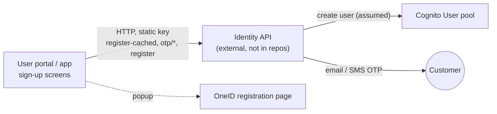

# X-06 · গ্রাহক নিবন্ধন

> **Bangla name:** গ্রাহক নিবন্ধন
>
> [← 60 · ক্রস-কাটিং](README.md) · [সূচিপত্র](../README.md) · [ওপেন কোয়ারি](../99-open-queries.md)

## 1. নাম ও উদ্দেশ্য

**গ্রাহক নিবন্ধন।** একজন নতুন গ্রাহক ওয়েব পোর্টালে বা অ্যাপে GoBCB অ্যাকাউন্ট তৈরি করেন। এই অ্যাকাউন্টটি **User** Cognito
pool-এ একজন ব্যবহারকারী, যা বাহ্যিক **identity API** তৈরি করে যখন গ্রাহক একবারের কোড দিয়ে ইমেইল ঠিকানা ও ফোন নম্বর —
দুটোই — যাচাই করে। এর বিকল্প হিসেবে গ্রাহক **OneID** দিয়েও নিবন্ধন করতে পারেন, যা OneID-এর নিজস্ব সাইটে ঘটে।

পাঁচটি রিপোজিটরির কোনোটিতেই identity API নেই; কীভাবে এটি আচরণ করে তার একমাত্র প্রমाण ক্লায়েন্টদের কল `[UNCONFIRMED: Q-01]`।

## 2. ট্রিগার ও অ্যাক্টর

| বিষয় | মান |
|---|---|
| অ্যাক্টর | Anonymous দর্শক |
| ক্লায়েন্ট ও স্ক্রিন | পোর্টাল `/:lang/auth/register` → `verify-email` → `email-verified` → `verify-phone` → `phone-verified` → `set-password`। অ্যাপ: `signup` → `emailOTP` → `emailVerification` → `phoneNumberOtp` → `phoneNumberVerification` → `setPassword` (`lib/presentation/navigation/route_path.dart`-এ `RoutePath`) |
| Cognito pool | User (অ্যাকাউন্ট তৈরি করে identity API) |
| রোল / প্রোগ্রাম স্কোপ | নেই |

## 3. ব্যবসায়িক প্রবাহ

১. গ্রাহক নাম, ইমেইল ও ১০ সংখ্যার ফোন দেন (ক্লায়েন্ট `+880` যোগ করে) এবং শর্তাবলি গ্রহণ করেন।
২. প্ল্যাটফর্ম ডেটাটি সাময়িকভাবে সংরক্ষণ করে ও একটি কোড ইমেইল করে। গ্রাহক সেটি লেখেন ("email verified")।
৩. প্ল্যাটফর্ম SMS-এ একটি কোড পাঠায়। গ্রাহক সেটি লেখেন ("phone verified")।
৪. গ্রাহক একটি পাসওয়ার্ড বেছে নেন। অ্যাকাউন্ট তৈরি হয়; পোর্টাল সফলতার বার্তা সহ লগইন পেজ খোলে।
৫. **OneID বিকল্প (পোর্টাল):** "Register with OneID" একটি পপআপে OneID-এর নিবন্ধন পেজ খোলে; OneID ফিরে `/:lang/auth/login`-এ
   রিডাইরেক্ট করলে পপআপ বন্ধ হয় এবং গ্রাহক OneID দিয়ে সাইন ইন করেন ([X-08](X-08-oneid-sso.md))। GoBCB-তে অ্যাকাউন্ট
   প্রথম OneID লগইনে তৈরি হয়।

## 4. প্রযুক্তিগত প্রবাহ

সব কল identity API base URL-এ যায় (পোর্টালে `environment.services.identity`, অ্যাপে `AUTH_API_BASE_URL`) সেই সাথে
একটি static হেডার `Authorization: <environment.headerkey | AUTH_API_TOKEN>`। কোনো GoBCB ব্যাকএন্ড সার্ভিস জড়িত নেই।

| # | থেকে → পর্যন্ত | হপ | রিকোয়েস্ট বডি (ক্লায়েন্ট যেভাবে পাঠায়) | সফল হলে |
|---|---|---|---|---|
| ১ | ক্লায়েন্ট → identity `POST user/register-cached` | **[HTTP, static key]** | পোর্টাল: `{ name, email (lower-case), phone, dob: "1900-01-01", address: "n/a", verification_type: "mobile", verification_id: "0123456789" }`। অ্যাপ: `{ name, email, phone, address, verification_type, verification_id, dob }` | পোর্টাল payload-টি `rvl_init_register` হিসেবে সংরক্ষণ করে ও ধাপ ২ শুরু করে |
| ২ | ক্লায়েন্ট → identity `POST otp/send-otp` | **[HTTP, static key]** | `{ type: "email", destination: <email> }` | `verify-email`-এ নেভিগেট করে |
| ৩ | ক্লায়েন্ট → identity `POST otp/verify-otp` | **[HTTP, static key]** | `{ type: "email", destination, otp }` | `email-verified`-এ নেভিগেট করে |
| ৪ | ক্লায়েন্ট → identity `POST otp/send-otp` | **[HTTP, static key]** | `{ type: "sms", destination: <phone> }` | `verify-phone`-এ নেভিগেট করে |
| ৫ | ক্লায়েন্ট → identity `POST otp/verify-otp` | **[HTTP, static key]** | `{ type: "sms", destination, otp }` | রেসপন্সের `user_id` `rvl_init_id` হিসেবে সংরক্ষণ হয় |
| ৬ | ক্লায়েন্ট → identity `POST user/register` | **[HTTP, static key]** | পোর্টাল: `{ user_id, password }`। অ্যাপ: `{ user_id, ekyc, address, password }` | পোর্টাল সংরক্ষিত মান মুছে `/auth/login` খোলে |
| ৭ | identity API → Cognito User pool | (রিপোজিটরির বাইরে) | — | ব্যবহারকারী তৈরি হয় `[UNCONFIRMED: Q-01]` |

ক্লায়েন্টরা যে এরর কোড চেন (`status_message` / এক্সেপশন টেক্সট থেকে): `user_already_exists`, `passport_or_nid_required`
(register-cached); `user_not_found`, `user_data_incomplete`, `error_getting_verification_information`, `error_creating_user`,
`error_saving_data_to_db`, `server_error` (register)।

## 5. কম্পোনেন্ট

| ধরন | কম্পোনেন্ট |
|---|---|
| ক্লায়েন্ট (পোর্টাল) | `UserRegistrationComponent`, `EmailVerificationCodeComponent`, `EmailVerifiedComponent`, `PhoneVerificationCodeComponent`, `SetPasswordComponent`, NgRx `IdentityEffects`, `IdentityApiService` |
| ক্লায়েন্ট (অ্যাপ) | `presentation/feature/auth/signup/*` view model, `AuthRepositoryImpl`, `AuthApiServiceImpl`, `AuthApiClient` |
| বাহ্যিক | Identity API `[UNCONFIRMED: Q-01]`; OneID নিবন্ধন পেজ (`environment.aws.oneIdRegisterUrl`) |
| AWS | Cognito User pool |

## 6. API কন্ট্রাক্ট

| মেথড | পাথ (identity API) | অথ | রিকোয়েস্ট | রেসপন্স | প্রধান এরর |
|---|---|---|---|---|---|
| POST | `user/register-cached` | static হেডার key | ধাপ ১ দেখুন | পোর্টাল পড়ে না | `user_already_exists`, `passport_or_nid_required` |
| POST | `otp/send-otp` | static হেডার key | `SendOtp { type, destination }` | পড়া হয় না | `status_message` টেক্সট |
| POST | `otp/verify-otp` | static হেডার key | `VerifyOtp { type, destination, otp }` | `{ user_id }` (ফোন ধাপ) | `invalid_otp` ([X-09](X-09-user-forgot-password.md) দেখুন) |
| POST | `user/register` | static হেডার key | `SignUpPayload { user_id, password }` (পোর্টাল) | পড়া হয় না | §4-এর তালিকা |

Payload ক্লাস: `rvl-gobcb-user-portal/ETP-Web/src/app/modules/core/models/user-auth.ts`। `OtpType` মান: `sms`, `email`
(`modules/core/enums/Enums.ts:15-18`)।

```json
// POST {identity}/user/register-cached   (portal)
{
  "name": "Rahim Uddin",
  "phone": "+8801711111111",
  "email": "rahim@example.com",
  "dob": "1900-01-01",
  "address": "n/a",
  "verification_type": "mobile",
  "verification_id": "0123456789"
}
```

```json
// POST {identity}/otp/verify-otp   (phone step)
{ "type": "sms", "destination": "+8801711111111", "otp": "482913" }

// 200 (only the field the portal reads)
{ "user_id": "<id issued by the identity API>" }
```

## 7. ডেটা ও পার্শ্বপ্রতিক্রিয়া

- Identity API: সাময়িক নিবন্ধন, OTP (ইমেইল ও SMS), সবশেষে Cognito ব্যবহারকারী। সাময়িক ডেটা ও প্রোফাইল কোথায় সংরক্ষণ করে
  তা দেখা যায় না `[UNCONFIRMED: Q-01]`।
- ব্রাউজার (পোর্টাল) local storage: `rvl_init_register`, `rvl_init_id`, `email_resend_code_timestamp`, `phone_resend_code_timestamp`;
  সফল হওয়ার পর সরানো হয়।
- কোনো GoBCB টেবিলে লেখা হয় না।

## 8. কোড রেফারেন্স

| কী | কোথায় |
|---|---|
| পোর্টাল ফরম ও OneID রেজিস্টার পপআপ | `rvl-gobcb-user-portal/ETP-Web/src/app/modules/featured/auth/components/user-registration/user-registration.component.ts:172-266` |
| পোর্টাল effects (ধাপ ১–৬) | `rvl-gobcb-user-portal/ETP-Web/src/app/modules/core/modules/identity/store/identity.effects.ts:38-212` |
| পোর্টালের identity API ক্লায়েন্ট | `rvl-gobcb-user-portal/ETP-Web/src/app/modules/core/services/api/identity-api.service.ts:30-64` |
| অ্যাপের identity API কল | `rvl-gobcb-user-app/data/lib/remote/api_service/auth_api_service/auth_api_service_impl.dart:34-240` |
| অ্যাপের static হেডার | `rvl-gobcb-user-app/data/lib/remote/api_client/auth_api_client.dart` |

## 9. হ্যান্ডওভার নোট

১. **identity API একটি ব্ল্যাক বক্স।** নিবন্ধন, OTP, প্রোফাইল, পাসওয়ার্ড রিসেট ও অ্যাপ ভার্সন সবই সেখানে এবং সোর্স কোনো
   রিপোজিটরিতে নেই `[UNCONFIRMED: Q-01]`। go-live-এর আগে BS23-এর কাছে এর রিপোজিটরি, হোস্টিং ও মালিক চাইুন।
২. **static key ক্লায়েন্টে পাঠানো হয়।** `environment.headerkey` (পোর্টাল বান্ডল) ও `AUTH_API_TOKEN` (অ্যাপের `.env`, অ্যাপ
   শুরুতে `Logger.debug` দিয়েও ছাপা হয়, `lib/main/main.dart:55`) ক্লায়েন্ট পাওয়া যে কেউ পড়তে পারে।
৩. **পোর্টাল প্লেসহোল্ডার পরিচয় ডেটা পাঠায়** (`dob: "1900-01-01"`, `address: "n/a"`, `verification_id: "0123456789"` )।
   অ্যাপ আসল মান ও একটি `ekyc` ফিল্ড পাঠায়। identity API-র আসল NID/passport ডেটা দরকার কি না স্পষ্ট নয়: অ্যাপ একটি
   `passport_or_nid_required` এরর সামলায় `[UNCONFIRMED: Q-01]`।
৪. **অ্যাপের `register` অজানা এরর লুকায়।** `AuthApiServiceImpl.register` `BaseException` ধরে এবং কেবল ছয়টি জানা মেসেজ পুনরায়
   ছুঁড়ে দেয়; অন্য যেকোনো এরর মেসেজ চাপা পড়ে এবং প্রবাহ সফল হওয়ার মতোই চলতে থাকে।
৫. **ক্লায়েন্ট OTP রেসপন্সের `user_id`-কে বিশ্বাস করে** এবং সেটি পাসওয়ার্ডের সাথে ফেরত পাঠায়। identity API
   সার্ভার-সাইডে `user/register`-কে যাচাই করা OTP-এর সাথে যুক্ত করে কি না এখান থেকে বোঝা যায় না।

## 10. কম্পোনেন্ট সম্পর্ক



**নির্ভর করে:** identity API, Cognito User pool। **প্রভাব ফেলে:** [X-07](X-07-user-password-login.md), [X-08](X-08-oneid-sso.md),
[P-11](../20-user-portal/P-11-profile.md) (প্রোফাইল আছে)।

## 11. ডেভেলপার টেস্ট গাইড

**লোকাল টেস্টযোগ্যতা: লোকালে নয়।** identity API-র কোনো সোর্স নেই; `/p/identity`-এর নিচের সবকিছুতে ইউজার-পোর্টাল প্রক্সি 503
দেয়, `user/my-profile` স্টাব ছাড়া (`docs/user-portal-local.md` §5), আর মোবাইল গেটওয়ে `/identity`-তে 503 দেয়
(`docs/mobile-local.md` §5)। বরং সিড করা গ্রাহক `+8801700000011` / `Passw0rd!23` ব্যবহার করুন।

| বিষয় | বিবরণ |
|---|---|
| টেস্ট ডেটা ও অ্যাকাউন্ট | সিড করা User-pool গ্রাহক `+8801700000011` (`scripts/Seed-EtpCognitoUsers.ps1`); প্রয়োজনে Floci-র বিপরীতে `aws cognito-idp admin-create-user` দিয়ে আরও তৈরি করুন |
| ব্রাউজার | `http://localhost:4201/en/auth/register` রেন্ডার হয়; জমা দিলে 503 এরর দেখায়। DevTools → Network-এ `POST /p/identity/user/register-cached` দেখায় `Authorization: <headerkey>`-সহ (`Bearer` নয়) |
| ইমুলেটর | `pwsh ./scripts/Setup-MobileApps.ps1 -App user -Run`; সাইন-আপ স্ক্রিন খোলে, `http://localhost:5200/identity/...`-এর কল 503 দেয় |
| Postman | কোনো কলেকশনই identity API কভার করে না |
| Visual Studio ডিবাগ | প্রযোজ্য নয় (কোনো GoBCB সার্ভিস জড়িত নয়) |
| যাচাই | ডিপ্লয় করা পরিবেশে: নতুন ফোন নম্বর User pool-এ দেখা যায় (`aws cognito-idp list-users --user-pool-id <UserPoolId> --filter "phone_number = \"+880…\""`) |