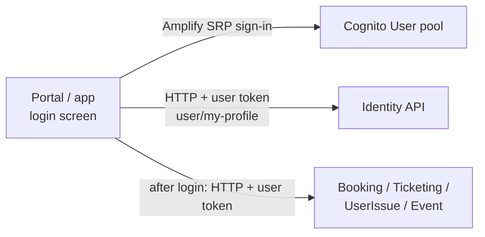

# X-07 · ফোন ও পাসওয়ার্ড দিয়ে গ্রাহক লগইন

> **Bangla name:** ফোন ও পাসওয়ার্ড দিয়ে গ্রাহক লগইন
>
> [← 60 · ক্রস-কাটিং](README.md) · [সূচিপত্র](../README.md) · [ওপেন কোয়ারি](../99-open-queries.md)

## 1. নাম ও উদ্দেশ্য

**গ্রাহক লগইন।** একজন নিবন্ধিত গ্রাহক পোর্টালে বা অ্যাপে ফোন নম্বর ও পাসওয়ার্ড দিয়ে সাইন ইন করেন। ক্লায়েন্ট সরাসরি
**User** Cognito pool-এর সাথে কথা বলে; এরপর identity API থেকে গ্রাহকের প্রোফাইল নেয়। অ্যাক্সেস টোকেন এরপর বুকিং, টিকিট ও
সাপোর্টের জন্য ব্যবহৃত হয় ([X-10](X-10-user-session.md))।

## 2. ট্রিগার ও অ্যাক্টর

| বিষয় | মান |
|---|---|
| অ্যাক্টর | User-pool অ্যাকাউন্ট থাকা একজন গ্রাহক ([X-06](X-06-user-registration.md)) |
| ক্লায়েন্ট ও স্ক্রিন | পোর্টাল `/:lang/auth/login` (`UserLoginComponent`); অ্যাপের `login` স্ক্রিন (`LoginViewModel.signInUser`) |
| Cognito pool | User |
| রোল / প্রোগ্রাম স্কোপ | ব্যাকএন্ড প্রতিটি User-pool টোকেনে রোল `user` দেয় ([X-14](X-14-authz-pool-policies.md)) |

## 3. ব্যবসায়িক প্রবাহ

১. গ্রাহক ১০ সংখ্যার ফোন (প্রথম অঙ্ক ১–৯) ও পাসওয়ার্ড দেন।
২. সফল হলে পোর্টাল প্রোফাইল নেয় এবং গ্রাহককে যে পেজ থেকে লগইনে পাঠিয়েছিল তার দিকে ফিরে যায় (`sessionStorage.returnUrl`),
   বা হোম পেজে। লগইন সেখান থেকে শুরু হলে অ্যাপ বুকিং স্ক্রিনে ফিরে যায়, নয়তো হোমে।
৩. ব্যর্থ হলে পোর্টাল Cognito-র বার্তা দেখায়; অ্যাপ "Incorrect phone number or password" দেখায়।
৪. পাসওয়ার্ড ব্যবহারকারীর প্রোফাইল না পাওয়া গেলে (`user_not_found`), পোর্টাল আবার সাইন আউট করায় এবং লগইন পেজ খোলে।

## 4. প্রযুক্তিগত প্রবাহ

| # | থেকে → পর্যন্ত | হপ | কী ঘটে |
|---|---|---|---|
| ১ | ক্লায়েন্ট → Cognito (User pool) | পোর্টাল: Amplify JS `Auth.signIn("+880…", password)` (SRP)। অ্যাপ: Amplify Flutter `Amplify.Auth.signIn` | Amplify টোকেন সংরক্ষণ করে (পোর্টাল: `localStorage`; অ্যাপ: Amplify secure storage) |
| 1a | | challenge `NEW_PASSWORD_REQUIRED` (পোর্টাল) | অ্যাডমিন পোর্টালের মতো একই পাসওয়ার্ড দিয়ে সম্পন্ন হয় ([X-01](X-01-admin-login.md)) |
| 1b | | challenge `SMS_MFA` | পোর্টাল `isMFARequired = true` করে, কিন্তু টেমপ্লেটে কোড ইনপুট নেই, তাই লগইন থেমে যায়। অ্যাপ: `result.isSignedIn == false` → সেশন `null` → "Incorrect phone number or password" |
| ২ | ক্লায়েন্ট → identity API `GET user/my-profile` | **[HTTP + user token]** (পোর্টাল: টোকেন ইন্টারসেপ্টর static হেডারের জায়গায় `Bearer` বসায়; অ্যাপ: `ProfileApiClient`, query `user_id=`) | NgRx identity store / অ্যাপ ক্যাশে প্রোফাইল সংরক্ষিত হয় |
| 2a | | `status_message == "user_not_found"` | পোর্টাল: পাসওয়ার্ড লগইন → সাইন আউট; SSO লগইন → রেজিস্টার ([X-08](X-08-oneid-sso.md))। অ্যাপ: যেকোনো এরর → `POST user/register-sso` তারপর আবার চেষ্টা |
| ৩ | ক্লায়েন্ট → Firebase Analytics | — | `logLogin(user_id)` |

অ্যাপ আগে যেকোনো বিদ্যমান সেশন থেকে সাইন আউট করে (`AuthRepositoryImpl.login`, `if (await isLoggedIn()) await signOut()`)।

## 5. কম্পোনেন্ট

| ধরন | কম্পোনেন্ট |
|---|---|
| ক্লায়েন্ট (পোর্টাল) | `UserLoginComponent`, `CognitoService` (`modules/shared/services/cognito.service.ts`), `IdentityStoreService`, `TokenInterceptor` |
| ক্লায়েন্ট (অ্যাপ) | `LoginViewModel`, `AuthRepositoryImpl`, `AWSAmplifyService`, `ProfileRepositoryImpl` |
| AWS | Cognito User pool (`environment.aws.userPoolId` / `AMPLIFY_CONFIG`) |
| বাহ্যিক | Identity API (`user/my-profile`) `[UNCONFIRMED: Q-01]` |

## 6. API কন্ট্রাক্ট

| মেথড | পাথ | অথ | রিকোয়েস্ট | রেসপন্স | প্রধান এরর |
|---|---|---|---|---|---|
| — | Amplify-এর মাধ্যমে Cognito `InitiateAuth` (SRP) | public client | `+880…`, পাসওয়ার্ড | Cognito টোকেন | `NotAuthorizedException` ("Incorrect username or password."), "User is disabled." |
| GET | `{identity}/user/my-profile` (অ্যাপ `?user_id=` যোগ করে) | `Bearer <User-pool access token>` | — | `UserProfile` (`user_data.user_id`, …) | `status_message: "user_not_found"` |

প্রোফাইল রেসপন্সের শেপ নির্ধারণ করে ক্লায়েন্ট মডেল `modules/core/models/user-profile.ts`; [P-11](../20-user-portal/P-11-profile.md) দেখুন।

## 7. ডেটা ও পার্শ্বপ্রতিক্রিয়া

- ব্রাউজার/অ্যাপ: Amplify টোকেন স্টোরেজ; পোর্টাল ফ্ল্যাগ `rvl_cognito_auth = true`।
- ইউজার id-সহ অ্যানালিটিক্স লগইন ইভেন্ট।
- কোনো GoBCB টেবিলে লেখা হয় না।

## 8. কোড রেফারেন্স

| কী | কোথায় |
|---|---|
| পোর্টালের লগইন জমা | `rvl-gobcb-user-portal/ETP-Web/src/app/modules/featured/auth/components/user-login/user-login.component.ts:182-224` |
| পোর্টালের Cognito সাইন ইন | `rvl-gobcb-user-portal/ETP-Web/src/app/modules/shared/services/cognito.service.ts:49-72` |
| পোর্টালে প্রোফাইল নেওয়া ও `user_not_found` ব্যবস্থাপনা | `rvl-gobcb-user-portal/ETP-Web/src/app/modules/core/modules/identity/store/identity.effects.ts:291-343` |
| অ্যাপের লগইন | `rvl-gobcb-user-app/lib/presentation/feature/auth/login/login_view_model.dart`, `data/lib/repository/auth_repository_impl.dart:26-62`, `data/lib/service/aws_amplify_service.dart:38-66` |
| অ্যাপের প্রোফাইল + SSO ফলব্যাক | `rvl-gobcb-user-app/data/lib/repository/profile_repository_impl.dart:55-86` |

## 9. হ্যান্ডওভার নোট

১. **SMS MFA কোনো ক্লায়েন্টেই ব্যবহারযোগ্য নয়।** User pool-এ MFA চালু থাকলে পোর্টাল MFA অবস্থায় আটকে যেত এবং অ্যাপ ভুল
   পাসওয়ার্ডের কথা বলত। MFA কনফিগার করা আছে কি না রিপোজিটরিতে নেই `[UNCONFIRMED: Q-03]`।
২. **অ্যাপ যেকোনো প্রোফাইল এররে SSO ব্যবহারকারী নিবন্ধন করে।** `getUserPersonInformation` প্রতিটি
   `BaseException`-এর জন্য `user/register-sso` কল করে, শুধু `user_not_found`-এর জন্য নয়, পাসওয়ার্ড ব্যবহারকারীদের জন্যও।
৩. **ফোনের ফরম্যাট।** দুই ক্লায়েন্টই Cognito ইউজারনেম হিসেবে `+880` + ১০ সংখ্যা পাঠায়; ব্যাকএন্ড কখনো পাসওয়ার্ড দেখে না।

## 10. কম্পোনেন্ট সম্পর্ক

**নির্ভর করে:** [X-06](X-06-user-registration.md)। **প্রভাব ফেলে:** টোকেন লাগে এমন প্রতিটি `P-xx` / `U-xx` ফিচার
([P-05](../20-user-portal/P-05-apply-promo-code.md), [P-06](../20-user-portal/P-06-booking-payment.md), [P-07](../20-user-portal/P-07-my-bookings.md), …)।

## 11. ডেভেলপার টেস্ট গাইড

**লোকাল টেস্টযোগ্যতা: পোর্টালে সম্পূর্ণ, অ্যাপে লোকালে নয়।** পোর্টাল কপি Amplify-কে Floci-র দিকে দেখায়; অ্যাপের
Amplify Flutter-এর কোনো endpoint override নেই এবং এটি আসল AWS-এর সাথে কথা বলে (`docs/mobile-local.md` §8, known gap 1)।

| বিষয় | বিবরণ |
|---|---|
| টেস্ট ডেটা ও অ্যাকাউন্ট | `+8801700000011` / `Passw0rd!23` (User pool, সিড করা অর্ডারের মালিক, `docs/local-dev.md` §7) |
| ব্রাউজার | `pwsh ./scripts/Setup-UserPortal.ps1 -Start`, `http://localhost:4201/en/auth/login` খুলুন, ফোন `1700000011`, পাসওয়ার্ড `Passw0rd!23` (`docs/user-portal-local.md` §5)। DevTools → Network: `/p/cognito` কল, তারপর `GET /p/identity/user/my-profile` যা লোকাল স্টাব ("Local User") দিয়ে উত্তর দেয় |
| ইমুলেটর | লগইন স্ক্রিন খোলে কিন্তু আসল Cognito-র বিপরীতে সাইন ইন ব্যর্থ হয় (known gap) |
| Postman | `postman/etp-login-all-pools.postman_collection.json` ফোল্ডার "User pool", রিকোয়েস্ট "Login as user" (USER_PASSWORD_AUTH) `access_token_user` সংরক্ষণ করে সার্ভিস কলেকশনের জন্য |
| Visual Studio ডিবাগ | `ETP.Booking.Service`-এ অ্যাট্যাচ করে যেকোনো `Policy = user` এন্ডপয়েন্ট কল করুন (যেমন `GET /booking/api/v1/user-booking-order/list`); `user` স্কিমের `OnTokenValidated`-এ ব্রেকপয়েন্ট, `rvl-gobcb-backend/Core/ETP.Core/Configuration/DefaultAuthenticationConfig.cs:46` |
| যাচাই | হেডারে "My Tickets" ও "Logout" দেখা যায়; `localStorage`-এ `CognitoIdentityServiceProvider.<clientId>.LastAuthUser` থাকে |