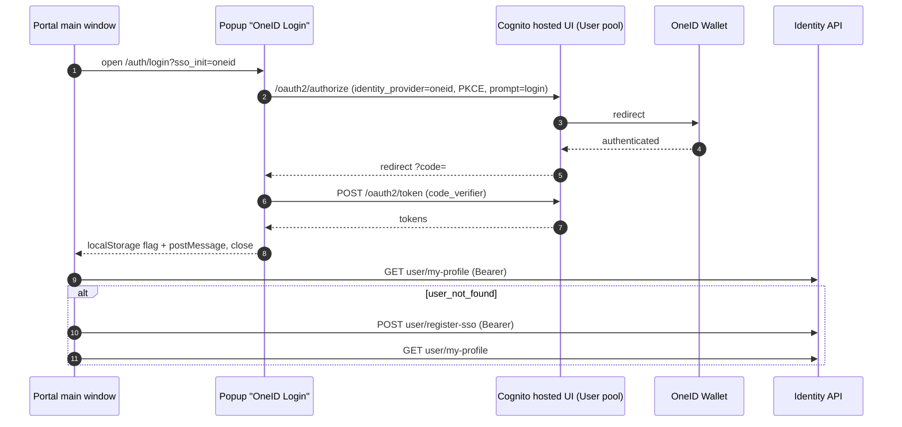

# X-08 · OneID সিঙ্গেল সাইন-অন

> **Bangla name:** OneID সিঙ্গেল সাইন-অন
>
> [← 60 · ক্রস-কাটিং](README.md) · [সূচিপত্র](../README.md) · [ওপেন কোয়ারি](../99-open-queries.md)

## 1. নাম ও উদ্দেশ্য

**OneID SSO।** একজন গ্রাহক GoBCB পাসওয়ার্ডের বদলে OneID Wallet অ্যাকাউন্ট দিয়ে সাইন ইন করতে পারেন। **User** Cognito
pool-এ OneID বাহ্যিক identity provider হিসেবে `oneid` নামে কনফিগার করা; ক্লায়েন্ট ওই provider দিয়ে Cognito-র hosted
সাইন ইন খোলে এবং সাধারণ User-pool টোকেন পায়। প্রথম OneID লগইনে ক্লায়েন্ট identity API-কে GoBCB প্রোফাইল তৈরি করতে বলে
(`user/register-sso`)। Cognito-তে OneID-এর কনফিগারেশন রিপোজিটরিতে নেই (architecture Q5)।

## 2. ট্রিগার ও অ্যাক্টর

| বিষয় | মান |
|---|---|
| অ্যাক্টর | OneID অ্যাকাউন্ট থাকা একজন গ্রাহক |
| ক্লায়েন্ট ও স্ক্রিন | পোর্টাল `/:lang/auth/login` → "Login with OneID Wallet" (`OneID Login` নামের পপআপ উইন্ডো); অ্যাপের লগইন স্ক্রিন → OneID বাটন (`LoginViewModel.onLoginWithOneIDBtnClicked`) |
| Cognito pool | User, identity provider `oneid` |
| রোল / প্রোগ্রাম স্কোপ | `user` ([X-07](X-07-user-password-login.md)-এর মতো) |

## 3. ব্যবসায়িক প্রবাহ

১. গ্রাহক OneID বাটনে চাপ দেন।
২. একটি পপআপ (পোর্টাল) বা সিস্টেম ব্রাউজার (অ্যাপ) OneID-এর লগইন পেজ দেখায়; OneID সবসময় credential চায় (`prompt=login`, পোর্টাল)।
৩. OneID অনুমোদন দেওয়ার পর উইন্ডো বন্ধ হয় এবং গ্রাহক সাইন ইন হয়ে যান।
৪. GoBCB-তে এই ব্যক্তির প্রোফাইল না থাকলে সেটি স্বয়ংক্রিয়ভাবে তৈরি হয়; তারপর গ্রাহক যে পেজ থেকে এসেছিলেন তাতে বা হোমে পৌঁছান।

## 4. প্রযুক্তিগত প্রবাহ

**পোর্টাল (পপআপে ম্যানুয়াল PKCE)**

| # | থেকে → পর্যন্ত | হপ | কী ঘটে |
|---|---|---|---|
| ১ | মূল উইন্ডো → পপআপ `/:lang/auth/login?sso_init=oneid` | browser | `OneID Login` নামের ৫০০×৭০০ পপআপ খোলে; `sso_login = true` সেট করে |
| ২ | পপআপ | browser | একটি PKCE verifier জেনারেট করে (৩২ র‍্যান্ডম বাইট), `localStorage.pkce_key` হিসেবে সংরক্ষণ করে, S256 challenge হিসাব করে |
| ৩ | পপআপ → Cognito hosted UI `https://<oauth.domain>/oauth2/authorize?identity_provider=oneid&redirect_uri=…&response_type=…&client_id=…&scope=…&prompt=login&code_challenge=…&code_challenge_method=S256` | browser redirect | Cognito OneID-এ ফরওয়ার্ড করে |
| ৪ | OneID → Cognito → পপআপ `redirectSignIn?code=…` | browser redirect | Authorization code |
| ৫ | পপআপ → Cognito `POST https://<oauth.domain>/oauth2/token` | `fetch`, form-encoded | `grant_type=authorization_code`, `client_id`, `code`, `redirect_uri`, `code_verifier` → id, access, refresh টোকেন |
| ৬ | পপআপ | browser | টোকেনগুলো Amplify-এর `localStorage` key-তে লেখে (`CognitoIdentityServiceProvider.<clientId>.<username>.idToken`, …) এবং `amplify-signin-with-hostedUI = true`; `sso_auth_complete = true` সেট করে; `postMessage({type:'sso-login-success'})`; নিজে বন্ধ হয় |
| ৭ | মূল উইন্ডো | browser | প্রতি ৩০০ মিলিসেকেন্ডে পোল করে (এবং `message` শোনে); `Auth.currentAuthenticatedUser({ bypassCache: true })` |
| ৮ | মূল উইন্ডো → identity `GET user/my-profile` | **[HTTP + user token]** | প্রোফাইল |
| 8a | মূল উইন্ডো → identity `POST user/register-sso` | **[HTTP + user token]** | কেবল যখন ধাপ ৮ `status_message == "user_not_found"` ফেরত দিয়েছে এবং `sso_login == true`। বডি: `Auth.currentAuthenticatedUser()` থেকে পাওয়া Amplify ব্যবহারকারী অবজেক্ট। তারপর আবার ধাপ ৮ |

**অ্যাপ (Amplify hosted UI)**

| # | থেকে → পর্যন্ত | হপ | কী ঘটে |
|---|---|---|---|
| ১ | অ্যাপ → Cognito hosted UI → OneID | `Amplify.Auth.signInWithWebUI(provider: AuthProvider.custom('oneid'), isPreferPrivateSession: true)` | সিস্টেম ব্রাউজার সেশন, private |
| ২ | অ্যাপ → identity `GET user/my-profile?user_id=<sub>` | **[HTTP + user token]** | যেকোনো এররে `{ "name": "", "cognito_sub": <sub> }` দিয়ে `POST user/register-sso`, তারপর আবার চেষ্টা |

## 5. কম্পোনেন্ট

| ধরন | কম্পোনেন্ট |
|---|---|
| ক্লায়েন্ট (পোর্টাল) | `UserLoginComponent` (পপআপ, PKCE), `CognitoService.getOAuthUrl / exchangeCodeForTokens / storeTokensInAmplifyFormat`, `IdentityEffects.fetchUserProfile$ / registerSSOUser$` |
| ক্লায়েন্ট (অ্যাপ) | `AWSAmplifyService.loginWithOneID`, `ProfileRepositoryImpl.getUserPersonInformation` |
| AWS | Cognito User pool hosted UI (`environment.aws.oauth.domain`), identity provider `oneid` |
| বাহ্যিক | OneID Wallet (architecture Q5); identity API `[UNCONFIRMED: Q-01]` |

## 6. API কন্ট্রাক্ট

| মেথড | পাথ | অথ | রিকোয়েস্ট | রেসপন্স | প্রধান এরর |
|---|---|---|---|---|---|
| GET | `https://<oauth.domain>/oauth2/authorize` | — | ধাপ ৩-এর মতো query | `code` সহ redirect | OneID / Cognito এরর পেজ |
| POST | `https://<oauth.domain>/oauth2/token` | — (public client + PKCE) | ধাপ ৫-এর মতো form ফিল্ড | `{ id_token, access_token, refresh_token, … }` | `error_description` → "Token exchange failed" |
| GET | `{identity}/user/my-profile` | `Bearer` | — | `UserProfile` | `user_not_found` |
| POST | `{identity}/user/register-sso` | `Bearer` (পোর্টাল: টোকেন ইন্টারসেপ্টর; অ্যাপ: `ProfileApiClient`) | পোর্টাল: Amplify ব্যবহারকারী অবজেক্ট; অ্যাপ: `{ name: "", cognito_sub }` | পড়া হয় না | ব্যর্থ হলে সাইন আউট (পোর্টাল) |

```http
POST https://<oauth.domain>/oauth2/token
Content-Type: application/x-www-form-urlencoded

grant_type=authorization_code&client_id=<userPoolWebClientId>&code=<code>&redirect_uri=<redirectSignIn>&code_verifier=<verifier>
```

```json
// POST {identity}/user/register-sso   (app)
{ "name": "", "cognito_sub": "8c1d2f7e-0000-4000-8000-000000000011" }
```

## 7. ডেটা ও পার্শ্বপ্রতিক্রিয়া

- Cognito: প্রথম OneID লগইনে Cognito User pool-এ একটি federated ব্যবহারকারী তৈরি করে (বাহ্যিক provider-এর জন্য Cognito-র
  আদর্শ আচরণ; অ্যাট্রিবিউট ম্যাপিং রিপোজিটরিতে নেই)।
- Identity API: `register-sso` দিয়ে প্রোফাইল তৈরি।
- পোর্টাল `localStorage`: `pkce_key` (বিনিময়ের পর সরানো হয়), Amplify টোকেন key, `amplify-signin-with-hostedUI`,
  `was_sso_login`, `sso_login`, `sso_auth_complete` / `sso_auth_error`।

## 8. কোড রেফারেন্স

| কী | কোথায় |
|---|---|
| পোর্টালের পপআপ, PKCE, কলব্যাক | `rvl-gobcb-user-portal/ETP-Web/src/app/modules/featured/auth/components/user-login/user-login.component.ts:46-73`, `:226-419` |
| পোর্টালের OAuth URL, টোকেন বিনিময়, Amplify স্টোরেজ | `rvl-gobcb-user-portal/ETP-Web/src/app/modules/shared/services/cognito.service.ts:23-45`, `:302-372` |
| পোর্টালের স্বয়ংক্রিয় নিবন্ধন | `rvl-gobcb-user-portal/ETP-Web/src/app/modules/core/modules/identity/store/identity.effects.ts:303-320`, `:374-427` |
| পোর্টালের Amplify কনফিগ | `rvl-gobcb-user-portal/ETP-Web/src/app/modules/core/config/awsConfig.ts` |
| অ্যাপের OneID সাইন ইন | `rvl-gobcb-user-app/data/lib/service/aws_amplify_service.dart:68-98` |
| অ্যাপের স্বয়ংক্রিয় নিবন্ধন | `rvl-gobcb-user-app/data/lib/repository/profile_repository_impl.dart:55-86`, `data/lib/remote/api_service/profile_api_service/profile_api_service_impl.dart:47-52` |

## 9. হ্যান্ডওভার নোট

১. **লগআউট OneID সেশন শেষ করে না।** পোর্টাল SSO ব্যবহারকারীদের জন্য `skipFederatedLogout` দিয়ে স্থানীয়ভাবে Cognito থেকে
   সাইন আউট করে; `federatedSignOut()` (যা OneID ও Cognito-র লগআউট এন্ডপয়েন্ট কল করত) আছে কিন্তু কখনো কোনো করা হয় না। পোর্টাল পরের
   লগইনে আবার OneID-কে জিজ্ঞাসা করাতে `prompt=login`-এর উপর নির্ভর করে।
২. **পোর্টালের `register-sso` বডি কোনো সংজ্ঞায়িত DTO নয়।** এটি Amplify-এর `Auth.currentAuthenticatedUser()` থেকে ফেরত আসা
   পুরো অবজেক্ট, Angular-এর `HttpClient` দিয়ে সিরিয়ালাইজড। identity API বদলানোর আগে DevTools-এ আসল রিকোয়েস্ট দেখুন।
৩. **অ্যাপের এরর চাপা পড়ে।** `loginWithOneID` প্রতিটি এরর ধরে শুধু লগ করে; এরপর view model সাইন ইন সফল হয়েছে কি না তা
   না দেখেই হোমে নেভিগেট করে।
৪. **দুটি ভিন্ন নিবন্ধন ট্রিগার।** পোর্টাল: কেবল SSO লগইনের সময় `user_not_found` হলে। অ্যাপ: যেকোনো প্রোফাইল এররে।
৫. **পোর্টাল Amplify দুবার কনফিগার করে।** পপআপের কলব্যাকে এটি `oauth` সেকশন সরিয়ে দেয় যাতে Amplify-এর নিজস্ব
   hosted-UI হ্যান্ডলার কোডটি না নেয় (`cognito.service.ts:24-34`)। Amplify আপগ্রেড করলে এটি রেখে দিন।
৬. OneID-এর identity-provider সেটআপ ও অ্যাট্রিবিউট ম্যাপিং আর্কিটেকচার ডকুমেন্টে খোলা (Q5)।

## 10. কম্পোনেন্ট সম্পর্ক



**নির্ভর করে:** provider `oneid`-সহ Cognito User pool, OneID, identity API। **প্রভাব ফেলে:**
[X-07](X-07-user-password-login.md)-এর মতো; [P-10](../20-user-portal/P-10-oneid-ticket-sync.md) (OneID wallet sync)।

## 11. ডেভেলপার টেস্ট গাইড

**লোকাল টেস্টযোগ্যতা: আংশিক (শুধু পোর্টাল)।** পোর্টালের প্রক্সি `/p/oneid`-এ একটি **ফেক OneID** হোস্ট করে যা স্বয়ংক্রিয়ভাবে
অনুমোদন দেয়, PKCE challenge পরীক্ষা করে এবং `+8801700000011`-এর জন্য আসল Floci টোকেন ফেরত দেয়
(`docs/user-portal-local.md` §5)। আসল OneID ও অ্যাপের প্রবাহ লোকালে চলে না।

| বিষয় | বিবরণ |
|---|---|
| টেস্ট ডেটা ও অ্যাকাউন্ট | ফেকটি সবসময় `+8801700000011` হিসেবে সাইন ইন করায়; অন্য ব্যবহারকারী পরীক্ষা করতে জেনারেট করা `portal-local/user-portal/proxy.conf.js`-এ `SSO_USER` বদলান |
| ব্রাউজার | `http://localhost:4201/en/auth/login` → "Login with OneID Wallet" (`localhost:4201`-এর জন্য পপআপ অনুমতি দিন)। `?sso_init=oneid` সরাসরি খুলবেন না: এটি কেবল পপআপের ভেতরে কাজ করে। DevTools (পপআপ) → Network: `/p/oneid/oauth2/authorize`, `/p/oneid/oauth2/token`; মূল উইন্ডো: `GET /p/identity/user/my-profile` (স্টাব) |
| ইমুলেটর | সম্ভব নয় (Amplify Flutter আসল Cognito-র সাথে কথা বলে, `docs/mobile-local.md` §8) |
| Postman | প্রযোজ্য নয় (ব্রাউজার redirect প্রবাহ) |
| Visual Studio ডিবাগ | সাইন ইনের জন্য প্রযোজ্য নয়; ফলে পাওয়া টোকেন [X-07](X-07-user-password-login.md)-এর মতো `user` স্কিম দিয়ে যাচাই হয় |
| যাচাই | `localStorage.amplify-signin-with-hostedUI == "true"`, `was_sso_login == "true"`; "My Tickets" সিড করা অর্ডারগুলো দেখায় |