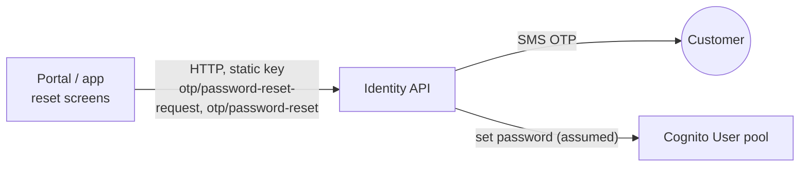

# X-09 · গ্রাহকের পাসওয়ার্ড ভুলে যাওয়া/রিসেট

> **Bangla name:** গ্রাহকের পাসওয়ার্ড ভুলে যাওয়া/রিসেট
>
> [← 60 · ক্রস-কাটিং](README.md) · [সূচিপত্র](../README.md) · [ওপেন কোয়ারি](../99-open-queries.md)

## 1. নাম ও উদ্দেশ্য

**গ্রাহক পাসওয়ার্ড রিসেট।** পাসওয়ার্ড ভুলে যাওয়া একজন গ্রাহক একটি SMS কোড চান এবং সেটি দিয়ে নতুন পাসওয়ার্ড নির্ধারণ
করেন। দুটি ধাপই বাহ্যিক identity API-তে যায়; GoBCB সার্ভিসগুলো জড়িত নয় `[UNCONFIRMED: Q-01]`।

## 2. ট্রিগার ও অ্যাক্টর

| বিষয় | মান |
|---|---|
| অ্যাক্টর | গ্রাহক, সাইন ইন না করা |
| ক্লায়েন্ট ও স্ক্রিন | পোর্টাল `/:lang/auth/phone-reset-password` → `reset-password-code` → `reset-password-verified`। অ্যাপ `forgetPassword` → `confirmNewPassword` → `forgetPasswordSuccess` |
| Cognito pool | User (ধরে নেওয়া হয়েছে identity API বদলায়) |

## 3. ব্যবসায়িক প্রবাহ

১. গ্রাহক ফোন নম্বর দেন ও একটি কোড চান।
২. প্ল্যাটফর্ম একটি SMS কোড পাঠায় (অ্যাপ "maximum OTP generation limit exceeded" চেন)।
৩. গ্রাহক কোড ও নতুন পাসওয়ার্ড দেন।
৪. একটি সফলতার পেজ তাকে লগইনে ফিরিয়ে নিয়ে যায়।

## 4. প্রযুক্তিগত প্রবাহ

| # | থেকে → পর্যন্ত | হপ | রিকোয়েস্ট বডি | ফলাফল |
|---|---|---|---|---|
| ১ | ক্লায়েন্ট → identity `POST otp/password-reset-request` | **[HTTP, static key]** | `{ phone }` | পোর্টাল সেটিকে `rvl_reset_pass` হিসেবে সংরক্ষণ করে ও কোড পেজ খোলে |
| ২ | ক্লায়েন্ট → identity `POST otp/password-reset` | **[HTTP, static key]** | `{ phone, otp, password }` | পোর্টাল `rvl_reset_pass` ও রিসেন্ড কাউন্টার মোছে, `reset-password-verified` খোলে |

## 5. কম্পোনেন্ট

| ধরন | কম্পোনেন্ট |
|---|---|
| ক্লায়েন্ট (পোর্টাল) | `PhoneVerificationResetPasswordComponent`, `ResetPasswordPhoneCodeComponent`, `ResetPasswordSuccessfulComponent`, `IdentityEffects.resetPasswordRequest$ / resetPassword$` |
| ক্লায়েন্ট (অ্যাপ) | `ForgetPassword*` ও `ConfirmNewPasswordViewModel`, `AuthRepositoryImpl.passwordResetRequest / passwordReset`, `AuthApiServiceImpl` |
| বাহ্যিক | Identity API `[UNCONFIRMED: Q-01]` |

## 6. API কন্ট্রাক্ট

| মেথড | পাথ (identity API) | অথ | রিকোয়েস্ট | রেসপন্স | প্রধান এরর (`status_message`) |
|---|---|---|---|---|---|
| POST | `otp/password-reset-request` | static হেডার key | `ResetPasswordRequest { phone }` | পড়া হয় না | `phone_number_not_found`, `user_not_found`, `exceeded_maximum_otp_generation_limit` |
| POST | `otp/password-reset` | static হেডার key | `ResetPassword { phone, otp, password }` | পড়া হয় না | `phone_number_not_found`, `user_not_found`, `invalid_otp` |

```json
// POST {identity}/otp/password-reset
{ "phone": "+8801711111111", "otp": "482913", "password": "N3w!Passw0rd" }
```

## 7. ডেটা ও পার্শ্বপ্রতিক্রিয়া

Identity API: OTP পাঠানো ও যাচাই; Cognito-তে পাসওয়ার্ড বদলানো (ধরে নেওয়া)। পোর্টালের local storage key
`rvl_reset_pass`, `pass_reset_resend_code_otpcounter`, `pass_reset_code_timestamp` (সফল হলে ও লগইন পেজ খুললে মোছা হয়)।

## 8. কোড রেফারেন্স

| কী | কোথায় |
|---|---|
| পোর্টালের effects | `rvl-gobcb-user-portal/ETP-Web/src/app/modules/core/modules/identity/store/identity.effects.ts:214-289` |
| পোর্টালের API কল | `rvl-gobcb-user-portal/ETP-Web/src/app/modules/core/services/api/identity-api.service.ts:73-89` |
| অ্যাপের API কল ও এরর ম্যাপিং | `rvl-gobcb-user-app/data/lib/remote/api_service/auth_api_service/auth_api_service_impl.dart:243-292` |
| অ্যাপের স্ক্রিন | `rvl-gobcb-user-app/lib/presentation/feature/auth/confirm_new_password/confirm_new_password_view_model.dart:110-155` |

## 9. হ্যান্ডওভার নোট

১. OTP ও পাসওয়ার্ড একই রিকোয়েস্টে যায়; identity API-কে এগুলো একসাথে যাচাই করতে হবে `[UNCONFIRMED: Q-01]`।
২. পোর্টালের `CognitoService.forgotPassword(phone, code, newPassword)` ভুল আর্গুমেন্ট দিয়ে `Auth.changePassword` কল করে ও
   ব্যবহৃত হয় না; এটি উপেক্ষা করুন (Appendix A)।
৩. ক্লায়েন্টে দৃশ্যমান কিছুই অন্য ডিভাইসে বিদ্যমান সেশন বাতিল করে না।

## 10. কম্পোনেন্ট সম্পর্ক



**নির্ভর করে:** [X-06](X-06-user-registration.md)। **প্রভাব ফেলে:** [X-07](X-07-user-password-login.md)।

## 11. ডেভেলপার টেস্ট গাইড

**লোকাল টেস্টযোগ্যতা: লোকালে নয়।** identity API লোকালে একটি 503 স্টাব (`docs/user-portal-local.md` §5, `docs/mobile-local.md` §8)।

| বিষয় | বিবরণ |
|---|---|
| টেস্ট ডেটা ও অ্যাকাউন্ট | লোকালে প্রযোজ্য নয়। লোকাল পাসওয়ার্ড বদলাতে Floci ব্যবহার করুন: `aws --endpoint-url http://localhost:4566 cognito-idp admin-set-user-password --user-pool-id <UserPoolId> --username +8801700000011 --password <new> --permanent` |
| ব্রাউজার | `http://localhost:4201/en/auth/phone-reset-password` রেন্ডার হয়; `POST /p/identity/otp/password-reset-request` রিকোয়েস্ট 503 ফেরত দেয় |
| ইমুলেটর | `scripts/mobile-gateway.js`-এর মাধ্যমে একই 503 (`/identity`) |
| Postman | কোনো কলেকশনই identity API কভার করে না |
| Visual Studio ডিবাগ | প্রযোজ্য নয় |
| যাচাই | ডিপ্লয় করা পরিবেশে: নতুন পাসওয়ার্ড দিয়ে সাইন ইন করুন ([X-07](X-07-user-password-login.md)) |