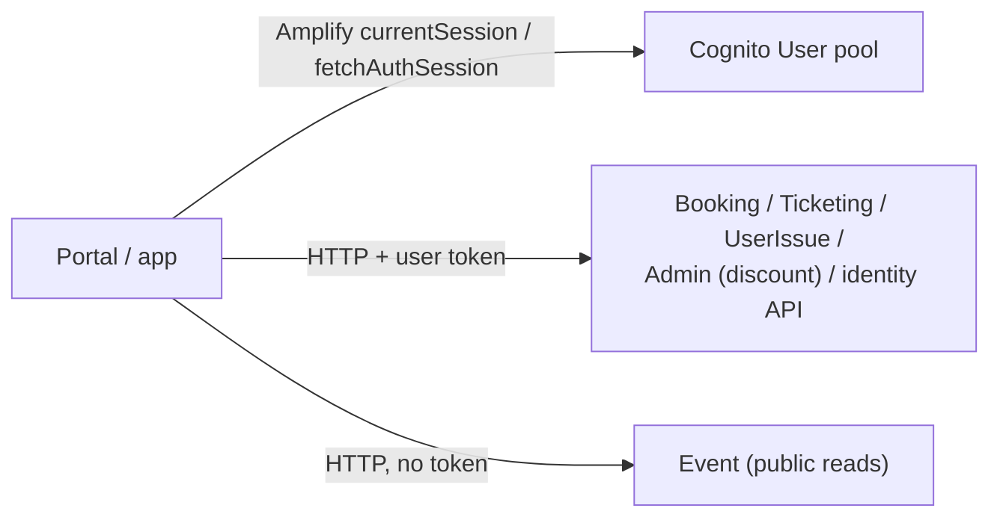

# X-10 · গ্রাহকের পাসওয়ার্ড পরিবর্তন, লগআউট ও টোকেন সংযুক্তি

> **Bangla name:** গ্রাহকের পাসওয়ার্ড পরিবর্তন, লগআউট ও টোকেন সংযুক্তি
>
> [← 60 · ক্রস-কাটিং](README.md) · [সূচিপত্র](../README.md) · [ওপেন কোয়ারি](../99-open-queries.md)

## 1. নাম ও উদ্দেশ্য

**গ্রাহক সেশন ব্যবস্থাপনা।** ইউজার পোর্টাল ও ইউজার অ্যাপ কীভাবে User-pool-এর access token API কলের সঙ্গে সংযুক্ত করে, সেটি expire হলে
কী ঘটে, এবং গ্রাহক কীভাবে পাসওয়ার্ড পরিবর্তন করে ও লগআউট করে। লগইন-এর দরকার এমন প্রতিটি গ্রাহক ফিচার এর উপর নির্ভরশীল।

## 2. ট্রিগার ও অ্যাক্টর

| বিষয় | মান |
|---|---|
| অ্যাক্টর | সাইন-ইন করা গ্রাহক |
| ক্লায়েন্ট ও স্ক্রিন | পোর্টাল: প্রতিটি HTTP কল (`TokenInterceptor`); প্রোফাইল পেজ → পাসওয়ার্ড পরিবর্তন (`UserProfilePagesComponent`); হেডার → লগআউট (`DefaultComponent.signOutUser`)। অ্যাপ: `TicketBanglaApiClient` / `ProfileApiClient`-এর মাধ্যমে প্রতিটি কল; Profile → পাসওয়ার্ড পরিবর্তন / সাইন আউট (`ProfileViewModel`) |
| Cognito pool | User |

## 3. ব্যবসায়িক প্রবাহ

- **পাসওয়ার্ড পরিবর্তন:** বর্তমান পাসওয়ার্ড, নতুন পাসওয়ার্ড দুবার; ৭ সেকেন্ডের জন্য সফলতার বার্তা (পোর্টাল)। গ্রাহক সাইন-ইন অবস্থায় থাকে।
- **লগআউট:** গ্রাহক সাইন-আউট হয়ে লগইন পেজে (পোর্টাল) বা লগইন স্ক্রিনে (অ্যাপ) পৌঁছান।
- **মেয়াদোত্তীর্ণ সেশন:** টোকন expire হয়ে যাওয়া অবস্থায় কোনো কল পাঠানোর ঠিক আগে পোর্টাল গ্রাহককে সাইন-আউট করে দেয়।

## 4. কারিগরি প্রবাহ

**পোর্টালে টোকেন সংযুক্তি** (`TokenInterceptor`, `app.module.ts`-এ রেজিস্টার করা): টোকেন যোগ করা হয় **শুধুমাত্র** তখন, যখন request URL-এর মধ্যে এই প্রিফিক্সগুলোর কোনো একটি থাকে; বাকি সব request (যেমন public Event endpoint) টোকেন ছাড়াই যায়:

| URL-এ আছে | কে ব্যবহার করে |
|---|---|
| `${services.bookings}/booking` | booking, capacity, orders ([P-04](../20-user-portal/P-04-seat-selection.md)–[P-08](../20-user-portal/P-08-ticket-generation-request.md)) |
| `${services.bookings}/admin/api/v1/discount` | সিস্টেম discount lookup ([P-04](../20-user-portal/P-04-seat-selection.md)) |
| `${services.bookings}/admin/api/v1/user-issue` | legacy issue endpoint (Appendix A) |
| `${services.userissue}/userissue/api/v1/user-issue` | issues ([P-12](../20-user-portal/P-12-issues-chat.md)) |
| `${services.userissue}/userissue/chathub` | SignalR negotiate |
| `${services.tickets}/ticketing` | tickets ([P-09](../20-user-portal/P-09-ticket-details-downloads.md), [P-10](../20-user-portal/P-10-oneid-ticket-sync.md)) |
| `${services.identity}/user/my-profile`, `/user/register-sso` | প্রোফাইল ([P-11](../20-user-portal/P-11-profile.md), [X-08](X-08-oneid-sso.md)) |
| `${services.bookings}/event/api/v1/events/venue-details` | seat map-এর জন্য venue details |

ধাপ: `Auth.currentSession()` (প্রয়োজন হলে Amplify refresh token দিয়ে রিফ্রেশ করে) → ফেরত পাওয়া টোকেনের `exp` তবুও পেরিয়ে গেলে `rvl_cognito_auth` সরান, প্রোফাইল মুছে ফেলুন, সাইন-আউট করুন এবং request-টি একটি কৃত্রিম 401 দিয়ে ব্যর্থ করুন → অন্যথায় `Authorization: Bearer` যোগ করুন।

**অ্যাপে টোকেন সংযুক্তি:** `TicketBanglaApiClient` (base `API_BASE_URL`) ও `ProfileApiClient` (base `AUTH_API_BASE_URL`) প্রতিটি request-এর আগে
`Amplify.Auth.fetchAuthSession()` কল করে `Bearer <accessToken>` যোগ করে; সেশন না থাকলে সেগুলো ছুঁড়ে দেয়
`CognitoUserSessionNotFoundException`। `AuthApiClient` বদলে static `AUTH_API_TOKEN` ব্যবহার করে।

| # | কাজ | কল |
|---|---|---|
| CP | পাসওয়ার্ড পরিবর্তন | পোর্টাল: Amplify `Auth.changePassword(user, old, new)`। অ্যাপ: `Amplify.Auth.updatePassword`। দুটোই → Cognito `ChangePassword` |
| LO | লগআউট (পোর্টাল) | `Auth.signOut({ global: false })`; `skipFederatedLogout` সহ SSO ব্যবহারকারীদের জন্য (Cognito/OneID লগআউটে কোনো redirect নেই); `rvl_cognito_auth`, SSO ফ্ল্যাগ ও প্রোফাইল সরায়; `/:lang/auth/login`-এ নিয়ে যায় |
| LO | লগআউট (অ্যাপ) | `Amplify.Auth.signOut()`; লোকাল user data মোছে; FCM টোকেন মুছে ফেলার কলটি comment করা (`profile_view_model.dart`, `// await firebaseRepository.deleteFCMToken();`) |

## 5. কম্পোনেন্ট

| ধরন | কম্পোনেন্ট |
|---|---|
| ক্লায়েন্ট (পোর্টাল) | `TokenInterceptor`, `CognitoService`, `UserProfilePagesComponent`, `DefaultComponent` |
| ক্লায়েন্ট (অ্যাপ) | `TicketBanglaApiClient`, `ProfileApiClient`, `AuthApiClient`, `AWSAmplifyService`, `ProfileViewModel`, `AuthRepositoryImpl.signOut` |
| AWS | Cognito User pool |

## 6. API কন্ট্র্যাক্ট

GoBCB-র কোনো নিজস্ব endpoint নেই। যোগ হওয়া হেডার: `Authorization: Bearer <User-pool access token>`। সার্ভার-সাইডে যাচাই:
[X-14](X-14-authz-pool-policies.md)।

## 7. ডেটা ও পার্শ্বপ্রতিক্রিয়া

Cognito-তে পাসওয়ার্ড পরিবর্তন; লগআউটে লোকাল টোকেন সরানো। লগআউটের পরেও push-এর জন্য ডিভাইস টোকেন রেজিস্টার্ড থাকে (অ্যাপ), তাই সেই ব্যবহারকারীর
push এখনও ডিভাইসে পৌঁছাতে পারে ([X-23](X-23-push-firebase.md))।

## 8. কোড রেফারেন্স

| কী | কোথায় |
|---|---|
| পোর্টাল interceptor | `rvl-gobcb-user-portal/ETP-Web/src/app/modules/core/interceptors/token.interceptor.ts:133-193` (লাইন ১-১১২ আগের comment করা সংস্করণ) |
| পোর্টাল পাসওয়ার্ড পরিবর্তন | `rvl-gobcb-user-portal/ETP-Web/src/app/modules/featured/profile/pages/user-profile-pages.component.ts:299-340`, `modules/shared/services/cognito.service.ts:182-199` |
| পোর্টাল লগআউট | `rvl-gobcb-user-portal/ETP-Web/src/app/modules/layout/components/default/default.component.ts:128-142`, `modules/shared/services/cognito.service.ts:96-117` |
| অ্যাপ API ক্লায়েন্ট | `rvl-gobcb-user-app/data/lib/remote/api_client/ticket_bangla_api_client.dart`, `profile_api_client.dart`, `auth_api_client.dart` |
| অ্যাপ পাসওয়ার্ড পরিবর্তন / সাইন আউট | `rvl-gobcb-user-app/data/lib/service/aws_amplify_service.dart:157-189`, `lib/presentation/feature/profile/profile_view_model.dart:343`, `:370-382` |

## 9. হ্যান্ডওভার নোট

1. **টোকেন সংযুক্তি মূলত URL ফ্র্যাগমেন্টের একটি allow-list**, যা environment-এর base URL থেকে তৈরি। টোকেন-এর দরকার এমন নতুন কোনো ব্যাকএন্ড পাথ
   `TokenInterceptor`-এ যোগ করতে হবে, নইলে সেই কল `Authorization` ছাড়া যায় এবং 401 পায়।
2. **৪০১-এ কোনো retry নেই।** সার্ভার থেকে 401 পেলে পোর্টাল কখনো রিফ্রেশ করে না; এটি নির্ভর করে Amplify-এর কলের আগে রিফ্রেশ করার উপর।
3. **লগআউট স্থানীয়।** অন্য সেশন এবং OneID সেশন জীবিত থাকে ([X-08](X-08-oneid-sso.md))।
4. **অ্যাপের লগআউট push টোকেন রেখে দেয়** (§৭ দেখুন)।

## 10. কম্পোনেন্ট সম্পর্ক

**নির্ভর করে:** [X-07](X-07-user-password-login.md), [X-08](X-08-oneid-sso.md)। **প্রভাব ফেলে:** টোকেন-সুরক্ষিত সব `P-xx` ও `U-xx` ফিচার।

## 11. ডেভেলপার টেস্ট গাইড

**লোকালভাবে পরীক্ষা: পোর্টালে সম্পূর্ণ, অ্যাপে লোকালভাবে সম্ভব নয়** (অ্যাপ সাইন-ইন জানা ঘাটতি, `docs/mobile-local.md` §৮)।

| বিষয় | বিবরণ |
|---|---|
| টেস্ট ডেটা ও অ্যাকাউন্ট | `+8801700000011` / `Passw0rd!23` |
| ব্রাউজার | `http://localhost:4201`-এ লগইন করে My Tickets খুলুন। DevTools → Network: `GET /p/booking/booking/api/v1/user-booking-order/list`-এ `Authorization: Bearer …` থাকে; `GET /p/event/event/api/v1/events/...`-এ থাকে না। হেডার থেকে লগআউট করে দেখুন `localStorage.rvl_cognito_auth` আর নেই |
| এমুলেটর | সম্ভব নয় (লোকালে সাইন-ইন নেই) |
| Postman | `postman/etp-login-all-pools.postman_collection.json` "Login as user"; তারপর `postman/services/etp-booking.postman_collection.json`-এর যেকোনো `Policy = user` request, যেমন "GET /api/v1/user-booking-order/list" |
| Visual Studio debug | `ETP.Booking.Service`-এ attach করুন, `user` scheme-এর `OnTokenValidated`-এ breakpoint (`DefaultAuthenticationConfig.cs:46`) |
| যাচাই | হেডার ছাড়া কল 401 দেয়; হেডার সহ 200 |