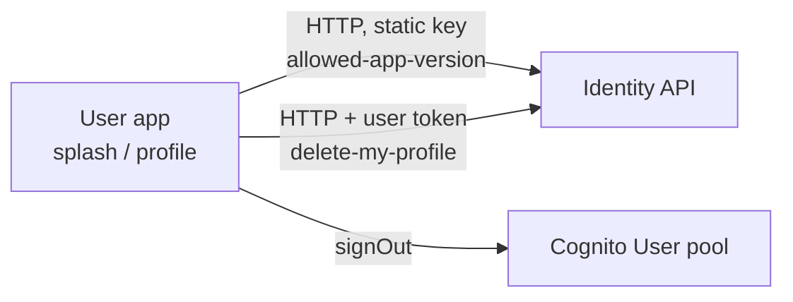

# X-11 · অ্যাকাউন্ট মুছে ফেলা ও অ্যাপ force-update

> **Bangla name:** অ্যাকাউন্ট মুছে ফেলা ও অ্যাপ force-update
>
> [← 60 · ক্রস-কাটিং](README.md) · [সূচিপত্র](../README.md) · [ওপেন কোয়ারি](../99-open-queries.md)

## 1. নাম ও উদ্দেশ্য

identity API-এর উপর নির্ভরশীল দুটি অ্যাপ-সাইড নিয়ন্ত্রণ:

- **অ্যাকাউন্ট মুছে ফেলা** (শুধু user app): গ্রাহক তার GoBCB প্রোফাইল মুছে ফেলেন এবং সাইন-আউট হয়ে যান।
- **force update** (user app ও checker app): অ্যাপ শুরু হওয়ার সময় নিজের ভার্সনটিকে প্রকাশিত ন্যূনতম ভার্সনের সঙ্গে তুলনা করে এবং
  গ্রাহক আপডেট করা পর্যন্ত ব্যবহার আটকে দেয়।

## 2. ট্রিগার ও অ্যাক্টর

| বিষয় | মান |
|---|---|
| অ্যাক্টর | গ্রাহক (অ্যাকাউন্ট মুছে ফেলা, force update); গেট কর্মী (checker app-এ force update) |
| ক্লায়েন্ট ও স্ক্রিন | User app Profile → Delete account (`ProfileViewModel.onDeleteAccount`); splash screen (`SplashViewModel._checkAppVersion`)। Checker app: splash ([X-12](X-12-checker-login.md)) |
| Cognito pool | User (অ্যাকাউন্ট মুছে ফেলা); কোনোটিই নয় (ভার্সন যাচাই) |

## 3. ব্যবসায়িক প্রবাহ

**অ্যাকাউন্ট মুছে ফেলা:** গ্রাহক নিশ্চিত করেন; প্রোফাইল মুছে যায়, অ্যাপ সাইন-আউট হয় এবং লগইন স্ক্রিন খোলে।
**Force update:** প্রকাশিত ভার্সন ইনস্টল করা ভার্সনের চেয়ে নতুন হলে একটি বন্ধ করা যায় না এমন "Update required" শিট এবং একটি
"Update now" বোতাম store লিঙ্ক খোলে; অ্যাপ splash screen পেরিয়ে এগোতে পারে না।

## 4. কারিগরি প্রবাহ

| # | থেকে → পর্যন্ত | লাফ | কী ঘটে |
|---|---|---|---|
| D1 | App → identity `DELETE user/delete-my-profile` | **[HTTP + user token]** (`ProfileApiClient`) | প্রোফাইল মুছে যায় (identity API) |
| D2 | App | `AuthRepositoryImpl.deleteUser` | `signOut()`, analytics `delete_user`, লোকাল ডেটা মোছে |
| V1 | App → identity `GET user/allowed-app-version` | **[HTTP, static key]** (`AuthApiClient`) | রেসপন্স `{ message, status, data: { up: { android, ios }, tc: { android, ios } } }`, প্রতিটি `{ version, buildNumber, appLink }` |
| V2 | App | `AppVersionMapper` | User app পড়ে `data.up.<platform>`; checker app পড়ে নিজের এন্ট্রি (`tc` = ticket checker, [X-12](X-12-checker-login.md) দেখুন) |
| V3 | App | `AppInfo.isUpdateRequired` | ডট-সেপারেটেড ভার্সনের অংশগুলো তুলনা করে; remote ও local ভার্সনের অংশের সংখ্যা আলাদা হলে আপডেট প্রয়োজন |

`AWSAmplifyService.deleteUser()` (Cognito self-delete) আছে কিন্তু কোথাও কোথাও বলা হয় না; অ্যাপ Cognito ব্যবহারকারীকে মুছে ফেলে না।

## 5. কম্পোনেন্ট

| ধরন | কম্পোনেন্ট |
|---|---|
| ক্লায়েন্ট | User app `ProfileViewModel`, `AuthRepositoryImpl`, `AuthApiServiceImpl.deleteUser`, `SplashViewModel`, `AppRepositoryImpl.getAppInfo`, `AppVersionMapper`, `domain/lib/model/app_info.dart` |
| বাহ্যিক | Identity API `[UNCONFIRMED: Q-01]` |

## 6. API কন্ট্র্যাক্ট

| Method | Path (identity API) | Auth | Request | Response | প্রধান ত্রুটি |
|---|---|---|---|---|---|
| DELETE | `user/delete-my-profile` | `Bearer` (User pool) | — | পড়া হয় না | পুনরায় ছুঁড়ে দেওয়া `BaseException` |
| GET | `user/allowed-app-version` | static header key | — | `AppVersionResponse` | `version` বা `buildNumber` অনুপস্থিত থাকলে mapper ছুঁড়ে দেয় "Version response is null"; splash সেটি ধরে ফেলে এগিয়ে যায় |

```json
// GET {identity}/user/allowed-app-version  (shape from AppVersionResponse)
{
  "message": "…",
  "status": "…",
  "data": {
    "up": { "android": { "version": "1.4.0", "buildNumber": 40, "appLink": "https://play.google.com/…" },
            "ios":     { "version": "1.4.0", "buildNumber": 40, "appLink": "https://apps.apple.com/…" } },
    "tc": { "android": { "version": "1.1.0", "buildNumber": 11, "appLink": "…" },
            "ios":     { "version": "1.1.0", "buildNumber": 11, "appLink": "…" } }
  }
}
```

## 7. ডেটা ও পার্শ্বপ্রতিক্রিয়া

Identity API: প্রোফাইল মোছে। গ্রাহকের মালিকানাধীন GoBCB ডেটা (`etp` স্কিমায় orders, tickets, issues) মুছে ফেলা হয় নাকি রাখা হয়,
তা কোনো GoBCB সার্ভিস সামলায় না `[UNCONFIRMED: Q-01]`।

## 8. কোড রেফারেন্স

| কী | কোথায় |
|---|---|
| অ্যাকাউন্ট মুছে ফেলা | `rvl-gobcb-user-app/lib/presentation/feature/profile/profile_view_model.dart:385-393`, `data/lib/repository/auth_repository_impl.dart:247-252`, `data/lib/remote/api_service/auth_api_service/auth_api_service_impl.dart:294-300` |
| ভার্সন যাচাই | `rvl-gobcb-user-app/lib/presentation/feature/splash/splash_view_model.dart`, `data/lib/repository/app_repository_impl.dart:88-115`, `data/lib/mapper/app_version_mapper.dart`, `domain/lib/model/app_info.dart:22` |
| রেসপন্স মডেল | `rvl-gobcb-user-app/data/lib/remote/response/app_version_response.dart` |

## 9. হ্যান্ডওভার নোট

1. **পোর্টালে `IdentityApiService`-এ `deleteUserProfile()` এবং তার effect আছে**, কিন্তু এটি শুরু করে এমন কোনো পোর্টাল স্ক্রিন পাওয়া যায়নি;
   অ্যাকাউন্ট মুছে ফেলা একটি অ্যাপ ফিচার।
2. **প্রোফাইল মুছে ফেললে Cognito ব্যবহারকারী মোছে না** — অ্যাপ কোডে (Amplify-এর `deleteUser()` অব্যবহৃত)। identity API এটি করে কি না
   জানা নেই `[UNCONFIRMED: Q-01]`।
3. **ভার্সন যাচাই ব্যর্থতা উপেক্ষা করা হয়** (অ্যাপ চলতে থাকে), তাই identity API না পৌঁছালেও স্টার্ট-আপ আটকায় না।

## 10. কম্পোনেন্ট সম্পর্ক



**নির্ভর করে:** [X-07](X-07-user-password-login.md)। **প্রভাব ফেলে:** [U-01](../30-user-app/U-01-splash-onboarding.md), [U-07](../30-user-app/U-07-profile-settings.md)।

## 11. ডেভেলপার টেস্ট গাইড

**লোকালভাবে পরীক্ষা: লোকালভাবে সম্ভব নয়।** `/identity`-এর উত্তর `scripts/mobile-gateway.js` 503 দেয়; splash error ধরে ফেলে এগিয়ে যায়,
তাই force-update শিট লোকালে কখনো আসে না। অ্যাকাউন্ট মুছে ফেলার জন্য সাইন-ইন করা ব্যবহারকারী লাগে (জানা ঘাটতি ১)।

| বিষয় | বিবরণ |
|---|---|
| টেস্ট ডেটা ও অ্যাকাউন্ট | — |
| ব্রাউজার | প্রযোজ্য নয় |
| এমুলেটর | `pwsh ./scripts/Setup-MobileApps.ps1 -App user -Run`; `flutter run` লগে ভার্সন কল ব্যর্থ হওয়া এবং অ্যাপ onboarding/Home-এ এগোনো দেখা যায় |
| Postman | কোনো collection-ই identity API কভার করে না |
| Visual Studio debug | প্রযোজ্য নয়; `SplashViewModel._checkAppVersion`-এ ধাপে ধাপে যেতে Flutter DevTools ব্যবহার করুন (`flutter run` যে URL দেখায়) |
| যাচাই | ডিপ্লয় করা environment-এ: identity API-তে বেশি `version` প্রকাশ করে অ্যাপ শুরু করুন |