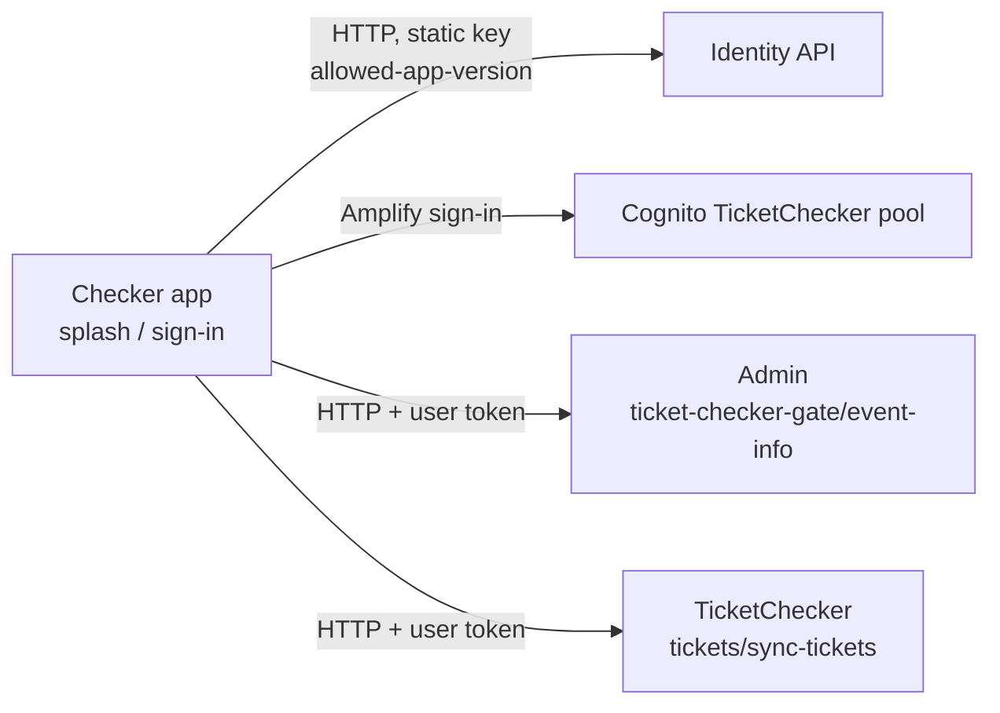

# X-12 · চেকার লগইন

> **Bangla name:** চেকার লগইন
>
> [← 60 · ক্রস-কাটিং](README.md) · [সূচিপত্র](../README.md) · [ওপেন কোয়ারি](../99-open-queries.md)

## 1. নাম ও উদ্দেশ্য

**চেকার লগইন।** গেট কর্মীরা checker app-এ সেই ফোন নম্বর ও পাসওয়ার্ড দিয়ে সাইন ইন করেন যা অ্যাডমিন পোর্টাল তাদের জন্য তৈরি করেছে
([X-05](X-05-admin-provisioning.md), [A-17](../10-admin-portal/A-17-ticket-checker-users.md))। অ্যাপ **TicketChecker** Cognito pool ব্যবহার করে।
সাইন ইনের আগে সেটি যাচাই করে যে ইনস্টল করা অ্যাপের ভার্সন এখনও অনুমোদিত আছে কি না।

## 2. ট্রিগার ও অ্যাক্টর

| বিষয় | মান |
|---|---|
| অ্যাক্টর | গেট কর্মী (টিকিট চেকার) |
| ক্লায়েন্ট ও স্ক্রিন | Checker app `/splash` → `/signIn` (`SignInViewModel.signInUser`) → `/eventPage` |
| Cognito pool | TicketChecker |
| রোল / প্রোগ্রাম স্কোপ | ব্যাকএন্ড এই pool-এর প্রতিটি টোকেনে `ticket-checker` রোল যোগ করে ([X-14](X-14-authz-pool-policies.md)) |

## 3. ব্যবসায়িক প্রবাহ

1. চালু হলে splash screen ভার্সন যাচাই করে এবং কোনো সেশন থাকলে সরাসরি event page খোলে।
2. অন্যথায় চেকার ফোন নম্বর (`+880` ছাড়া) ও পাসওয়ার্ড লেখেন।
3. অ্যাপ আবার ভার্সন যাচাই করে; আপডেট প্রয়োজন হলে একটি বাধা দেয় এমন "Update required" শিট আসে।
4. সফল হলে event page খোলে এবং নির্ধারিত ইভেন্ট ও গেট লোড করে ([C-01](../40-checker-app/C-01-assigned-event-gate.md))।
5. "Sign out" রয়েছে event page-এ।

## 4. কারিগরি প্রবাহ

| # | থেকে → পর্যন্ত | লাফ | কী ঘটে |
|---|---|---|---|
| 1 | App → identity `GET user/allowed-app-version` | **[HTTP, static key]** (`AuthApiClient`, হেডার `Authorization: <AUTH_API_TOKEN or empty>`) | পড়ে `data.tc.android` / `data.tc.ios` (`tc` = এই অ্যাপ; user app পড়ে `up`) |
| 2 | App → Cognito (TicketChecker pool) | Amplify Flutter `Amplify.Auth.signIn("+880…", password)` | পুরো সাইন ইন না হলে (যেকোনো challenge) সেশন `null` হয় |
| 3 | App → Admin, TicketChecker services | **[HTTP + user token]** (`TicketApiClient`, `fetchAuthSession` থেকে পাওয়া `Bearer <accessToken>`) | প্রথম কল: `GET /admin/api/v1/ticket-checker-gate/event-info` ([C-01](../40-checker-app/C-01-assigned-event-gate.md)) |
| 4 | সাইন আউট | event page থেকে `Amplify.Auth.signOut()` | লোকাল |

## 5. কম্পোনেন্ট

| ধরন | কম্পোনেন্ট |
|---|---|
| ক্লায়েন্ট | Checker app `SplashViewModel`, `SignInViewModel`, `AuthRepositoryImpl`, `AWSAmplifyService`, `AuthApiClient`, `TicketApiClient`, `EventPageViewModel` (sign out) |
| AWS | Cognito TicketChecker pool (`AMPLIFY_CONFIG`) |
| বাহ্যিক | Identity API (শুধু অ্যাপ ভার্সন) `[UNCONFIRMED: Q-01]` |

## 6. API কন্ট্র্যাক্ট

| Method | Path | Auth | Request | Response | প্রধান ত্রুটি |
|---|---|---|---|---|---|
| GET | `{AUTH_API_BASE_URL}/user/allowed-app-version` | static header key | — | `AppVersionResponse` ([X-11](X-11-delete-account-force-update.md) দেখুন) | — |
| — | Amplify-এর মাধ্যমে Cognito `InitiateAuth` | public client | phone, password | tokens | "Incorrect username or password." |

## 7. ডেটা ও পার্শ্বপ্রতিক্রিয়া

ডিভাইসে Amplify টোকেন সংরক্ষণ। লগইনের সময় ব্যাকএন্ড কিছু লেখে না।

## 8. কোড রেফারেন্স

| কী | কোথায় |
|---|---|
| সাইন ইন ও ভার্সন গেট | `rvl-gobcb-checker-app/lib/presentation/feature/sign_in/sign_in_view_model.dart` (`signInUser`) |
| Splash | `rvl-gobcb-checker-app/lib/presentation/feature/splash/splash_view_model.dart` |
| Cognito লগইন | `rvl-gobcb-checker-app/data/lib/service/aws_amplify_service.dart:35-62` |
| API ক্লায়েন্ট | `rvl-gobcb-checker-app/data/lib/remote/api_client/auth_api_client.dart`, `ticket_api_client.dart` |
| ভার্সন ম্যাপিং (`tc`) | `rvl-gobcb-checker-app/data/lib/mapper/app_version_mapper.dart:9-11` |
| আবশ্যক environment key | `rvl-gobcb-checker-app/lib/main/main.dart:14-18` (`VDS_CERTIFICATE`, `AMPLIFY_CONFIG`, `API_BASE_URL`) |

## 9. হ্যান্ডওভার নোট

1. **Debug build পাসওয়ার্ড লগ করে।** `AWSAmplifyService.login` `Logger.debug` দিয়ে `username` ও `password` লগ করে; লগিং কেবল তখনই
   চালু থাকে যখন `kDebugMode` সত্য (`main.dart`)। debug build-এর লগ শেয়ার করবেন না।
2. **`AUTH_API_BASE_URL` checker app-এর আবশ্যক তালিকায় নেই**; এটি না থাকলে ভার্সন যাচাই চলতে পারে না।
3. **অ্যাপে পাসওয়ার্ড পরিবর্তন বা রিসেট নেই।** চেকাররা অ্যাডমিনের কাছ থেকে নতুন পাসওয়ার্ড পান
   ([A-17](../10-admin-portal/A-17-ticket-checker-users.md)-এ "Set Password"); ব্যাকএন্ডে `PUT /admin/api/v1/ticket-checker/change-password`-ও আছে
   (চেকারের access token সহ body), কিন্তু কোনো ক্লায়েন্ট এটি কল করে না।
4. **নিষ্ক্রিয় অ্যাকাউন্ট:** অ্যাডমিন পোর্টালে কোনো চেকারকে নিষ্ক্রিয় করলে `AdminUserGlobalSignOut` কোনো সার্ভিসকে ডাকে না; অ্যাপ ইতিমধ্যে
   ডাউনলোড করা টিকিট নিয়ে অফলাইনে চলতে থাকে যতক্ষণ না সার্ভারের দরকার হয় ([C-02](../40-checker-app/C-02-offline-ticket-download.md))।

## 10. কম্পোনেন্ট সম্পর্ক

**নির্ভর করে:** [X-05](X-05-admin-provisioning.md), [A-17](../10-admin-portal/A-17-ticket-checker-users.md), [A-18](../10-admin-portal/A-18-gate-assignment.md)।
**প্রভাব ফেলে:** সব `C-xx` ফিচার।

## 11. ডেভেলপার টেস্ট গাইড

**লোকালভাবে পরীক্ষা: সাইন ইন লোকালভাবে সম্ভব নয়, ব্যাকএন্ড আংশিক।** Amplify Flutter-কে Floci-র দিকে নির্দেশ করা যায় না, তাই অ্যাপ লোকালে
সাইন ইন করতে পারে না (`docs/mobile-local.md` §৮, জানা ঘাটতি ১)। একটি Floci টোকেন দিয়ে চেকারের ব্যাকএন্ড কল পরীক্ষা করা যায়।

| বিষয় | বিবরণ |
|---|---|
| টেস্ট ডেটা ও অ্যাকাউন্ট | TicketChecker-pool ব্যবহারকারী `+8801700000021` / `Passw0rd!23`; এই ব্যবহারকারীর জন্য seeded gate ও gate staff (`docs/local-dev.md` §৭, "Match day") |
| ব্রাউজার | প্রযোজ্য নয় |
| এমুলেটর | `pwsh ./scripts/Setup-MobileApps.ps1 -App checker -Run`: সাইন-ইন স্ক্রিন খোলে; বাস্তব Cognito-র বিপরীতে সাইন ইন ব্যর্থ হয় |
| Postman | `postman/etp-login-all-pools.postman_collection.json` ফোল্ডার "Ticketchecker pool", "Login as ticket_checker" → `access_token_ticket_checker`; তারপর `postman/services/etp-ticketchecker.postman_collection.json` "POST /api/v1/tickets/sync-tickets" |
| Visual Studio debug | `ETP.Admin.Service`-এ attach করুন; `ticket-checker` scheme-এর `OnTokenValidated`-এ breakpoint (`DefaultAuthenticationConfig.cs:156`) এবং `GET /admin/api/v1/ticket-checker-gate/event-info` কল করুন |
| যাচাই | চেকার টোকেনে `event-info` থেকে 200; Admin-pool টোকেনে 401/403 |