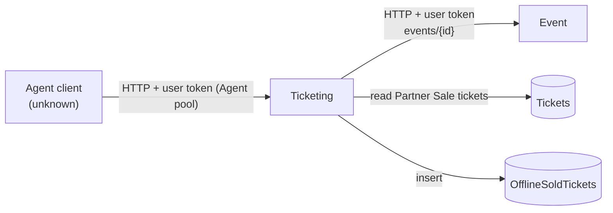

# X-13 · এজেন্ট pool ও অফলাইনে বিক্রি টিকিট

> **Bangla name:** এজেন্ট pool ও অফলাইনে বিক্রি টিকিট
>
> [← 60 · ক্রস-কাটিং](README.md) · [সূচিপত্র](../README.md) · [ওপেন কোয়ারি](../99-open-queries.md)

## 1. নাম ও উদ্দেশ্য

**এজেন্ট pool।** বিক্রেতা এজেন্টদের (অফলাইন টিকিট বিক্রেতা) চতুর্থ একটি Cognito pool, **Agent**,-এ অ্যাকাউন্ট আছে। তাদের একমাত্র API
রেকর্ড করে যে আগে থেকে ছাপা **partner-sale** টিকিট বিক্রি হয়েছে, চাইলে ক্রেতার ফোন নম্বরসহ। পাঁচটি রিপোজিটরির কোনো ক্লায়েন্ট Agent pool দিয়ে
সাইন ইন করে না বা এই API কল করে না `[UNCONFIRMED: Q-07]`।

## 2. ট্রিগার ও অ্যাক্টর

| বিষয় | মান |
|---|---|
| অ্যাক্টর | বিক্রেতা এজেন্ট (অ্যাডমিন পোর্টালে তৈরি অ্যাকাউন্ট, [A-26](../10-admin-portal/A-26-agent-users.md)) |
| ক্লায়েন্ট | অজানা `[UNCONFIRMED: Q-07]` |
| Cognito pool | Agent |
| রোল / প্রোগ্রাম স্কোপ | ব্যাকএন্ড এই pool-এর টোকেনে `agent` রোল যোগ করে ([X-14](X-14-authz-pool-policies.md)) |

## 3. ব্যবসায়িক প্রবাহ

1. পার্টনার রিজার্ভেশনের জন্য অ্যাডমিন পোর্টালে পার্টনার টিকিট জেনারেট হয় ([A-11](../10-admin-portal/A-11-seat-reservation.md),
   [A-12](../10-admin-portal/A-12-reserved-tickets.md)); সেগুলোর টিকিট টাইপ `Partner Sale`।
2. এজেন্ট সেগুলোর কিছু অফলাইনে বিক্রি করে এবং টিকিট নম্বর (স্ক্যান করা QR বা টাইপ করা) ও ক্রেতার ফোন/আইডি (সর্বোচ্চ ২০ অক্ষর) দিয়ে
   বিক্রয়টি রেকর্ড করে।
3. প্ল্যাটফর্ম সেই টিকিটগুলো প্রত্যাখ্যান করে যা partner-sale টিকিট নয়, যেগুলো আগেই রেকর্ড হয়েছে, বা যেগুলোর ইভেন্ট তার টিকিট বিক্রির সময়সীমা
   পেরিয়ে গেছে।

## 4. কারিগরি প্রবাহ

| # | থেকে → পর্যন্ত | লাফ | কী ঘটে |
|---|---|---|---|
| 1 | Agent client → Ticketing `POST /ticketing/api/v1/offline-sold-ticket` | **[HTTP + user token]** (Agent pool) | `Policy = agent` |
| 2 | Ticketing → database | **[Shared table]** | `OfflineSoldTickets`-এ আগে থেকে থাকা নম্বর প্রত্যাখ্যান; `Tickets` থেকে এমনগুলো লোড করে যেখানে `TicketNumber` তালিকায় আছে এবং `TicketType == "Partner Sale"`; কোনোটি না থাকলে → 400 "Invalid QR \|\| …" |
| 3 | Ticketing → Event প্রতিটি আলাদা ইভেন্টের জন্য `GET /event/api/v1/events/{eventId}` | **[HTTP + user token]** (টোকেন ফরোয়ার্ডিং) | `TicketSellingStopDateTime < UtcNow` হলে প্রত্যাখ্যান |
| 4 | Ticketing → database | — | প্রতি টিকিটের জন্য একটি `OfflineSoldTickets` রো ঢোকায় (`UserId` = এজেন্টের `sub`) |

## 5. কম্পোনেন্ট

| ধরন | কম্পোনেন্ট |
|---|---|
| সার্ভিস | Ticketing: `OfflineTicketSoldController` → `OfflineSoldTicketManager` → `TicketRepository`, `OfflineSoldTicketRepository`; `IEventClient` |
| সার্ভিস | Event (event details) |
| AWS | Cognito Agent pool |
| ডেটা | `etp."Tickets"` (পড়া), `etp."OfflineSoldTickets"` (লেখা) |

## 6. API কন্ট্র্যাক্ট

| Method | Path | Auth | Request DTO | Response | প্রধান ত্রুটি (400) |
|---|---|---|---|---|---|
| POST | `/ticketing/api/v1/offline-sold-ticket` | `Policy = agent` | `OfflineSoldTicketCreateRequest { TicketNumbers: string[], TicketHolderIdentification?: string }` | `{ "message": "Offline sold tickets created successfully." }` | "The following ticket is already sold: …", "Invalid QR \|\| This ticket can not be sold: …", "Phone no must not exceed 20 characters.", "Ticket requests are no longer available as the ticket selling period of … has ended." |

```json
// POST /ticketing/api/v1/offline-sold-ticket
{ "ticketNumbers": ["BDI-000123", "BDI-000124"], "ticketHolderIdentification": "+8801711111111" }

// 200
{ "message": "Offline sold tickets created successfully." }
```

উপরের টিকিট নম্বরগুলো কেবল আকৃতি বোঝানোর জন্য; আসল নম্বরে প্রোগ্রামের টিকিট প্রিফিক্স ব্যবহার হয় ([A-03](../10-admin-portal/A-03-program-settings.md))।

## 7. ডেটা ও পার্শ্বপ্রতিক্রিয়া

প্রতি টিকিটের জন্য একটি `OfflineSoldTickets` রো (event, gallery/block/level, reservation id ও public id, ticket number, holder id,
agent id, `CreatedAt`)। আর কিছু বদলায় না: টিকিট নিজে এবং তার রিজার্ভেশন আপডেট হয় না।

## 8. কোড রেফারেন্স

| কী | কোথায় |
|---|---|
| Controller | `rvl-gobcb-backend/Services/Ticketing/ETP.Ticketing.Service/Api/OfflineTicketSoldController.cs:30-41` |
| Manager | `rvl-gobcb-backend/Services/Ticketing/ETP.Ticketing.Domain/Managers/OfflineSoldTicketManager.cs:21-132` |
| Partner-sale ফিল্টার | `rvl-gobcb-backend/Services/Ticketing/ETP.Ticketing.Storage/Repositories/TicketRepository.cs:36-40` |
| Entity | `rvl-gobcb-backend/Services/Ticketing/ETP.Ticketing.Storage/Models/OfflineSoldTicket.cs` |
| Agent pool scheme | `rvl-gobcb-backend/Core/ETP.Core/Configuration/DefaultAuthenticationConfig.cs:173-214` |

## 9. হ্যান্ডওভার নোট

1. **কোনো জানা ক্লায়েন্ট নেই।** পোর্টাল বা অ্যাপ কোনোটিই Agent pool ব্যবহার করে না; আর্কিটেকচার ডকুমেন্টও ক্লায়েন্টকে "not found" হিসেবে তালিকাভুক্ত করে
   `[UNCONFIRMED: Q-07]`।
2. **এজেন্ট অ্যাকাউন্ট ব্যবস্থাপনা অ্যানোনিমাস** — Admin সার্ভিসে ([X-05](X-05-admin-provisioning.md), [X-18](X-18-endpoints-without-auth.md))।
3. **কোনো read API নেই।** ব্যাকএন্ডে কোথাও `OfflineSoldTickets` ফিরিয়ে পড়া হয় না (কোনো রিপোর্ট নেই, কোনো অ্যাডমিন স্ক্রিন নেই) `[UNCONFIRMED: Q-07]`।
4. **Event-এ টোকেন ফরোয়ার্ডিং:** Event endpoint-এ কোনো `[Authorize]` নেই, তাই ফরোয়ার্ড করা Agent টোকেন সেখানে যাচাই করা হয় না।

## 10. কম্পোনেন্ট সম্পর্ক



**নির্ভর করে:** [A-26](../10-admin-portal/A-26-agent-users.md), [A-11](../10-admin-portal/A-11-seat-reservation.md), [A-12](../10-admin-portal/A-12-reserved-tickets.md)।
**প্রভাব ফেলে:** যেকোনো কিছু নয় যা এটি ফিরিয়ে পড়ে (নোট দেখুন)।

## 11. ডেভেলপার টেস্ট গাইড

**লোকালভাবে পরীক্ষা: আংশিক।** endpoint ও Agent-pool লগইন লোকালে কাজ করে; কোনো `Partner Sale` টিকিট বা এজেন্ট-বিক্রৃত টিকিট seeded নেই
(`docs/local-dev.md` §৭, "What this does not cover"), তাই সফল কলের জন্য আগে একটি পার্টনার রিজার্ভেশন তৈরি করতে হবে
([A-11](../10-admin-portal/A-11-seat-reservation.md))।

| বিষয় | বিবরণ |
|---|---|
| টেস্ট ডেটা ও অ্যাকাউন্ট | Agent-pool ব্যবহারকারী `+8801700000031` / `Passw0rd!23` (`floci/seed-users.ps1`) |
| ব্রাউজার | প্রযোজ্য নয় |
| এমুলেটর | প্রযোজ্য নয় |
| Postman | `postman/etp-login-all-pools.postman_collection.json` "Agent pool" → "Login as agent" (`access_token_agent`); `postman/services/etp-ticketing.postman_collection.json` ফোল্ডার "OfflineTicketSold", "POST /api/v1/offline-sold-ticket" |
| Visual Studio debug | `ETP.Ticketing.Service`-এ attach করুন; `OfflineSoldTicketManager.cs:21`-এ breakpoint |
| যাচাই | `select "TicketNumber","UserId","TicketHolderIdentification" from etp."OfflineSoldTickets" order by "Id" desc;` |