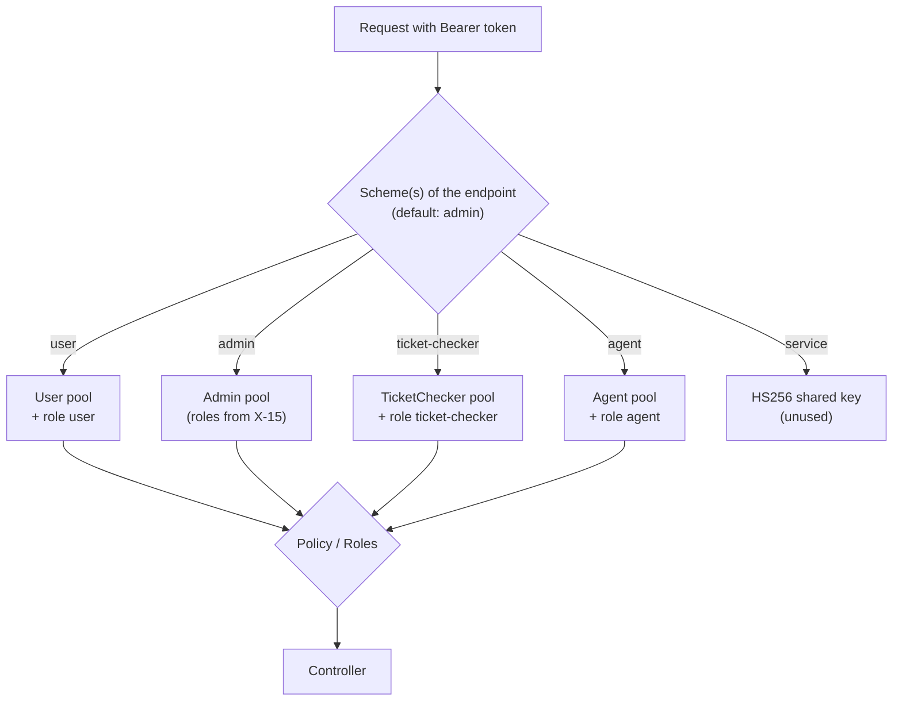

# X-14 · অথরাইজেশন স্তর ১: pool স্কিম ও পলিসি

> **Bangla name:** অথরাইজেশন স্তর ১: pool স্কিম ও পলিসি
>
> [← 60 · ক্রস-কাটিং](README.md) · [সূচিপত্র](../README.md) · [ওপেন কোয়ারি](../99-open-queries.md)

## 1. নাম ও উদ্দেশ্য

**Pool স্কিম ও পলিসি।** প্রতিটি সার্ভিস bearer token নিজেই যাচাই করে। প্রতি Cognito pool-এর জন্য একটি করে JWT **authentication scheme**
(`user`, `admin`, `ticket-checker`, `agent`) আছে, তার সঙ্গে একটি পঞ্চম স্কিম (`service`) shared-key টোকেনের জন্য। একটি endpoint
`[Authorize(Policy = AuthScheme.X)]` দিয়ে জানায় সে কোন pool গ্রহণ করে, অথবা কেবল রোলের নাম দিলে অন্তর্জত ভাবে Admin pool। এটি চারটি
অথরাইজেশন স্তরের প্রথম (architecture §2.4); রোল হলো [X-15](X-15-authz-roles.md), প্রোগ্রাম স্কোপ হলো
[X-16](X-16-authz-program-scope.md)।

## 2. ট্রিগার ও অ্যাক্টর

`Authorization: Bearer …` হেডারসহ প্রতিটি API request, সেই প্রতিটি সার্ভিসে যেখানে `AddJwtBearerAuthentication` ও
`UseAuthentication` আছে (Platform, PushNotification ও UserAuth ছাড়া সবগুলো — এখানে `UseAuthentication`/`UseAuthorization` comment করা)।

## 3. ব্যবসায়িক প্রবাহ

ব্যবহারকারীর চোখে পড়ে না। গ্রাহকের টোকেন কোনো admin endpoint খুলতে পারে না, চেকারের টোকেন কোনো গ্রাহক endpoint খুলতে পারে না, এবং তেমনি।

## 4. কারিগরি প্রবাহ

| # | ধাপ | বিবরণ |
|---|---|---|
| 1 | টোকন পড়া | endpoint-এর প্রয়োজনীয় scheme-এর `JwtBearer` handler। Default scheme (যখন endpoint কোনোটির নাম দেয় না) হলো **`admin`** (`DefaultAuthenticateScheme = AuthScheme.Admin`) |
| 2 | যাচাই | Issuer = `AWS:CognitoPool:<Pool>:Authority`; signature keys আসে `AWS:CognitoPool:<Pool>:Metadata` থেকে (OIDC metadata); lifetime; **`client_id` claim-এর উপর audience check**, `AWS:CognitoPool:<Pool>:ClientId`-এর বিপরীতে (কমা-সেপারেটেড তালিকা গ্রহণযোগ্য)। Cognito access token-এ `client_id` থাকে, `aud` নয় |
| 3 | `OnTokenValidated` | claim যোগ করে `AppClaimTypes.AccessToken` (raw token, পরে টোকেন ফরোয়ার্ডিংয়ে ব্যবহৃত, [X-19](X-19-service-to-service.md))। প্রতি pool-এর জন্য একটি নির্দিষ্ট role claim যোগ করে: `user` → `user`, `ticket-checker` → `ticket-checker`, `agent` → `agent`। `admin` স্কিম **কোনো** রোল যোগ করে না (এটি আসে [X-15](X-15-authz-roles.md) থেকে) |
| 4 | চ্যাট হাব | `user` ও `admin` স্কিম query string-এ `?access_token=`-ও গ্রহণ করে, কেবল `/userissue/chathub` বা `/admin/chathub` দিয়ে শুরু হওয়া path-এর জন্য (SignalR WebSockets হেডার পাঠাতে পারে না) |
| 5 | পলিসি | `AuthorizationConfig`: পলিসি `admin` = scheme `admin` দিয়ে authenticated; `user` / `ticket-checker` / `agent` = ঐ scheme দিয়ে authenticated **এবং** একই নামের role claim; `service` = scheme `service` + role `service` |
| 6 | ফলাফল | টোকন নেই/অবৈধ → 401 (ফাঁকা body)। অন্য pool-এর বৈধ টোকেন → ঐ scheme-এর জন্য 401 (issuer mismatch) অথবা পলিসির role claim না থাকলে 403 |

**প্রতিটি সার্ভিসের endpoint কোন pool গ্রহণ করে** (attribute থেকে; সম্পূর্ণ তালিকা [Appendix B](../91-appendix-b-endpoint-index.md)-তে):

| সার্ভিস | গৃহীত pool |
|---|---|
| Admin | Admin (role-based, default scheme); `ticket-checker-gate`-এ TicketChecker (ক্লাসে scheme `admin,ticket-checker` গ্রহণ করে); legacy `user-issue` মেথডে User (Appendix A); অনেক endpoint কোনোটিই নয় ([X-18](X-18-endpoints-without-auth.md)) |
| Booking | গ্রাহকের order endpoint-এ User (`Policy = user`); admin order lookup ও দুটি seat-reservation endpoint-এ Admin (`Policy = admin`, কোনো role check নেই); বাকি সব কোনোটিই নয় |
| Ticketing | টিকিট অ্যাকশনে User; reserved tickets ও signed cookie/token-এ Admin; `offline-sold-ticket`-এ Agent; বাকি সব কোনোটিই নয় |
| UserIssue | নিজের issue তৈরি/পড়ায় User; সাপোর্ট পাশে Admin (কোনো role check নেই); chat REST endpoint কোনোটিই নয়; হাব: `user` বা `admin` স্কিম |
| TicketChecker | `tickets/sync-tickets`-এ TicketChecker |
| Event, PushNotification, Scheduler, Utility, Platform | কোনোটিই নয় |

## 5. কম্পোনেন্ট

| ধরন | কম্পোনেন্ট |
|---|---|
| কোড | `Core/ETP.Core/Configuration/DefaultAuthenticationConfig.cs` (স্কিম), `Core/ETP.Core/Configuration/AuthorizationConfig.cs` (পলিসি), `Core/ETP.Core/Constant/AppConstant.cs` (`AuthScheme`, `Role`) |
| কনফিগ | `AWS:CognitoPool:{User,Admin,TicketChecker,Agent}:{PoolId,ClientId,Authority,Metadata}`, `Authentication:Jwt:{Key,Issuer,Audience}` |
| AWS | প্রতি pool-এর জন্য Cognito OIDC metadata / JWKS |

## 6. API কন্ট্র্যাক্ট

এটি কোনো endpoint নয়। হেডার কন্ট্রাক্ট: `Authorization: Bearer <Cognito access token>` (ID token প্রত্যাখ্যাত হয় কারণ সেগুলোতে `aud` থাকে,
`client_id` নয়; Postman-এর "ID token instead of access token" request এটি দেখায়)। SignalR-এর জন্য: `?access_token=<token>`।

## 7. ডেটা ও পার্শ্বপ্রতিক্রিয়া

কোনোটি নয়। যাচাই করা টোকন ফরোয়ার্ডিংয়ের জন্য একটি claim হিসেবে রাখা হয়।

## 8. কোড রেফারেন্স

| কী | কোথায় |
|---|---|
| স্কিম, `client_id` audience check, role claim, চ্যাট-হাব query টোকন | `rvl-gobcb-backend/Core/ETP.Core/Configuration/DefaultAuthenticationConfig.cs:16-246` |
| পলিসি | `rvl-gobcb-backend/Core/ETP.Core/Configuration/AuthorizationConfig.cs:13-38` |
| কনস্ট্যান্ট | `rvl-gobcb-backend/Core/ETP.Core/Constant/AppConstant.cs:40-62` |
| রেজিস্ট্রেশনের উদাহরণ | `rvl-gobcb-backend/Services/Admin/ETP.Admin.Service/Program.cs:38-39`, `:86-87`, `:109-110` |

## 9. হ্যান্ডওভার নোট

1. **`Policy = admin` মানে "যেকোনো Admin-pool ব্যবহারকারী"।** Booking, Ticketing ও UserIssue এটি রোল ছাড়াই ব্যবহার করে, তাই উদাহরণ হিসেবে
   একজন `customer_support` ব্যবহারকারী Ticketing-এর reserved-ticket endpoint ডাকতে পারেন (architecture §2.5, observation 1)।
2. **Default scheme হলো `admin`।** কেবল `[Authorize(Roles = …)]` থাকা একটি endpoint Admin pool দিয়ে authenticate করে; সেখানে একটি User টোকন
   403 নয়, 401 পায়।
3. **`service` স্কিম অব্যবহৃত।** `GET /admin/api/v1/token` এর জন্য HS256 টোকন ইস্যু করে, কিন্তু কোনো endpoint `Policy = service` চায় না
   ([X-18](X-18-endpoints-without-auth.md), architecture §2.3)।
4. API Gateway সার্ভিসগুলোর আগে টোকন যাচাই করে কি না তা যাচাই করা হয়নি (architecture Q1, Q1b)।
5. যেসব সার্ভিস authenticate করে না (PushNotification, Event, Scheduler, Utility, Platform), তারা কে কল করছে তা জানতে পারে না।

## 10. কম্পোনেন্ট সম্পর্ক

**নির্ভর করে:** Cognito pool, কনফিগারেশন ([X-26](X-26-configuration.md))। **প্রভাব ফেলে:** টোকেন-সুরক্ষিত প্রতিটি ফিচার।

## 11. ডেভেলপার টেস্ট গাইড

**লোকালভাবে পরীক্ষা: সম্পূর্ণ।** Floci চারটি pool-ই দেয়; `scripts/Set-EtpSecrets.ps1` `Authority`/`Metadata` লেখে (`etp-floci-tls` proxy-এর মাধ্যমে
HTTPS, `docs/local-dev.md` Step 3)।

| বিষয় | বিবরণ |
|---|---|
| টেস্ট ডেটা ও অ্যাকাউন্ট | প্রতি pool-এ একজন ব্যবহারকারী: admin `…01`–`…05`, user `…11`, checker `…21`, agent `…31` (`floci/seed-users.ps1`) |
| ব্রাউজার | প্রয়োজন নেই |
| এমুলেটর | প্রয়োজন নেই |
| Postman | `postman/etp-cognito-auth.postman_collection.json` ফোল্ডার "04 - Backend JWT validation (Admin scheme)": "No token", "Malformed bearer token", "Forged token (wrong signing key)", "Tampered signature on real token", "ID token instead of access token", "access_token query string (only honoured on chathub paths)", "Valid admin access token"। Cross-pool পরীক্ষা: `access_token_admin` দিয়ে `postman/services/etp-booking.postman_collection.json`-এর একটি `Policy = user` request কল করুন → 401 |
| Visual Studio debug | যেকোনো সার্ভিসে attach করুন; `DefaultAuthenticationConfig.cs`-এর `AudienceValidator` lambda ও `OnTokenValidated` handler-এ breakpoint |
| যাচাই | `pwsh ./scripts/Test-EtpLocal.ps1` টোকন ছাড়া 401 এবং Admin টোকন সহ 200 যাচাই করে |