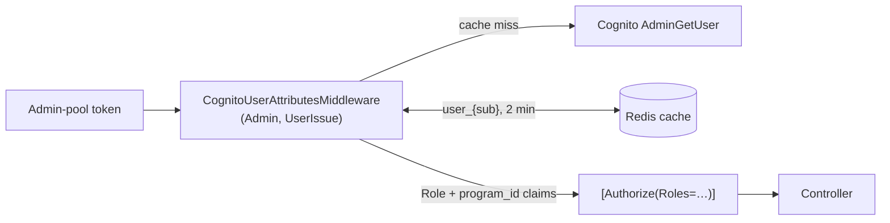

# X-15 · অথরাইজেশন স্তর ২–৩: স্টাফ রোল

> **Bangla name:** অথরাইজেশন স্তর ২–৩: স্টাফ রোল
>
> [← 60 · ক্রস-কাটিং](README.md) · [সূচিপত্র](../README.md) · [ওপেন কোয়ারি](../99-open-queries.md)

## 1. নাম ও উদ্দেশ্য

**স্টাফ রোল।** Admin-pool ব্যবহারকারীরা তাদের রোল Cognito attribute `custom:role`-এ (কমা-সেপারেটেড) বহন করে। Admin ও UserIssue সার্ভিস
প্রতিটি request-এ সেই attribute-কে role claim-এ রূপান্তর করে (স্তর ২) এবং কন্ট্রোলার `[Authorize(Roles = …)]` দিয়ে রোল অনুযায়ী অনুমতি দেয় বা
আটকায় (স্তর ৩)। এই ফাইল পদ্ধতিটি ব্যাখ্যা করে এবং Admin সার্ভিসের **রোল × কন্ট্রোলার ম্যাট্রিক্স** দেয়।

## 2. ট্রিগার ও অ্যাক্টর

Admin-pool টোকেনসহ Admin বা UserIssue সার্ভিসে আসা প্রতিটি request।

| রোলের মান | কোড কনস্ট্যান্ট | অর্থ (মেনু ও কন্ট্রোলার থেকে) |
|---|---|---|
| `admin` | `Role.Admin` | পূর্ণ administrator |
| `event_manager` | `Role.EventManager` | programs, venues, events, notices, raffle, gate assignment |
| `ticket_manager` | `Role.TicketManager` | events, ticket layouts/attributes, ticket checkers, reserved-ticket generation |
| `ticket_operator` | `Role.BCBPersonnel` | BCB personnel: dashboard, events, reports, reserved-ticket generation |
| `customer_support` | `Role.CustomerSupportAdmin` | customer issues |

## 3. ব্যবসায়িক প্রবাহ

একজন administrator অ্যাডমিন পোর্টালে কোনো কর্মীকে এক বা একাধিক রোল (ও প্রোগ্রাম) দেন ([X-05](X-05-admin-provisioning.md))। এরপর থেকে ঐ কর্মী
সেই অনুযায়ী মেনু দেখেন ([X-17](X-17-authz-client-side.md)) এবং ব্যাকএন্ড কেবল সেই অনুযায়ী endpoint-গুলো অনুমতি দেয়।

## 4. কারিগরি প্রবাহ

| # | ধাপ | বিবরণ |
|---|---|---|
| 1 | Authenticate | Default scheme `admin` টোকন যাচাই করে ([X-14](X-14-authz-pool-policies.md)) |
| 2 | Enrich | `CognitoUserAttributesMiddleware` (শুধু Admin ও UserIssue-এ রেজিস্টার করা): `sub` পড়ে; `scope` claim থেকে pool বাছে (`aws.cognito.signin.user.admin` → Admin pool); ক্যাশ `User`, key `user_{sub}`-এর মাধ্যমে Cognito `AdminGetUser(pool, sub)` কল করে; `custom:role`-এর প্রতিটি কমা-সেপারেটেড মানের জন্য একটি করে `ClaimTypes.Role` claim এবং `custom:program_ids`-এর প্রতিটি মানের জন্য একটি করে `program_id` claim যোগ করে |
| 3 | Authorize | `[Authorize(Roles = "a,b")]` পাস করে যদি ব্যবহারকারীর তালিকাভুক্ত কোনো একটি রোল থাকে। ক্লাস ও মেথডের দুটি attribute-ই প্রযোজ্য (logical AND) |
| 4 | ব্যর্থতা | রোল নেই → 403। Enrichment-এর ত্রুটি লগ হয়ে উপেক্ষা হয়, তাই request রোল ছাড়া চলতে থাকে এবং শেষে 403 হয় |

**ক্যাশ:** `ICacheManager` একটি distributed (Redis) ক্যাশ, যার প্রতিটি ক্যাশের default absolute expiry **২ মিনিট**
(`Core/ETP.Core/Configuration/CacheConfig.cs:13`, `:40-43`)। Admin সার্ভিস কোনো কর্মী ব্যবহারকারীকে আপডেট বা মুছে ফেলার সময় `user_{id}` সরায়
([X-05](X-05-admin-provisioning.md))।

### রোল × কন্ট্রোলার ম্যাট্রিক্স (Admin সার্ভিস)

✔ = কন্ট্রোলার attribute অনুমতি দেয়; ✔* = নোট দেখুন; — = অনুমতি দেয় না; "open" = কোডে কোনো authorization নেই ([X-18](X-18-endpoints-without-auth.md))।

| কন্ট্রোলার (route) | admin | event_manager | ticket_manager | ticket_operator | customer_support | নোট |
|---|---|---|---|---|---|---|
| `activity-log` | ✔ | ✔ | — | — | — | |
| `admin-users` | ✔ | — | — | — | — | `forget-password`, `set-forget-password` open |
| `agent-users` | open | open | open | open | open | কোনো `[Authorize]` নেই |
| `block-level-entry-gate` | ✔ | — | — | — | — | অন্য সার্ভিস ডাকে ([X-19](X-19-service-to-service.md)) |
| `currency` | open | | | | | অন্তর্দৃষ্টিহীন (Appendix A) |
| `dashboard` | ✔ | — | — | ✔ | — | এছাড়া `[AuthorizeProgram]` ([X-16](X-16-authz-program-scope.md)) |
| `discount` | ✔ | — | — | — | — | `program/{p}/{e}/{g}` open |
| `events` | ✔ | ✔ | ✔ | ✔ | — | `[AuthorizeProgram]` comment করা |
| `event-settings` | open | | | | | |
| `eventsVenueDetails` | ✔ | ✔ | ✔ | ✔ | — | |
| `gallery` | ✔ | — | — | — | — | অন্তর্দৃষ্টিহীন (Appendix A) |
| `general-notice` | ✔ | ✔ | — | — | — | `public` open |
| `header-footer` | open | | | | | GET এবং PUT |
| `landing-page-image` | ✔ | ✔ | — | — | — | `public` open |
| `portal-users` | open | | | | | internal ([X-19](X-19-service-to-service.md)) |
| `program` | ✔ | ✔ | ✔ | ✔ | ✔ | |
| `program-settings`, `programVenue`, `programVenueDetails`, `teams`, `venues` | ✔ | ✔ | — | — | — | |
| `promo-codes` | ✔ | — | — | — | — | |
| `raffle-draw` | ✔ | ✔ | — | — | — | |
| `social-media-settings`, `system-settings` | ✔ | — | — | — | — | |
| `ticket-attributes`, `ticket-layout` | ✔ | ✔ | ✔ | ✔ | — | |
| `ticket-checker` | ✔ | ✔ | ✔ | ✔ | — | `search`: শুধু admin, event_manager |
| `ticket-checker-gate` | ✔ | ✔ | — | ✔ | — | scheme `admin,ticket-checker`; রোল `ticket-checker`-ও গ্রহণযোগ্য ✔*; `GET {eventId}` ও `POST` শুধু admin/event_manager; `event-info` শুধু checker |
| `ticket-pricing` | open | | | | | admin content টোকেন ছাড়াই পরিচালিত হয় |
| `token` | open | | | | | service token issuer (অব্যবহৃত path) |
| `user-issue` | ✔ | — | — | — | ✔ | legacy (Appendix A) |
| `user-issue-chat` | open | | | | | legacy (Appendix A) |

✔* **`ticket-checker-gate`-এ চেকার টোকেন:** ক্লাস attribute TicketChecker scheme ও রোল `ticket-checker` গ্রহণ করে, তাই একটি চেকারের টোকন এই কন্ট্রোলারের
প্রতিটি মেথড কল করতে পারে যেখানে কঠোরতর মেথড attribute নেই — `force-assign`, `force-unassign`, `update-download-status`, `remove-user`,
`report`, `export`, `duplicate-tickets` ও `manual-entry-tickets` সহ।

**Admin সার্ভিসের বাইরে** রোল যাচাই করা হয় না: Booking, Ticketing ও UserIssue `Policy = admin` ব্যবহার করে, যা যেকোনো Admin-pool
ব্যবহারকারী গ্রহণ করে ([X-14](X-14-authz-pool-policies.md))।

## 5. কম্পোনেন্ট

| ধরন | কম্পোনেন্ট |
|---|---|
| কোড | `Core/ETP.Core/Middleware/CognitoUserAttributesMiddleware.cs`, `Core/ETP.Core/Constant/AppConstant.cs:49-62`, `Services/Admin/ETP.Admin.Service/Api/`-এর কন্ট্রোলার |
| AWS | Cognito Admin pool (static IAM key সহ `AdminGetUser`) |
| ক্যাশ | Redis, ক্যাশ `User`, key `user_{sub}`, ২ মিনিট |

## 6. API কন্ট্র্যাক্ট

এটি কোনো endpoint নয়। role claim কেবল সার্ভারে দৃশ্যমান।

## 7. ডেটা ও পার্শ্বপ্রতিক্রিয়া

প্রতি ক্যাশ miss-এ প্রতি ২ মিনিটে প্রতি ব্যবহারকারীর জন্য একটি Cognito `AdminGetUser` কল।

## 8. কোড রেফারেন্স

| কী | কোথায় |
|---|---|
| Middleware (scope থেকে pool, attribute → claim) | `rvl-gobcb-backend/Core/ETP.Core/Middleware/CognitoUserAttributesMiddleware.cs:34-140` |
| রেজিস্ট্রেশন (Admin) | `rvl-gobcb-backend/Services/Admin/ETP.Admin.Service/Program.cs:90` |
| রেজিস্ট্রেশন (UserIssue) | `rvl-gobcb-backend/Services/UserIssue/ETP.UserIssue.Service/Program.cs:75` |
| ক্যাশ expiry | `rvl-gobcb-backend/Core/ETP.Core/Configuration/CacheConfig.cs:13-45` |
| Checker gate কন্ট্রোলারের attribute | `rvl-gobcb-backend/Services/Admin/ETP.Admin.Service/Api/TicketCheckerGateController.cs:23-24`, `:72` |

## 9. হ্যান্ডওভার নোট

1. **scope দিয়ে pool বাছাই কাকতালীয়ভাবে কাজ করে।** `aws.cognito.signin.user.admin` হলো SDK সাইন-ইন থেকে আসা প্রতিটি Cognito access টোকেনের
   standard scope, তাই middleware সবসময় Admin pool-এই দেখে। এটি কেবল এ কারণেই সঠিক যে default scheme `admin`: অন্য pool-এর টোকেন default scheme
   দিয়ে কখনো authenticate হয় না, তাই middleware সেগুলো দেখেই না (architecture §2.5, observation 2)।
2. **রোল পরিবর্তনের প্রভাব ২ মিনিটের মধ্যে দেখা যায়** (ক্যাশ), পরিবর্তন করা Admin ইন্সট্যান্সে সঙ্গে সঙ্গে, এবং কেবল পোর্টাল তার নিজের
   ৫৫ মিনিটের ক্যাশ রিফ্রেশ করার পর ([X-17](X-17-authz-client-side.md))।
3. **`ticket_manager` gate পরিচালনা করতে পারে না** (`ticket-checker-gate` এতে নেই), যদিও মেনুতে gate events-এর সঙ্গে গ্রুপ করা আছে।
4. **admin gate অপারেশনে চেকার টোকেন গ্রহণ করা হয়** (উপরে ✔*)। এটি কি ইচ্ছাকৃত, তা পর্যালোচনা করুন।
5. Admin-এ middleware-এর ক্রম: `UseAuthentication` → `UseAuthorization` → `ProgramIdMiddleware` → `CognitoUserAttributesMiddleware`
   → … → `UseRouting` → `UseAuthentication` → `UseAuthorization`। Endpoint authorization চলে দ্বিতীয় জোড়ায়, claim যোগ হওয়ার পরে।
   `Program.cs` ছুঁলে এই ক্রম রাখুন।

## 10. কম্পোনেন্ট সম্পর্ক

**নির্ভর করে:** [X-05](X-05-admin-provisioning.md), [X-14](X-14-authz-pool-policies.md), [X-25](X-25-redis.md)।
**প্রভাব ফেলে:** প্রতিটি `A-xx` ফিচার; [X-16](X-16-authz-program-scope.md) (`program_id` claim ব্যবহার করে)।

## 11. ডেভেলপার টেস্ট গাইড

**লোকালভাবে পরীক্ষা: সম্পূর্ণ।**

| বিষয় | বিবরণ |
|---|---|
| টেস্ট ডেটা ও অ্যাকাউন্ট | Admin-pool-এর পাঁচজন ব্যবহারকারী, প্রতি রোলে একজন (`scripts/Seed-EtpCognitoUsers.ps1`) |
| ব্রাউজার | `http://localhost:4200`-এ প্রতিটি রোল হিসেবে লগইন করে মেনুটি ম্যাট্রিক্সের সঙ্গে মিলিয়ে দেখুন |
| এমুলেটর | প্রযোজ্য নয় |
| Postman | `postman/etp-cognito-auth.postman_collection.json` ফোল্ডার "05 - Role-based access (custom:role -> Role claim)" (`admin-users`, `ticket-checker/search`, `ticket-checker`, `user-issue`-এ প্রতি রোলের জন্য allow/deny); "03 - Token lifecycle" → "AdminGetUser (what CognitoUserAttributesMiddleware calls)" |
| Visual Studio debug | `ETP.Admin.Service`-এ attach করুন; `CognitoUserAttributesMiddleware.cs:63`-এ breakpoint এবং `context.User.Claims` পরীক্ষা করুন |
| যাচাই | "Update role to customer_support" দিয়ে (ফোল্ডার ০৬) একটি রোল বদলে আগের রোলের ব্যবহার করতে পারত এমন endpoint কল করুন: সর্বোচ্চ ২ মিনিট পর 403। `docker exec etp-redis redis-cli --scan --pattern "*user_*"` ক্যাশ এন্ট্রি দেখায় |