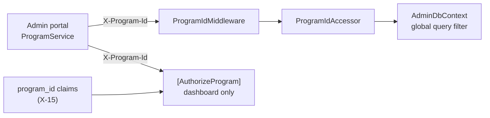

# X-16 · অথরাইজেশন স্তর ৪: প্রোগ্রাম স্কোপ

> **Bangla name:** অথরাইজেশন স্তর ৪: প্রোগ্রাম স্কোপ
>
> [← 60 · ক্রস-কাটিং](README.md) · [সূচিপত্র](../README.md) · [ওপেন কোয়ারি](../99-open-queries.md)

## 1. নাম ও উদ্দেশ্য

**প্রোগ্রাম স্কোপ।** `admin` ছাড়া কর্মীরা কেবল তাদের `custom:program_ids`-এ নিয়োজিত প্রোগ্রামগুলোর (সিরিজ/টুর্নামেন্ট) উপরই কাজ করা
উচিত। কোডে `X-Program-Id` হেডার ব্যবহার করে দুটি আলাদা পদ্ধতি আছে:

1. একটি **ডেটা ফিল্টার**: Admin সার্ভিসে একটি EF Core global query filter, যা প্রোগ্রাম-মালিকানাধীন রো-কে হেডারের প্রোগ্রামে সীমাবদ্ধ করে;
2. একটি **অ্যাক্সেস চেক**: `[AuthorizeProgram]`, যা হেডারকে ব্যবহারকারীর `program_id` claim-এর সঙ্গে তুলনা করে, কেবল dashboard-এ ব্যবহৃত।

## 2. ট্রিগার ও অ্যাক্টর

| বিষয় | মান |
|---|---|
| অ্যাক্টর | অ্যাডমিন পোর্টাল ব্যবহারকারী, প্রোগ্রাম বেছে নেওয়ার পর ([A-01](../10-admin-portal/A-01-program-selection.md)) |
| ক্লায়েন্ট | অ্যাডমিন পোর্টালের `ProgramIdInterceptor` প্রতিটি request-এ `X-Program-Id` পাঠায় ([X-04](X-04-admin-session.md)) |
| সার্ভিস | শুধু Admin |

## 3. ব্যবসায়িক প্রবাহ

একজন কর্মী একটি প্রোগ্রাম বাছেন; এরপর থেকে তালিকাগুলোতে (events, promo codes, discounts, notices, ticket layouts, …) কেবল ঐ প্রোগ্রামের
ডেটা দেখা যায়। "back to global menu" বেছে নিলে প্রোগ্রাম 0 হয়, যা global মেনু দেখায় ([X-17](X-17-authz-client-side.md))।

## 4. কারিগরি প্রবাহ

| # | ধাপ | বিবরণ |
|---|---|---|
| 1 | `ProgramIdMiddleware` | `X-Program-Id` পার্স করে; `HttpContext.Items["ProgramId"]`-এ রাখে (অনুপস্থিত, সংখ্যা নয় বা ≤ 0 হলে 0) |
| 2 | `ProgramIdAccessor` | Scoped service যা `Items["ProgramId"]` পড়ে |
| 3 | `AdminDbContext` query filter | `IHasProgramId` ইমপ্লিমেন্ট করা প্রতিটি entity-এর জন্য: `ProgramId <= 0 OR entity.ProgramId == ProgramId` |
| 4 | `[AuthorizeProgram]` (শুধু dashboard) | রোল `admin` → পাস। রোল `user` → পাস ("portal user … not defined yet")। অন্যথায়: হেডার অনুপস্থিত/অবৈধ/নেতিবাচক → **400** "Missing or invalid X-Program-Id header."; হেডার ব্যবহারকারীর `program_id` claim-এ না থাকলে → **403** "User does not have permission for program with Id {id}." |

**যেসব entity ফিল্টার হয়** (`IHasProgramId`): `Event`, `EventVenueDetails`, `ProgramTeam`, `ProgramVenue`, `ProgramVenueDetails`,
`ProgramSettings`, `PromoCode`, `PromoCodeAssign`, `Discount`, `DiscountAssign`, `GeneralNotice`, `TicketCheckerGate`,
`TicketAttributes`, `TicketLayoutConfig`, `UserIssue`, `UserIssueChatMessage`।

## 5. কম্পোনেন্ট

| ধরন | কম্পোনেন্ট |
|---|---|
| ক্লায়েন্ট | অ্যাডমিন পোর্টাল `ProgramService` (`localStorage.globalProgramId`), `ProgramIdInterceptor` |
| সার্ভিস | Admin: `ProgramIdMiddleware`, `ProgramIdAccessor`, `AdminDbContext`, `AuthorizeProgramAttribute`, `DashboardController` |
| Claim | `program_id`, `custom:program_ids` থেকে ([X-15](X-15-authz-roles.md)) |

## 6. API কন্ট্র্যাক্ট

| Header | মান | প্রভাব |
|---|---|---|
| `X-Program-Id` | integer; `0` বা অনুপস্থিত = কোনো প্রোগ্রাম নয় | প্রতিটি request-এ Admin সার্ভিসের ডেটা ফিল্টার; `GET /admin/api/v1/dashboard/*`-এ অ্যাক্সেস চেক |

```json
// 403 from [AuthorizeProgram] (plain text body, not ProblemDetails)
User does not have permission for program with Id 2.
```

## 7. ডেটা ও পার্শ্বপ্রতিক্রিয়া

কোনোটি নয়; ফিল্টার কেবল query সরু করে।

## 8. কোড রেফারেন্স

| কী | কোথায় |
|---|---|
| Middleware | `rvl-gobcb-backend/Services/Admin/ETP.Admin.Service/Middleware/ProgramIdMiddleware.cs` |
| Accessor | `rvl-gobcb-backend/Services/Admin/ETP.Admin.Storage/Repositories/ProgramIdAccessor.cs` |
| Global query filter | `rvl-gobcb-backend/Services/Admin/ETP.Admin.Storage/DbContexts/AdminDbContext.cs:595-617` |
| অ্যাক্সেস চেক | `rvl-gobcb-backend/Services/Admin/ETP.Admin.Service/Attributes/AuthorizeProgramAttribute.cs` |
| ব্যবহার | `rvl-gobcb-backend/Services/Admin/ETP.Admin.Service/Api/DashboardController.cs:18`; `EventsController.cs:19`-এ comment করা |
| ক্লায়েন্ট সাইড | `rvl-gobcb-admin-portal/src/app/interceptors/program-id.interceptor.ts`, `src/app/core/services/program.service.ts` |

## 9. হ্যান্ডওভার নোট

1. **ডেটা ফিল্টার কোনো অ্যাক্সেস কন্ট্রোল নয়।** এটি হেডারকে বিশ্বাস করে। প্রোগ্রাম ১-এ সীমাবদ্ধ একজন ব্যবহারকারী `X-Program-Id: 2` পাঠালে
   প্রোগ্রাম ২-এর রো দেখতে পান; `0` (বা কোনো হেডার না পাঠালে) পাঠালে ফিল্টার পুরোপুরি সরে যায়। কেবল dashboard ব্যবহারকারীর প্রোগ্রামের
   বিপরীতে হেডার যাচাই করে।
2. **403 শাখা কাজ থামায় না।** `AuthorizeProgramAttribute` 403 রেসপন্স লেখে কিন্তু `context.Result` সেট করে না; একটি `IAsyncAuthorizationFilter`-এর
   ক্ষেত্রে MVC তারপরও এগিয়ে action চালায়, যা ইতিমধ্যে শুরু হয়ে গেছে এমন রেসপন্সে লিখতে গিয়ে ব্যর্থ হয়। dashboard-এর (read-only) ক্ষেত্রে প্রভাব
   একটি error log, কিন্তু এভাবে লেখার endpoint-এর জন্য এই attribute ব্যবহার করবেন না।
3. **Middleware ও ফিল্টার কেবল Admin সার্ভিসে** আছে। Booking, Ticketing ও UserIssue হেডারটি পেয়ে উপেক্ষা করে; তাদের admin endpoint-গুলো
   বদলে query parameter হিসেবে `programId` নেয় (যেমন reports, [A-22](../10-admin-portal/A-22-reports.md))।
4. **`user` রোল `[AuthorizeProgram]` পাস করে**, কিন্তু dashboard-এর ক্লাস attribute-এ Admin pool সহ `admin` বা `ticket_operator` লাগে, তাই গ্রাহকরা
   এতে পৌঁছাতে পারে না।

## 10. কম্পোনেন্ট সম্পর্ক



**নির্ভর করে:** [A-01](../10-admin-portal/A-01-program-selection.md), [X-15](X-15-authz-roles.md)।
**প্রভাব ফেলে:** প্রতিটি প্রোগ্রাম-স্কোপড `A-xx` তালিকা; [A-21](../10-admin-portal/A-21-dashboard.md)।

## 11. ডেভেলপার টেস্ট গাইড

**লোকালভাবে পরীক্ষা: সম্পূর্ণ।**

| বিষয় | বিবরণ |
|---|---|
| টেস্ট ডেটা ও অ্যাকাউন্ট | `+8801700000004` ticket_operator, প্রোগ্রাম `1`; `+8801700000002` event_manager, `1,2`; seeded প্রোগ্রাম ১ (Bangladesh vs India Series) ও ২ (BPL) (`docs/local-dev.md` §৭) |
| ব্রাউজার | `1700000004` হিসেবে লগইন করে প্রোগ্রাম ১ বেছে নিন, Dashboard খুলুন: DevTools-এ `X-Program-Id: 1` এবং 200 দেখা যায় |
| এমুলেটর | প্রযোজ্য নয় |
| Postman | `postman/services/etp-admin.postman_collection.json` ফোল্ডার "Dashboard": "Login as ticket_operator" চালান (`postman/etp-login-all-pools.postman_collection.json`), request-এর bearer token `{{access_token_ticket_operator}}` করুন (service collection-এ default `{{access_token_admin}}`) এবং হেডার `X-Program-Id: 2` পাঠান → 403 text; `X-Program-Id: 1` → 200; কোনো হেডার না দিলে → 400। তারপর ফোল্ডার "Events"-এর "GET /api/v1/events" `X-Program-Id: 0` ও `2` দিয়ে চালিয়ে ফিল্টার কীভাবে ফলাফল বদলায় দেখুন |
| Visual Studio debug | `ETP.Admin.Service`-এ attach করুন; `AuthorizeProgramAttribute.OnAuthorizationAsync` ও `ProgramIdMiddleware.InvokeAsync`-তে breakpoint |
| যাচাই | রো সংখ্যা তুলনা: `select "ProgramId", count(*) from etp."Events" group by 1;` বনাম প্রতি হেডার মানের জন্য API-র ফলাফল |