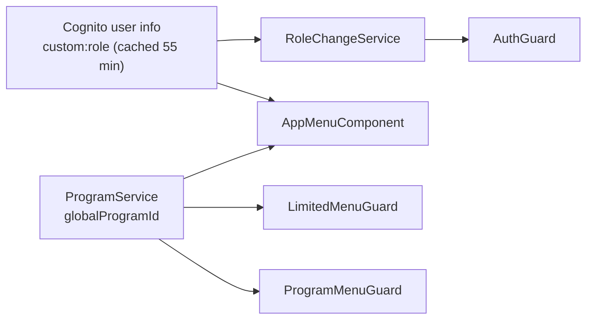

# X-17 · ক্লায়েন্ট-সাইড অথরাইজেশন (মেনু ও গার্ড)

> **Bangla name:** ক্লায়েন্ট-সাইড অথরাইজেশন (মেনু ও গার্ড)
>
> [← 60 · ক্রস-কাটিং](README.md) · [সূচিপত্র](../README.md) · [ওপেন কোয়ারি](../99-open-queries.md)

## 1. নাম ও উদ্দেশ্য

**ক্লায়েন্ট-সাইড অথরাইজেশন।** পোর্টালগুলো সাইন-ইন করা ব্যবহারকারীর রোল ও নির্বাচিত প্রোগ্রামের উপর নির্ভর করে মেনু আইটেম লুকায় ও
route আটকায়। এটি **সুবিধা, নিরাপত্তা নয়**: route guard যা আটকায়, API-তে সরাসরি কল করে তা পাওয়া যায়, যেখানে কেবল সার্ভার-সাইডের
স্তরগুলোই গোনা হয় ([X-14](X-14-authz-pool-policies.md)–[X-16](X-16-authz-program-scope.md))।

## 2. ট্রিগার ও অ্যাক্টর

| বিষয় | মান |
|---|---|
| অ্যাক্টর | অ্যাডমিন-পোর্টাল কর্মী; ইউজার-পোর্টাল গ্রাহক |
| ক্লায়েন্ট | অ্যাডমিন পোর্টাল: `AppMenuComponent.buildMenu`, `AuthGuard` + `RoleChangeService`, `ProgramMenuGuard`, `LimitedMenuGuard`। ইউজার পোর্টাল: `AuthGuard`, `UnAuthGuard`, `LanguageGuard` |

## 3. ব্যবসায়িক প্রবাহ

**অ্যাডমিন পোর্টাল।** দুটি মেনু আছে: **global মেনু** (কোনো প্রোগ্রাম নির্বাচিত নয়, program id 0) এবং **program মেনু** (একটি প্রোগ্রাম
নির্বাচিত)। লগইনের পর ব্যবহারকারী রোল অনুযায়ী global পেজে পৌঁছান ([X-01](X-01-admin-login.md)); Program management-এ একটি প্রোগ্রাম বেছে
নিলে program মেনুতে স্থানান্তর হয় ([A-01](../10-admin-portal/A-01-program-selection.md)); "back to global menu" প্রোগ্রাম 0 করে দেয়।

| রোল (প্রথম মিলেই চলে) | Global মেনু (program 0) | Program মেনু (প্রোগ্রাম নির্বাচিত) |
|---|---|---|
| `admin` | Venue Management, Prog. Managem., Site Settings (Media Configuration, Content Editor), Users (Regular Admins, Ticket Checkers, Seller Agents), Activity Log | Dashboard, Events, Generate Tickets, Reports (Booking Orders, Payment Discrepancy, Ticket Checker: Detailed / Duplicate Entry Count, Sales: Event-Wise / Summary, Revenue: Day-wise / Event-wise / Summary), Promo & Discount (Promo, Discount), Issues (Issue List, Reconciliation) |
| `customer_support` | Home | Issues (Issue List, Reconciliation) |
| `event_manager` + `ticket_manager` | Venue Management, Prog. Managem., Site Settings | Events, Generate Tickets |
| `ticket_manager` | Home | Generate Ticket |
| `ticket_operator` | Home | Dashboard, Generate Ticket, Reports (admin-এর sub-item-গুলো একই) |
| `event_manager` | Venue Management, Prog. Managem., Site Settings | Events |

**ইউজার পোর্টাল।** `tickets/*` ও `issues/*`-এর জন্য লগইন দরকার; `auth/*` শুধু সাইন-আউট অতিথিদের জন্য; `user-profile`-এর কোনো guard নেই।

## 4. কারিগরি প্রবাহ

**অ্যাডমিন পোর্টাল route guard** (`app-routing.module.ts`):

| Guard | Routes | নিয়ম |
|---|---|---|
| `ProgramMenuGuard` | `''` (dashboard), `events`, `promo-management`, `ticket-layout`, `issues`, `report` | program id > 0 দরকার, নইলে `/program-management`-এ redirect |
| `LimitedMenuGuard` | `users`, `ticket-checker`, `settings`, `agent-user`, `venue-management`, `program-management` | program id == 0 দরকার, নইলে `/`-এ redirect |
| `AuthGuard` | `activity-log`, `home`, এবং প্রতিটি feature module-এর ভিতরে | সাইন ইন (`Auth.currentSession`), তারপর `RoleChangeService.handleRoleTransition(url)` |
| কোনোটিই নয় | `change-password`, `media-configuration`, `content-editor` | — |

`RoleChangeService.isRouteAllowedForRole` (প্রতি রোলে গ্রহণযোগ্য URL প্রিফিক্স):

| রোল | গ্রহণযোগ্য URL প্রিফিক্স |
|---|---|
| `admin` | সবকিছু |
| `customer_support` | `/home`, `/issues` |
| `event_manager` + `ticket_manager` | `/program-management`, `/venue-management`, `/media-configuration`, `/content-editor`, `/events` |
| `ticket_manager` | `/home`, `/events/event-ticket`, `/events/generate-ticket` |
| `ticket_operator` | `/home`, `/`, `/events/event-ticket`, `/report`, `/events/generate-ticket` |
| `event_manager` | `/program-management`, `/events`, `/venue-management`, `/media-configuration`, `/content-editor` |

রোল-পরিবর্তন শনাক্তকরণ: রোলের স্ট্রিং `sessionStorage.lastKnownUserRole`-এর সঙ্গে তুলনা করা হয়; বদলালে প্রোগ্রাম 0 হয়ে যায়, একটি
"Your role has been changed…" toast দেখায় এবং ব্যবহারকারীকে ঐ রোলের default পেজে redirect করা হয়। রোল আসে ৫৫ মিনিট ক্যাশ করা Amplify user
info থেকে ([X-01](X-01-admin-login.md))।

**ইউজার পোর্টাল guard:** `AuthGuard` কেবল লোকাল ফ্ল্যাগ `localStorage.rvl_cognito_auth == "true"` দেখে; `UnAuthGuard` OneID popup-কে
পাস করে এবং অন্যথায় সাইন-ইন করা ব্যবহারকারীকে হোমে redirect করে; `LanguageGuard` `/:lang` অংশ সামলায়
([P-13](../20-user-portal/P-13-language-switch.md))।

## 5. কম্পোনেন্ট

| ধরন | কম্পোনেন্ট |
|---|---|
| অ্যাডমিন পোর্টাল | `src/app/layout/app.menu.component.ts`, `src/app/core/guard/{auth,program-menu,limited-menu}.guard.ts`, `src/app/core/services/role-change.service.ts`, `src/app/core/services/program.service.ts` |
| ইউজার পোর্টাল | `ETP-Web/src/app/modules/core/guards/{authentication,unAuthentication,language}.guard.ts`, `app-routing.module.ts` |

## 6. API কন্ট্র্যাক্ট

কোনোটিই নয়।

## 7. ডেটা ও পার্শ্বপ্রতিক্রিয়া

শুধু ব্রাউজার storage: `localStorage.globalProgramId`, `sessionStorage.lastKnownUserRole` (অ্যাডমিন পোর্টাল); `localStorage.rvl_cognito_auth`
(ইউজার পোর্টাল)।

## 8. কোড রেফারেন্স

| কী | কোথায় |
|---|---|
| রোল অনুযায়ী অ্যাডমিন মেনু | `rvl-gobcb-admin-portal/src/app/layout/app.menu.component.ts:39-262` |
| অ্যাডমিন route ও guard | `rvl-gobcb-admin-portal/src/app/app-routing.module.ts:14-33` |
| রোল allow-list ও রোল-পরিবর্তন ব্যবস্থাপনা | `rvl-gobcb-admin-portal/src/app/core/services/role-change.service.ts:31-201` |
| ইউজার পোর্টাল route | `rvl-gobcb-user-portal/ETP-Web/src/app/app-routing.module.ts:8-71` |
| ইউজার পোর্টাল guard | `rvl-gobcb-user-portal/ETP-Web/src/app/modules/core/guards/authentication.guard.ts`, `unAuthentication.guard.ts` |

## 9. হ্যান্ডওভার নোট

1. **মেনু ও সার্ভারের নিয়ম কোথাও মেলে না।** উদাহরণ: `ticket_manager` "Generate Ticket" দেখেন, কিন্তু ব্যাকএন্ডের reserved-ticket endpoint
   যেকোনো Admin-pool ব্যবহারকারী গ্রহণ করে ([X-14](X-14-authz-pool-policies.md)), তাই `customer_support` সরাসরি সেগুলো কল করতে পারত;
   Site Settings-এর route (`media-configuration`, `content-editor`)-এর কোনো route guard নেই-ই।
2. **`/settings` মডিউল routed, কিন্তু কোনো মেনুতে নেই।** এতে notices, landing page, programs, program teams, program venues ও footer
   settings স্ক্রিন আছে ([A-31](../10-admin-portal/A-31-general-notices.md), [A-30](../10-admin-portal/A-30-header-footer-social.md))।
3. **রোল স্ট্রিং মিলিয়ে দেখা।** মেনু কমা-সেপারেটেড স্ট্রিংয়ে `roles.includes('admin')` ব্যবহার করে, যা মূলত substring check: ভবিষ্যতের যেকোনো রোলে
   "admin" থাকলেও সেটিও মিলে যাবে। `isRouteAllowedForRole` স্ট্রিংটি ঠিকভাবে ভাগ করে।
4. **ইউজার পোর্টালের `AuthGuard` লোকাল ফ্ল্যাগকে বিশ্বাস করে**; আসল যাচাই হয় যখন টোকন interceptor বা API কলটি প্রত্যাখ্যান করে।

## 10. কম্পোনেন্ট সম্পর্ক

**নির্ভর করে:** [X-01](X-01-admin-login.md), [A-01](../10-admin-portal/A-01-program-selection.md)।
**প্রভাব ফেলে:** প্রতিটি `A-xx` ফিচারে প্রতি রোল UI-তে যা পৌঁছাতে পারে।

## 11. ডেভেলপার টেস্ট গাইড

**লোকালভাবে পরীক্ষা: সম্পূর্ণ।**

| বিষয় | বিবরণ |
|---|---|
| টেস্ট ডেটা ও অ্যাকাউন্ট | Admin-pool-এর পাঁচজন ব্যবহারকারী (`docs/admin-portal-local.md` §৫) |
| ব্রাউজার | `http://localhost:4200`-এ প্রতিটি রোল হিসেবে লগইন করুন; মেনুগুলো §৩-এর সঙ্গে মিলিয়ে দেখুন; নিষিদ্ধ URL লিখুন (যেমন `ticket_operator` হিসেবে `/users`) এবং redirect দেখুন। Postman-এ (নিচে) কোনো ব্যবহারকারীর রোল বদলে অপেক্ষা করে নেভিগেট করুন: ৫৫ মিনিটের user-info ক্যাশ শেষ হলে বা reload করার পর "Role Updated" toast আসে |
| এমুলেটর | প্রযোজ্য নয় |
| Postman | `postman/etp-cognito-auth.postman_collection.json` ফোল্ডার "06 - Admin user lifecycle", "Update role to customer_support" |
| Visual Studio debug | প্রযোজ্য নয় (শুধু ব্রাউজার); `role-change.service.ts`-এ DevTools Sources ব্যবহার করুন |
| যাচাই | DevTools → Application → Session Storage-এর `lastKnownUserRole`; Local Storage-এর `globalProgramId` |