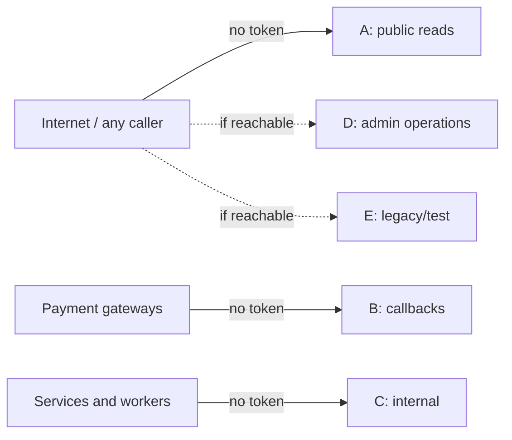

# X-18 · অথরাইজেশন ছাড়া endpoint

> **Bangla name:** অথরাইজেশন ছাড়া endpoint
>
> [← 60 · ক্রস-কাটিং](README.md) · [সূচিপত্র](../README.md) · [ওপেন কোয়ারি](../99-open-queries.md)

## 1. নাম ও উদ্দেশ্য

**অথরাইজেশন ছাড়া endpoint।** `BaseController`-এর `[Authorize]` comment করা, তাই কোনো কন্ট্রোলার বা action-এ `[Authorize]` attribute না থাকলে
কন্ট্রোলারের সেই action অ্যানোনিমাস। ব্যাকএন্ডের **৩৫৪টি endpoint-এর মধ্যে ১৩৭টির** কোনো `[Authorize]` নেই, বা আছে `[AllowAnonymous]`। কিছু
ইচ্ছাকৃতভাবে public (অতিথিদের জন্য event list, payment callback), কিছু সার্ভিস ও ওয়ার্কারের মধ্যে internal call (যেগুলো user token বহন
করতে পারে না, [X-19](X-19-service-to-service.md)), আর কিছু অ্যাডমিন-পোর্টাল অপারেশন যেগুলো সুরক্ষিত করার উদ্দেশ্যে তৈরি বলে মনে হয়।
কী ঠিক করা দরকার তা আপনি নিজে ঠিক করতে পারেন, তাই এই ফাইল সবগুলোকে বিভাগ অনুযায়ী তালিকাভুক্ত করে।

এগুলোর কোনোটিকে ইন্টারনেট থেকে API Gateway, NLB বা ingress আটকায় কি না তা রিপোজিটরিতে দেখা যায় না
(architecture Q1b) `[UNCONFIRMED: Q-04]`।

## 2. ট্রিগার ও অ্যাক্টর

যেকোনো HTTP ক্লায়েন্ট যেটি সার্ভিসে পৌঁছাতে পারে।

## 3. ব্যবসায়িক প্রবাহ

কোনো ব্যবহারকারী-ফিচার নয়। নিচের বিভাগগুলো বলে দেয় প্রতিটি endpoint কে কল করার কথা।

## 4. কারিগরি প্রবাহ

| কারণ | কোথায় |
|---|---|
| base ক্লাসে `// [Authorize]` comment করা | `rvl-gobcb-backend/Core/ETP.Core.Web/BaseController.cs:14` |
| একেবারে `[Authorize]` নেই এমন কন্ট্রোলার | Admin: `AgentController`, `CurrencyController`, `EventSettingsController`, `HeaderFooterController`, `PortalUsersController`, `TicketPricingController`, `TokenIssuerController`, `UserIssueChatController`। Booking: `BookingReportController`, `CapacityController`, `EventCapacityAdjustmentController`, `ReportController`, এবং `SeatReservationController` ও `UserBookingOrderController`-এর বেশিরভাগ action। Event: সব। PushNotification: সব। Ticketing: `BookingOrderTicketController`-এর কয়েকটি action। TicketChecker: `TestingController`। UserIssue: `ReportIssueChatController` |
| `Program.cs`-এ `UseAuthentication`/`UseAuthorization` comment করা | Platform, PushNotification, UserAuth |
| ইচ্ছাকৃতভাবে `[AllowAnonymous]` | নিচের বিভাগ A ও B-তে তালিকাভুক্ত |

### বিভাগ A — ডিজাইন অনুযায়ী public (অতিথি, পোর্টাল, অ্যাপ)

| Endpoint | কে ব্যবহার করে |
|---|---|
| `GET /event/api/v1/*` (৯টি `events/*`, `header-footer`, `landing-page-image/public`, `events/programs`, `events/programs/programId/{id}`, `ticket-pricing/list`, `ticket-pricing/program-pricing`) | ইউজার পোর্টাল, ইউজার অ্যাপ, অন্য সার্ভিস ([P-01](../20-user-portal/P-01-home-content.md), [P-02](../20-user-portal/P-02-browse-events.md), [P-03](../20-user-portal/P-03-info-pages.md)) |
| `GET /admin/api/v1/landing-page-image/public`, `GET /admin/api/v1/general-notice/public`, `GET /admin/api/v1/header-footer` | পোর্টাল/অ্যাপ ([P-01](../20-user-portal/P-01-home-content.md)) |
| `GET /admin/api/v1/discount/program/{programId}/{eventId}/{galleryId}` | পোর্টাল/অ্যাপ seat selection ([P-04](../20-user-portal/P-04-seat-selection.md)) |
| `GET /admin/api/v1/ticket-pricing`, `/list`, `/{id}` | কনটেন্ট পেজ ([A-14](../10-admin-portal/A-14-ticket-pricing-content.md)) |
| `GET /booking/api/v1/capacity/level-user-portal-seats` | seat map ([P-04](../20-user-portal/P-04-seat-selection.md)) |
| `GET /ticketing/api/v1/booking-order-ticket/shared` | শেয়ার করা টিকিট লিঙ্ক, একটি signature parameter দিয়ে সুরক্ষিত ([P-09](../20-user-portal/P-09-ticket-details-downloads.md)) |

### বিভাগ B — payment-gateway callback

| Endpoint | নোট |
|---|---|
| `GET /booking/api/v1/user-booking-order/dgepay/payment-status` | পেমেন্টের পর DgePay redirect ([P-06](../20-user-portal/P-06-booking-payment.md)) |
| `POST /booking/api/v1/user-booking-order/sslcommerz/payment-success`, `-fail`, `-cancel`, `-ipn` | SSLCommerz callback (Appendix A) |
| `GET /booking/api/v1/user-booking-order/payment-status-bypass` | `rawData`-তে একটি order-এর public id নেয়, **gateway-কে জিজ্ঞেস করে না** (status check comment করা এবং status hard-coded `Paid`, payment info text "BY PASS TRANSACTION - TEST"), order-কে paid চিহ্নিত করে, `OrderSuccess` publish করে এবং Ticketing-কে টিকিট তৈরি করতে বলে; [P-06](../20-user-portal/P-06-booking-payment.md) ও [S-01](../50-system-initiated/S-01-level-capacity-update.md) দেখুন। **পৌঁছানো গেলে অত্যন্ত ঝুঁকিপূর্ণ।** |

### বিভাগ C — অন্য সার্ভিস বা ওয়ার্কার থেকে internal call

| Endpoint group | কে ডাকে (typed client) |
|---|---|
| Booking-এর `capacity/*` GET ও `POST capacity`; `event-capacity-adjustment/by-event`, `count/{eventId}`; `seat-reservation/by-event`, `count`, `remainingReserveCount`, `reservations-count`, `update-*-status`, `merge-status`, `zip-status`, `update-reservation-ticket-preview`, `event-id`; `user-booking-order/public-id/{id}`, `generate-ticket-request/{publicId}`, `update-status`, `not-notified-list`, `update-notification-status`, `promo-code/{code}`, `booked-user-record/{id}` | `Core/ETP.Core/ServiceClient/BookingClient/BookingClient.cs` (Admin, Ticketing, Scheduler, Utility) |
| Ticketing-এর `booking-order-ticket/initiate`, `initiate-user-ticket`, `generate-request/{publicId}`, `ticket-counts`, `by-gallery-block-level`, `ticket-numbers`, `GET booking-order-ticket?id=`, `booking-order-id`, `reserved-urls` | `Core/ETP.Core/ServiceClient/TicketingClient/TicketingClient.cs` (Booking, Admin, Utility); `generate-request` পোর্টাল/অ্যাপ থেকেও ([P-08](../20-user-portal/P-08-ticket-generation-request.md)) |
| Admin-এর `portal-users/{phoneNo}` | `Core/ETP.Core/ServiceClient/AdminClient/AdminClient.cs` |
| PushNotification: `bulk-status` (৮টি) ছাড়া সব endpoint | `PushNotificationClient` (Admin, Scheduler) এবং ইউজার অ্যাপ (device token, [U-09](../30-user-app/U-09-device-token.md)) |

### বিভাগ D — অথরাইজেশন ছাড়া অ্যাডমিন-পোর্টাল অপারেশন (পর্যালোচনা করুন)

| Endpoint | স্ক্রিন |
|---|---|
| Admin `agent-users/*` (৮টি) | [A-26](../10-admin-portal/A-26-agent-users.md) |
| Admin `admin-users/forget-password`, `admin-users/set-forget-password` | [X-02](X-02-admin-forgot-password.md) |
| Admin `ticket-pricing` POST/PUT/DELETE/publish/unpublish, `attribute/{id}` DELETE | [A-14](../10-admin-portal/A-14-ticket-pricing-content.md) |
| Admin `header-footer` PUT | [A-30](../10-admin-portal/A-30-header-footer-social.md) |
| Admin `event-settings/{eventId}` GET/PUT | [A-08](../10-admin-portal/A-08-event-settings.md) |
| Booking `dashboard/*` (৪টি) | [A-21](../10-admin-portal/A-21-dashboard.md) |
| Booking `report/admin/*` (৮টি) | [A-22](../10-admin-portal/A-22-reports.md) |
| Booking `POST seat-reservation`, `GET seat-reservation/by-event-level` | [A-11](../10-admin-portal/A-11-seat-reservation.md) |
| Booking `POST event-capacity-adjustment`, `GET by-event-level` | [A-10](../10-admin-portal/A-10-capacity-adjustment.md) |
| UserIssue `user-issue-chat/*` (৮টি) | [A-24](../10-admin-portal/A-24-user-issues-admin.md), [P-12](../20-user-portal/P-12-issues-chat.md) |

### বিভাগ E — legacy, টেস্ট বা অন্তর্দৃষ্টিহীন (Appendix A)

Admin `currency`, `token`, `user-issue-chat/*` (৮টি, Admin-এর কপি), `user-issue/user-detail/{orderId}`; TicketChecker
`testing/re-initiate-data`, `testing/sync-data`; root `GET /event`, `/platform`, `/ticketChecker`, `/ticketing`; PushNotification
`push-notification/bulk-status/{requestId}`। [Appendix A](../90-appendix-a-legacy.md) দেখুন।

## 5. কম্পোনেন্ট

সব সার্ভিস; প্রতি endpoint-এর auth মান আছে [Appendix B](../91-appendix-b-endpoint-index.md)-তে।

## 6. API কন্ট্র্যাক্ট

অপরিবর্তিত; এই ফাইল কেবল শ্রেণিবিন্যাস করে।

## 7. ডেটা ও পার্শ্বপ্রতিক্রিয়া

বিভাগ D-এর কয়েকটি endpoint ডেটা লেখে (agent account, পাসওয়ার্ড, কনটেন্ট, event settings, seat reservation, capacity)।
TicketChecker-এর `testing/re-initiate-data` টেস্ট ডেটা পুনরায় তৈরি করে ([Appendix A](../90-appendix-a-legacy.md))।

## 8. কোড রেফারেন্স

| কী | কোথায় |
|---|---|
| Comment করা base attribute | `rvl-gobcb-backend/Core/ETP.Core.Web/BaseController.cs:14-15` |
| Comment করা pipeline (উদাহরণ) | `rvl-gobcb-backend/Services/PushNotification/ETP.PushNotification.Service/Program.cs` |
| Internal endpoint ডাকা typed client | `rvl-gobcb-backend/Core/ETP.Core/ServiceClient/{BookingClient,TicketingClient,AdminClient,PushNotificationClient}/` |

## 9. হ্যান্ডওভার নোট

1. **প্রতি বিভাগে আলাদা সিদ্ধান্ত নিন।** A: অ্যানোনিমাস রাখুন। B: অ্যানোনিমাস রাখুন, কিন্তু server-side-এ gateway-এর signature/ডেটা যাচাই করুন
   (DgePay callback ট্রানজেকশন আবার যাচাই করে, [P-06](../20-user-portal/P-06-booking-payment.md)); production থেকে `payment-status-bypass`
   সরান। C: service identity বা network policy দিয়ে সুরক্ষিত করুন; আজকের একমাত্র সুরক্ষা এটি যে path-গুলো প্রকাশ করার কথা নয় (architecture §2.3 B)।
   D: পোর্টালের মেনু যে রোলগুলো বোঝায়, সেগুলো দিয়ে `[Authorize]` যোগ করুন। E: সরান।
2. **C-এর endpoint-এ `[Authorize]` যোগ করলে ওয়ার্কার ভেঙে যায়**: ওয়ার্কার কোনো টোকন পাঠায় না। আগে একটি service credential চালু করুন
   (অব্যবহৃত `service` স্কিম একটি শুরুর বিন্দু, [X-14](X-14-authz-pool-policies.md))।
3. এই তালিকা সত্য থাকে রাখতে প্রতিটি পরিবর্তনের পর [Appendix B](../91-appendix-b-endpoint-index.md)-এর জন্য ব্যবহৃত endpoint extractor আবার চালান।

## 10. কম্পোনেন্ট সম্পর্ক

**নির্ভর করে:** network exposure (architecture Q1b)। **প্রভাব ফেলে:** [A-08](../10-admin-portal/A-08-event-settings.md),
[A-10](../10-admin-portal/A-10-capacity-adjustment.md), [A-11](../10-admin-portal/A-11-seat-reservation.md), [A-14](../10-admin-portal/A-14-ticket-pricing-content.md),
[A-21](../10-admin-portal/A-21-dashboard.md), [A-22](../10-admin-portal/A-22-reports.md), [A-26](../10-admin-portal/A-26-agent-users.md), [X-02](X-02-admin-forgot-password.md)-এর নিরাপত্তা।

## 11. ডেভেলপার টেস্ট গাইড

**লোকালভাবে পরীক্ষা: সম্পূর্ণ।**

| বিষয় | বিবরণ |
|---|---|
| টেস্ট ডেটা ও অ্যাকাউন্ট | কোনোটি লাগে না (এটাই তো বিষয়) |
| ব্রাউজার | `http://localhost:5102/booking/swagger` → Authorize ছাড়া `GET /booking/api/v1/report/admin/booking-metrics` কল করুন: 200 |
| এমুলেটর | প্রযোজ্য নয় |
| Postman | উপরের বিভাগগুলোর যেকোনো request, auth type "No Auth" রেখে, যেমন `postman/services/etp-booking.postman_collection.json` "GET /api/v1/report/admin/booking-metrics" (`/booking` প্রিফিক্স যোগ করুন, [Appendix D](../93-appendix-d-local-test-reference.md)) |
| Visual Studio debug | প্রয়োজন নেই |
| যাচাই | [Appendix B](../91-appendix-b-endpoint-index.md)-এ বর্ণিত পদ্ধতিতে পুনরায় গণনা করুন (evidence baseline-এ ১৩৭ হওয়া কাঠাও) |