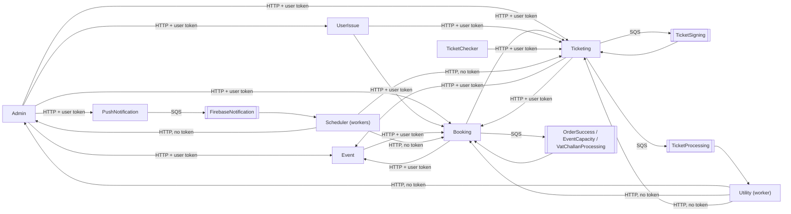

# X-19 · সার্ভিস-থেকে-সার্ভিস যোগাযোগ

> **Bangla name:** সার্ভিস-থেকে-সার্ভিস যোগাযোগ
>
> [← 60 · ক্রস-কাটিং](README.md) · [সূচিপত্র](../README.md) · [ওপেন কোয়ারি](../99-open-queries.md)

## 1. নাম ও উদ্দেশ্য

**সার্ভিস-থেকে-সার্ভিস যোগাযোগ।** সার্ভিসগুলো typed client দিয়ে HTTP-র মাধ্যমে একে অপরকে সিঙ্ক্রোনাসভাবে কল করে, আর ধীর কাজ
SQS কিউ-র মাধ্যমে হস্তান্তর করে। **কে কাকে কোন ক্রেডেনশিয়াল দিয়ে কল করে** — এই ফাইলটিই তার রেফারেন্স। ধারণাগুলো:
[টোকেন ফরোয়ার্ডিং](../00-platform-primer.md#explainer-token-forwarding), [কিউ-চালিত প্রসেসিং](../00-platform-primer.md#explainer-queue-driven),
[ব্যাকগ্রাউন্ড ওয়ার্কার](../00-platform-primer.md#explainer-background-workers)। আর্কিটেকচার ডকুমেন্টের §2.3 একই
তিনটি মেকানিজম বর্ণনা করে।

## 2. ট্রিগার ও অ্যাক্টর

একটি কন্ট্রোলার অ্যাকশন (ব্যবহারকারীর অনুরোধ), অথবা এমন একটি ব্যাকগ্রাউন্ড ওয়ার্কার যার অন্য কোনো সার্ভিস বা বাইরের সিস্টেম থেকে ডেটা বা কাজ দরকার।

## 3. ব্যবসায়িক প্রবাহ

ব্যবহারকারীর কাছে অদৃশ্য। উদাহরণ: অর্ডার দিতে গিয়ে Booking থেকে Event-এর ইভেন্ট ডেটা পড়ে এবং পরে Ticketing-কে বলে টিকিট তৈরি করতে;
Scheduler-এর একটি ওয়ার্কার Booking-কে জিজ্ঞেস করে কোন অর্ডারগুলোর এখনও নোটিফিকেশন দরকার।

## 4. কারিগরি প্রবাহ

**মেকানিজম**

| ট্যাগ | মেকানিজম | ক্রেডেনশিয়াল |
|---|---|---|
| **[HTTP + user token]** | typed `HttpClient` সহ `DelegatedBearerAuthenticationHandler`, একটি রিকোয়েস্টের ভেতর থেকে কল করা | কলারের Cognito access token, `AppClaimTypes.AccessToken` claim থেকে কপি করা |
| **[HTTP, no token]** | একই client, একটি ওয়ার্কার থেকে কল করা (কোনো `HttpContext` নেই) | কিছু নেই; শুধু `[Authorize]`-ছাড়া এন্ডপয়েন্টের বিপরীতেই কাজ করে ([X-18](X-18-endpoints-without-auth.md)-এর ক্যাটাগরি C) |
| **[HTTP, static key]** | কনফিগারেশন থেকে নির্দিষ্ট `Authorization` হেডারসহ client | `Notification:Authorization`, `Serverless:Authorization`, gateway/TSP/NBR/OneID ক্রেডেনশিয়াল |
| **[SQS: Key]** | `SqsPublisher` → কিউ → পোলিং করা ওয়ার্কার | AWS static key `AWS:AccessKey`/`AWS:SecretAccessKey`; মেসেজে কোনো টোকেন নেই |

**প্রতিটি সার্ভিসে রেজিস্টার করা typed HTTP client** (প্রতিটি সার্ভিসের `Configuration(s)/DependencyConfig.cs`):

| কলার | ক্লায়েন্ট ইন্টারফেস | Base URL key | ব্যবহারকারীর টোকেন ফরোয়ার্ড হয়? | স্ট্যাটিক হেডার |
|---|---|---|---|---|
| Admin | `IEventClient`, `IEventProvider` | `Services:Event` | হ্যাঁ | |
| Admin | `IBookingClient` | `Services:Booking` | হ্যাঁ | |
| Admin | `ITicketingClient` | `Services:Ticketing` | হ্যাঁ | |
| Admin | `IUserIssueClient` | `Services:UserIssue` | হ্যাঁ | |
| Admin | `IPushNotificationClient` | `Services:PushNotification` | হ্যাঁ | |
| Admin | `INotificationClient` | `Notification:Endpoint` | | `Notification:Authorization` |
| Admin | `IServerlessClient` | `Serverless:BaseUrl` | | `Serverless:Authorization` |
| Booking | `IEventClient` | `Services:Event` | হ্যাঁ | |
| Booking | `ITicketingClient` | `Services:Ticketing` | হ্যাঁ | |
| Booking | `IUserClient` (`user/my-profile`) | `Services:AppBase` | হ্যাঁ | |
| Booking | `IServerlessClient`, `INotificationClient` | `Serverless:BaseUrl`, `Notification:Endpoint` | | static |
| Booking | `IDgePayPaymentManager`, `ISSLCommerzPaymentManager`, `INBROpenApiManager` | `PaymentSettings:*` / NBR settings থেকে | | gateway ক্রেডেনশিয়াল ([P-06](../20-user-portal/P-06-booking-payment.md), [S-10](../50-system-initiated/S-10-vat-challan.md)) |
| Event | `IBookingClient` | `Services:Booking` | হ্যাঁ | |
| Scheduler | `IBookingClient` | `Services:Booking` | হ্যাঁ (ওয়ার্কারে কোনোটিই নয়) | |
| Scheduler | `IEventClient` | **`Services:Admin`** | হ্যাঁ (ওয়ার্কারে কোনোটিই নয়) | |
| Scheduler | `ITicketingClient`, `IAdminClient` | `Services:Ticketing`, `Services:Admin` | হ্যাঁ (ওয়ার্কারে কোনোটিই নয়) | |
| Scheduler | `INotificationClient` | `Notification:Endpoint` | | static |
| TicketChecker | `ITicketingClient` | `Services:Ticketing` | হ্যাঁ | |
| Ticketing | `IEventClient` (দুটি রেজিস্ট্রেশন) | `Services:Event` | হ্যাঁ | |
| Ticketing | `IBookingClient` | `Services:Booking` | হ্যাঁ | |
| Ticketing | `IUserClient` | `Services:AppBase` | হ্যাঁ | |
| Ticketing | `IAuthProvider`, `ITspSignedTicketProvider` | `TSP:AuthUrl`, `TSP:SignUrl` | | TSP client certificate ([S-08](../50-system-initiated/S-08-ticket-signing.md)) |
| Ticketing | `IServerlessClient` | `Serverless:BaseUrl` | | static |
| Ticketing | `IOneIdManager` | `OneIdSettings:*` | | `OneIdSettings:AuthorizationToken` ([P-10](../20-user-portal/P-10-oneid-ticket-sync.md)) |
| UserIssue | `IBookingClient`, `ITicketingClient` | `Services:Booking`, `Services:Ticketing` | হ্যাঁ | |
| UserIssue | `IServerlessClient` | `Serverless:BaseUrl` | | static |
| Utility | `IAdminClient`, `IBookingClient`, `ITicketingClient` | `Services:Admin`, `:Booking`, `:Ticketing` | হ্যাঁ (ওয়ার্কারে কোনোটিই নয়) | |

বেশিরভাগ HTTP client সাময়িক এরর ৩বার exponential back-off সহ রিট্রাই করে (Polly), কিছু সাধারণ ৩-রিট্রাই পলিসি ব্যবহার করে।

**কিউ** (`AWS:Queue:*`-এর নিচের key)

| কিউ key | কে publish করে | কে পড়ে | ফিচার |
|---|---|---|---|
| `OrderSuccess` | Booking `UserBookingOrderManager`, `CapacityManager` | Booking `LevelCapacityUpdateService` | [S-01](../50-system-initiated/S-01-level-capacity-update.md) |
| `EventCapacity` | Booking `CapacityManager` | Booking `EventLiveCapacityUpdateService` | [S-02](../50-system-initiated/S-02-event-live-capacity.md) |
| `VatChallanProcessing` | Booking `UserBookingOrderManager` | Booking `VatChallanProcessingService` | [S-10](../50-system-initiated/S-10-vat-challan.md) |
| `TicketSigning` | Ticketing `TicketManager` | Ticketing `TicketGenerationService` | [S-08](../50-system-initiated/S-08-ticket-signing.md) |
| `TicketProcessing` | Ticketing `TicketManager` | Utility `TicketProcessingService` | [S-09](../50-system-initiated/S-09-ticket-merge-zip.md) |
| `FirebaseNotification` | PushNotification `NotificationManager` | Scheduler `FirebaseNotificationService` | [S-11](../50-system-initiated/S-11-firebase-notification.md) |

## 5. কম্পোনেন্ট

| ধরন | কম্পোনেন্ট |
|---|---|
| কোড | `Core/ETP.Core.Web/Security/DelegatedBearerAuthenticationHandler.cs`, `Core/ETP.Core/ServiceClient/*`, `Services/*/ETP.*.Client/*`, `Core/ETP.Core/Queue/Services/SqsPublisher.cs` |
| কনফিগ | `Services:*`, `Notification:*`, `Serverless:*`, `AWS:Queue:*`, `AWS:AccessKey`, `AWS:SecretAccessKey` |

## 6. API কন্ট্র্যাক্ট

অভ্যন্তরে কল করা এন্ডপয়েন্টগুলো [X-18](X-18-endpoints-without-auth.md)-এ (ক্যাটাগরি C) এবং তাদের কলারদের সহ
[অ্যাপেন্ডিক্স B](../91-appendix-b-endpoint-index.md)-তে তালিকাভুক্ত।

## 7. ডেটা ও পার্শ্বপ্রতিক্রিয়া

নিজস্ব কোনোটিই নেই।

## 8. কোড রেফারেন্স

| কী | কোথায় |
|---|---|
| টোকেন ফরোয়ার্ডিং হ্যান্ডলার | `rvl-gobcb-backend/Core/ETP.Core.Web/Security/DelegatedBearerAuthenticationHandler.cs` |
| claim হিসেবে সংরক্ষিত টোকেন | `rvl-gobcb-backend/Core/ETP.Core/Configuration/DefaultAuthenticationConfig.cs:52-53` (প্রতিটি scheme-এর জন্যও) |
| ক্লায়েন্ট রেজিস্ট্রেশন | `rvl-gobcb-backend/Services/Admin/ETP.Admin.Service/Configurations/DependencyConfig.cs:123-195`; `Services/Booking/ETP.Booking.Service/Configuration/DependencyConfig.cs:83-200`; `Services/Scheduler/ETP.Scheduler.Service/Configurations/DependencyConfig.cs:71-110`; `Services/Ticketing/ETP.Ticketing.Service/Configurations/DependencyConfig.cs:151-255`; `Services/UserIssue/ETP.UserIssue.Service/Configurations/DependencyConfig.cs:55-80`; `Services/Utility/ETP.Utility.Service/Configurations/DependencyConfig.cs:51-75`; `Services/Event/ETP.Event.Service/Configurations/DependencyConfig.cs:66`; `Services/TicketChecker/ETP.TicketChecker.Service/Configurations/DependencyConfig.cs:49` |
| শেয়ার করা typed client | `rvl-gobcb-backend/Core/ETP.Core/ServiceClient/` (`AdminClient`, `BookingClient`, `TicketingClient`, `EventClient`, `NotificationClient`, `PushNotificationClient`, `ServerlessClient`, `UserClient`, `UserIssueClient`) |
| কিউ publisher | `rvl-gobcb-backend/Core/ETP.Core/Queue/Services/SqsPublisher.cs` |

## 9. হ্যান্ডওভার নোট

1. **ফরোয়ার্ডিং কলারের pool-কে ক্যালির পলিসির সাথে যুক্ত করে।** এমন একটি গ্রাহক-রিকোয়েস্ট যেখানে Booking-কে Admin-এর জন্য
   নির্দিষ্ট এন্ডপয়েন্ট কল করতে হয়, সেটি ব্যর্থ হবে; এ কারণেই অভ্যন্তরীণ এন্ডপয়েন্টগুলো anonymous।
2. **Scheduler-এর `IEventClient` `Services:Event` নয়, `Services:Admin`-এর দিকে ইঙ্গুত করে**। কোন সার্ভিস সাড়া দেবে তা ক্লায়েন্টের
   পাথ দিয়ে নির্ধারিত হয় ([S-04](../50-system-initiated/S-04-scheduler-capacity-update.md))।
3. **`Services:AppBase`** হলো `IUserClient`-এর base URL, যা ফরোয়ার্ড করা টোকেন দিয়ে `user/my-profile` কল করে, অর্থাৎ identity API
   `[UNCONFIRMED: Q-01]`। লোকালে এটি `http://localhost:4200/`-এ সেট করা (`scripts/user-secrets.example.json`), যা অ্যাডমিন পোর্টাল —
   তাই লোকালে এই কলগুলো কাজ করে না।
4. **রিকোয়েস্টের মাঝে টোকেনের মেয়াদ শেষ**: সার্ভিসগুলো টোকেন রিফ্রেশ করে না (আর্কিটেকচার §2.3 A)।
5. **MassTransit রেজিস্টার করা আছে কিন্তু অব্যবহৃত** ([অ্যাপেন্ডিক্স A](../90-appendix-a-legacy.md))।

## 10. কম্পোনেন্ট সম্পর্ক

**নির্ভর করে:** কনফিগারেশন ([X-26](X-26-configuration.md)), নেটওয়ার্কের অবস্থান (আর্কিটেকচার §4.1)। **প্রভাব ফেলে:** প্রতিটি বহু-সার্ভিস ফিচার।

## 11. ডেভেলপার টেস্ট গাইড

**লোকালে পরীক্ষাযোগ্যতা: সম্পূর্ণ** — HTTP ও SQS-এর জন্য (Floci); বাইরের সিস্টেমগুলো ডামি।

| বিষয় | বিবরণ |
|---|---|
| টেস্ট ডেটা ও অ্যাকাউন্ট | যেকোনো; সিড ডেটা `pwsh ./scripts/Seed-EtpData.ps1` থেকে |
| ব্রাউজার | Aspire ড্যাশবোর্ড → **Traces**: একটি ট্রেস সার্ভিসগুলোর মধ্য দিয়ে একটি রিকোয়েস্ট অনুসরণ করে (`docs/local-dev.md` §4 "During the day") |
| এমুলেটর | — |
| Postman | একটি ক্রস-সার্ভিস কল ট্রিগার করুন, যেমন `postman/services/etp-admin.postman_collection.json`-এর "POST /api/v1/events" (Admin → Event/Booking) |
| Visual Studio ডিবাগ | একসাথে দুটি সার্ভিসে অ্যাট্যাচ করুন (`docs/local-dev.md` §6.1 টিপস), কলারের `DelegatedBearerAuthenticationHandler.SendAsync`-এ এবং ক্যালির কন্ট্রোলারে ব্রেকপয়েন্ট |
| যাচাই | `aws --endpoint-url http://localhost:4566 sqs list-queues` ছয়টি কিউ দেখায়; `aws --endpoint-url http://localhost:4566 sqs receive-message --queue-url <url>` একটি মেসেজ দেখে (`floci/README.md` "During the day") |
