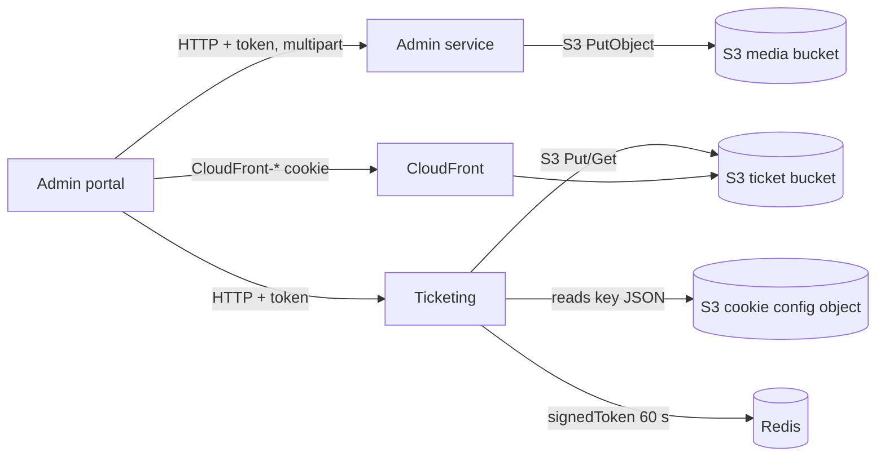

# X-20 · ফাইল স্টোরেজ (S3, CloudFront)

> **Bangla name:** ফাইল স্টোরেজ (S3, CloudFront)
>
> [← 60 · ক্রস-কাটিং](README.md) · [সূচিপত্র](../README.md) · [ওপেন কোয়ারি](../99-open-queries.md)

## 1. নাম ও উদ্দেশ্য

**ফাইল স্টোরেজ।** প্ল্যাটফর্ম যা কিছু ফাইল হিসেবে রাখে, সবই Amazon S3-তে থাকে: আপলোড করা ছবি (ইভেন্ট কভার, ব্যানার, লোগো, ভেন্যু ম্যাপ), টিকিটের PDF লেআউট, এবং তৈরি টিকিট (ফাঁকা, সাইন করা, মার্জ করা, জিপ করা)। রিজার্ভ টিকিট একটি CloudFront **signed cookie** দিয়ে সুরক্ষিত। ধারণার পটভূমি: [শেয়ার করা ডেটাবেস](../00-platform-primer.md#explainer-shared-database) (ফাইল একমাত্র জিনিস যা *ডেটাবেসে নেই*) এবং আর্কিটেকচার ডকুমেন্টের স্টোরেজ অংশ।

## 2. ট্রিগার ও অ্যাক্টর

- অ্যাডমিন পোর্টালের ব্যবহারকারীরা ছবি বা টিকিট লেআউট আপলোড করেন (**admin** pool)।
- Ticketing-এর ম্যানেজার ও ওয়ার্কাররা তৈরি টিকিট লেখেন ([S-08](../50-system-initiated/S-08-ticket-signing.md), [S-09](../50-system-initiated/S-09-ticket-merge-zip.md))।
- অ্যাডমিন পোর্টালের ব্যবহারকারীরা রিজার্ভ টিকিট ডাউনলোড করেন, যার জন্য নিচে বর্ণিত signed token ও cookie দরকার।

## 3. ব্যবসায়িক প্রবাহ

একজন অ্যাডমিন একটি ছবি বা টিকিট টেমপ্লেট আপলোড করেন; প্ল্যাটফর্ম তা সংরক্ষণ করে এবং তার পাথ সংশ্লিষ্ট ডেটাবেস রো-এ সেভ করে। কম্প্লিমেন্টারি বা পার্টনার (রিজার্ভ) টিকিটের ক্ষেত্রে অ্যাডমিন টিকিটগুলো তৈরি করেন, তারপর মার্জ করা PDF বা একটি zip হিসেবে ডাউনলোড করেন; ব্রাউজার আগে একটি স্বল্পমেয়াদি cookie পায় যা সুরক্ষিত ফাইলগুলো পড়তে দেয় ([A-12](../10-admin-portal/A-12-reserved-tickets.md))।

## 4. কারিগরি প্রবাহ

দুটি S3 বাকেট `AWS:*` সেটিংসের মাধ্যমে কনফিগার করা:

| সেটিং | কী কাজে | ম্যানেজার (ইন্টারফেস) |
|---|---|---|
| `AWS:Bucket:Name` | মিডিয়া: ছবি ও চ্যাট অ্যাটাচমেন্ট | `AwsSimpleStorageMediaManager` (`ICloudFrontMediaManager`) |
| `AWS:Ticket:Bucket:Name` | টিকিট লেআউট ও তৈরি টিকিট | `AwsSimpleStorageTicketMediaManager` (`ITicketMediaManager`) |

লোকালে দুটি সেটিংই Floci-তে একটিমাত্র বাকেট `etp-local`-এর দিকে ইঙ্গুত করে (`scripts/user-secrets.example.json`, তৈরি করে `scripts/Seed-EtpFloci.ps1`)।

**Key কাঠামো।** `UploadContentAsync(directory, parentId, name, ...)` অবজেক্ট key-কে `{directory}/{parentId}/{name}` হিসেবে গড়ে, অথবা `parentId` খালি থাকলে `{directory}/{name}`, এবং সেই key ফেরত দেয়। এরপর ম্যানেজারগুলো মালিক রো-তে একটি **পূর্ণ URL**, `{AWS:Bucket:BaseUrl}/{key}`, সংরক্ষণ করে (যেমন `ProgramManager.UploadImageAsync`); টিকিট-লেআউট ও টিকিট কোড এই URL-গুলো ফোল্ডারের নামে ভেঙে key ফিরিয়ে আনে, তারপর অবজেক্ট মুছে ফেলে।

**মিডিয়া ফোল্ডার** (`AWS:Bucket`):

| ফোল্ডার | কে লেখে |
|---|---|
| `eventcover/{eventId}` | `EventManager` |
| `eventsegmentcover/...` | event segment cover upload |
| `header-footer/{id}` | `HeaderFooterManager` |
| `landing-page/{type}` | `LandingPageImageManager` |
| `program/{programId}` | `ProgramManager` |
| `teams-logo/{id}`, `teams-flag/{id}` | `ProgramTeamManager` |
| `venueimage/...` | `VenueManager` (SVG ম্যাপ ও গ্যালারি ছবি) |
| `chat-attachments/{userIssueId}` | `UserIssueChatManager` |

**টিকিট-বাকেটের পাথ** (`AWS:Ticket:*`; দ্বিগুণ `//` ভাঙা হয়ে `/` হয়):

| পাথ | বিষয়বস্তু |
|---|---|
| `ticekt-layout/{layoutId}/{layoutType}/...` | আপলোড করা PDF লেআউট (স্পেলিং `ticekt` কোডেই আছে) |
| `ticekt-layout-preview/{layoutId}/{layoutType}/...` | লেআউটের প্রিভিউ রেন্ডার |
| `back-page-ticekt-layout/{layoutId}/...` | ব্যাক-পেজ লেআউট |
| `{BlankBase}/user/{userId}/{orderPublicId}` এবং `{BlankBase}/reserved/{orderPublicId}` | সাইন করা নয় এমন টিকিট |
| `{SignedBase}/user/{createdBy}/{orderPublicId}` এবং `{SignedBase}/reserved/{createdBy}/{orderPublicId}` | TSP সাইনিংয়ের পরের টিকিট |
| `{MergeBase}/{reservationId}/{prefix}_{i}.pdf` এবং `.zip` | মার্জ ও জিপ করা রিজার্ভ টিকিট, `MergeSize` অনুযায়ী চাংকে বিভক্ত |
| `{TemplateBase}/{fileName}.pdf` | টিকিট তৈরি করার সময় পঠিত টেমপ্লেট |

**রিজার্ভ টিকিটে signed অ্যাক্সেস** (Ticketing `/ticketing/api/v1/booking-order-ticket/`-এর কল):

1. `POST generate-signed-token` **[HTTP + user token]**, admin পলিসি। `TicketManager.GenerateSignedTokenAsync` কলারের bearer token-এর একটি HMAC-SHA512 হিসাব করে এবং তা **৬০ সেকেন্ডের জন্য একটিমাত্র গ্লোবাল Redis key `signedToken`-এ** সংরক্ষণ করে।
2. `GET signed-cookie` **[HTTP + user token]**, admin পলিসি। `TicketingCookieManager.GetCloudFrontSignedCookie` S3 থেকে একটি JSON অবজেক্ট পড়ে (`CloudfrontTicketValidator:BucketName` / `ObjectKey`), যেখানে `KeyPairId`, `ResourceUrl`, `Expiration` ও `PrivateKey` (base64 PEM) থাকে। এটি একটি পলিসি তৈরি করে (`AWS:EpochTime` < এখন + `Expiration`), সেটিকে RSA **SHA1** দিয়ে সই করে এবং টেক্সট `CloudFront-Policy=...; CloudFront-Signature=...; CloudFront-Key-Pair-Id=...` ফেরত দেয়।
3. অ্যাডমিন পোর্টাল (`event.service.ts`, `setSignedCookie`) সেই টেক্সট ভেঙে প্রতিটি `CloudFront-*` অংশ `environment.cloudFront.mainDomain`-এর জন্য `document.cookie` দিয়ে লেখে; পরবর্তী ফাইল রিকোয়েস্টগুলো CloudFront-এ এই cookie বহন করে।

**শেয়ার করা টিকিট।** একটি শেয়ার করা টিকিট লিংক `AWS:Ticket:ShareExpiryMinutes` সময়ের জন্য `sharedTicket:{ticketNumber}_{signature}` key-তে একটি presigned S3 URL Redis-এ সংরক্ষণ করে ([P-09](../20-user-portal/P-09-ticket-details-downloads.md))।

## 5. কম্পোনেন্ট

| ধরন | কম্পোনেন্ট |
|---|---|
| কোড | `Core/ETP.Core.BlobStorage/*` (`AwsSimpleStorageMediaManager`, `AwsSimpleStorageTicketMediaManager`, `S3CloudFrontStroge`, `TicketingCookieManager`) |
| যেসব সার্ভিস ব্যবহার করে | Admin, Booking, Ticketing (প্রত্যেকেই নিজ `DependencyConfig.cs`-এ ম্যানেজারগুলো রেজিস্টার করে) |
| AWS | S3 বাকেট, CloudFront distribution ও key pair |
| Redis | `signedToken`, `sharedTicket:*` ([X-25](X-25-redis.md)) |
| কনফিগ | `AWS:Region`, `AWS:AccessKey`, `AWS:SecretAccessKey`, `AWS:Bucket:*`, `AWS:Ticket:*`, `CloudfrontTicketValidator:*` ([X-26](X-26-configuration.md)) |

## 6. API কন্ট্র্যাক্ট

| Method | Path | Auth | Response | নোট |
|---|---|---|---|---|
| POST | `/ticketing/api/v1/booking-order-ticket/generate-signed-token` | `admin` পলিসি | `string` (হ্যাশ) | একটিমাত্র `signedToken` key বদলে দেয় |
| GET | `/ticketing/api/v1/booking-order-ticket/signed-cookie` | `admin` পলিসি | `string` (cookie টেক্সট) | পোর্টাল চারপাশের কোট খুলে `; ` দিয়ে ভাঙে |
| GET | `/ticketing/api/v1/booking-order-ticket/reserved-urls?reservationId=` | কোডে কিছু নেই | URL-এর তালিকা | পোর্টালে কোনো কলার পাওয়া যায়নি ([A-12](../10-admin-portal/A-12-reserved-tickets.md)) |

ছবি আপলোড হয় সংশ্লিষ্ট ফিচারের নিজস্ব multipart এন্ডপয়েন্টের অংশ হিসেবে (যেমন event create/update), আলাদা স্টোরেজ এন্ডপয়েন্ট নয়।

## 7. ডেটা ও পার্শ্বপ্রতিক্রিয়া

- §4-এ তালিকাভুক্ত S3 অবজেক্ট; মালিক রো পূর্ণ URL `{AWS:Bucket:BaseUrl}/{key}` সংরক্ষণ করে (যেমন ইভেন্টের `EventCoverImage` বা প্রোগ্রামের `Logo`)।
- ছবি বদলানোর সময় আগে পুরোনো অবজেক্ট মুছে ফেলা হয় (`DeleteContentAsync`), দেখুন `EventManager` ও `TicketLayoutConfigsManager`।
- Redis key `signedToken` ও `sharedTicket:*`।

## 8. কোড রেফারেন্স

| কী | কোথায় |
|---|---|
| মিডিয়া ম্যানেজার | `rvl-gobcb-backend/Core/ETP.Core.BlobStorage/AWSS3/AwsSimpleStorageMediaManager.cs` |
| cookie সাইনিং | `rvl-gobcb-backend/Core/ETP.Core.BlobStorage/AWSS3/TicketingCookieManager.cs` |
| cookie কনফিগ পড়া | `rvl-gobcb-backend/Core/ETP.Core.BlobStorage/AWSS3/S3CloudFrontStroge.cs` |
| এন্ডপয়েন্ট | `rvl-gobcb-backend/Services/Ticketing/ETP.Ticketing.Service/Api/BookingOrderTicketController.cs:488` (`generate-signed-token`), `:521` (`signed-cookie`) |
| signed token | `rvl-gobcb-backend/Services/Ticketing/ETP.Ticketing.Domain/Managers/TicketManager.cs:1995` |
| শেয়ার-লিংক ক্যাশ | `rvl-gobcb-backend/Services/Ticketing/ETP.Ticketing.Domain/Managers/TicketManager.cs:1904` |
| রেজিস্ট্রেশন | `rvl-gobcb-backend/Services/Admin/ETP.Admin.Service/Configurations/DependencyConfig.cs:209-228` |
| পোর্টালের cookie কোড | `rvl-gobcb-admin-portal/src/app/features/events/services/event.service.ts:230-250` |
| অপশন ক্লাস | `rvl-gobcb-backend/Core/ETP.Core/Options/AwsOptions.cs` |

## 9. হ্যান্ডওভার নোট

1. **`generate-signed-token` একটিমাত্র গ্লোবাল Redis key ব্যবহার করে।** ৬০ সেকেন্ডের মধ্যে দুজন অ্যাডমিন এটি কল করলে তারা একে অপরকে বদলে দেয়। ব্যাকএন্ডে `signedToken` কোথাও পড়া হয় না; এই মানটি কে ব্যবহার করে তা এই রিপোজিটরিতে নেই `[UNCONFIRMED: Q-06]`।
2. **cookie সাইনিং key হলো একটি S3 অবজেক্ট।** CloudFront key pair রোটেট করা মানে সেই JSON অবজেক্টটি এডিট করা, কোনো কনফিগারেশন মান বদলানো নয়। অবজেক্টটিতে প্রাইভেট key আছে, তাই ওই বাকেটে প্রবেশাধিকার সংবেদনশীল।
3. **`ticekt` একটি টাইপো যা এখন ডেটার অংশ।** বিদ্যমান অবজেক্ট ও ডেটাবেসের মানে তা আছে; key মাইগ্রেট না করে এটি "সংশোধন" করবেন না।
4. ডেটাবেস **পূর্ণ URL** সংরক্ষণ করে, যা `AWS:Bucket:BaseUrl` থেকে তৈরি; তাই বাকেট বা CDN ডোমেইন বদলালে ওই URL-গুলোর ডেটা মাইগ্রেশন দরকার (অথবা পুরোনো base URL জীবিত রাখতে হবে)।
5. `ICloudFrontMediaManager.CdnBaseUrl` ঘোষণা করা আছে কিন্তু `AwsSimpleStorageMediaManager`-এ কখনো সেট করা হয় না; পাবলিক URL প্রতিটি ম্যানেজার `AWS:Bucket:BaseUrl` থেকে নিজে তৈরি করে, এবং সেই সেটিং আসলে কোথায় (S3 নাকি CloudFront ডোমেইন) ইঙ্গুত করে — সেটি একটি ডিপ্লয়মেন্ট মান `[UNCONFIRMED: Q-06]`।

## 10. কম্পোনেন্ট সম্পর্ক

**নির্ভর করে:** কনফিগারেশন ([X-26](X-26-configuration.md)), অ্যাডমিন লগইন ([X-01](X-01-admin-login.md))। **প্রভাব ফেলে:** event, program, team, venue, ticket-layout ও reserved-ticket ফিচার, টিকিট ডাউনলোড।

## 11. ডেভেলপার টেস্ট গাইড

**লোকালে পরীক্ষাযোগ্যতা: আংশিক।** আপলোড ও তৈরি টিকিট Floci S3-এ (বাকেট `etp-local`) কাজ করে। signed cookie লোকালে কাজ করতে পারে না: `CloudfrontTicketValidator` হলো `local-dummy`, তাই `GET signed-cookie` "Failed to get file" দিয়ে ব্যর্থ হয়।

| বিষয় | বিবরণ |
|---|---|
| টেস্ট ডেটা ও অ্যাকাউন্ট | অ্যাডমিন লগইন ([X-01](X-01-admin-login.md)); `pwsh ./scripts/Seed-EtpData.ps1` |
| ব্রাউজার | অ্যাডমিন পোর্টাল `http://localhost:4200`, একটি event cover আপলোড করুন; DevTools Network-এ `/admin/api/v1/...`-এর multipart রিকোয়েস্ট দেখা যাবে |
| এমুলেটর | — |
| Postman | `postman/services/etp-admin.postman_collection.json`-এর multipart upload রিকোয়েস্ট; `signed-cookie`-এর জন্য `etp-ticketing` কালেকশন (লোকালে উপরের ব্যর্থতা আশা করুন) |
| Visual Studio ডিবাগ | `AwsSimpleStorageMediaManager.UploadContentAsync`-এ ব্রেকপয়েন্ট; cookie-এর জন্য `TicketingCookieManager.GetCloudFrontSignedCookie` |
| যাচাই | `aws --endpoint-url http://localhost:4566 s3 ls s3://etp-local --recursive` `eventcover/<id>/...`-এর মতো key দেখায় |
